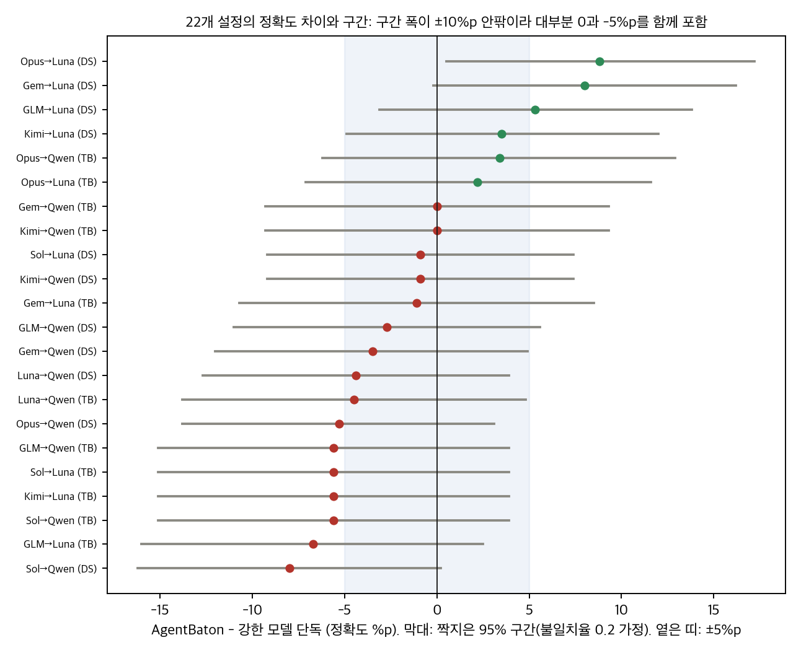
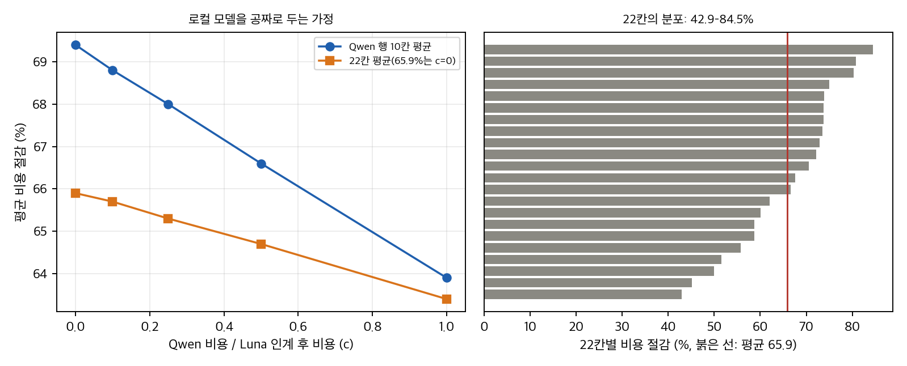
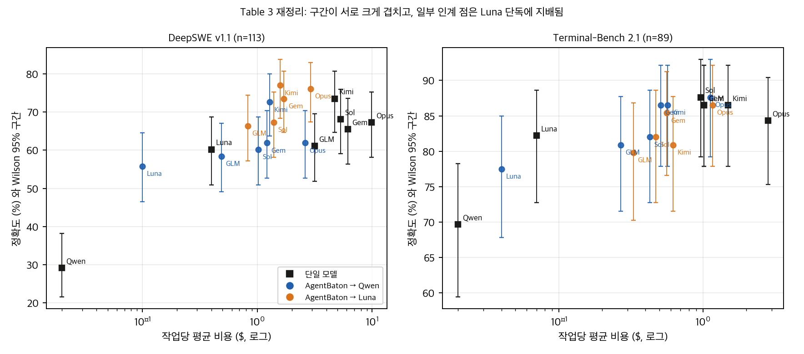
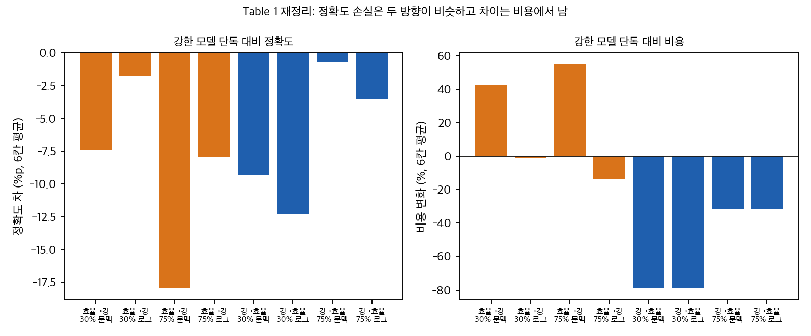

# 싼 모델에 일을 넘기면 정말 65.9%가 싸지나

긴 에이전트 과제는 비싼 모델이 안정적이지만 비용이 큽니다. NVIDIA의 *AgentBaton* (Li 외, arXiv:2610.35959)은 **한 과제 안에서** 강한 모델이 먼저 일하다가 어느 시점에 싼 모델에 일을 넘기면(handoff) 비용을 크게 줄이면서 정확도를 지킬 수 있다고 주장합니다. 이 글은 공식 코드와 궤적이 공개되지 않은 이 논문의 표를 옮겨 적어 다시 계산하고, 주장이 표본 오차와 비용 회계에서 얼마나 버티는지 확인한 기록입니다. 코드 실행이나 API 호출은 하지 않았습니다.

## 무엇을 주장하나

- 한 번만 넘기는 인계를 DeepSWE v1.1과 Terminal-Bench 2.1에서 비교합니다. 강한 모델(GPT-5.6 Sol, Kimi K3, GLM-5.3 등)과 싼 모델(로컬 Qwen3.8-27B, 클라우드 GPT-5.6 Luna)을 짝짓습니다.
- 싼 모델이 먼저 하고 강한 모델이 이어받으면 강한 모델 단독보다 못하고 비용도 거의 안 줄지만, 강한 모델이 먼저 하고 싼 모델이 마무리하면 시점이 맞을 때 정확도를 지키며 비용이 크게 준다고 합니다.
- 이를 바탕으로 Qwen 3.5 2B를 매 턴 "넘길 만한가"를 판정하도록 학습한 AgentBaton을 제안하고, 모델 쌍 11개 × 벤치마크 2개에서 비용 평균 65.9% 감소, 강한 모델 단독 대비 정확도 최대 +8.8%p라고 보고합니다.

## 숫자는 맞습니다

표 3의 부제 22칸(정확도와 비용 상대 변화)이 모두 다시 나오고, 65.9%는 22칸의 단순 평균, "12/22칸에서 개선 또는 상대 손실 5% 미만", +8.8%p(Opus 5→Luna, DeepSWE)도 재현됩니다. 정확도가 k/113(DeepSWE)과 k/89(Terminal-Bench) 격자에 놓여서 문항 수를 역산할 수 있었습니다. 즉 +8.8%p는 10개 과제의 차이입니다.

## 표본 오차 안입니다

- 정확도 한 칸의 95% Wilson 구간은 ±9–10%p입니다. 과제별 결과가 없어서 같은 과제를 두 조건에서 푼 짝지은 검정은 할 수 없으니, 두 조건의 성공 여부가 다른 과제의 비율(불일치율)을 시나리오로 놓았습니다. 불일치율 0.2에서 최소 검출 차이는 DeepSWE 11.8%p, Terminal-Bench 13.3%p입니다.
- +8.8%p의 짝지은 p는 0.064(불일치율 0.2)입니다. 10개 비교 중 최댓값이라 참 차이가 0이어도 15.6%(두 벤치마크 20개면 37%) 확률로 나옵니다. Holm 보정 뒤에는 22칸 중 유의한 칸이 없습니다.
- "정확도를 지킨다"를 −5%p 한계의 동등성으로 읽으면 불일치율 0.2에서 22칸 중 5칸만 지지됩니다.

## 같은 구성이 두 번 다르게 나옵니다

표 3(본문)과 표 6(부록)에 같은 구성(DeepSWE, 추론 노력 max)이 있는데 GLM-5.3 단독이 61.1%와 69.0%(9과제), GLM→Luna가 66.4%와 72.6%, GPT-5.6 Sol 단독이 68.1%와 71.7%로 다릅니다. 어느 쪽인지 논문이 밝히지 않았습니다. 9과제는 헤드라인 +8.8%p(10과제)와 같은 크기입니다. 또 Opus 5의 노력 곡선이 단조롭지 않아(xhigh 75.2% → max 67.3%) "강한 모델 단독"을 xhigh로 잡으면 +8.8%p는 +0.9%p가 됩니다.

## 비용 65.9%는 어디에 달려 있나

로컬 모델에 0원을 매기는 것이 우려였지만, 같은 표의 Luna 행과 Qwen 행의 비용 차로 Luna의 인계 후 비용을 추정해 Qwen에 그 25%를 매기면 평균 절감은 65.3%, 100%면 63.4%로 크게 움직이지 않았습니다. 원천(강한) 모델의 인계 전 비용이 지배적이기 때문입니다.

오히려 민감한 것은 **기준선**입니다. 절감은 "max 노력 강한 모델 단독" 대비이고, 같은 논문의 싼 모델 단독(Luna)이 AgentBaton 22칸 중 9칸을 정확도 이상, 비용 이하로 지배합니다(예: Sol→Qwen Terminal-Bench 82.0%/0.43달러 대 Luna 단독 82.2%/0.07달러). 표 6의 모든 단일 구성 중 정확도가 같거나 높은 가장 싼 것과 비교하면 AgentBaton 30점 중 9점이 더 비쌉니다. 탐지기 비용은 논문의 비용에 포함되지 않았고, 가정을 두면 평균이 65.9%에서 약 56–65%로 내려갑니다(Luna→Qwen Terminal-Bench에서는 탐지기가 비용의 16–107%).

## 방향 비대칭은 정확도가 아니라 비용에서 나옵니다

표 1의 24칸씩을 강한 모델 단독과 비교하면 정확도 평균 차이는 약→강 −8.7%p, 강→약 −6.5%p로 비슷합니다. 비용은 약→강이 평균 +20.7%(15칸이 단독보다 비쌈), 강→약은 −55.3%입니다.

비용 비대칭은 로컬 모델이 0원이고 강한 모델의 비용이 뒤쪽 턴에 몰린다는 사실로 대부분 설명됩니다(비용이 진행에 대해 x^α, α≈1.2–1.5). 강→약 30% 인계의 예측 절감 79%가 관측 75–85%와 맞고, 약→강 30% 인계는 강한 모델이 앞 30%(비용 몫 16–21%)만 아끼는데 관측은 −20–+10%입니다. 논문은 "한 방향 의존"과 "오류가 쌓인다"로 설명하지만 이미 망가진 상태, 긴 문맥 전달, 강한 모델의 적응을 가르는 통제 실험은 없습니다. 문맥 전달 방식은 약→강에서 로그 파일이 12칸 중 10칸에서 높았고(평균 +7.9%p) 강→약에서는 문맥 안이 12칸 중 8칸에서 높았습니다. 같은 결론은 *The Handoff Tax*(arXiv:2608.24358)가 두 달 먼저 보였습니다.

## 탐지기는 무엇을 더하나

학습 데이터(SWE-rebench V2 2,000과제, Codex가 사후에 적합 시점을 표시)와 평가 벤치마크는 분리되어 있습니다. 그러나 고정 진행률(AgentBaton의 평균 인계 진행률을 임계값으로, 원천 궤적 총길이라는 미래 정보를 씀)과 정확도 차이가 ±2과제 안이고, 고정 턴 기준선보다는 정확도가 +3–4.5%p(3–5과제, 짝지은 p 0.52–0.68) 높지만 비용도 4칸 모두 1.02–1.54배입니다. 고정 턴을 더 늦춰 비용을 맞춘 비교는 없습니다.

## 정리와 읽을 때의 단서

- 인용해도 되는 것: "강한 모델 단독 대비 API 비용을 평균 65.9% 줄였다"(표 3, 단순 평균, 로컬 0원, 탐지기 비용 제외), "약→강 인계는 정확도가 낮고 비용이 안 준다"(표 1, 강→약도 정확도는 비슷).
- 인용하지 말아야 할 것: "정확도를 지킨다"를 통계적으로 동등하다는 뜻으로, "+8.8%p"를 개선의 증거로.
- 확인하고 싶은 것: 표 3과 표 6의 불일치, 과제별 결과(짝지은 검정), 탐지기 비용을 포함한 비용, 싼 모델 단독을 포함한 파레토.

분석 노트(01–04), 재계산 스크립트와 결과, 공개용 리포트는 함께 올린 git 폴더에 있습니다. 논문 PDF에 "© 2026 NVIDIA. All rights reserved."가 있어 논문 그림은 싣지 않았고, 그래프는 모두 우리가 그렸습니다.

## 자료

- [통합 리포트 PDF](report/report_public.pdf)
- [01. 논문 분석: AgentBaton (arXiv:2610.35959)](analysis/01_paper_analysis.md)
- [02. 계보와 관련 연구](analysis/02_prior_work.md)
- [03. 분석: 표본 수, 통계, 비용 식, 방향 비대칭, 탐지기](analysis/03_analysis.md)
- [04. 주장 검증 (공식 코드 없음)](analysis/04_claim_verification.md)
