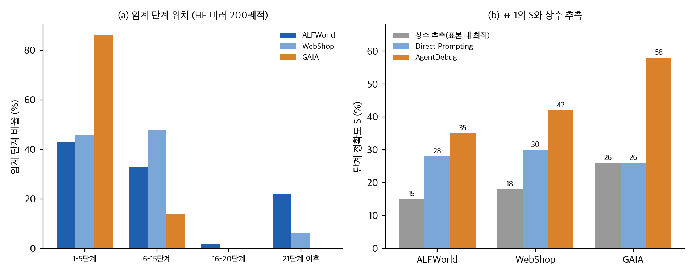
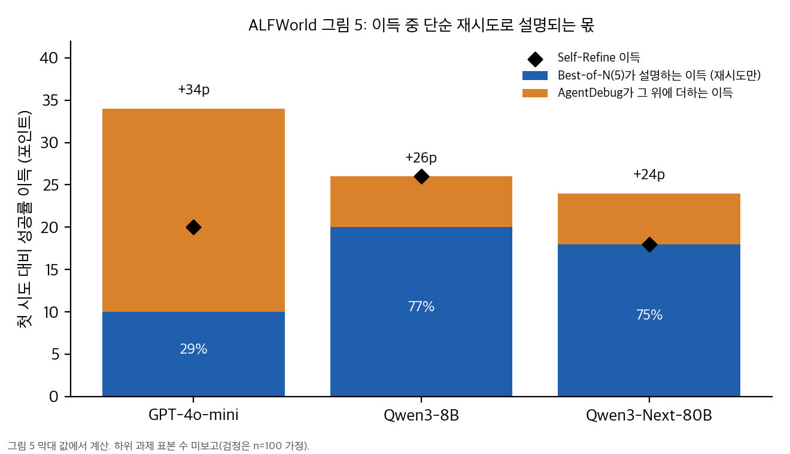

# AgentDebug의 이득은 진단 덕분인가: 숫자와 코드로 다시 본 Zhu et al.

Zhu et al.(ICML 2026 워크숍)은 단일 에이전트의 실패를 memory, reflection, planning, action, system 다섯 모듈의 오류 유형으로 분류하고(AgentErrorTaxonomy), ALFWorld·WebShop·GAIA의 실패 궤적 200개에 사람이 근본 원인 단계를 주석한 데이터(AgentErrorBench)를 만든 뒤, LLM이 근본 원인 단계를 찾아 교정 피드백을 그 단계에 넣고 다시 실행시키는 AgentDebug를 제안합니다. 이 글은 논문의 공개 표와 그림 값을 다시 계산하고, 공식 저장소를 읽어 논문과 대조한 결과입니다. 코드와 모델은 실행하지 않았습니다.

## 무엇을 확인했나

- **표 1은 내부적으로 맞습니다.** 모든 셀이 환경별 궤적 수(100/50/50)의 정수 개수입니다. 다만 "Average" 열은 환경별 값의 단순 평균이고, 궤적 수로 가중하면 AgentDebug의 step 정확도는 45.0이 아니라 42.5, all-correct는 24.3이 아니라 23.5입니다. 본문 §4.2 상자의 "50.0% step, 42.5% all-correct"는 표 어디와도 맞지 않습니다(42.5는 풀링 step 정확도와 같은 값입니다).
- **비율 표기가 섞여 있습니다.** "24% 높은 all-correct"(24.3 대 0.3)는 포인트 차이이고 "step accuracy 61% 향상"(45.0 대 28.0)은 상대 개선입니다.

## 임계 단계 탐지: 어디까지가 표본 오차인가

AgentDebug(GPT-4.1)를 같은 모델의 직접 질의와 비교한 표 1을, 짝지은 예측이 공개되지 않았으므로 정확 McNemar 검정의 가능 범위(불일치쌍을 가장 유리하게, 가장 불리하게 배치)로 판단했습니다.

- all-correct(단계+모듈+유형 모두 일치)는 모든 환경에서 어떤 배치에서도 유의합니다(p ≤ 0.016).
- step 정확도는 GAIA(58 대 26)와 풀링(42.5 대 28.0)에서 유의하지만, ALFWorld(35 대 28)와 WebShop(42 대 30)은 최악 배치에서 p가 0.45와 0.41이라 표본 오차 안일 수 있습니다.
- 데이터에서 가장 흔한 단계를 항상 답하는 상수 추측은 ALFWorld 15%, WebShop 18%, GAIA 26%입니다. AgentDebug는 세 환경 모두 이를 유의하게 넘지만(p ≤ 0.016), Direct Prompting의 GAIA 26%는 상수 추측과 같은 값입니다.

## 공개 주석 데이터를 다시 세어 보면

공식 데이터는 Google Drive에 있고, 이 분석은 HF의 제3자 미러(`davide221/agenterrorbench`, 200행)를 썼습니다. 공식과 같다는 보증은 없지만 ALFWorld와 GAIA의 모듈별·단계 구간별 개수가 논문 그림 11, 13과 전부 같고, WebShop만 1건 다릅니다(논문 그림 12는 49건).

- **"대부분의 실패가 6–15단계에 몰린다"(§2.2)는 데이터와 다릅니다.** 1–5단계가 54.5%, 6–15단계가 32.0%, 21단계 이후가 12.5%입니다. 임계 단계의 상대 위치 중앙값은 궤적 길이의 0.24입니다.
- **"memory와 reflection이 지배적"도 과합니다.** plan 하나가 39.0%로 memory와 reflection의 합(39.0%)과 같습니다.
- ALFWorld 실패 100건은 모두 30턴을 다 쓴 궤적입니다. 이 벤치마크의 ALFWorld 실패는 사실상 "30단계 안에 끝내지 못한" 표본입니다.
- 미러의 라벨에는 오류 유형이 빈 값인 궤적이 27건(13.5%), 철자 변형(`plan_inefficient`), 모듈 이름 혼용(`plan`/`planning`)이 있고, 궤적마다 주석이 임계 단계 한 개뿐입니다. 논문은 모든 단계를 검토했다고 서술합니다.
- 주석자 일치도는 Cohen's κ = 0.55 한 값입니다. 이중 주석한 궤적 수, 신뢰구간, 어느 수준(단계·모듈·유형)의 일치인지가 없어 다시 계산할 수 없고, Landis–Koch 구간으로는 moderate입니다("substantial"이 아님).

## 회복 실험: "최대 26% 향상"의 정체

그림 6의 ALFWorld 막대(26)는 그림 5의 Qwen3-8B 값(48 → 74)과 같은 **26 포인트**의 절대 이득입니다. 상대 개선으로는 +54%입니다. 그림 5의 최대 이득은 GPT-4o-mini의 +34 포인트(21 → 55)이고, Qwen3-8B에서는 AgentDebug 74와 Self-Refine 74가 같습니다. ToT는 세 백본 모두 첫 시도와 같은 값입니다.

이득 중 얼마가 단순 재시도로 설명되는지 보려고 같은 시도 수의 Best-of-N(5)을 뺐습니다.

- GPT-4o-mini는 이득 +34 중 Best-of-N이 +10(29%)만 설명하고, AgentDebug의 우위(+24)는 분명합니다.
- Qwen3-8B와 Qwen3-Next-80B는 이득의 77%와 75%가 Best-of-N으로 설명됩니다. AgentDebug가 그 위에 더하는 것은 +6 포인트인데, 하위 과제 표본 수가 논문에 없어 n=100을 가정하면 McNemar p 가능 범위가 0.03–0.46으로 표본 오차와 구별되지 않을 수 있습니다.
- "최대 시도 횟수를 총 토큰 사용량으로 맞췄다"(§4.2)고 하지만 토큰 수나 비용 표가 없고 공개 코드에도 토큰 집계가 없습니다. 재롤아웃이 임계 단계부터라 한 번당 비용이 적은 반면, 디버거가 단계×모듈마다 부르는 호출 비용이 포함됐는지 알 수 없습니다.

이득을 "진단 덕분"으로 돌리려면 같은 파이프라인에서 진단 부분만 바꾼 절제(예: 임계 단계를 무작위·오라클로 바꾸기, 피드백 없이 같은 단계부터 재실행)가 필요한데 없습니다. 디버거(GPT-4.1)와 에이전트(GPT-4o-mini, Qwen3)가 다르고, 피드백이 실패한 궤적 전체를 본 뒤 쓴 "무엇을 했어야 했는가"라서 같은 환경의 재시도에서는 사후 정보가 섞일 수 있습니다.

## 공식 코드와의 대조

`ulab-uiuc/AgentDebug`(MIT, 커밋 `7740fe3a`)를 정적으로 읽었습니다.

- **2단계는 반사실 탐색이 아닙니다.** 본문 §3.2는 "각 단계에 교정 행동을 대입해 시험한다"고 쓰지만, 알고리즘 1의 주석("no rollout/counterfactuals")과 코드는 실패 궤적을 한 번에 읽는 단일 LLM 호출입니다. 반사실 방식은 기준선 Brute Force와 Binary Search입니다.
- 디버거는 환경의 성공/실패 판정을 입력("TASK RESULT: FAILED")으로 씁니다.
- **공개된 것은 탐지 단계뿐입니다.** 반복 재롤아웃 루프, 기준선(Self-Refine, Vanilla, ToT 등), 표 1의 평가 스크립트는 저장소에 없습니다. 환경 쪽 재생 훅은 있으나 부르는 곳이 없습니다.
- 분류 체계가 문서(17유형)와 코드(18유형 + `others`)에서 다르고, 1단계의 system 오류는 코드 구조상 2단계 입력에 전달되지 않습니다. 단계 번호는 탐지기 1-based, 재생 훅 0-based로 문서화되어 있습니다.

## 이 저장소의 다른 분석과의 관계

- 같은 "근본 원인 단계 찾기" 문제인 Who&When 분석에서는 단계 수준 귀인이 어렵고 단순 규칙이 비슷하게 나왔습니다. 같은 방식으로 계산한 상수 추측 기준선(15/18/26%)과 비교하면 AgentDebug의 step 정확도는 이를 넘지만 Direct Prompting은 환경에 따라 같거나 조금 넘습니다.
- MAST 분석은 라운드별 쌍별 κ 원표(최종 14모드 0.73, 4 trace)를 공개해 다시 계산할 수 있었습니다. AgentDebug는 κ 한 값만 적습니다.
- 위치를 주면 수정이 좋아진다는 Tyen et al. 분석의 오라클 위치 대 무작위 위치 대조가 이 논문에는 없습니다. Self-Debug 분석에서 본 것처럼 이득의 큰 몫이 단순 재시도로 설명된다는 점은 같습니다.

## 인용할 때

- 인용해도 되는 것: 표 1의 탐지 비교(all-correct와 GAIA·풀링 step의 우위), AgentErrorBench의 구성(200궤적, 모듈 분포), 그림 5의 누적 성공률 값(Best-of-N 몫과 함께).
- 인용하지 말 것: "up to 26% relative improvements", §4.2 Findings의 50.0·42.5, "6–15단계에 몰림", "같은 토큰 예산" 주장, "근본 원인 표적이 이득의 원인"이라는 해석.
- 한계: 단일 실행, 하위 과제 표본 수와 시드 미보고, 공식 데이터는 받지 않고 비공식 미러로 재계산, 코드는 실행하지 않음.

분석 문서 전체(01–04, 재계산 스크립트와 결과)는 함께 올린 저장소에 있습니다.

## 자료

- [통합 리포트 PDF](report/report_public.pdf)
- [01. 논문 분석: Where LLM Agents Fail and How They can Learn From Failures (AgentDebug)](analysis/01_paper_analysis.md)
- [02. 계보, 관련 연구, 자료 표](analysis/02_prior_work.md)
- [03. 재계산과 검정](analysis/03_analysis.md)
- [04. 논문 대 공식 코드 대조 (D1–D9)](analysis/04_code_verification.md)
