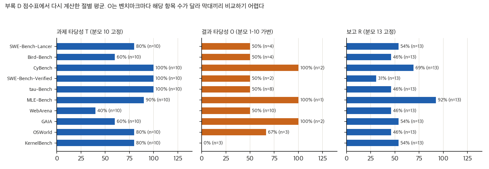
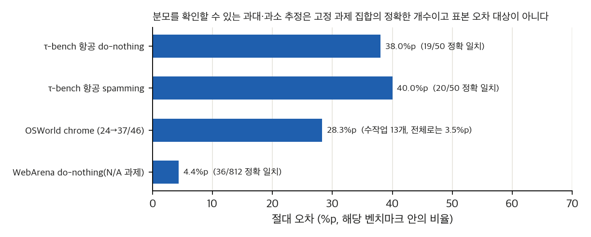
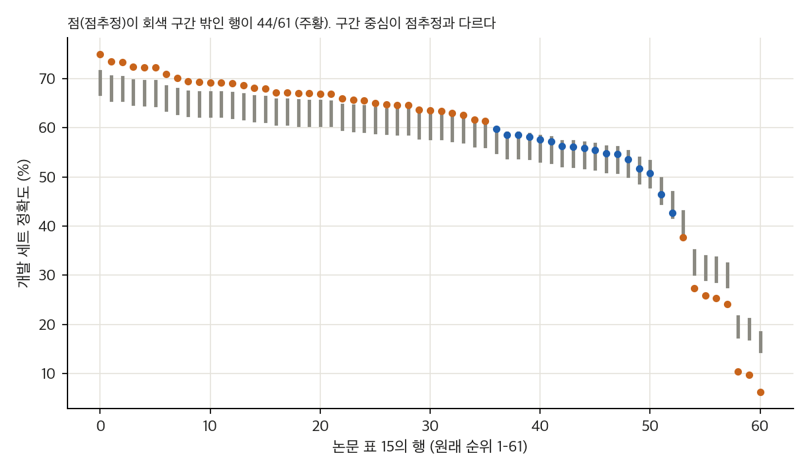

# 에이전트 벤치마크 점검표(ABC)를 다시 계산해 보니

에이전트 벤치마크는 점수가 능력을 재는지 채점기의 빈틈을 재는지 구분하기 어렵습니다. Zhu et al.(NeurIPS 2025 D&B)은 이를 **과제 타당성**(풀 수 있고 지름길이 없는가)과 **결과 타당성**(채점기가 성공이라 하면 정말 성공인가)으로 나누고, 채점 방식별 점검표 ABC(43항목)로 10개 벤치마크를 평가했습니다. 평가표와 재현용 자료는 저자 저장소에 있고, 이 글은 그 수치를 다시 계산하고 저장소를 정적으로 읽은 기록입니다. 벤치마크 실행, 패치 적용, LLM 호출은 하지 않았습니다.

## 점검표는 어떻게 생겼나

과제 타당성 T.1–T.10(도구, 환경, 구현), 결과 타당성 O.a–O.i 20개(문자열 일치, LLM 판정자, 단위·E2E 테스트, 퍼징, 상태 일치, 답 일치), 보고 R.1–R.13(공개, 오염 방지, 신뢰구간, 사람 기준선, **트리비얼 에이전트 결과**)입니다. 점수는 항목마다 1/0이고 해당하는 항목의 평균을 냅니다. 부록 D의 평가표 10건을 저자 저장소의 yaml과 항목별로 대조하니 **모두 일치**했고, "과제 타당성 위반 7개, 결과 타당성 위반 7개, 보고 한계 10개"도 재계산으로 맞습니다.

다만 점수를 순위처럼 읽으면 안 됩니다. T와 R은 분모가 10·13으로 고정인데 O는 벤치마크마다 해당 항목 수가 1–10으로 달라서, MLE-bench의 O 100%는 1/1이고 WebArena의 50%는 5/10입니다. 도구·API를 쓰지 않아 해당 없는 항목을 1점으로 세기도 해서, 이를 분모에서 빼면 T 점수가 최대 10%p 내려갑니다(위반 벤치마크 수는 그대로). 또 점검표의 항목 번호가 그림 3(O.f.1·2), 부록 D(O.f.2·3), 저장소 ABC.md(I./II./III. 체계, 42항목, 환경 고정 항목 없음)에서 서로 다릅니다. 평가자가 몇 명이었는지, 평가자 간 일치도가 있는지는 논문과 저장소 어디에도 없습니다.

## 정확히 재현되는 것: τ-bench와 WebArena

논문은 τ-bench에서 아무것도 안 하는 에이전트가 항공 과제의 38%를 통과한다고 합니다. 풀 수 없는 과제는 DB가 안 바뀌면 성공이기 때문입니다. 과제 정의 파일을 코드 실행 없이(ast) 읽어 "정답 액션에 DB를 바꾸는 호출이 없고 요구 출력이 비어 있는 과제"를 세면 항공 50문항 중 **19개(38.0%)**이고, 정답 문구가 DB에 그대로 있는 과제(정답 "4")를 더하면 DB를 통째로 쏟는 에이전트가 통과하는 **20개(40.0%)**입니다. 저자의 수정 패치가 `required_actions`를 붙인 과제도 정확히 19개입니다. WebArena에서 빈 응답이 통과하는 N/A 정답 과제도 저장소 설정에서 **36/812(4.43%)**로 표의 4.4%와 맞습니다.

이 수치들은 **고정된 과제 집합의 정확한 개수**라서 표본 오차의 대상이 아닙니다. 표본 오차가 필요한 것은 "그래서 이 에이전트가 더 낫다"류의 비교입니다. 서론은 do-nothing 38%가 GPT-4o 35%를 넘는다고 쓰지만, 50문항의 Wilson 95% 구간이 [25.9, 51.8]과 [24.1, 49.9]로 크게 겹쳐 점추정 순위일 뿐입니다.

주의할 점이 몇 있습니다. 소매 쪽 수치(논문 6.0%, 9.6%)는 정적 계산으로는 5/115(4.3%), 9/115(7.8%)까지만 재현되고 나머지 2개 과제는 도구 코드를 실행해야 확인됩니다(실행하지 않음). 재현 패치의 "빈 응답"은 실제로는 `transfer_to_human_agents`를 즉시 호출하는 것입니다. 저자의 수정 패치는 항공만 고치고 소매는 고치지 않으며, 필수 액션이 대부분 읽기 호출이라 읽기만 하고 끝내는 에이전트가 통과할 수 있습니다(코드 논리상의 추론이며 실행하지 않음). OSWorld chrome 과제 13/46이 깨져 UI-TARS가 24/46에서 37/46이 된다는 산술(+28.3%p)은 맞지만, 369문항 전체로는 +3.5%p(42.5% → 46.0%)이고 한 에이전트의 실패 궤적만 수작업으로 본 결과입니다.

## 인용하면 안 되는 것

- **부록 F 표 15(BIRD 신뢰구간).** 식과 N≈1,531로 61행 구간이 모두 재현됩니다. 그런데 구간이 점추정을 포함하지 않는 행이 61개 중 44개입니다(첫 행은 74.9%에 [66.8, 71.4]). 식의 μ = e + (1−2e)p₀는 "참 값이 p일 때 관측되는 기대값"인데 관측값에 적용해 방향이 반대로 되어 있습니다. 오류율 e를 보정하려면 (p₀−e)/(1−2e)가 맞는 방향입니다.

- **초록의 "최대 100% 상대 오차".** 이 숫자를 만드는 표를 찾지 못했습니다. 진짜 능력이 0인 에이전트의 점수에 대한 상대 오차는 정의되지 않으므로 절대 %p와 대상 범위를 같이 적는 편이 정확합니다.
- **KernelBench 31%.** 논문은 "level 1 과제마다 커널 3개"를 표본했다고 쓰지만 저장소 스크립트는 정답 판정 커널 중 총 1,000개를 과제별 비례로 뽑습니다. 수작업 검증 테스트는 129개이고 통과·실패 로그가 없어 재계산할 수 없습니다.
- **SWE-bench 리더보드 변화율(부록 E.1).** Verified 40.9%, Lite 24.4%로 적었는데 UTBoost 초록은 Lite 40.9%, Verified 24.4%입니다.

## 점검표는 SWE-bench 채점 코드의 허점을 잡았나

SWE-bench의 채점 코드를 따로 정적으로 읽어 보면(같은 저장소 분석) 비어 있는 PASS_TO_PASS는 만점으로 처리되고, 모든 FAIL_TO_PASS 테스트가 SKIPPED로 끝나면 해결로 판정될 수 있으며(최신 코드의 주석이 이를 인정), 판본에 따라 모델이 고친 테스트 파일을 되돌리는지가 달라집니다. ABC의 항목 문구로는 T.10(채점 우회 취약점 없음)과 T.5(에이전트와 정답 격리)가 이를 겨냥하지만, 논문의 SWE-bench 평가는 두 항목에 모두 1점을 주었습니다. 평가가 코드를 읽어 채점하지 않고 문서를 보고 채점했다는 것이 이유 문구("No vulnerabilities are found")에 드러납니다. 반대로 점검표에는 채점기 판본·정의 고정, 생성 설정(온도 등) 보고, 채점기 로직의 경계 조건 검사가 없습니다.

## 정리

ABC는 채점기가 빈 응답과 우회를 성공으로 세는지 묻는 좋은 질문 목록이고, 가장 큰 증거(τ-bench 항공, WebArena N/A)는 과제 정의에서 정확히 재현됩니다. 점수표를 순위로 쓰거나 표 15의 구간, "100% 상대 오차", KernelBench 31%를 인용하지 않는 편이 안전합니다. 점검표를 적용할 때는 점검 결과를 코드를 읽고 근거와 함께 남기고, 평가자 여러 명의 일치도를 함께 보고하는 것이 다음 단계입니다.

## 확인하지 못한 것

- 소매 τ-bench의 2개 과제 차이(도구 코드 실행 필요), WebArena 1.4–5.2% 과대(궤적 필요), KernelBench 31%(로그 없음), CVE-Bench 33%(자료 없음), SWE-Lancer 100%(벤치마크 실행).
- 항목 번호의 판본 차이는 v5 PDF와 저장소 기준이며 이전 판의 본문은 비교하지 않았습니다.

## 자료

- [통합 리포트 PDF](report/report_public.pdf)
- [01. 논문 분석: Establishing Best Practices for Building Rigorous Agentic Benchmarks (ABC)](analysis/01_paper_analysis.md)
- [02. 계보와 관련 연구](analysis/02_prior_work.md)
- [03. 재계산과 검산](analysis/03_analysis.md)
- [04. 논문 대 공식 자료 정적 대조 (D1–D12)](analysis/04_code_verification.md)
