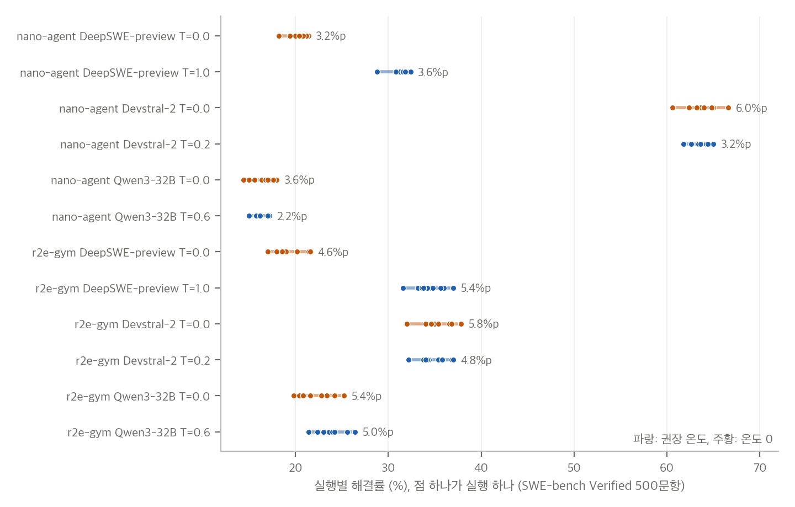
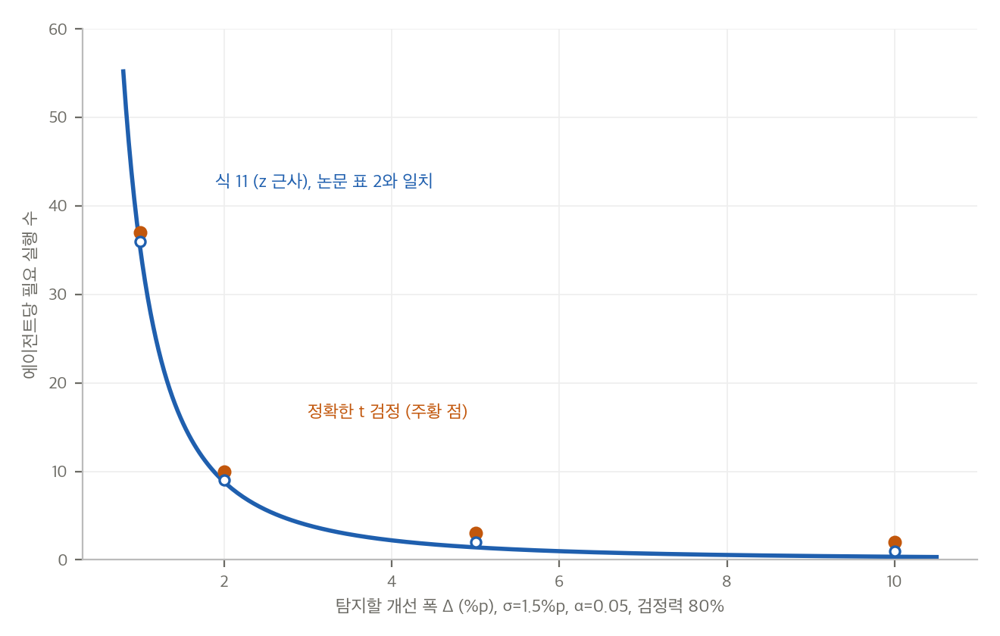
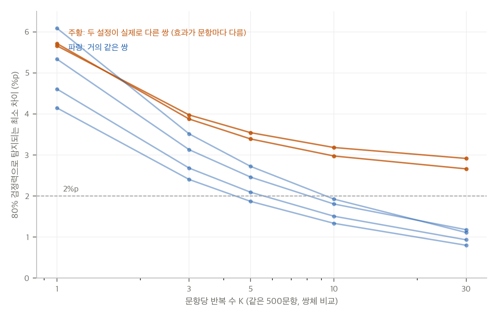

# 03. 재계산, 식 검산, 통계 검증

공개 결과(HF `ASSERT-KTH/agentic-evals-artifacts`의 실행별 SWE-bench 평가 JSON 120개, `resolved_ids` 포함, 5.8 MB)로 논문 수치를 다시 만들었습니다. 궤적 파일(수십 GB)은 받지 않았으므로 토큰 분기 분석(그림 2)은 재계산하지 않았습니다. 스크립트는 `analysis/recompute_runs.py`, `analysis/power_check.py`이고 결과는 `*_results.json`입니다(수 초–30초, CPU).

## 1. 표 1·3 재계산: 일치

12개 설정 × 10 실행의 해결률에서 평균, 표준편차(ddof=1), 최소, 최대를 계산했습니다.

- 표 1의 48개 값(12행 × 평균·표준편차·최소·최대)이 모두 논문의 소수 첫째 자리 값과 일치합니다. 표준편차는 표본 표준편차(ddof=1)로 계산했을 때 일치합니다(ddof=0 값은 0.04–0.1 %p 작고, `recompute_runs_results.json`에 둘 다 있습니다).
- 범위는 최소 2.2(nano-agent/Qwen3-32B T=0.6), 최대 6.0 %p(nano-agent/Devstral-2 T=0)입니다. 초록의 "2.2–6.0 %p"가 맞습니다.
- Shapiro-Wilk(표 3)는 12개 중 11개의 W·p가 재현되고, 나머지 하나는 p 0.133 대 0.134(반올림 차이)입니다. DeepSWE-preview/nano-agent T=1.0만 p=0.016으로 기각됩니다.

## 2. 초록의 두 문장은 표보다 강합니다

- **"온도 0에서도 표준편차 1.5 %p 초과"(초록):** 온도 0의 6개 설정 표준편차는 1.17, 0.96, 1.64, 1.76, 1.49, 1.70입니다. 1.5를 넘는 것은 3개(Devstral-2 nano-agent, Qwen3-32B R2E-Gym, Devstral-2 R2E-Gym)입니다. 6개 모두가 아닙니다. 표 1 전체의 범위(0.7–1.8)와 온도 0의 하한(1.0)을 같이 읽어야 합니다.
- **"온도 0에서 분산이 줄지 않고 때로는 늘어난다"(§2.4.1):** 권장 온도 대 0의 표준편차는 Qwen3 nano 0.75 → 1.17, DeepSWE nano 1.02 → 0.96, Devstral nano 1.13 → 1.64, Qwen3 R2E 1.45 → 1.76, DeepSWE R2E 1.54 → 1.49, Devstral R2E 1.49 → 1.70입니다. DeepSWE는 두 스캐폴드 모두 오히려 낮아 "never"는 틀렸고, 분산비 F 검정(자유도 9, 9)은 6쌍 모두 유의하지 않습니다(p 0.19–0.92). 결론은 "온도 0이 분산을 눈에 띄게 줄이지 않는다"이고, "늘린다"는 근거가 없습니다. 또 본문 "0.7% variance … 1.2% variance"의 숫자는 분산이 아니라 표준편차입니다.
- **범위는 반복 수에 따라 커지는 통계량입니다.** 정규 분포에서 m회 범위의 기대값은 m=2에서 1.13σ, 5에서 2.32σ, 10에서 3.08σ, 20에서 3.73σ, 100에서 5.02σ입니다(시뮬레이션 20만 회). σ=0.7–1.8 %p와 m=10이면 2.2–5.5 %p가 기대되고 관측 2.2–6.0과 맞습니다. "2.2–6.0 %p"는 안정된 모수가 아니라 10회 표본의 범위입니다. 다른 연구가 20회를 돌리면 범위는 약 20% 커집니다. 인용할 때는 표준편차를 쓰세요.

## 3. pass@k와 pass^k: 그림 값 재현, "24.9 %p"의 의미가 다름

식 3의 추정량으로 m=10에서 계산했습니다. 그림 1·6·7에 적힌 pass@5와 pass^5의 11개 쌍이 모두 소수 첫째 자리까지 일치합니다(예: Devstral-2/R2E-Gym T=0.2는 59.3과 11.6, DeepSWE/R2E-Gym T=1.0은 52.9와 15.5). nano-agent/DeepSWE-preview T=1.0은 논문 그림에 없고, 우리 값은 51.6과 11.8입니다.

그런데 서론과 결론은 "pass@k와 pass^k의 격차(최선과 최악의 차이)가 최대 24.9 %p"라고 쓰고, §2.4.2는 같은 24.9를 "pass@1에서 pass@5로의 최대 증가"로 씁니다. 재계산하면 **24.9는 pass@5 − pass@1**(Devstral-2/R2E-Gym 온도 0: 60.3 − 35.4)입니다. 낙관 경계와 비관 경계의 차이 pass@5 − pass^5는 같은 설정에서 **48.7 %p**입니다(60.3 − 11.6). 서론·결론 문장은 pass@1 기준의 값으로 고쳐 인용해야 합니다.

m=10 전체로 보면 pass^10은 3.6–43.2%, pass@10은 33.8–80.0%입니다(`recompute_runs_results.json`). 500문항 중 10번 모두 실패한 문항이 100–331개이고, 10번 모두 성공한 문항은 18–216개입니다. 나머지(144–309개)가 결과가 갈리는 문항입니다.

## 4. 문항 단위 분산 분해: 실행 간 분산은 문항별 동전 던지기로 설명됨

문항 i의 성공 확률 p_i = c_i/m (c_i는 m=10회 중 성공 수)를 추정하고 이항 문항 모형을 세웁니다. 한 번 실행한 해결률 r의 분산은 (Error Bars 논문 §3의 분해와 같은 꼴)

- Var(r) = [Var_i(p_i) + E_i(p_i(1 − p_i))] / N
- 문항 고정 시 실행 간 분산 = E_i(p_i(1 − p_i)) / N (문항 독립 가정)

여기서 E[p(1−p)]의 불편추정은 c(m − c)/(m(m − 1))의 평균입니다.

| 값 | 12개 설정에서 |
|---|---|
| 실행 간(문항 고정) 분산이 한 번 실행의 총분산에서 차지하는 비율 | 0.28–0.52 (평균 0.43) |
| 문항 모집단까지 포함한 단일 실행 표준오차 √(p̄(1−p̄)/N) | 1.65–2.15 %p (평균 1.95) |
| 관측 실행 표준편차 ÷ 문항 독립 모형의 예측 | 0.71–1.40 (평균 1.06) |
| 위 비율이 1인지 검정하는 χ² p (양측, 자유도 9) | 최소 0.08, 어느 설정도 기각 안 됨 |
| 같은 설정 두 실행의 문항 성공 지시자 상관 (평균 φ) | 0.48–0.72 |

- **해석:** 표 1의 σ(0.7–1.8 %p)는 "각 문항이 독립적으로 p_i 확률로 성공한다"는 모형이 예측하는 값과 통계적으로 구별되지 않습니다. 즉 실행 간 분산을 일으키는 것은 실행 전체에 걸친 공통 충격(부하, 장애)이 아니라 문항마다의 독립적 우연으로 보입니다. 다만 n=10 실행의 표준편차 추정은 상대 오차가 약 24%라서 작은 편차는 가려집니다.
- 분산의 절반 이상(48–72%)은 문항 난이도의 차이 Var(x)입니다. 이 항은 반복해도 줄지 않습니다.
- Table 2의 σ=1.5 %p에 해당하는 이항 모형값은 1.47 %p입니다(R2E-Gym/Devstral-2 온도 0의 p_i로 계산).

## 5. 식 11과 표 2: 36개 값은 식 그대로, 단 z 근사의 한계

식 5–11을 직접 검산했습니다. Δ/(σ√(2/n)) ≥ z_{α/2} + z_β에서 √(n/2) ≥ (z_{α/2} + z_β)σ/Δ, 즉 n ≥ 2((z_{α/2} + z_β)/(Δ/σ))²이고 논문의 식 9–11이 맞습니다. (식 7의 분모가 σ√(2/n)이고 σ를 알고 있다는 가정입니다.)

- **표 2의 36개 값 전부 식 11의 올림과 일치합니다.** 예: Δ=1, σ=0.7이면 7.69 → 8, σ=1.5이면 35.3 → 36, Δ=2, σ=1.5이면 8.83 → 9.
- **z 근사는 n이 작을 때 낙관적입니다.** σ를 10회 표본에서 추정하므로 t 분포가 맞습니다. 비중심 t로 정확히 풀면 필요 실행 수가 늘어납니다: (Δ=2 %p, σ=0.7)은 논문 2 대 정확 4, (2, 1.5)는 9 대 10, (1, 1.5)는 36 대 37, (5, 0.7)은 1 대 2입니다. 표의 "1"(단일 실행으로 충분)은 σ를 알고 있을 때만 성립하고, 분산을 추정하려면 최소 2회가 필요합니다.
- **본문 문장 검증:** "2 %p를 탐지하려면 약 9회"(σ=1.5): 정확한 t 검정력은 n=9에서 75.7%, n=10에서 80.5%입니다. "10회를 돌리는 연구는 2 %p 이상을 신뢰성 있게 탐지한다"는 말은 맞습니다. "검정력 95%에 15회"(그림 5): z 근사 14.6, 정확한 t 16.
- **시뮬레이션으로 확인:** R2E-Gym/Devstral-2 온도 0의 문항별 p_i로 이항 모형을 만들고 B의 실패 확률의 일부를 성공으로 바꿔 평균 +2 %p를 줍니다(실행 표준편차 약 1.4 %p). 에이전트당 n회, 두 표본 t 검정, 6,000회 시뮬레이션: n=9에서 검정력 74.7%, n=10에서 80.4%, n=20에서 98.0%입니다. +1 %p는 n=36에서 81.0%입니다. 정확한 t 계산(75.7%, 80.5%)과 맞고 식 11(9회)은 약 5 %p 낙관적입니다.

## 6. 표 2가 답하지 않는 것: 문항 표본 오차

표 2의 σ는 "같은 500문항을 반복했을 때의 흔들림"입니다. 그래서 필요 실행 수는 "이 500문항에서 A와 B의 진짜 평균 차이가 Δ인지"만 판정합니다. 새 문항이 들어오는 일반화는 다루지 않습니다. Error Bars 논문의 쌍체 표준오차(식 7)로 다시 계산했습니다. 같은 500문항에서 설정 A와 B를 비교할 때 문항별 평균 성공률 차이 d_i = p̂_A,i − p̂_B,i의 표준오차 SE = √(Var(d_i)/N)입니다. 이를 실행 잡음 몫 (E[σ_A²] + E[σ_B²])/(KN)과 K에 무관한 몫으로 나눕니다.

| 비교 (권장 온도 대 0) | 차이 %p | 실행 잡음만 SE (K=10) | 문항 쌍체 SE (K=10) |
|---|---|---|---|
| nano-agent DeepSWE-preview 1.0 대 0.0 | +11.0 | 0.58 | 1.06 |
| R2E-Gym DeepSWE-preview 1.0 대 0.0 | +15.3 | 0.56 | 1.14 |
| nano-agent Devstral-2 0.2 대 0.0 | −0.28 | 0.52 | 0.54 |
| R2E-Gym Devstral-2 0.2 대 0.0 | −0.42 | 0.69 | 0.68 |
| nano-agent Qwen3-32B 0.6 대 0.0 | +0.02 | 0.47 | 0.48 |
| R2E-Gym Qwen3-32B 0.6 대 0.0 | +1.58 | 0.60 | 0.64 |

- 두 설정이 거의 같으면(차이 0 근처) 두 SE가 같아 표 2의 σ와 √(2/n)로 충분합니다. 실제로 서로 다른 쌍에서는 문항마다 효과가 다르기 때문에 쌍체 SE가 실행 잡음의 약 2배입니다(DeepSWE 두 쌍).
- 문항 반복 수 K에 따른 80% 검정력 최소 탐지 효과(쌍체, α=0.05): **K=1이면 4.1–6.1 %p, K=3이면 2.4–4.0, K=5이면 1.9–3.5, K=10이면 1.3–3.2, K=30이면 0.8–2.9**입니다. 실제로 다른 쌍은 K를 무한대로 늘려도 2.5–2.8 %p 아래로 내려가지 않습니다(추정치이고 대립 가설마다 다름). 논문이 "2–3 %p 보고는 잡음일 수 있다"고 한 것은 K=1에서는 맞고(최소 탐지 4–6 %p), 반복을 늘리면 점점 줄지만 문항 표본 오차가 남습니다.
- 그림에서 파랑은 거의 같은 쌍, 주황은 실제로 다른 쌍입니다.

- **결론:** 표 2는 "같은 벤치마크 문항 안에서의 실행 잡음에 의한 탐지 한계"로는 맞지만, 문항을 모집단에서 뽑았다고 보면 실행 수를 늘려도 SE에 하한이 있습니다. 표 2의 1 %p / 36회는 문항 모집단 일반화를 보장하지 않습니다. Error Bars 논문의 Var(x) 항이 표 2 접근에 빠져 있습니다. (이 논문은 Miller(2024)를 한 줄 인용하나 이 분해는 쓰지 않습니다.)

## 7. 온도 효과 검정과 "단일 실행 비교"의 실제 위험

12개 설정에서 권장 온도 대 온도 0을 6쌍 비교했습니다(`recompute_runs_results.json`의 `temperature_effects`).

| 쌍 | 차이 %p | Welch t p (실행 수준) | 쌍체 z (문항 모집단) | 단일 실행끼리 McNemar 유의 비율 (100쌍) | 단일 실행 부호가 평균 부호와 같을 비율 |
|---|---|---|---|---|---|
| nano DeepSWE 1.0 대 0 | +11.0 | 2e-15 | 10.4 | 1.00 | 1.00 |
| R2E DeepSWE 1.0 대 0 | +15.3 | 1e-14 | 13.5 | 1.00 | 1.00 |
| nano Devstral 0.2 대 0 | −0.28 | 0.66 | −0.52 | 0.08 | 0.54 |
| R2E Devstral 0.2 대 0 | −0.42 | 0.56 | −0.62 | 0.05 | 0.56 |
| nano Qwen3 0.6 대 0 | +0.02 | 0.96 | 0.04 | 0.00 | 0.48 |
| R2E Qwen3 0.6 대 0 | +1.58 | 0.042 | 2.45 | 0.15 | 0.74 |

- 논문의 두 서술(DeepSWE는 유의, Devstral은 차이 없음)은 모두 확인됩니다. 논문이 따로 다루지 않은 R2E Qwen3는 +1.58 %p로 경계입니다. 6개 검정에 보정을 하지 않으면 p=0.042는 약합니다. 또 단일 실행 한 쌍만 보면 부호가 맞을 확률이 74%뿐이고 유의하다고 나올 확률은 15%입니다.
- **같은 설정을 두 번 돌렸을 때(45쌍):** 해결률이 2 %p 이상 다를 쌍이 9–51%(평균 32%), 3 %p 이상은 0–29%(평균 13%)입니다. 즉 "2–3 %p 차이는 같은 설정에서도 흔하다"는 주장이 직접 확인됩니다. 같은 실행 쌍에 문항 쌍체 McNemar 검정을 적용하면 기각률이 0–16%(평균 5.6%)로 대체로 5% 수준입니다(45쌍은 10회 실행에서 나와 서로 독립이 아니라서 개별 설정의 9–16%는 우연 범위일 수 있음). 문항 쌍체 검정을 쓰면 단일 실행도 거짓 양성 수준은 맞고, 부족한 것은 검정력입니다(위 K=1의 MDE 4–6 %p).

## 8. 주장 판정

| 주장 | 판정 |
|---|---|
| 12개 설정의 표 1·3 | **재계산 일치** |
| 단일 실행 pass@1이 2.2–6.0 %p 범위로 움직임 | 일치. 단 범위는 10회 표본의 통계량 (§2) |
| 온도 0에서 표준편차 1.5 %p 초과 | 6개 중 3개만 (§2) |
| 온도 0에서 분산이 줄지 않음 | 줄어든다는 증거가 없음은 맞음. "늘어난다"는 근거 없음 (§2) |
| pass@5 − pass@1 최대 24.9 %p | 일치. 서론·결론의 "optimistic−pessimistic 24.9"는 오기, 실제 48.7 (§3) |
| 표 2의 필요 실행 수 | 식 11 그대로 일치. t 분포와 문항 모집단을 보면 낙관적 (§5–6) |
| 10회 실행이면 2 %p 이상 탐지 | 맞음 (정확한 t 80.5%, 시뮬레이션 80.4%), 문항 고정 가정 |
| 분기가 궤적 초반에 일어남 | 재계산하지 않음 (궤적 데이터 미수신) |

## 9. 그림 2 읽기 (궤적 데이터를 받지 않아 그림 라벨만 대조)

- 본문(§2.4.3)은 "DeepSWE-preview nano-agent의 중앙값이 토큰 5(권장 온도 1.0), 즉 궤적의 0.5%"라고 쓰지만, 그림 2 아래 줄의 라벨은 온도 1.0이 **0.1%**, 온도 0이 0.5%입니다. 절대 위치의 중앙값 5와 56은 본문과 그림이 일치합니다. 상대 위치 0.5%는 온도 0의 값으로 보입니다. 사소하지만 인용할 때는 그림 값을 쓰세요.
- 본문 "첫 분기는 항상 궤적의 1% 안에서 일어난다"는 **중앙값**에 대한 말입니다. 같은 그림 아래 줄의 바이올린 상단은 설정에 따라 약 21%에서 98%까지 뻗어 있어, 일부 문항 쌍은 궤적 후반에서야 갈라집니다. 분기가 "항상" 초반이라는 인용은 피하고 "중앙값이 초반"으로 쓰세요.
- 절대 위치 중앙값은 Devstral-2에서 212(온도 0), 115(온도 0.6)로 DeepSWE-preview(56, 5)와 Qwen3-32B(32, 9)보다 훨씬 늦습니다. 모델마다 첫 응답의 길이와 결정성이 달라 분기 위치를 모델 간에 비교하기 어렵습니다.

