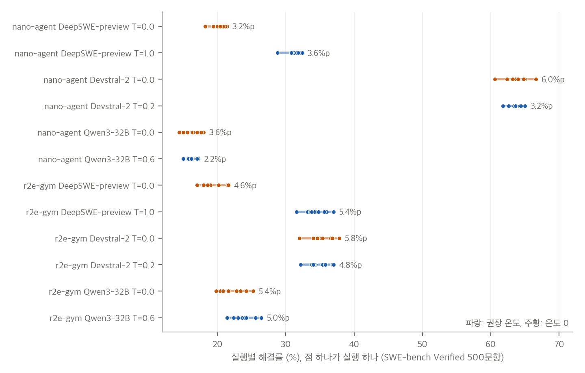
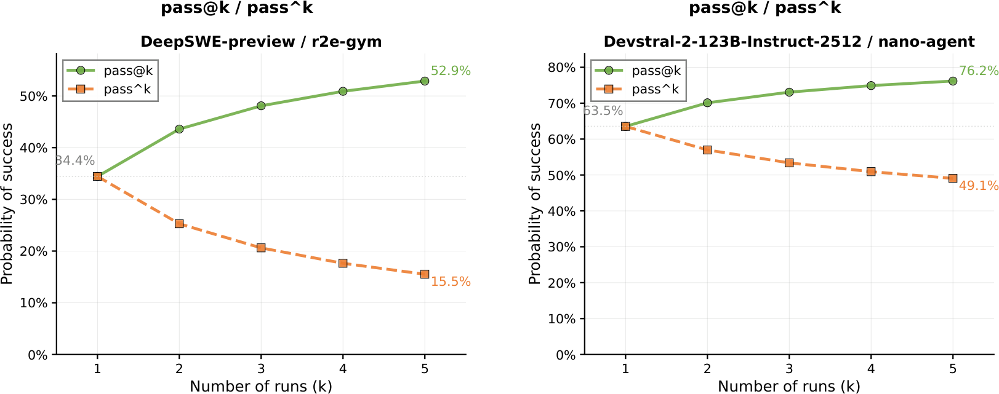
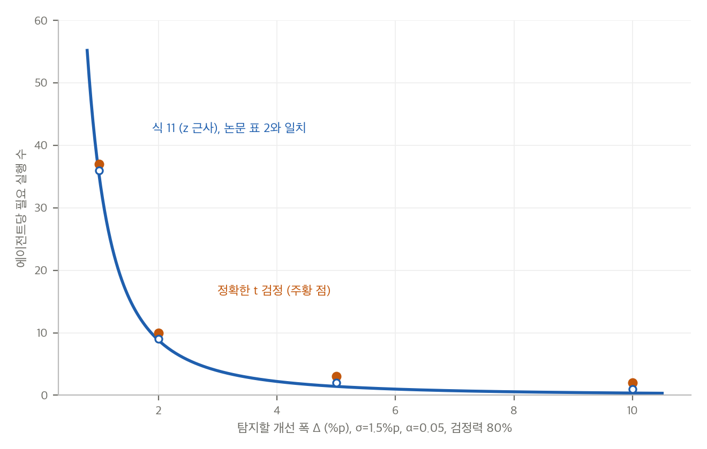
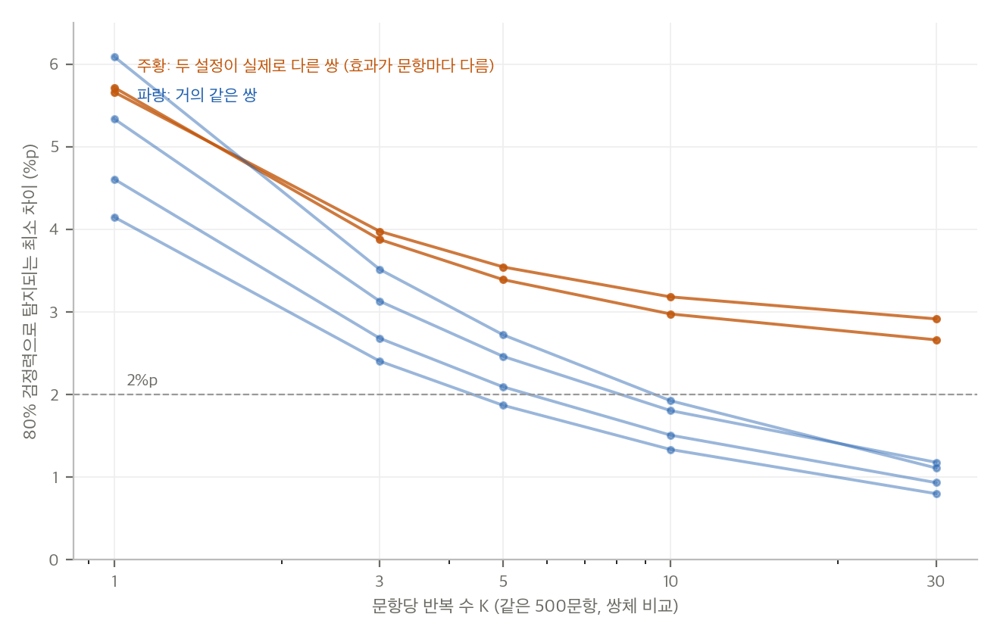
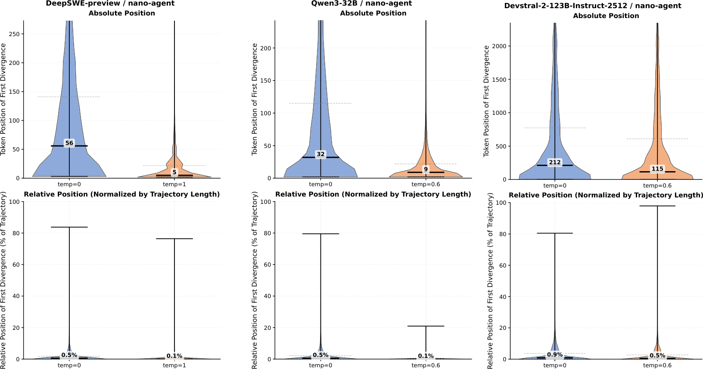

> **논문:** Bjarni Haukur Bjarnason, André Silva, Martin Monperrus. *On Randomness in Agentic Evals.* ICLR 2026 워크숍(Agents in the Wild), arXiv:2602.07150 (v3, 2026-03-25).
> 저자 저장소와 HF 결과(CC BY 4.0)가 공개되어 있어 평가 결과 JSON 120개(5.8 MB)로 표를 다시 계산했습니다. 그림 두 장(그림 1, 2)은 출처를 표기했고 나머지 세 장은 우리가 그린 그래프입니다.

## 논문이 묻는 것

에이전트 논문은 보통 과제마다 한 번 돌린 pass@1을 보고합니다. 같은 설정을 다시 돌리면 점수가 얼마나 달라질까요? 저자들은 모델 3개(Qwen3-32B, DeepSWE-preview, Devstral-2)와 스캐폴드 2개(nano-agent, R2E-Gym)를 권장 온도와 온도 0에서 각각 10회, SWE-Bench-Verified 500문항에 돌려 60,000 궤적을 모았습니다. 결론은 단일 실행 pass@1이 2.2–6.0 %p 범위로 움직이고, 온도 0도 소용이 없으며, 2–3 %p 개선 보고는 잡음일 수 있다는 것입니다. 권고는 여러 번 돌리기, 검정력 분석, pass@k와 pass^k 병기입니다.

## 우리가 확인한 것

### 1. 표 1과 표 3은 그대로 재현됩니다

12개 설정의 평균, 표준편차(ddof=1), 최소, 최대 48개 값과 Shapiro-Wilk 12개가 모두 일치합니다.

*우리가 그린 그래프. 점 하나가 실행 하나입니다.*

다만 초록의 "2.2–6.0 %p"는 **10회 표본의 범위**입니다. 정규 분포에서 범위의 기대값은 10회에 3.08σ, 20회에 3.73σ, 100회에 5.02σ로 늘어납니다. 안정된 값은 표준편차(0.7–1.8 %p)이므로 그쪽으로 인용하는 편이 맞습니다.

초록의 다른 문장도 표보다 강합니다. 온도 0에서 표준편차가 1.5 %p를 넘는 설정은 6개 중 3개이고, "온도 0에서 분산이 줄지 않고 때로 늘어난다"는 권장 온도 대 0의 분산비 F 검정에서 6쌍 모두 유의하지 않아(p 0.19–0.92) "줄지 않는다"까지만 지지됩니다.

### 2. pass@k의 "24.9 %p"는 다른 격차의 값입니다

pass@5와 pass^5의 그림 값 11쌍이 모두 재현됩니다.

*논문 그림 1. © 저자, CC BY 4.0, 출처 arXiv:2602.07150 (v3).*

그런데 서론과 결론은 낙관 경계와 비관 경계의 격차가 최대 24.9 %p라고 쓰는데, 24.9는 **pass@5 − pass@1**(Devstral-2/R2E-Gym 온도 0: 60.3 − 35.4)입니다. pass@5 − pass^5는 같은 설정에서 48.7 %p입니다.

### 3. 실행 간 분산은 문항별 동전 던지기로 설명됩니다

문항별 성공 확률 p_i를 10회에서 추정해 이항 모형을 세우면, 문항이 독립일 때의 예측 표준편차와 관측 표준편차의 비가 0.71–1.40이고 어느 설정도 기각되지 않습니다(χ² p ≥ 0.08). 단일 실행 총분산에서 실행 간 분산이 차지하는 몫은 28–52%이고 나머지는 문항 난이도 차이이며 반복으로 줄지 않습니다. 같은 설정을 두 번 돌리면 해결률이 2 %p 이상 다른 쌍이 평균 32%(9–51%)입니다. 문항 쌍체 McNemar 검정을 쓰면 같은 설정 두 실행의 기각률은 평균 5.6%로 5% 수준입니다.

### 4. 필요 실행 수 표 2: 식은 맞고 두 가지가 빠졌습니다

표 2의 36개 값은 두 표본 검정의 n ≥ 2((z_{α/2}+z_β)σ/Δ)²을 올린 값과 정확히 일치합니다. 하지만 이 식은 σ를 아는 z 근사입니다. 10회 표본에서 σ를 추정하므로 비중심 t로 풀면 필요 횟수가 1–2회 늘어납니다((Δ=2 %p, σ=0.7)는 2 대 4, (2, 1.5)는 9 대 10). 이항 시뮬레이션으로도 n=9에서 검정력 74.7%, n=10에서 80.4%였습니다. "10회면 2 %p를 탐지한다"는 말은 맞습니다.

*우리가 그린 그래프. 파랑은 식 11(논문 표 2와 일치), 주황 점은 정확한 t 검정입니다.*

더 큰 문제는 σ가 "같은 500문항을 반복했을 때의 흔들림"이라는 점입니다. Error Bars 논문(Miller, arXiv:2411.00640)의 분해로 보면 단일 실행 분산은 문항 난이도 분산과 문항 안 반복 분산의 합이고, 반복은 뒤의 것만 줄입니다. 두 설정이 실제로 다를 때(DeepSWE의 온도 1.0 대 0) 문항 쌍체 표준오차는 실행 잡음만의 표준오차의 약 2배(1.06–1.14 대 0.56–0.58 %p)였습니다. 쌍체 비교에서 80% 검정력으로 잡히는 최소 차이는 문항당 반복 K=1이면 4.1–6.1 %p, K=10이면 1.3–3.2 %p이고, 실제로 다른 쌍은 K를 무한히 늘려도 2.5–2.8 %p 아래로 내려가지 않았습니다(추정이고 대립 가설에 따라 다름).

*우리가 그린 그래프. 주황은 실제로 다른 쌍, 파랑은 거의 같은 쌍입니다.*

### 5. 온도 효과 일부는 빈 패치입니다

논문은 DeepSWE-preview의 11.0 %p(nano-agent), 15.3 %p(R2E-Gym) 온도 효과를 "확률적 탐색이 능력을 올린다"로 해석합니다. 평가 JSON의 빈 패치 수를 보면 DeepSWE-preview는 온도 0에서 500문항 중 148개(nano-agent), 115개(R2E-Gym)가 빈 패치이고 권장 온도 1.0에서는 42.5개, 11.3개입니다. 패치를 낸 문항만 보면 차이가 5.4 %p, 10.3 %p로 줄어듭니다. 탐욕 디코딩이 실패 모드에 빠졌을 가능성이 있으나 이 데이터로는 원인을 가릴 수 없습니다.

### 6. 첫 토큰 분기 분석은 확인하지 못했습니다

궤적 파일이 수십 GB라 받지 않았습니다. 그림 라벨만 대조하면 본문의 "중앙값 토큰 5, 궤적의 0.5%"는 그림 2에서 온도 1.0이 0.1%, 온도 0이 0.5%로 적혀 있고, "항상 1% 안"은 중앙값의 말이며 그림에는 후반 분기도 있습니다.

*논문 그림 2. © 저자, CC BY 4.0, 출처 arXiv:2602.07150 (v3).*

## 공식 코드와 결과

- 저장소(ASSERT-KTH/agentic-evals-lab, 라이선스 파일 없음)에는 추론·평가 스크립트와 모델별 설정이 있고, **pass@k, 표 2, 정규성, 분기 분석 코드는 없습니다.**
- nano-agent/Qwen3-32B의 온도가 논문 표 4에서는 0.6, 저장소 설정 파일에서는 1.0입니다.
- 설정 파일에 `time_limit: 600`이 있는데 논문 부록에는 토큰·도구 호출 상한만 있고, 재개 규칙은 빈 패치 문항을 다시 돌립니다.
- nano-agent DeepSWE 온도 1.0 폴더의 결과 파일 이름이 `temp_0.0`, `r2egym`으로 붙어 있어 폴더 이름과 평균으로 매핑해야 합니다.

## 인용할 때

- 인용해도 되는 것: 같은 설정 10회의 표준편차 0.7–1.8 %p(표 1), 온도 0의 비결정성, pass@k와 pass^k를 병기하는 보고, 10회면 약 2 %p 탐지.
- 붙일 단서: 영역은 SWE-Bench-Verified의 코딩 에이전트 6개 조합, 범위는 10회 표본의 통계량, 문항 표본 오차는 표 2에 없음, 24.9 %p의 정의, 온도 효과의 빈 패치 혼입, nano-agent/Qwen3-32B의 온도 불일치.

재계산 스크립트와 결과, 공개 리포트는 함께 올린 자료에 있습니다.

## 자료

- [통합 리포트 PDF](report/report_public.pdf)
- [On Randomness in Agentic Evals (arXiv:2602.07150) 논문 분석](analysis/01_paper_analysis.md)
- [02. 선행 연구, 후속 연구, 자료](analysis/02_prior_work.md)
- [03. 재계산, 식 검산, 통계 검증](analysis/03_analysis.md)
- [04. 공식 코드·결과 대조](analysis/04_code_verification.md)
