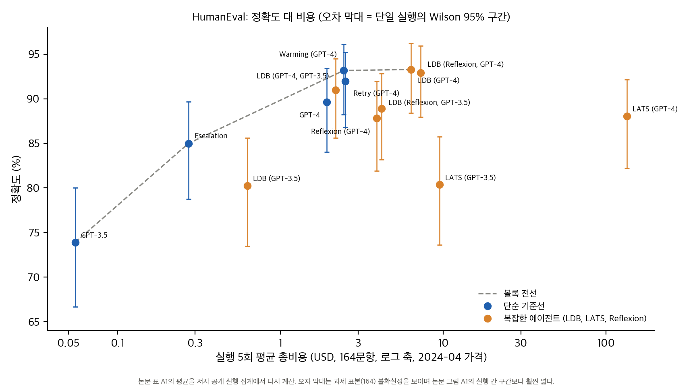
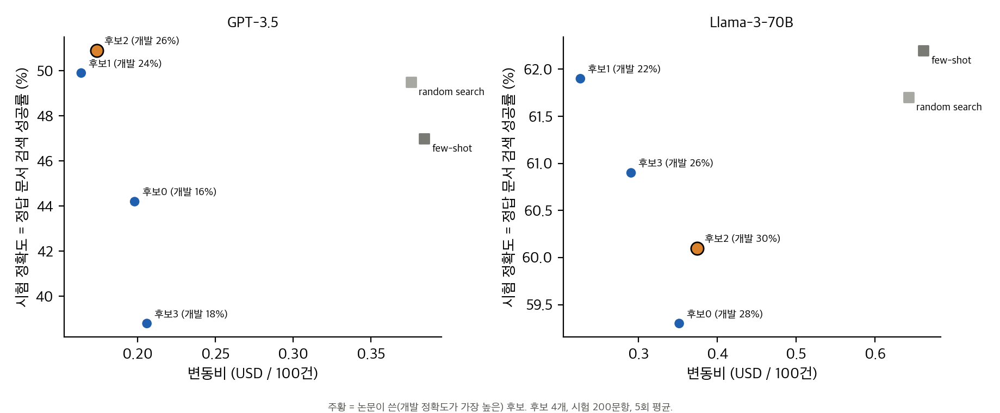

# 03 재계산과 통계 검정

입력은 저자 저장소(`benediktstroebl/agent-evals`, 커밋 5ce7c0c)에 저장된 실행 결과입니다. 코드는 실행하지 않았고 API도 부르지 않았습니다. 스크립트는 `analysis/extract_pertask.py`(저장소 `repo/`에서 과제별 통과 여부와 HotPotQA 결과를 `analysis/source_data/`로 추출)와 `analysis/recompute.py`(재계산, 결과 `recompute_results.json`)입니다. 쪽·표 번호는 arXiv v1입니다.

데이터 규모는 HumanEval 164문항 × 에이전트 11개 × 5회 실행(과제별 통과 여부 `is_solved`), 실행별 집계 CSV(토큰 수, 비용, 정확도), HotPotQA 200문항 × 설계 5개 × 모델 2개입니다. 논문 표 A1의 최소·최대·평균이 저장소 CSV에서 다시 계산한 값과 정확도 0.063%p, 비용 0.005 USD 안에서 모두 일치하므로 저장소는 논문 표의 원자료로 볼 수 있습니다.

## 1. 표 A1·A2·A7 재계산

**표 A1(2024-04판 모델).** 13개 행의 평균·최소·최대(정확도, 비용)를 실행별 CSV에서 계산해 논문 값과 비교했습니다. 최대 차이는 정확도 0.063%p(반올림), 비용 0.005 USD입니다. 아래는 우리가 다시 계산한 값과 5회 실행 t 95% 구간입니다.

| 에이전트 | 정확도 평균 (최소–최대) | 실행 간 SD (%p) | t 95% 구간 | 비용 USD (최소–최대) |
|---|---|---|---|---|
| GPT-3.5 zero-shot | 73.90 (71.95–76.22) | 1.69 | 71.8–76.0 | 0.055 |
| GPT-4 zero-shot | 89.63 (87.80–90.85) | 1.43 | 87.9–91.4 | 1.93 (1.91–1.95) |
| Retry (GPT-4) | 91.95 (91.46–92.68) | 0.51 | 91.3–92.6 | 2.51 (2.46–2.56) |
| Warming (GPT-4) | 93.17 (92.07–93.90) | 0.67 | 92.3–94.0 | 2.45 (2.37–2.54) |
| Escalation | 85.00 (84.15–85.37) | 0.55 | 84.3–85.7 | 0.27 (0.26–0.29) |
| LDB (GPT-3.5) | 80.24 (78.66–82.93) | 1.76 | 78.1–82.4 | 0.63 (0.56–0.77) |
| LDB (GPT-4, GPT-3.5) | 90.98 (89.02–92.07) | 1.52 | 89.1–92.9 | 2.19 (2.14–2.25) |
| LDB (Reflexion, GPT-3.5) | 88.90 (86.59–91.46) | 1.85 | 86.6–91.2 | 4.19 (3.98–4.37) |
| LDB (GPT-4) | 93.29 (92.07–94.51) | 0.96 | 92.1–94.5 | 6.36 (5.11–7.08) |
| LDB (Reflexion, GPT-4) | 92.93 (91.46–95.12) | 1.53 | 91.0–94.8 | 7.26 (6.19–9.63) |
| Reflexion (GPT-4) | 87.80 (85.98–90.85) | 1.93 | 85.4–90.2 | 3.90 (3.76–4.13) |
| LATS (GPT-3.5) | 80.37 (78.66–83.54) | 1.90 | 78.0–82.7 | 9.49 (8.94–9.89) |
| LATS (GPT-4) | 88.05 (82.32–91.46) | 3.41 | 83.8–92.3 | 134.50 (123.98–147.13) |

과제별 `is_solved`의 합계도 CSV 정확도와 일치합니다(예: Warming 153, 151, 154, 153, 153/164). 즉 CSV와 과제별 결과가 같은 실행에서 나왔습니다. LATS는 저장소 README가 일부 실행이 중간에 끊겨 jsonl 정확도가 부정확하다고 밝히지만, GPT-4와 GPT-3.5의 5회 실행은 jsonl 합계가 CSV와 맞았습니다(146, 135, 145, 150, 146 대 CSV 89.0, 82.3, 88.4, 91.5, 89.0%).

**표 A2(2023-06판 모델).** 같은 방식으로 CSV와 대조했습니다. LATS는 GPT-4와 GPT-3.5 모두 1회 실행뿐이라 구간이 없습니다(83.54%, 360.02 USD / 77.44%, 8.97 USD). 논문 표 A2의 LATS 행도 같은 값입니다.

**표 A7(보고 대 재현).** 우리 계산의 실행 범위와 비교하면 다음과 같습니다.

| 에이전트 | 보고 | 우리 실행 최소–최대 | 위치 |
|---|---|---|---|
| LATS (GPT-4) | 94.4 | 82.3–91.5 | 최대 위 |
| LATS (GPT-3.5) | 83.8 | 78.7–83.5 | 최대 위 |
| LDB (GPT-4, GPT-3.5) | 89.6 | 89.0–92.1 | 범위 안 |
| LDB (Reflexion, GPT-3.5) | 95.1 | 86.6–91.5 | 최대 위 |
| LDB (GPT-3.5) | 82.9 | 78.7–82.9 | 최대와 같음 |
| GPT-4 기준선(LDB 논문 보고) | 75.0 | 87.8–90.9 | 최소 아래 |
| Reflexion (GPT-4) | 91.0 | 86.0–90.9 | 최대 위(0.15%p) |

논문 6절의 "보고 정확도가 5회 실행 최대보다 높은 경우가 많고, 기준선은 최소보다 낮았다"는 서술이 이 표로 확인됩니다(7개 중 4개가 최대 위, 1개가 최소 아래). 단 보고 수치는 평가한 과제 부분집합이 다릅니다(Reflexion 161문항, LATS 160문항 안팎, LDB 164문항). 그래서 "정확도 차이"에는 부분집합 효과가 섞여 있고, 재현 실패와 같은 말이 아닙니다(논문도 이 점을 표 A7 주석에 적었습니다).

## 2. 비용 산술

**토큰 수 × 단가.** CSV에는 모델별 입력·출력 토큰이 있습니다. 논문의 단가(GPT-4-turbo 10/30, GPT-3.5-0125 0.5/1.5, Llama-3-70B 0.9/0.9 USD per 1M)와 Llama-3-8B 0.2/0.2(논문에는 없고 저장소 `humaneval_eval.ipynb`의 `model_prices`에 있음)를 곱해 합하면 다음이 맞습니다.

- GPT-4 zero-shot run1: 31,154 × 10 + 53,766 × 30 = 1.9245 USD. CSV 1.92452. 일치.
- LATS (GPT-4) run1: 8,949,357 × 10 + 1,225,786 × 30 = 126.267 USD. CSV 126.267. 일치(LATS 한 번 평가에 입력 토큰 약 895만, 출력 약 123만).
- Warming, Retry, Reflexion, LATS, Escalation, GPT-3.5 zero-shot, LDB (GPT-3.5, 자기 시드)는 잔차가 0입니다(Escalation은 Llama-3-8B 단가 0.2/0.2로 0.277이 되어 CSV 0.2771과 맞습니다).
- **0613판의 단가 모호함.** 부록 A.1의 0613 단가 문장은 GPT-3.5-0613을 "0.5 (1.5)와 10 (30)"이라 적어 앞 문장을 되풀이한 듯 읽힙니다. 자료와 저장소 `model_prices`로 보면 GPT-3.5-0613은 0.5/1.5(데이터 0.0411 USD 일치, 단가 10/30이면 0.8228)이고 GPT-4-0613은 30/60(2.9222 USD 일치)입니다.

**LDB의 비용에는 시드 프로그램 생성 비용이 들어 있습니다.** LDB 행의 총비용에서 토큰 곱을 빼면 남는 잔차가, 같은 실행 번호의 시드 생성 비용과 **정확히 같습니다**(최대 오차 0.0000). 시드는 다음과 같습니다.

| 논문 표기 | CSV 모델 이름(`디버거+시드`) | 시드 출처 | 디버거 |
|---|---|---|---|
| LDB (GPT-4) | `gpt-4-turbo+gpt-4-turbo` | GPT-4 zero-shot | GPT-4 |
| LDB (GPT-4, GPT-3.5) | `gpt-3.5-turbo+gpt-4-turbo` | GPT-4 zero-shot | GPT-3.5 |
| LDB (GPT-3.5) | `gpt-3.5-turbo+gpt-3.5-turbo` | GPT-3.5 zero-shot | GPT-3.5 |
| LDB (Reflexion, GPT-3.5) | `gpt-3.5-turbo+reflexion` | Reflexion 실행(GPT-4) | GPT-3.5 |
| LDB (Reflexion, GPT-4) | `gpt-4-turbo+reflexion` | Reflexion 실행(GPT-4) | GPT-4 |

그림 1 설명("괄호 안 둘은 코드 생성 모델, 디버그 모델 순")과 CSV 이름의 순서가 반대입니다. 그리고 **표 A1의 LDB (Reflexion, GPT-3.5)는 시드가 GPT-4 Reflexion**입니다(시드 파일 이름 `humaneval-py._reflexion_2_gpt-4-turbo-2024-04-09`). 이것이 표 A6이 지적한 LDB 논문의 "GPT-3.5로 Reflexion을 썼다고 했지만 실제 시드는 GPT-4" 문제이고, 비용 4.19 USD의 대부분(3.90)이 GPT-4 Reflexion 비용입니다. 반대로 **LDB (GPT-4, GPT-3.5)의 비용 2.19 USD 중 1.93이 시드(GPT-4 zero-shot)** 이고 GPT-3.5 디버깅은 0.26뿐입니다.

**비용 배수(Warming 대비, 2024-04 단가).** 논문 2.3절 "Reflexion과 LDB는 Warming보다 50% 넘게, LATS는 50배 넘게 비쌈"을 확인했습니다.

| 에이전트 | 비용 배수 | 에이전트 | 비용 배수 |
|---|---|---|---|
| LATS (GPT-4) | 54.9 | Retry (GPT-4) | 1.02 |
| LDB (Reflexion, GPT-4) | 2.97 | LDB (GPT-4, GPT-3.5) | **0.89** |
| LDB (GPT-4) | 2.60 | GPT-4 zero-shot | 0.79 |
| LDB (Reflexion, GPT-3.5) | 1.71 | LDB (GPT-3.5) | 0.26 |
| Reflexion (GPT-4) | 1.59 | Escalation | 0.11 |
| LATS (GPT-3.5) | 3.87 | | |

"LDB는 50% 넘게 비쌈"은 LDB 다섯 변형 중 세 개에만 해당합니다. LDB (GPT-4, GPT-3.5)는 Warming보다 11% 싸고(정확도 90.98 대 93.17), LDB (GPT-3.5)는 74% 쌉니다(정확도 80.24). 즉 "LDB가 비싸다"는 말은 변형을 지정해야 맞습니다.

"Escalation이 LDB (GPT-3.5)보다 비용이 절반 미만"은 0.273 / 0.629 = 0.43으로 맞습니다.

## 3. 정확도 차이와 "동률" 주장

### 3.1 불확실성의 두 종류

논문 그림 A1의 구간은 **같은 164문항에서 5회 반복했을 때의 변동**(모델 샘플링과 비결정성)입니다. 단일 실행 정확도가 가진 **과제 표본 변동**(164문항을 다른 164문항으로 바꿨을 때의 변동)은 포함되지 않습니다. 둘의 크기를 비교하면:

| 에이전트 | 실행 간 SD (%p) | 이항 SD √(p(1−p)/164) (%p) | 단일 실행 Wilson 95% 구간 |
|---|---|---|---|
| Warming (GPT-4) | 0.67 | 1.97 | 88.2–96.1 |
| LDB (GPT-4) | 0.96 | 1.95 | 88.4–96.2 |
| Retry (GPT-4) | 0.51 | 2.12 | 86.8–95.2 |
| GPT-4 zero-shot | 1.43 | 2.38 | 84.0–93.4 |
| Reflexion (GPT-4) | 1.93 | 2.56 | 81.9–91.9 |
| Escalation | 0.55 | 2.79 | 78.7–89.7 |

실행 간 SD는 이항 SD의 약 1/5–3/4입니다. 같은 164문항에서 반복하면 어려운 문항이 계속 틀리기 때문입니다. 그래서 5회 평균의 t 구간(폭 약 ±1–2%p)은 "164문항 대 새 문항"의 일반화를 말해 주지 못합니다. 일반화를 보려면 과제를 단위로 한 짝지은 분석이 필요하고, 아래가 그것입니다.

### 3.2 짝지은 과제 단위 비교

각 과제의 통과율(5회 평균)의 에이전트 간 차이를 과제 단위로 복원추출(20,000회, 시드 0)해 평균 차이의 구간을 구했습니다. "동등 한계"는 90% 구간의 절대 최대값으로, 이 이내로는 차이가 없다고 말할 수 있는(양측 5%의 TOST) 가장 좁은 한계입니다. "실행 Welch p"는 5회 대 5회 실행 정확도의 Welch t 검정인데, 과제 변동을 무시해 **반보수적**입니다.

| A 대 B | 차이 (%p) | 과제 부트스트랩 95% | 동등 한계 | 실행 Welch p | A가 나은 과제 / 못한 과제 / 같음 |
|---|---|---|---|---|---|
| Warming 대 LDB (GPT-4) | −0.12 | −2.32, +1.95 | **1.95** | 0.82 | 7 / 7 / 150 |
| Warming 대 LDB (Reflexion, GPT-4) | +0.24 | −2.93, +3.54 | 2.93 | 0.76 | 12 / 9 / 143 |
| Warming 대 LDB (GPT-4, GPT-3.5) | +2.20 | −0.12, +4.76 | 4.27 | 0.028 | 11 / 4 / 149 |
| Warming 대 Reflexion (GPT-4) | +5.37 | +2.44, +8.66 | 8.05 | 0.002 | 25 / 4 / 135 |
| Warming 대 Retry | +1.22 | +0.12, +2.56 | 2.32 | 0.013 | 6 / 1 / 157 |
| Warming 대 GPT-4 zero-shot | +3.54 | +1.59, +5.98 | 5.49 | 0.003 | 12 / 1 / 151 |
| Retry 대 GPT-4 zero-shot | +2.32 | +0.73, +4.15 | 3.78 | 0.019 | 10 / 2 / 152 |
| Retry 대 LDB (GPT-4) | −1.34 | −3.29, +0.37 | 3.05 | 0.033 | 5 / 9 / 150 |
| LDB (GPT-4, GPT-3.5) 대 GPT-4 zero-shot | +1.34 | −0.12, +3.17 | 2.80 | 0.19 | 7 / 2 / 155 |
| LDB (GPT-4) 대 GPT-4 zero-shot | +3.66 | +1.59, +5.98 | 5.61 | 0.002 | 15 / 1 / 148 |
| Escalation 대 LDB (GPT-3.5) | +4.76 | −0.24, +9.76 | 9.02 | 0.003 | 27 / 12 / 125 |
| Escalation 대 GPT-3.5 zero-shot | +11.10 | +5.12, +17.20 | 16.22 | <0.001 | 34 / 11 / 119 |
| Reflexion (GPT-4) 대 GPT-4 zero-shot | −1.83 | −5.12, +1.34 | 4.51 | 0.13 | 9 / 20 / 135 |

읽는 법:

1. **"Warming이 최고 에이전트(LDB (GPT-4))와 정확도 차이가 없다"** 는 성립합니다. 차이 −0.12%p, 95% 구간 ±2%p. 그러나 이것은 "차이가 없다는 증거"가 아니라 **"±2%p보다 큰 차이는 배제된다"** 입니다. ±1%p 동등은 주장할 수 없습니다. 과제 164개에서 두 에이전트의 과제별 통과율 차이의 SD가 13.9%p이므로 과제 단위 표준오차가 1.09%p이고, 80% 검정력으로 구분되는 최소 차이(MDE)는 3.0%p입니다. 즉 이 자료는 3%p 이하의 차이를 구별할 해상도가 없습니다. (`little_power/`의 MDE ≈ 2.8·√(d/n)와 같은 식입니다.)
2. 같은 계산으로 Warming 대 LDB (Reflexion, GPT-4)는 ±2.9%p 안에서 동등, Warming 대 Reflexion (GPT-4)는 Warming이 유의하게 높습니다(+5.4, 구간이 0 위).
3. **복잡한 에이전트가 항상 단순 기준선과 같은 것은 아닙니다.** LDB (GPT-4, GPT-3.5)는 Warming보다 2.2%p 낮고 구간 하한이 −0.12라 경계에 있습니다. 비용은 11% 쌉니다. 이 변형은 비용 면에서 같은 쪽에 있고 정확도는 경계라 "단순 기준선이 지배한다"고 단정하기 어렵습니다.
4. **디버깅의 순수 이득은 작고 불확실합니다.** LDB (GPT-4, GPT-3.5)는 시드(GPT-4 zero-shot)보다 +1.34%p(구간 −0.12 ~ +3.17)이고, Retry는 같은 기준선보다 +2.32%p(구간 +0.73 ~ +4.15), Warming은 +3.54%p(구간 +1.59 ~ +5.98)입니다. 디버깅(GPT-3.5로 한 디버거 + 공개 테스트 신호)보다 단순 재시도가 이득이 더 큽니다. 같은 모델(GPT-4)로 디버깅하는 LDB (GPT-4)는 +3.66%p로 Warming(+3.54)과 같습니다. 이 구조는 `self_debug/`(이득의 대부분이 통과·실패 판정을 받는 재시도에서 온다)와 같은 방향입니다.
5. **Warming 대 Retry(온도 올리기 대 온도 0 반복).** +1.22%p(구간 +0.12 ~ +2.56), 비용은 2.45 대 2.51로 비슷합니다. 약하게 유의합니다. 온도를 올리는 쪽이 단순 반복보다 낫다는 방향은 논문 설계 의도와 맞지만, 한 벤치마크의 1.2%p이고 다중 비교 보정을 하지 않았습니다(우리가 계산한 쌍은 15개).
6. **Escalation 대 LDB (GPT-3.5)** 는 방향은 논문대로입니다(+4.76%p, 비용은 0.43배). 그러나 과제 단위 95% 구간이 0을 포함합니다(−0.24 ~ +9.76). 실행 Welch p 0.003은 과제 변동을 무시해서 나온 값입니다. 논문 서술("strictly improves accuracy")은 점추정에서는 맞고 과제 표본 오차까지 보면 확정적이지 않습니다.
7. **Reflexion (GPT-4) 대 GPT-4 zero-shot은 −1.83%p**(구간 −5.1 ~ +1.3)로 Reflexion이 오히려 낮은 방향입니다. 예시 테스트가 없는 3과제(HumanEval/32, 38, 50)만의 영향은 아닙니다. 그 3과제를 빼도 88.3 대 89.4로 같은 방향입니다(`recompute.py` 출력 `three_tasks_without_example_tests`). 2023-06판 모델에서는 80.2 대 86.5로 더 벌어집니다(표 A2). 논문 표 A7의 보고값 91.0은 161문항 평가였습니다.

**LATS (GPT-4).** 과제별 결과의 정확도가 CSV와 맞는 5회 실행이 있으나 위 분석은 실행 수준만 합니다. 5회 실행 88.05%(82.3–91.5, SD 3.41)는 Warming 93.17보다 5.1%p 낮고(Welch p 0.027), 비용이 54.9배입니다. LATS의 실행 간 SD가 다른 에이전트의 2–5배라 구간이 가장 넓습니다.

### 3.3 포화: 164문항 중 변별하는 문항이 적다

GPT-4 기반 상위 7개 에이전트(Warming, Retry, LDB 세 종류, Reflexion, GPT-4 zero-shot)에서 모든 실행이 맞히는 과제가 123개, 모두 틀리는 과제가 4개이고, **변별하는 과제는 37개**뿐입니다. 11개 에이전트 전체로 보면 94개 과제는 모두 맞히고 2개 과제는 아무도 맞히지 못합니다. 그래서 164문항 벤치마크에서 1문항은 0.61%p이고, 에이전트 순위의 차이는 사실상 수십 개 어려운 문항에서 갈립니다. 논문이 보인 "복잡한 에이전트 대 단순 기준선의 동률"은 HumanEval이 포화된 영역이라는 점을 함께 말해야 합니다. 저자도 SWE-bench 같은 더 어려운 과제에서는 다를 수 있다고 인정합니다(2.3절 끝).

## 4. 파레토 전선과 가격 시점

**전선 계산.** 13개 점(평균 비용, 평균 정확도)에서 볼록 전선을 구했습니다(논문 정의, 부록 A.1).

- 2024-04 가격: GPT-3.5 → Escalation → Warming → LDB (GPT-4). 지배되지 않는 점은 이 넷에 GPT-4 zero-shot과 LDB (GPT-4, GPT-3.5)가 더해져 6개입니다. 논문 각주 2대로 GPT-4 zero-shot은 **볼록 전선에서는 빠지지만** 지배되지는 않습니다(비용 1.93은 Warming보다 싸고 LDB (GPT-4, GPT-3.5)보다도 쌈).
- **LDB (GPT-4)(93.29 %, 6.36 USD)는 볼록 전선 위**입니다. Warming(93.17, 2.45)보다 0.12%p 높은 점추정 때문입니다. 2.3절 본문이 쓴 "유의하게 낫지 않으면 전선 위"의 정의라면 Warming이 LDB (GPT-4)를 지배하고, 부록의 평균 기준 정의라면 LDB (GPT-4)도 전선 위입니다. **본문과 부록의 전선 정의가 다릅니다.**
- 2023-06 모델 자료(표 A2)로 같은 계산을 하면 볼록 전선이 같습니다(GPT-3.5 → Escalation → Warming → LDB (GPT-4)). 모델 판이 바뀌어도 전선 구성은 유지됩니다.

**가격 변화 민감도.** GPT-4 단가(입력·출력 모두)를 s배로 바꾸고 모든 에이전트의 비용을 모델별 토큰으로 다시 계산했습니다(Llama와 GPT-3.5 단가는 고정). 볼록 전선의 구성은 s = 0.06부터 3까지 변하지 않고(위 네 점), GPT-4가 25배 이상 싸지는 s ≤ 0.04에서야 GPT-4 zero-shot이 전선에 들어옵니다. 순서가 가격에 안정적인 이유는 비교 대상 대부분의 비용이 GPT-4 호출이기 때문이고 논문 2.3절도 그렇게 설명합니다.

**비용 배수의 안정성.** 2.3절의 "이 비율은 모델 단가가 바뀌어도 안정적"은 대략만 맞습니다. 0613판(30/60 단가)에서 Warming 대비 비용 배수는 LATS (GPT-4) 92.7(0409판 54.9), LDB (Reflexion, GPT-4) 4.64(2.97), Reflexion 2.13(1.59), LDB (GPT-4) 2.40(2.60)입니다. 순서는 같고 크기는 최대 1.7배 흔들립니다. 입력과 출력의 단가 비율이 달라지면(10:30 대 30:60) 입력 토큰이 많은 LATS가 더 비싸지는 식으로 배수가 달라집니다.

우리가 그린 그림. 저자 공개 실행 집계에서 다시 계산한 평균과 볼록 전선. 오차 막대는 단일 실행의 Wilson 95% 구간(과제 표본 불확실성)이다.

## 5. 저장소 코드와 논문의 설정 대조 요약(정적)

`04_code_verification.md`에 자세히 있습니다. 여기서는 03의 수치에 영향을 준 것만 적습니다. (1) Retry, Warming, Escalation은 예시 테스트로 멈추고 최종 채점은 전체 테스트입니다. 코드에서 확인했습니다. (2) 5회 실행 번호별로 LDB의 시드가 같은 번호의 zero-shot 실행입니다(비용 잔차가 정확히 일치). 그래서 "LDB 대 GPT-4 zero-shot"의 실행별 정확도는 서로 독립이 아닙니다.

## 6. HotPotQA 결합 최적화 (3절, 그림 2, 표 A3)

**표 A3 재계산.** 저장소 `HotpotQA/retrieval_score/*/…eval_results.json`의 과제별 결과에서 다시 계산한 평균·최소·최대와 비용이 표 A3과 모두 일치합니다(정확도 10개 행, 변동비, 고정비). 표 A3의 "정확도"는 **정답 문서를 모두 검색했는가**(`gold_passages_retrieved`)이고 답의 정확 일치(exact match)가 아닙니다. 파일에는 두 지표가 모두 있어 다음처럼 비교됩니다.

| 모델 | 설계 | 검색 성공률 (표 A3) | 답 정확 일치 | 변동비/100건 | 고정비 |
|---|---|---|---|---|---|
| GPT-3.5 | few-shot | 0.470 | 0.501 | 0.384 | 0.029 |
| GPT-3.5 | random search | 0.495 | 0.517 | 0.376 | 2.696 |
| GPT-3.5 | 결합 최적화 | 0.509 | **0.479** | 0.174 | 2.714 |
| Llama-3-70B | few-shot | 0.622 | 0.533 | 0.661 | 0.028 |
| Llama-3-70B | random search | 0.617 | 0.538 | 0.643 | 4.820 |
| Llama-3-70B | 결합 최적화 | 0.601 | 0.530 | 0.374 | 3.844 |

**비용 절감.** GPT-3.5에서 변동비가 random search 대비 53.8%, few-shot 대비 54.8% 줄고, Llama에서 41.7%와 43.4% 줄어, 본문 "53%와 41%"에 맞습니다(소수점 아래 절삭). 비용은 토큰 수에서 결정되므로 5회 사이에 거의 흔들리지 않습니다(범위 <1%). 그래서 **비용 절감은 믿을 수 있고 불확실성은 정확도 쪽에 있습니다.**

**손익분기.** (결합 고정비 − few-shot 고정비) / (변동비 차이 / 100)으로 GPT-3.5에서 1,275건, Llama에서 1,331건입니다. 부록 그림 A6 캡션(1,275와 1,332)과 맞고, **본문 3.2절의 "1,350건"과는 다릅니다**. random search 대비로는 GPT-3.5가 9건, Llama는 결합 최적화의 고정비(3.84)가 random search(4.82)보다 낮아 처음부터 쌉니다.

**정확도가 "비슷하다"는 주장의 구간.** 200개 시험 문항을 과제 단위로 짝지어 비교했습니다.

| 모델 | 결합 − few-shot | 95% 구간 | 동등 한계 | 결합 − random search | 95% 구간 |
|---|---|---|---|---|---|
| GPT-3.5 | +3.9%p | −1.5, +9.4 | 8.5%p | +1.4 | −4.2, +7.0 |
| Llama-3-70B | −2.1%p | −7.1, +2.8 | 6.3%p | −1.6 | −6.9, +3.8 |

"정확도를 유지한다"는 **±6–9%p 이내**로만 말할 수 있습니다(200문항에서 단일 실행 정확도의 Wilson 구간 폭이 ±7%p 수준: GPT-3.5 결합 0.441–0.578). 그리고 답 정확 일치로 보면 GPT-3.5 결합 최적화(0.479)가 few-shot(0.501)과 random search(0.517)보다 낮아 순서가 뒤집힙니다. "비슷한 정확도"는 검색 성공률 지표에서만 나옵니다.

**후보 선택 규칙.** 결합 최적화가 낸 후보는 4개입니다. 논문은 "개발 정확도가 가장 높은" 후보를 보고했습니다. 개발은 50문항이고 개발 정확도는 최적화 지표(정답 일치 + 문맥 + 홉 조건)의 값이라 0.16–0.30이며, 보고 지표(검색 성공률)와 다릅니다.

| 모델 | 후보 | 개발 정확도 | 시험 검색 성공률 | 변동비/100건 |
|---|---|---|---|---|
| GPT-3.5 | 0 | 0.16 | 0.442 | 0.198 |
| | 1 | 0.24 | 0.499 | 0.164 |
| | **2 (보고)** | 0.26 | 0.509 | 0.174 |
| | 3 | 0.18 | 0.388 | 0.206 |
| Llama-3-70B | 0 | 0.28 | 0.593 | 0.352 |
| | **1** | 0.22 | **0.619** | **0.227** |
| | 2 (보고) | 0.30 | 0.601 | 0.374 |
| | 3 | 0.26 | 0.609 | 0.291 |

Llama에서는 개발 정확도가 가장 낮은 후보 1이 시험에서 정확도가 가장 높고(0.619) 비용도 가장 낮아(0.227, few-shot 대비 66% 절감) 다른 셋을 모두 지배합니다. 비용 절감이 목적인 결합 최적화가, **비용을 보지 않고 50문항 개발 정확도로 후보를 고르는 규칙** 때문에 절감 폭을 절반 가까이 놓쳤습니다(few-shot 대비 보고 43.4% 대 후보 1의 65.7%). 또 후보가 4개뿐이고 개발이 50문항이라 개발 정확도 차이(0.02–0.08)는 표본 오차 안입니다(50문항에서 SE 약 6%p). 이것은 우리가 시험 결과를 본 뒤 말하는 사후 분석이라, 후보 1이 "더 좋은 규칙"이라는 증거가 아니라 선택 규칙이 비용을 쓰지 않았다는 관찰입니다.

우리가 그린 그림. 결합 최적화가 낸 후보 4개의 시험 검색 성공률과 변동비. 주황이 논문이 보고한(개발 정확도 최고) 후보.

## 7. NovelQA (4.1절, 표 A5)

**표 A5의 산술.** 모두 일치합니다.

- 롱컨텍스트 총비용 = 소설 98.09 + 문항 1.709 = 99.80 USD. 문항 토큰 = 88 × 690.807(템플릿) + 110,094 = 170,885 토큰 × 10 USD/1M = 1.709 USD.
- 소설당 롱컨텍스트 비용(문항 1개) = 98.09 / 88 = 1.1147 USD(표 1.115).
- RAG의 새 소설 문항 1개 비용 = 임베딩 0.0285 + 질문 0.0222 = 0.0507(표 0.051). 비 = 1.115 / 0.051 = 21.86 ✓.
- NovelQA 방식(소설당 한 번에 묻기)의 비 = 99.80 / 52.80 = 1.89, 단일 질문 방식의 비 21.86과의 차이는 11.6배(논문 "열 배 과대 추정").
- RAG 총비용 52.80은 88 × 0.0285 + 0.0222 × 약 2,305문항 = 53.7로 1.7% 차이가 납니다(문항 수가 약 2,265개면 일치). 문항 수가 2,300으로 어림이라 허용 오차입니다.

**정확도의 "같음"의 구간.** 67.89와 67.81의 차이 0.08%p는 약 2문항입니다(문항 수가 예컨대 2,280, 2,283, 2,308, 2,311, 2,336이면 두 값이 정수 개수로 맞고 k₁ − k₂ = 2). 각 1회 실행이고 문항별 짝 자료가 없어 비짝 비교로 표준오차가 1.38%p이고, 95% 구간 반폭이 2.7%p입니다. 따라서 "정확도가 같다"는 **±약 3%p 이내**로만 말할 수 있습니다. 비용 비 21.86은 토큰 단가의 산술이므로 불확실성이 정확도 쪽에 있습니다. 논문도 NovelQA만 오차 막대가 없다고 밝힙니다(체크리스트 3c). 또 정확도 보고값 67.81은 NovelQA 논문의 GPT-4 보고값 71%와 약 3%p 다르고, 논문은 이를 확률성 탓일 수 있다고 적습니다(부록 D).

## 8. 홀드아웃 표 (5절, 표 1, 부록 표 A4)

부록 표 A4(쪽 27)를 PDF 이미지로 보고 17행을 옮겨 적어 센 결과입니다.

| 수준 | 우리 집계(적합/전체) | 논문 표 1 |
|---|---|---|
| 분포 특정 | 1/1 (Jericho) | 1/1 |
| 과제 특정 | 3/6 (WebShop, PPNL, ScienceWorld) | 3/6 |
| 도메인 일반 | 1/8 (Mind2Web) | 1/8 |
| 완전 일반 | 0/2 | 0/2 |
| 합계 | 5/17 | 5/17 |

표 1은 표 A4와 일치합니다. 홀드아웃이 있는 벤치마크는 10개(표의 "Holdout set" 열)이고 그중 5개가 수준에 적합하다는 캡션도 맞습니다.

**불일치 하나.** 캡션과 5절은 "17개 중 **7개는 홀드아웃이 없고 앞으로 만들 계획도 밝히지 않았다**"고 쓰지만, 표 A4 본문으로는 홀드아웃이 없는 7개(MLAgentBench, WebArena, agbenchmark, LLF-Bench, TaskBench, MINT, τ-bench) 중 **MINT와 τ-bench는 "저자가 갱신 계획을 언급했다"** 고 적혀 있습니다. 계획이 없는 것은 5개입니다. 5절은 또 "계획이 있으면 적합한 것으로 센다"고 정의하므로, 그 정의대로면 MINT와 τ-bench(새 과제·도메인 추가 계획)가 도메인 일반의 적합 쪽에 들어가 표 1이 1/8이 아니라 3/8이 될 수 있습니다. 즉 "7"과 "5/10"을 만든 규칙이 일관되지 않습니다. 결론의 방향(대부분 벤치마크가 적합한 홀드아웃이 없다)은 바뀌지 않습니다. 수준 분류(예: SWE-bench를 과제 특정, GAIA를 완전 일반)는 저자의 "최선의 추측"이라 다르게 분류할 여지가 있고, 논문도 그렇게 적었습니다.

## 9. WebArena STeP 사례와 재현성 사례 (5.1절, 6절, 표 A6)

공개 자료로 확인한 범위는 제한적입니다.

- **STeP의 정확도.** 본문 35.8%(리더보드). 저장소 노트북 `webarena_step_eval.ipynb`의 출력에는 STeP을 수정 없이 돌린 전체 벤치마크 성공률이 **24.75%(812과제 중 201)**, Reddit 하위집합 21.7%(129과제)로 적혀 있습니다. 이 수치는 논문 본문이 쓰지 않으며, 35.8%와 24.75%의 차이를 논문이 설명하지 않습니다. 원인(Reddit 속도 제한, 평가 로그의 오기, 8개 과제 제거)이 몇 %p씩 기여하는지는 자료에서 분해하지 못했습니다.
- **상한.** 표 A6의 "Reddit 하위집합 129과제 중 30과제가 속도 제한에 영향"이 모두 거짓 성공으로 바뀌었다고 해도 전체 812과제에서 3.7%p가 상한입니다. 35.8%에서 24.75%로의 11%p 차이는 이것만으로 설명되지 않습니다.
- **하드코딩 정책.** 5.1절의 `/user/user_name` 서술은 STeP 저장소의 정책 문서로 확인해야 하고, 이번에는 읽지 않았습니다(저장소 `webagents-step/`가 clone에 있어 정적 확인 가능, 후속 과제).
- **LATS의 부분 테스트 평가(표 A6).** 저장소에서 LATS 5회 실행의 `passed_with_erroneous_code`(공개 테스트는 통과했으나 전체 테스트는 실패한 과제)가 GPT-4에서 3–6개(평균 4.6개, 2.8%p), GPT-3.5에서 2–6개(평균 3.8개, 2.3%p)입니다. 논문의 "약 3%p 차이"와 크기가 맞지만, 이 플래그는 첫 시도 통과 후 실패만 세므로 같은 양을 직접 측정한 것은 아닙니다.
- **Reddit 속도 제한의 순서 효과, 평가 로그의 오기(Listing 2)** 는 저자가 제시한 로그 한 건의 사례로, 전체 비율은 보이지 않습니다.

## 10. 문서 안의 불일치 목록 (경미한 것)

| 위치 | 내용 |
|---|---|
| 3.2절 대 그림 A6 | 손익분기 1,350 대 1,332(Llama)·1,275(GPT-3.5). 우리 계산 1,331·1,275 |
| 2.3절 본문 대 부록 A.1 | 파레토 전선이 "유의하게 지배되지 않는" 점인지 "평균 기준 비지배 + 볼록"인지 |
| 표 A1 | LDB (Reflexion, GPT-3.5)의 최대값이 "0.91.5"(오타). 표 A7은 소수 표기(0.866–0.915)로 바뀌어 있음 |
| 표 A3 | GPT-3.5 random search의 범위가 "0.50–0.485"(최소와 최대가 뒤바뀜) |
| 그림 1 캡션 | LDB 괄호 순서(생성, 디버그) 대 저장소 CSV 이름(디버거+시드) |
| 5절·표 A4 캡션 | "계획 없음 7개"(표를 읽으면 5개) |
| 부록 A.1 | gpt-3.5-turbo-0613 단가 문장이 앞 문장을 되풀이한 듯 적혀 있음(자료로는 0.5/1.5) |

## 11. 재현 제안(실행하지 않음)

- **재현 불필요, 정적 재계산으로 충분한 것**: 표 A1·A3·A5의 값은 저장소 자료에서 모두 다시 나왔습니다.
- **재현해 볼 가치가 있는 것(API 비용 발생, 사용자 승인 필요)**: (1) 같은 세 기준선을 현재 모델(GPT-4o 계열 이상)로 HumanEval보다 어려운 과제에서 반복(추정 수십 USD, 모델에 따라 다름). (2) HotPotQA 결합 최적화에서 후보 선택 규칙을 비용 기울기 기반으로 바꿔 보기(수 USD). 둘 다 LLM API 호출이라 승인 후에만 합니다.
- **GPU가 필요한 재현은 없습니다.** 모든 실험이 API 호출입니다.
