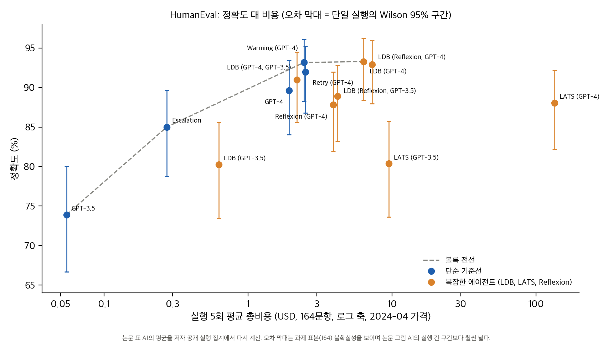
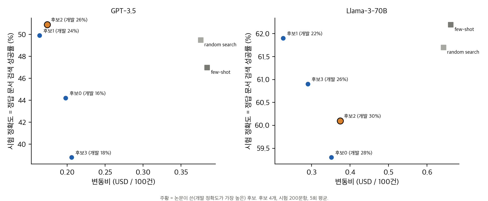

# 정확도가 같다는 말을 믿으려면

에이전트 논문에서 "새 구조가 정확도를 올렸다"는 주장은 흔합니다. Kapoor, Stroebl, Siegel, Nadgir, Narayanan의 *AI Agents That Matter* (TMLR 2025)는 반대 방향의 주장으로 유명합니다. 코드 생성 벤치마크 HumanEval에서 **같은 모델을 최대 5번 다시 시도하는 것만으로** LDB, LATS, Reflexion 같은 복잡한 에이전트와 정확도가 같고 비용은 훨씬 적다는 것입니다. 이 글은 저자가 공개한 실행 결과로 그 주장과 몇 개의 표를 직접 다시 계산해 본 기록입니다. 코드는 실행하지 않았고 API도 부르지 않았습니다. 분석한 판은 arXiv v1입니다.

## 수치는 맞습니다

저자 저장소에는 에이전트마다 5회 실행의 과제별 통과 여부와 토큰·비용 로그가 있습니다. 논문 표 A1의 13개 행(정확도 평균과 최소·최대, 비용)을 여기서 다시 계산하면 정확도는 0.063%p, 비용은 0.005 USD 안에서 모두 맞습니다. 비용도 토큰 수에 단가(GPT-4-turbo 입력 10, 출력 30 USD/1M)를 곱한 값과 같습니다. 표 A3(HotPotQA)과 표 A5(NovelQA)도 같은 방식으로 맞았습니다. 즉 이 논문의 표는 믿고 인용해도 됩니다.

흥미로운 것은 LDB의 비용 구성입니다. 총비용에서 토큰 곱을 빼면 남는 값이 같은 실행 번호의 **시드 프로그램을 만든 비용과 소수점까지 같습니다**. "LDB (GPT-4, GPT-3.5)"의 2.19 USD 중 1.93이 GPT-4가 처음 쓴 프로그램의 비용이고, GPT-3.5 디버깅은 0.26뿐입니다. 이름의 괄호도 그림 설명(생성, 디버그)과 저장소의 파일 이름(디버거, 시드)이 반대 순서입니다.

## "정확도가 같다"는 얼마나 같은가

논문의 구간(그림 A1)은 같은 164문항으로 5번 돌렸을 때의 변동입니다. 어려운 문항은 매번 틀리므로 이 변동은 작아서, 실행 간 표준편차는 0.5–1.9%p이고 이항 모형이 말하는 표준편차는 2.0–3.4%p입니다. 문항 표본이 달라졌을 때의 변동은 들어 있지 않습니다. 그래서 과제 단위로 짝을 지어 부트스트랩했습니다.

| 비교 | 차이 (%p) | 95% 구간 | 동등 한계 |
|---|---|---|---|
| Warming 대 LDB (GPT-4) | −0.12 | −2.3 ~ +2.0 | 1.95 |
| Warming 대 LDB (Reflexion, GPT-4) | +0.24 | −2.9 ~ +3.5 | 2.93 |
| Warming 대 LDB (GPT-4, GPT-3.5) | +2.20 | −0.1 ~ +4.8 | 4.27 |
| Warming 대 Reflexion (GPT-4) | +5.37 | +2.4 ~ +8.7 | 8.05 |

Warming(온도를 0에서 0.5로 올려 가며 재시도)과 가장 정확한 LDB 변형의 차이는 −0.12%p입니다. 그러나 이것은 "차이가 없다는 증거"가 아니라 "±2%p보다 큰 차이는 배제된다"입니다. 동등 한계는 90% 구간의 절대 최대로, 이 값 이내로 동등하다고 말할 수 있는 가장 좁은 한계입니다. 164문항에서 두 에이전트의 과제별 통과율 차이의 표준편차가 13.9%p라 표준오차는 1.09%p이고, 80% 검정력으로 구분되는 최소 차이는 약 3%p입니다. 그리고 GPT-4 기반 상위 에이전트에서 모든 실행이 맞히는 문항이 123개, 모두 틀리는 문항이 4개라 **변별하는 문항은 37개뿐**입니다. HumanEval은 이미 포화된 영역입니다.

비용 쪽 주장도 단서가 붙습니다. Warming 대비 비용은 LATS (GPT-4) 54.9배, LDB (GPT-4) 2.6배, Reflexion 1.6배로 "50% 넘게"가 맞지만, LDB (GPT-4, GPT-3.5)는 0.89배로 오히려 11% 쌉니다(정확도는 2.2%p 낮고 구간 하한이 −0.1). "LDB가 비싸다"는 변형을 지정해야 맞습니다.

## 디버깅은 재시도보다 얼마나 더하나

LDB (GPT-4, GPT-3.5)의 시드는 GPT-4 zero-shot 프로그램이므로, 시드 대비 이득이 디버깅의 순수 기여입니다. 이 값은 +1.34%p(구간 −0.1 ~ +3.2)입니다. 같은 기준선에서 Retry는 +2.32%p(구간 +0.7 ~ +4.2), Warming은 +3.54%p(구간 +1.6 ~ +6.0)입니다. 같은 모델로 디버깅하는 LDB (GPT-4)는 +3.66%p로 Warming과 같습니다. 디버깅 신호(공개 테스트의 통과·실패)를 쓰는 재시도가 이득의 대부분이라는 점은 `self_debug/`(Self-Debug)와 `agentdebug/`(Best-of-N이 이득의 75–77%)에서 본 구조와 같은 방향입니다. 다만 이 논문의 증거는 한 벤치마크입니다.

## 비용 순서는 가격에 안정적인가

2.3절은 비용 비율이 모델 단가가 바뀌어도 안정적이라고 합니다. 볼록 전선(GPT-3.5, Escalation, Warming, LDB (GPT-4))은 GPT-4 단가를 0.06배에서 3배까지 바꿔도, 2023-06판 모델 자료로 다시 그려도 같았습니다. 하지만 비용 배수는 최대 1.7배 흔들립니다(LATS 54.9배 대 92.7배). 본문은 전선이 "유의하게 지배되지 않는" 점이라 하고 부록은 "평균 기준 비지배에 볼록"이라 정의해 두 정의가 다릅니다. 부록 정의에서는 LDB (GPT-4)도 전선 위입니다.

## HotPotQA 결합 최적화: 절감은 확실, 정확도 유지는 느슨

DSPy에 Optuna를 붙여 정확도와 프롬프트의 시연 토큰 수를 함께 최적화하면 변동비가 GPT-3.5에서 53–55%, Llama-3-70B에서 42–43% 줄어듭니다. 비용은 토큰에서 정해지므로 이 부분은 믿을 수 있습니다. 문제는 "정확도 유지"입니다. 보고 지표는 답 정확도가 아니라 **정답 문서를 모두 검색했는가**이고, 200문항에서 짝지은 비교의 동등 한계는 ±6–9%p입니다. 답 정확 일치로 보면 GPT-3.5의 결합 최적화(0.479)가 few-shot(0.501)과 random search(0.517)보다 낮습니다.

또 하나. Optuna가 낸 후보 4개 중 논문은 50문항 개발 정확도가 가장 높은 것을 보고했습니다. Llama에서는 개발 정확도가 가장 낮은 후보(0.22)가 시험에서 정확도 0.619로 가장 높으면서 비용도 가장 낮아 few-shot 대비 66%를 줄입니다(보고된 후보는 43%). 비용을 줄이는 최적화인데 후보를 고르는 규칙은 비용을 쓰지 않았습니다. 이것은 시험 결과를 본 뒤의 사후 관찰이지 더 좋은 규칙의 증거는 아닙니다.

## 작은 불일치들

손익분기는 본문 1,350건, 부록 그림 캡션 1,332(Llama)와 1,275(GPT-3.5), 우리 계산 1,331과 1,275입니다. 홀드아웃 조사의 "계획도 없는 벤치마크 7개"는 표 A4에서 MINT와 τ-bench가 갱신 계획을 언급하므로 5개입니다. 표 1의 수준별 집계(1/1, 3/6, 1/8, 0/2)는 표 A4와 맞습니다. 재현성 표 A7에서 보고 정확도는 7개 중 4개가 우리가 센 5회 실행의 최대 위에 있습니다(LATS 94.4 대 최대 91.5 등). 이 논문의 그림 1 파레토 점선은 노트북에 좌표가 손으로 적혀 있지만, 값은 평균과 같고 예제 노트북의 알고리즘으로도 같은 네 점이 나옵니다.

## 정리

- 표와 비용 산술은 맞습니다. 비율과 방향도 대체로 맞습니다.
- "같다"는 ±2%p 안에서이고, 164문항의 해상도는 약 3%p입니다. HumanEval은 변별 문항이 37개로 포화되어 있습니다.
- 복잡한 에이전트의 순수 이득(디버깅 +1.3%p)은 단순 재시도(+2.3%p)보다 작지만 구간이 넓습니다.
- 결합 최적화의 비용 절감은 확실하나 정확도 유지는 지표와 구간에 따라 다릅니다.
- 이 결과를 인용할 때는 구간 폭과 한 벤치마크라는 한계를 함께 적으세요. 재계산 스크립트와 자료는 분석 노트(`recompute.py`, `source_data/`)에 있습니다.

## 자료

- [통합 리포트 PDF](report/report_public.pdf)
- [01 논문 분석: AI Agents That Matter (arXiv:2407.01502)](analysis/01_paper_analysis.md)
- [02 계보와 관련 연구](analysis/02_prior_work.md)
- [03 재계산과 통계 검정](analysis/03_analysis.md)
- [04 논문 대 공식 코드 정적 대조](analysis/04_code_verification.md)
