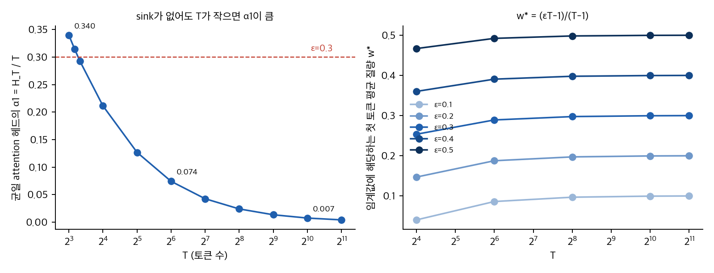
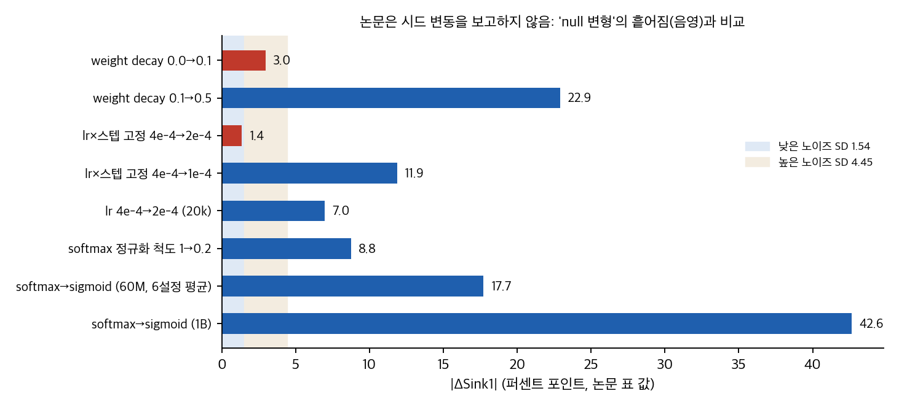
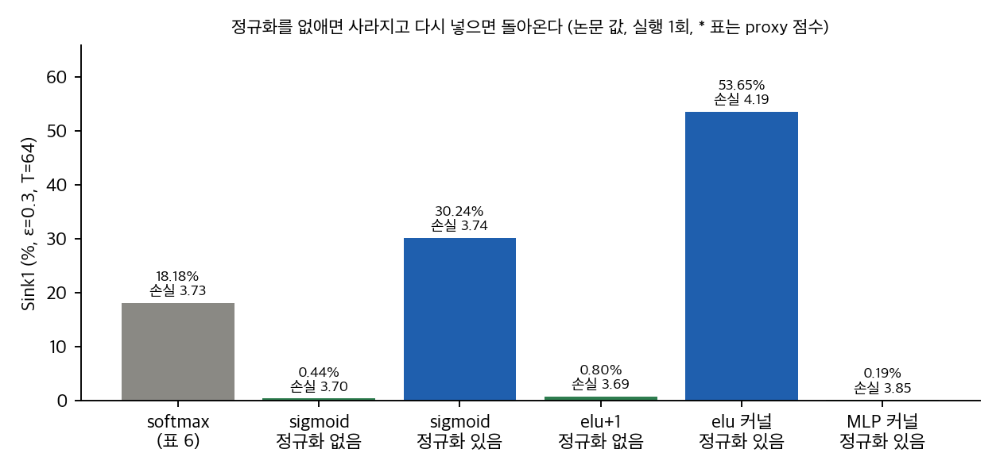
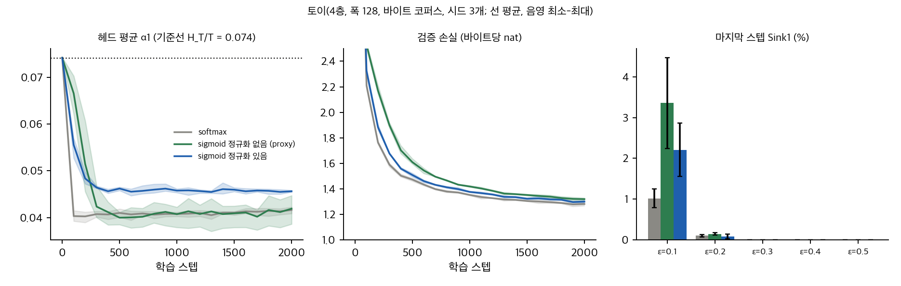
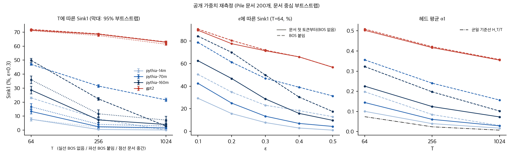

> **논문:** Gu et al. *When Attention Sink Emerges in Language Models: An Empirical View.* ICLR 2025, arXiv:2410.10781 (v2). 논문은 arXiv 비독점 배포 라이선스라 논문 그림은 싣지 않았고 그림은 모두 직접 그린 것입니다. 논문 표에 인쇄된 값으로 계산했고 공식 코드는 읽기만 했으며 실행하지 않았습니다. 마지막 절의 공개 가중치 측정은 같은 지표 정의를 직접 구현해 썼습니다.

## 논문이 묻는 것

LM은 의미 없는 첫 토큰에 attention을 몰아 줍니다(attention sink). 저자들은 60M 모델을 Pile 5B 토큰으로 직접 학습하며 학습률, weight decay, 데이터량, 손실, 위치 임베딩, attention bias, 정규화를 하나씩 바꿔 sink가 언제 생기는지 봅니다. 결론은 충분한 데이터와 효과적 최적화 뒤에 생기고, sink는 값 계산에 기여하지 않는 key bias처럼 작동하며, softmax 정규화를 없앤 sigmoid attention에서는 1B까지 생기지 않는다는 것입니다.

## 1. 지표의 임계값은 눈금이 아닙니다

헤드의 첫 토큰 중요도 α₁ = (1/T)Σᵢ A_{i,1}이 ε=0.3을 넘으면 sink로 셉니다. 식 자체는 공식 코드와 일치합니다. 다만 모든 질의가 같은 비중으로 보는 균일 헤드도 α₁ = H_T/T가 되어 T=64에서 0.074이고, T≤9에서는 ε=0.3을 넘습니다. 임계값 ε=0.3은 "질의의 평균 28.9%를 첫 토큰이 가져간다"에 해당합니다(T=64). 서로 다른 T의 값은 직접 비교되지 않습니다. 부록의 Rotary 상한(명제 4)은 q·k 크기 ξ가 1.09 이하일 때만 α₁<0.3을 보증하므로, 표 1의 "반복 토큰에서 0.00"은 명제가 아니라 경험적 관찰입니다.

*왼쪽: 균일 attention 헤드의 α₁. 오른쪽: 임계값 ε에 대응하는 첫 토큰 평균 질량.*

## 2. 모든 표가 실행 1회입니다

공식 설정의 시드는 42 하나이고 표에는 구간이 없습니다. 논문이 "영향 없음"이라고 한 변형(FFN 활성함수, 배치 크기)의 Sink는 표준편차 1.5 정도로 흩어지고(위치 임베딩과 헤드 수까지 합치면 4.5), 이를 노이즈의 대용 척도로 삼아 보면:

- weight decay 0.0 → 0.1의 +3 pp와, lr×스텝을 고정한 4e-4 → 2e-4의 −1.4 pp는 노이즈와 구분되지 않습니다.
- weight decay 0.1 → 0.5(+22.9 pp), softmax → sigmoid(−17.7 pp 평균, 1B에서 −42.7 pp)는 뚜렷합니다.
- 학습률이 작을수록 sink가 약하다는 결과는 검증 손실이 함께 변해(상관 0.84) 학습이 덜 끝난 효과와 분리되지 않습니다.
- 위치 임베딩은 "영향 없음"이지만 Sink는 18–33%로 세기는 다릅니다. "출현을 막지 못한다"로 읽어야 합니다.

*막대: 표 값의 차이, 음영: 대용 노이즈. 시드 반복이 아니라 대용 척도입니다.*

## 3. 정규화를 없애면 사라지고, 다시 넣으면 돌아옵니다

sigmoid 정규화 없음은 학습률 3종과 weight decay 4종 조합 6개에서 모두 0.18–0.81%이고 정규화를 다시 넣으면 30.24%입니다. 핵심 대조는 일관됩니다. 단, 정규화 없는 모델의 Sink는 sim/Σsim으로 정규화한 proxy 점수로 잰 것이어서 softmax와 같은 척도의 비교는 아닙니다. 또 sigmoid와 elu는 검증 손실이 softmax와 같거나 낮지만, MLP·identity 커널은 0.12–0.26 더 나쁩니다.

*논문 표 6, 14의 값입니다.*

## 4. 표 산술과 데이터 양 실험

- 표 5에서 sink가 bias에서 첫 토큰으로 "이동"한다지만 두 지표의 합은 73.3에서 11.2까지 줄어 총량이 보존되지 않습니다.
- 표 13은 key bias 차원이 늘수록 sink가 뚜렷해진다고 하나 8 → 16 차원에서 31.4 → 23.3으로 단조가 아닙니다.
- 배치 1M 토큰 × 20k 스텝은 약 21B 토큰으로 5B 데이터를 4.2회 반복합니다. 같은 스텝에서 데이터를 50M으로 줄이면 419회 반복이라, 데이터 양 실험의 "sink가 사라진다"는 다양성 부족과 반복이 섞인 결과입니다.

## 5. 공개 코드와의 차이

54개 설정이 모두 최소 학습률을 학습률과 같게 두어 워밍업 뒤 학습률이 상수입니다(논문은 cosine). 표 9의 학습률 행(8e-4, 2e-4 등)은 공개 설정에 없고, 측정은 학습 데이터가 아닌 `probe_valid.jsonl` 문서 앞 64토큰으로 합니다. weight decay는 손실의 L2가 아닌 AdamW 분리형입니다. 결과 로그는 저장소에 없습니다.

## 6. 소형 토이: 방향 확인에 실패했습니다

4층, 폭 128, RoPE의 직접 짠 모델을 파이썬 표준 라이브러리 소스(바이트 코퍼스)로 2,000스텝 학습해 softmax, sigmoid(정규화 없음), sigmoid(정규화 있음)를 시드 3개씩 돌렸습니다. **softmax에서도 Sink(ε=0.3)가 0%였습니다.** 모든 헤드의 α₁이 균일 기준선 0.074 아래였고, 세 변형의 차이는 ε=0.1에서 0.8–4.6%일 뿐입니다. 논문의 방향(18% 대 0.4%)을 확인하지도 반박하지도 못합니다. 문맥 64, 0.7M 파라미터, 2k 스텝으로는 첫 토큰을 "아무것도 안 하는 자리"로 쓸 압력이 약했을 수 있습니다(가설).

## 7. 공개 가중치로 다시 재 보면: BOS, ε, T

Pythia-14M/70M/160M과 GPT-2(최종 체크포인트, fp32, CPU)에 Pile 문서 200개(시드 0)를 넣어 같은 지표를 BOS 유무, ε, T를 바꿔 쟀습니다. 신뢰구간은 문서 부트스트랩이고 학습 시드 변동은 없습니다. 두 모델군의 토크나이저는 기본으로 BOS(`<|endoftext|>`)를 붙이지 않으므로 공식 측정 코드를 그대로 쓰면 "BOS 없음"입니다.

- **Pythia-14M에도 sink가 있으나 약합니다.** T=64, ε=0.3에서 7.8% [6.5, 8.9], BOS를 붙이면 23.1%입니다. 70M 13.4%, 160M 28.7%, GPT-2 71.4%로 규모에 따라 늘어납니다. 크기가 비슷한 내 토이(0.7M)의 0%는 모델 크기만의 문제가 아니었습니다.
- **BOS의 효과는 모델에 달렸습니다.** Pythia에서는 +15–34 pp이고 GPT-2에서는 +0.6 pp입니다. 한 모델군에서 BOS를 무시해도 된다고 일반화할 수 없습니다.
- **문서 첫 토큰부터 재는 방식**(논문 코드)은 문서 중간에서 시작하는 입력보다 Pythia-70M/160M에서 3–7 pp 낮고 다른 두 모델에서는 구분되지 않습니다.
- **ε와 T가 순위를 바꿉니다.** T가 커지면 모든 모델에서 Sink가 줄고 기준선 H_T/T를 빼고도 줄어듭니다. BOS를 붙이면 70M과 160M의 순서가 ε=0.3과 0.4 사이, 그리고 T=1024에서 뒤바뀝니다.

*색은 모델, 선 모양은 입력 조건(실선 BOS 없음, 파선 BOS, 점선 문서 중간)입니다.*

한계: 모델 4개, 최종 체크포인트만, 논문의 60M LLaMA형 모델과 구조가 다르고 bf16 측정은 재현하지 않았습니다. LLaMA·Mistral의 기본 BOS 동작은 확인하지 못했습니다.

## 인용할 때

- 인용해도 되는 것: sink의 정의, "softmax 정규화를 없애면 60M과 1B에서 sink가 없다"(proxy 지표, 1B는 실행 1회).
- 단서: 모든 표 실행 1회, 작은 차이는 구분 불가, 학습률 효과는 손실과 분리 불가, 결론은 60M 사전학습에 한정.

## 자료

- [통합 리포트 PDF](report/report_public.pdf)
- [01. 논문 분석: When Attention Sink Emerges in Language Models: An Empirical View](analysis/01_paper_analysis.md)
- [02. 선행 연구, 계보, 관련 분석](analysis/02_prior_work.md)
- [03. 식 검산, 표 재계산, 시드 변동 점검, CPU·MPS 토이](analysis/03_analysis.md)
- [04. 논문과 공식 코드 대조 (`sail-sg/Attention-Sink`)](analysis/04_code_verification.md)
