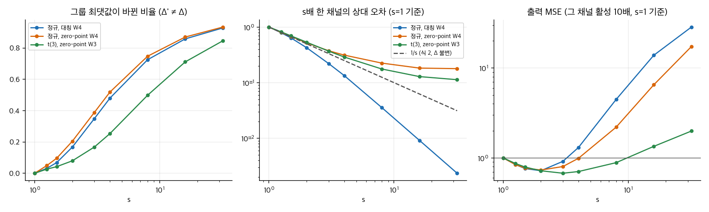
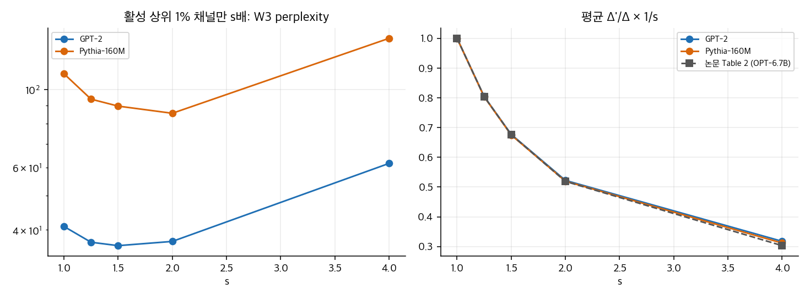
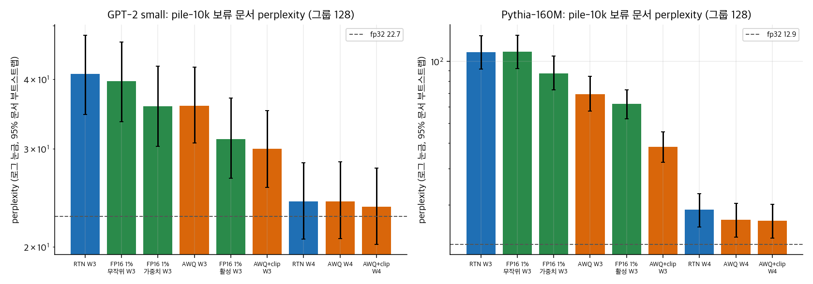

# AWQ가 실제로 일하는 것은 무엇인가

AWQ(Lin et al., MLSys 2024)의 주장은 간단합니다. 가중치 전용 저비트 양자화에서 중요한 가중치는 전체의 1% 정도이고, 어느 채널이 중요한지는 **가중치 크기가 아니라 곱해지는 활성의 크기**로 알 수 있습니다. 그 채널을 FP16으로 남기면 하드웨어에 불리하니, 대신 가중치에 s를 곱하고 입력을 s로 나눠 상대 양자화 오차를 줄입니다. 이 글은 이 알고리즘을 직접 짜서(`minimal_impl.py`, CPU, 테스트 20개) 식의 가정이 어디서 깨지는지, 그리고 작은 모델에서 이득이 어디서 나오는지를 숫자로 확인한 기록입니다. 논문 그림은 쓰지 않았고(arXiv 라이선스가 CC가 아님) 그래프는 모두 직접 그렸습니다. 공식 코드는 읽기만 했고 실행하지 않았습니다.

## 식 2: 왜 s > 1이 오차를 줄이나

그룹 가중치의 한 원소 w를 s배 하면 양자화 격자 간격이 Δ에서 Δ'로 바뀝니다. 오차는 Δ'·RoundErr(ws/Δ')·x/s이므로 원래 오차 대비 비가 **(Δ'/Δ)·(1/s)**입니다. 그룹 최댓값이 안 바뀌어 Δ' ≈ Δ이면 오차는 정확히 1/s로 줄어듭니다.

그룹 2만 개로 확인하면 s ≤ 1.5에서 측정한 오차비가 1/s와 맞습니다. 그러나 **s = 2에서 그룹의 17-20%, s = 4에서 약 50%가 최댓값이 바뀌어** Δ' ≠ Δ이고, 이 그룹에서는 나머지 채널의 오차가 Δ'/Δ만큼 커집니다. 그 결과 출력 오차는 s가 2-3일 때 최소가 되고(키운 채널의 활성이 10배라고 가정), 이후 다시 늘어납니다. 논문 Table 2의 "s = 2에서 최적, s = 4에서 다시 나빠짐"과 같은 모양입니다. 하나 더: 대칭 양자화에서는 키운 원소가 그룹 최댓값이 되면 격자점에 정확히 놓여 오차가 0이 되므로, 논문 Table 2의 "평균 Δ'/Δ × 1/s"는 실제 오차비보다 보수적입니다(zero-point 비대칭에서는 일치).

## 실제 모델에서

GPT-2 small과 Pythia-160M에서 활성 상위 1% 채널만 s배 하면 "평균 Δ'/Δ × 1/s"가 논문 OPT-6.7B 값과 소수 둘째 자리까지 맞았고(s = 2: 0.522, 0.520 대 0.519), 최적 s는 1.5-2였으며 s = 4는 RTN보다 나빴습니다.

FP16으로 남길 1% 채널을 활성, 가중치 노름, 무작위로 고르면 W3에서 활성 기준이 가장 낫습니다(GPT-2 RTN 40.9 → 활성 31.3, 가중치 35.8, 무작위 39.7. Pythia-160M 110.7 → 62.2, 87.2, 111.5. 문서 단위 부트스트랩 Holm 보정 p 0.003 이하). 다만 논문 OPT에서는 가중치 기준이 RTN과 거의 같았는데 우리 모델에서는 무작위보다 유의하게 낫습니다.

## scale과 clipping 중 무엇이 일했나

AWQ의 scale(층 출력 손실로 α 탐색)은 W3에서 RTN 대비 perplexity를 GPT-2 12%, Pythia 37% 낮췄고 W4에서는 Pythia만 11% 낮췄습니다(GPT-2는 +0.2%, CI [-1.1, +1.5]%로 RTN과 구분되지 않음). 가중치 clipping을 더하자 W3에서 추가로 16%(GPT-2), 45%(Pythia) 낮아졌습니다. **작은 모델 둘에서는 AWQ의 이득 중 scale의 몫이 절반 이하**였고, 논문은 clipping을 한 문장으로만 서술합니다. 또한 같은 1%를 FP16으로 두는 혼합 정밀도가 scale만 한 것보다 낫습니다(비율 1.15, 1.11).

주의할 점이 세 가지 있습니다. ① 우리 "AWQ"는 층 출력 손실이고 공식 코드는 블록 출력 손실을 씁니다. ② 보정 추출은 시드 하나이며, 보정 문장 수를 4, 8, 32개로 바꾸자 오히려 적을 때 좋아지는 경우가 있었습니다(Pythia W3 56.0, 59.0, 69.3). 신뢰구간은 평가 문서 표집만 반영합니다. ③ 모델이 작아서(124M, 162M) 논문의 7B-65B 결과로 옮길 수 없습니다. 4비트 g128도 이 규모에서는 FP32보다 4-6%(GPT-2), 30-47%(Pythia) 나쁩니다.

## 온디바이스 산술과 형식

Llama-2-7B(6.738B 파라미터)를 W4 g128로 만들면 블록 선형은 가중치당 4 + 32/128 = 4.25비트(그룹마다 FP16 scale과 zero), 임베딩과 lm_head는 FP16이라 **가중치 3.97 GB(3.70 GiB), 압축비 3.4배**입니다(이름값 4배가 아님). KV 캐시(컨텍스트 4096, FP16) 2.0 GiB를 더해도 약 5.7 GiB라 24 GB 맥에 여유 있게 들어갑니다. 논문의 "HF FP16 대비 3.2-3.3배"는 커널 융합 이득(62/52 = 1.19배)을 포함하며, 4090 대역폭(1 TB/s) 상한 대비 달성도는 FP16 융합 84%, W4 76%입니다.

맥에서 쓰는 형식과의 관계(정적으로 읽음): AWQ는 저장 형식이 아니라 가중치를 바꾸는 전처리이므로 MLX affine 양자화(`mlx-lm`의 `mlx_lm.awq`가 같은 탐색을 구현. 기본 그룹 64, 격자 10), GGUF Q4_0/Q4_1/Q4_K 같은 그룹 형식 위에 올릴 수 있습니다. llama.cpp는 스케일 흡수 대신 imatrix로 활성 정보를 반올림 오차의 가중에만 씁니다. 같은 "4비트"라도 비트 예산이 4.25(AWQ g128), 4.5(Q4_K, 그룹 64 FP16 scale+bias)로 달라서 perplexity 비교는 실제 비트로 맞춰야 합니다. MLX의 저장 dtype은 확인하지 못했습니다.

## 공식 코드와 논문의 차이 (정적 읽기)

손실이 **블록 출력**이라는 점(논문 식 4는 층), 기본 양자화기가 **zero-point 비대칭**이라는 점(식 1은 대칭), α 격자에 1.0이 없다는 점(0.95까지), 스케일을 `s/√(max·min)`로 정규화한다는 점(결과에는 영향 없음), clip이 입력 의존 출력 MSE이고 대칭 클램프라는 점, 보정이 512토큰 이하 문서 128개라는 점, GPT-NeoX는 attention 출력 스케일이 없다는 점 등 12개를 정리했습니다(`analysis/04_code_verification.md`).

## 한계

- 속도는 재지 않았습니다(GPU와 공식 코드 실행 없음). 시뮬레이션 양자화입니다.
- 모델 둘, 평가 문서 64개(약 2.5만 토큰), 보정 추출 하나입니다.
- 논문 표 재계산에서 Table 1의 6칸이 RTN보다 나쁘고, Table 1과 3의 OPT-1.3B RTN이 119.00 대 119.47로 다릅니다. Table 4의 INT4 g128에서 AWQ와 GPTQ-R의 차이는 7개 모델 모두 -0.01 ~ -0.05 PPL로 부호는 일관되나 신뢰구간이 없습니다.

## 자료

- [최소 구현](analysis/minimal_impl.py)
- [01. AWQ 논문 분석](analysis/01_paper_analysis.md)
- [02. 계보와 이웃 연구](analysis/02_prior_work.md)
- [03. 검산과 구현 실험](analysis/03_analysis.md)
- [04. 논문 ↔ 공식 코드 대조 (정적)](analysis/04_code_verification.md)
