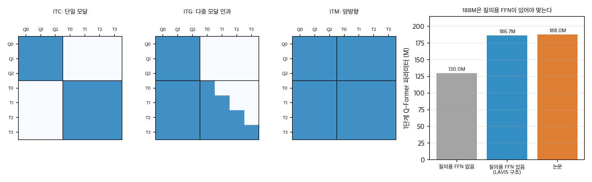
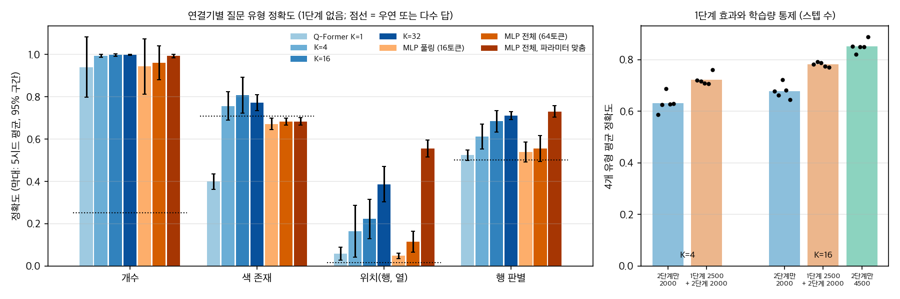

# BLIP-2의 Q-Former를 직접 짜 보면

Li et al.의 *BLIP-2*(Salesforce, ICML 2023)는 고정된 이미지 인코더와 고정된 LLM 사이에 **학습 가능한 질의 32개**를 가진 Q-Former를 두고, 이미지 크기와 상관없이 시각 정보를 고정 개수 토큰으로 압축합니다. 1단계는 세 목적(ITC, ITM, ITG)을 서로 다른 self-attention 마스크로 함께 학습하고, 2단계는 질의 출력을 선형 투영해 LLM의 소프트 프롬프트로 넣습니다. 이 글은 구조를 식과 마스크로 검산하고, 작은 PyTorch 구현과 합성 데이터로 성질을 확인하고, 공식 코드(LAVIS)와 정적으로 맞춰 본 기록입니다. **토이는 논문 재현이 아닙니다.** 논문의 수치는 하나도 재측정하지 않았습니다.

## 세 마스크가 정보 흐름을 정한다

세 목적은 같은 파라미터와 같은 입력 형식을 쓰고 **질의와 텍스트가 서로 볼 수 있는지**만 바꿉니다(그림 왼쪽 세 행렬, 행이 보는 쪽).

- **ITC(단일 모달):** 질의와 텍스트가 서로 못 봅니다. 질의 32개의 출력과 텍스트 [CLS] 출력의 코사인 중 **최댓값**을 이미지-텍스트 유사도로 씁니다(K = 1이면 평범한 CLIP식 코사인). 이미지→텍스트 행렬의 전치가 텍스트→이미지 행렬이라 한 행렬로 대칭 손실을 계산합니다.
- **ITG(다중 모달 인과):** 질의는 텍스트를 못 보고 텍스트는 모든 질의와 앞쪽 텍스트를 봅니다. 이미지 특징은 교차 attention으로 **질의 위치에만** 들어가므로, 텍스트가 이미지를 알려면 반드시 [이미지 → 질의 → 텍스트] 경로를 거칩니다. 그래서 질의 32개가 "텍스트 생성에 필요한 정보를 전부" 담아야 하고, 질의는 텍스트를 보지 못해 **무엇을 묻는지 모른 채** 압축합니다.
- **ITM(양방향):** 모두가 모두를 봅니다. 질의별 2-클래스 로짓의 평균이 매칭 점수입니다.

12층 모델(교차 attention이 층 0, 2, ..., 10)에서 층별로 이미지를 바꿔 보면, 질의 표현은 층 0부터, ITG와 ITM의 텍스트 표현은 층 1부터 달라지고 ITC의 텍스트 표현은 끝까지 달라지지 않습니다. ITC에서는 한 번의 마스크 순전파가 공식 코드처럼 질의와 텍스트를 따로 돌린 결과와 같고, ITG에서 질의 출력은 텍스트를 바꿔도(또는 텍스트를 빼도) 같습니다. 공식 코드는 이 사실을 이용해 질의의 키·값(`past_key_values`)을 재사용합니다. 이 성질들을 pytest 21개로 확인했습니다.

## 188M은 논문에 없는 FFN이 있어야 맞는다

논문은 Q-Former가 188M이고 "같은 self-attention 층을 공유"한다고만 씁니다. BERT-base(12층) + 격층 교차 attention(ViT-g 폭 1408) 구조를 편향과 LayerNorm까지 세면 **질의용 FFN이 텍스트용 FFN과 따로 있을 때 186.7M, 없을 때 130.0M**입니다(그림 오른쪽). 공식 코드의 `BertLayer`는 실제로 `intermediate_query`와 `output_query`를 따로 둡니다. 2단계에서 텍스트 쪽(어휘·위치 임베딩, 텍스트 FFN, LM 헤드)을 떼어 내고 LLM 입력 차원으로 가는 선형 투영을 더하면 표 2의 학습 파라미터 104M, 107M, 108M 여섯 값이 모두 0.3M 안에서 맞습니다. "Flamingo보다 54배 적다"는 10.2B / 188M = 54.3이고, 표 2의 같은 모델(108M)로 나누면 94배입니다.

## 합성 장면 토이: 압축은 어떤 과제에서 손해인가

설정: 8 x 8 칸에 색 물체 1–4개의 합성 장면을 **고정된 무작위 인코더**(칸마다 32차원 특징 64개)로 인코딩하고, 텍스트(캡션 + 질문 + 답)로만 사전학습한 뒤 **고정한 작은 디코더**(23만 파라미터) 앞에 소프트 프롬프트로 붙입니다. 연결기만 학습합니다(2,000스텝). 질문 네 유형: 개수, 색 존재, 위치(행과 열), 행 판별. 정답 캡션을 글자로 주었을 때의 상한(오라클)은 개수와 색 존재 100%, 행 판별 95.8%, **위치 78.0%**입니다. 5시드, t 95% 구간. **논문 재현이 아닙니다.**

- **질의 수:** Q-Former의 질의를 1, 4, 16, 32개로 키우면 4개 유형 평균이 48.0, 63.1, 67.7, 71.7%이고, 위치는 5.8, 16.3, 22.2, 38.6%로 가장 크게 오릅니다. 개수는 질의 4개부터 99%를 넘습니다. 전역 요약 질문은 질의 몇 개로 충분하고 칸 단위 조회가 압축에서 손해를 봅니다.
- **MLP와 비교할 때의 함정:** 패치 64개를 전부 넘기는 MLP 투영기는 파라미터가 12K일 때 57.8%로 Q-Former에 졌습니다. 그런데 파라미터를 Q-Former와 같은 약 24만으로 맞추면 **74.0%로 K = 16(67.7%)보다 6.3%p 높고 K = 32와는 구분되지 않으며**, 위치는 55.4% 대 38.6%로 MLP가 앞섭니다. 색 존재는 Q-Former가 7–12%p 앞섭니다. "Q-Former가 낫다/MLP가 낫다"는 부호가 파라미터 수와 수렴에 따라 바뀌었으므로, 이 토이는 압축이 **위치 조회에서 손해이고 전역 질문에서 이득**이라는 방향만 줍니다. 후속 문헌(LLaVA-1.5, MM1, Honeybee, Cambrian-1)이 보고한 방향과 같습니다.
- **1단계의 효과:** ITC + ITM + ITG를 먼저 학습한 뒤 2단계로 가면 같은 2단계 스텝에서 평균 +10.4%p(K = 16, 구간 [7.2, 13.6])입니다. 그러나 2단계만 4,500스텝(총 스텝을 맞춤) 학습한 대조군은 **85.2%로 1단계 + 2단계(78.1%)보다 7.1%p [3.2, 11.0] 높았습니다.** 이 토이에서 1단계의 이득은 학습량으로 설명됩니다. 논문의 그림 5(1단계가 없으면 VQA가 크게 낮음)와 그 대조군의 총 학습량이 다르다는 점(250k + 80k 대 80k 스텝)을 같이 보면, 그림 5는 "1단계가 필요하다"의 증거로 읽기에 조건이 많습니다. 후속 문헌(Prismatic, LLaVA-1.5)은 MLP 연결기에서는 이런 정렬 단계가 불필요하다고 보고합니다.
- 한계: 모든 연결기가 수렴 전이고, 디코더가 캡션 글자를 읽는 모델이라 Q-Former에 유리한 편향이 있을 수 있으며, 이미지 인코더가 무작위 MLP라 실제 ViT 특징과 다릅니다.

## 공식 코드와 다른 점

- 텍스트와 이미지를 섞는 마스크를 **명시적 행렬이 아니라 경로 분리와 KV 재사용**으로 구현(기능은 같음). ITM의 어려운 음성은 argmax가 아니라 유사도 softmax **표본추출**.
- 논문에 없는 값: ITC 투영 차원 256, 학습되는 온도(초기 0.07, clamp 없음), **ITC와 ITG 손실의 라벨 평활화 0.1**, 이미지 인코더 뒤의 학습되는 `ln_vision`.
- 이미지 인코더의 "마지막 층 제거"는 EVA ViT-g를 처음부터 39층으로 만드는 것으로 구현됩니다.
- ITC 손실은 라벨 평활화 때문에 0이 될 수 없고 배치 2320에서 하한이 1.0995입니다.

## 인용 전에 알아둘 점

- 표 2의 "더 큰 LLM이 낫다"는 VQAv2 test-dev에서 OPT-2.7B → 6.7B가 +0.3(표본 오차 약 1.4배)이고, 가장 큰 차이는 크기가 아니라 OPT 대 FlanT5(+10.7)입니다. GQA에서는 ViT-L이 ViT-g보다 0.2점 높습니다.
- 표 4의 "개방형 생성 모델 최고"는 Flamingo80B, OFA와의 차이가 0.2–0.3점으로 표본 오차 수준입니다.
- 그림 5(1단계가 없으면 크게 떨어짐)는 모델 두 개, 실행 한 번, 총 학습량이 다른 대조군입니다. 후속 문헌(LLaVA-1.5, Prismatic, MM1)은 MLP 연결기에서는 이런 정렬 단계가 불필요하고 연결기 종류보다 시각 토큰 수와 해상도가 중요하다고 보고합니다(초록 수준 확인).
- 다른 판 차이: arXiv v1 → v2 → v3는 표기(ViT-G → ViT-g)와 참고문헌, 조판 수정이고 수치와 방법은 같습니다.

코드와 결과는 이 글과 함께 올린 분석 노트(`analysis/`)에 있습니다.

## 자료

- [최소 구현](analysis/minimal_impl.py)
- [01. 논문 분석: BLIP-2 (arXiv:2301.12597)](analysis/01_paper_analysis.md)
- [02. 계보와 관련 연구: BLIP-2 (arXiv:2301.12597)](analysis/02_prior_work.md)
- [03. 분석: BLIP-2 (arXiv:2301.12597)](analysis/03_analysis.md)
- [04. 주장 검증: BLIP-2 (arXiv:2301.12597)](analysis/04_claim_verification.md)
