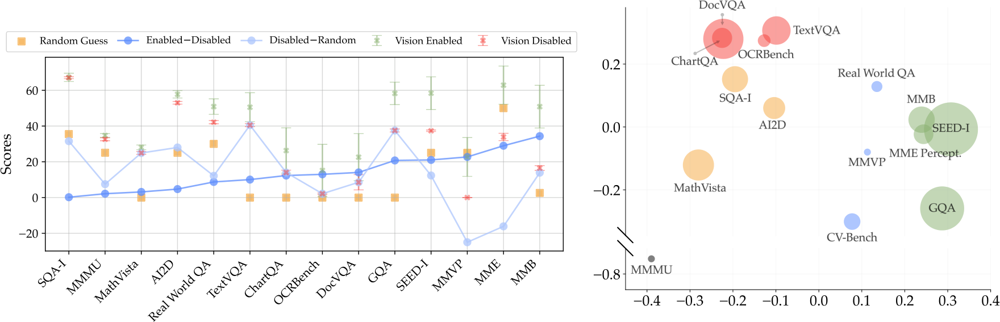
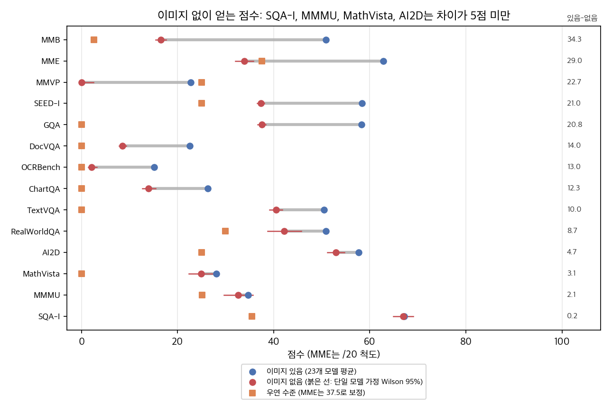
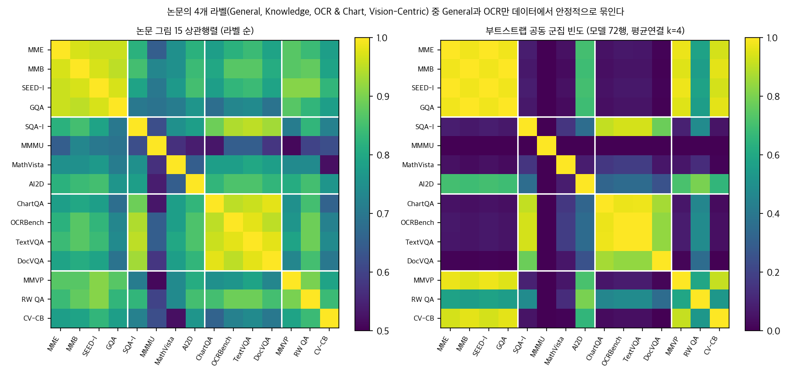
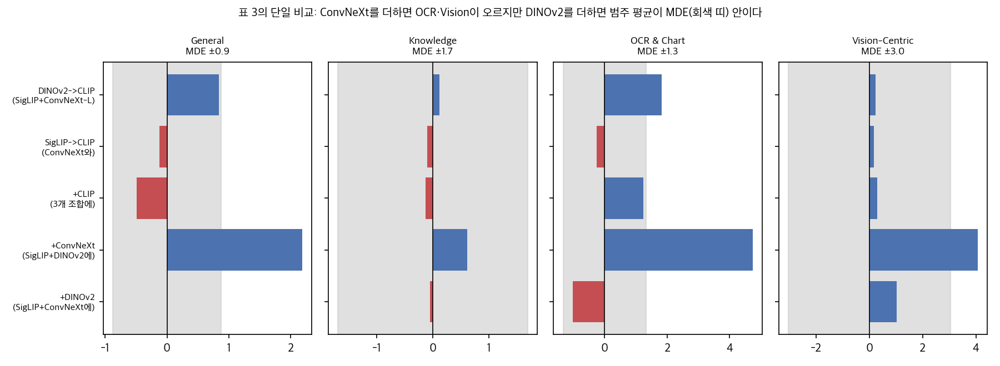
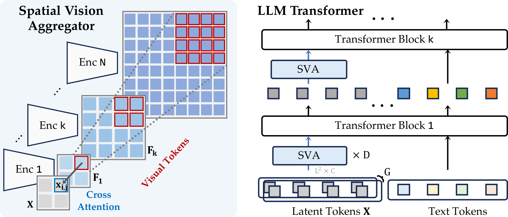
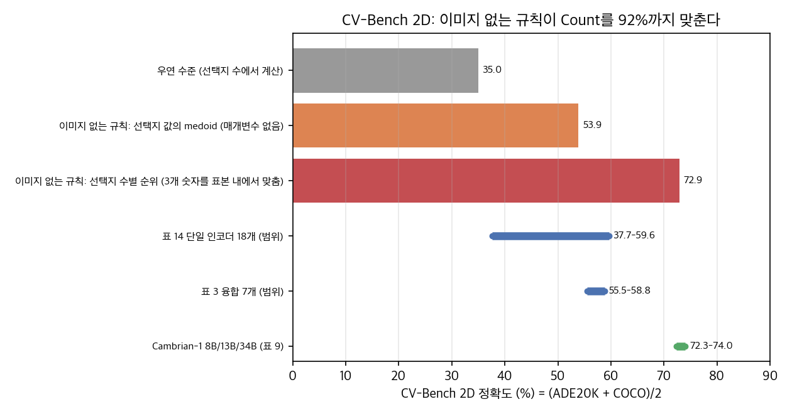

# Cambrian-1 분석: 이미지 없이 풀리는 벤치마크와 비전 인코더 비교, 어디까지 믿을 수 있나

*Cambrian-1* (Tong, Brown 외, NYU, NeurIPS 2024 구두, arXiv:2406.16860 v2)는 같은 LLM(Vicuna-1.5-7B)에 비전 인코더 23종을 바꿔 붙여 비교하고, 벤치마크를 이미지 있음·없음·우연 수준으로 분석하고, 비전 중심 벤치마크 CV-Bench와 공간 비전 집계기 SVA를 제안합니다. 이 글은 부록 표 12–16, 표 3, 그림 3·15를 옮겨 다시 계산하고 CV-Bench의 질문·답 주석(HF)과 공식 코드를 정적으로 대조한 결과입니다. 코드는 실행하지 않았고 가중치도 받지 않았습니다. 모든 차이는 학습 한 번의 결과이고, "MDE"는 두 모델이 20% 문항에서 다르게 답한다고 가정한 쌍체 최소 검출 효과입니다(불일치율은 공개되지 않아 대표값).

## 1. "이미지 없이도 풀린다": 23개 모델의 평균입니다

*그림: 논문 그림 3. © 저자, CC BY 4.0, 출처 arXiv:2406.16860 (v2).*

논문 그림 3 왼쪽의 점은 PDF의 벡터 도형이라 위치에서 값을 복원했습니다. 우연 수준을 아는 마커로 축을 보정하고 두 선("있음−없음", "없음−우연")이 다른 시리즈의 차이와 0.01점 안에서 일치함을 확인했습니다.

- SQA-I, MMMU, MathVista, AI2D의 있음−없음은 0.2, 2.1, 3.1, 4.7점으로 논문의 "5% 미만"이 맞습니다. 단 이것은 23개 모델의 평균입니다. 그림의 "이미지 있음" 평균은 표 14의 18행 평균과 평균 0.30점 차이로 맞아서 1.2M 2단계·동결 설정의 평균이고, 모델별 이미지 없음 점수는 공개되지 않았습니다. 이미지 없음 점수가 인코더에 의존하지 않는다고 가정하면 좋은 인코더 하나(SigLIP SO400M)에서는 SQA-I +5.1, MMMU +3.5, MathVista +4.4, AI2D +8.6입니다.
- **MME의 우연 수준 50은 쓰인 점수 정의와 맞지 않습니다.** 공식 평가 코드는 범주 점수를 100·(정확도 + acc+)로 계산하고 만점 2,000을 20으로 나눕니다. 무작위 예/아니오 답은 정확도 50%, acc+ 25%라 이 척도의 우연 수준은 37.5입니다. 이미지 없음 33.9는 우연보다 3.6점 낮은 것이지 16점이 아닙니다.
- **MMVP의 이미지 없음 0점은 지표의 필연입니다.** 쌍을 둘 다 맞혀야 정답인데 질문과 선택지가 같은 두 이미지에서 이미지를 빼면 답이 같으니 0이 됩니다. "시각 근거화가 중요하다"의 증거가 아닙니다.
- TextVQA와 GQA의 "우연과 약 40% 차이"는 우연 수준이 0인 개방형 지표라 언어 prior의 양일 뿐입니다. 이 모델들은 SQA·AI2D 학습 문항도 봤고, 논문 표 21에 따르면 테스트 이미지의 62.6%(SQA-I), 47.2%(AI2D)가 학습 데이터에 있습니다(질문 수준의 겹침은 확인되지 않음).

## 2. 벤치마크 군집: 넷 중 둘만 안정적입니다

논문은 15개 벤치마크를 점수 상관과 PCA로 General, Knowledge, OCR & Chart, Vision-Centric 넷으로 묶습니다. 그림 15의 상관행렬은 텍스트로 추출돼 그대로 다시 분석할 수 있었습니다. 상관을 만든 모델 수는 논문에 없어서 표 14의 18행과 표 12–15의 72행으로 같은 절차를 돌렸습니다.

| 라벨 | 모델 재표본 2,000회에서 같은 라벨 동료와 같은 군집 | 판단 |
|---|---|---|
| General (MME, MMB, SEED-I, GQA) | 99–100% | 안정 |
| OCR & Chart (ChartQA, OCRBench, TextVQA, DocVQA) | 80–94% | 안정 |
| Vision-Centric (MMVP, RealWorldQA, CV-Bench) | 26–74% | 불안정. General과의 상관이 더 높음 |
| Knowledge (SQA-I, MMMU, MathVista, AI2D) | 0–28% | 군집이 아님 |

그림 15에서 SQA-I의 평균 상관은 Knowledge 동료와 0.72, OCR & Chart와 0.93입니다. 논문도 MMMU를 "다른 것과 상관이 낮지만 문항 성격에 따라" Knowledge에 넣었다고 적습니다. 첫 주성분이 분산의 76–82%를 설명해 대부분의 상관은 "인코더가 얼마나 좋은가" 하나에서 나옵니다. 그래서 Knowledge와 Vision-Centric 범주 평균은 같은 능력의 평균이 아니라 비슷한 종류의 문항 묶음입니다.

## 3. 인코더 비교: 확실한 것과 확인되지 않는 것

- **언어 지도(9) 대 자기지도(5):** 16개 벤치마크 모두 언어 지도가 높고 13개가 MDE 밖입니다. 범주 평균 차이는 General +12.4, Knowledge +2.2, OCR & Chart +20.9, Vision-Centric +7.8입니다. 해상도·구조·크기·사전학습 데이터가 교란된 비교입니다. "DINOv2가 일부 언어 지도 모델보다 비전 중심에서 낫다"는 표 14에서 0/9입니다(표 2의 DINOv2 ViT-L/14@518 행은 해당 설정의 점수가 부록 표에 없어 검증할 수 없습니다).
- **동결 해제:** 13모델 평균 +1.20(평균 MDE 0.96), 11개 모델 상승, Knowledge는 +0.07로 거의 변화 없음입니다. "언어 지도 모델은 항상 이득"은 아니어서 DFN-CLIP L/224는 −0.21입니다.
- **어댑터 데이터:** 0 → 0.5M 평균 +3.22(16개 중 14개 상승), 0.5M → 1.2M +1.56(13개 상승). 그러나 DFN-CLIP H +13.8, ConvNeXt-XXL +8.6처럼 일부가 이끌고 CLIP-336은 +0.66(평균 MDE 이내)입니다.
- **해상도:** 입력 해상도와 범주 평균의 순위상관은 OCR & Chart 0.76(ViT만 0.97), Vision-Centric 0.10입니다. 해상도만 바꾼 유일한 쌍(ConvNeXt-L 512 → 1024)의 평균 변화는 어댑터 0M에서 −8.4, 1.2M에서 +1.8로 부호가 뒤집힙니다.
- **5M 데이터와 DINOv2:** 5M·동결 해제 DINOv2는 0.7M 동결 CLIP을 16개 중 8개 벤치마크에서 넘지만, CLIP도 함께 오르므로 평균 격차는 8.64에서 10.04로 벌어집니다. 좁혀진 것은 General과 Vision-Centric(해제)뿐입니다.

### 인코더 결합

표 3에서 한 가지만 다른 쌍을 보면 ConvNeXt(고해상도 다단계 특징)를 더하는 것은 평균 +2.91(16개 중 15개 상승)로 확실하지만, **DINOv2를 더하는 것은 평균 −0.01**(비전 중심 +1.03, OCR −1.02, 범주 MDE 안)입니다. 4개 조합 54.74는 단일 SigLIP(53.91)보다 +0.83으로 평균 MDE(0.96) 안이고, 토큰 수도 달라(576 대 729) 교란이 있습니다. 논문의 "비언어 지도 모델을 더하면 특히 비전 중심에서 오른다"는 이 통제 쌍에서 지지되지 않습니다.

## 4. SVA: 산술과 절제

*그림: 논문 그림 8 (SVA 도식). © 저자, CC BY 4.0, 출처 arXiv:2406.16860 (v2).*

- 식 (1)의 "질의 (i, j)는 부분 영역만 본다"를 재배열한 국소 어텐션과 전체 키 마스크 어텐션이 수치적으로 같음을 작은 토이에서 확인했습니다(최대 오차 9e-8). 질의당 키는 1+1+1+16 = 19개로, 공간 제약 없는 교차 어텐션(10,944개)보다 576배 적습니다. 시각 토큰은 24×24 = 576개(줄바꿈 포함 600)로 LLaVA-NeXT의 2,880개보다 5배 적습니다.
- 공식 코드 구조로 세면 한 층은 식 (1)이 요구하는 W^Q, W^K, W^V(C=1024에서 9.4M)의 1.67배(15.8M)이고, 8B 모델의 SVA 총량은 약 302.8M(LLM의 3.8%)입니다. 논문에는 이 수가 없습니다.
- 절제는 범주 평균 MDE와 비교해야 합니다. SVA − Concat은 General +1.3(MDE 0.88), OCR & Chart +5.4(1.33)만 MDE 밖이고 Knowledge +0.8, Vision +0.6은 안입니다. 다층 집계(+0.9), D(+0.7), G(+0.7)의 이득은 OCR & Chart MDE(1.33) 안입니다. Resampler 대비 이득(OCR +28.4)과 36토큰 압축에서 C-Abstractor·LDPv2 대비 OCR 이득은 확실합니다.

## 5. CV-Bench: 구성은 맞고 Count에는 선택지 단서가 있습니다

HF 주석으로 다시 세면 문항 수는 논문 표 1과 모두 일치합니다(관계 650, 개수 788, 깊이 600, 거리 600, 합계 2,638). 우연 수준은 선택지 수에서 계산해 42.5%입니다(2D 35.0%, 3D 50%). 수작업 검수에서 수정·기각한 문항 수는 논문에 없습니다.

개수 문항의 선택지는 정답에 ±1, ±2를 더한 구조(정답 a에 대해 {a−1, a, a+1, a+2} 463개, {a−2…a+2} 146개 등 상위 네 패턴이 87%)라서 정답이 정렬된 선택지의 정해진 순위에 몰립니다. 선택지가 4, 5, 6개일 때 각각 두 번째, 가운데, 네 번째로 작은 값을 고르는 규칙이 이미지 없이 788문항의 **92.4%**를 맞힙니다(세 숫자를 이 벤치마크에서 맞춘 표본 내 규칙이고, 매개변수 없는 규칙은 57.1%). 개수 외 과제를 우연 수준으로 두고 합성하면 이미지 없는 규칙의 2D 점수가 72.9%로, 보고된 최종 Cambrian-1의 2D(72.3–74.0)와 같은 수준입니다. 모델이 이 단서를 쓴다는 증거는 아니며 하위 과제별 점수를 보고해야 가릴 수 있습니다. 나머지 과제는 단서가 없습니다(정답 글자 반반, 관계 다수결 52–54%). 3D 문항 1,200개는 이미지 674장에서 나와 독립이 아닙니다. 종합 지표의 95% 구간 반폭은 약 ±1.9점, MDE는 2.46점입니다.

## 6. Prismatic과 결론이 갈리는 곳

같은 질문을 다룬 두 설계 비교입니다. Cambrian-1은 Prismatic을 이름으로 지목해 두 결론을 반박합니다.

- **동결 해제:** Prismatic은 평균 z −1.15(위치 지정 −11 – −41점), Cambrian-1은 평균 +1.20. 공통 벤치마크 GQA에서 부호가 반대(−2.5 대 +1.46, 둘 다 MDE 1.12 밖)입니다. 시각 lr(LM의 절반), 정렬 데이터, 배치가 다르고 분리 실험은 없어 원인은 확정되지 않았습니다.
- **정렬 단계:** 겹치는 설정(CLIP-336, LLaVA 558K)에서 Cambrian-1의 0 → 0.5M은 +0.66(MDE 이내)로 Prismatic의 "차이 작음"과 맞습니다. 큰 이득은 DFN·ConvNeXt와 1.2M 정렬에서 나옵니다.
- 인코더 선택(언어 지도 > 자기지도)은 일치하고, DINOv2 융합 효과는 평가 묶음이 달라 약하게 다릅니다.

## 7. 공식 코드와 다른 점

- 공개 모델과 스크립트의 DINOv2는 giant@378이고 논문은 ViT-L/14@518입니다. 34B의 LLM 안 교차 어텐션 stride는 코드 7, 논문 9이고 층 개수는 논문에 없습니다. 지시 튜닝 lr은 8B·13B에서 4e-5(논문 표 23은 2e-5)입니다.
- 논문이 말하는 "퍼지 매칭"은 코드에 없고, 객관식 8개 벤치마크가 응답의 첫 글자를 정답 글자로 보는 공통 규칙을 씁니다.
- 질의에 붙는 전역 문맥 특징은 코드에서 첫 인코더(SigLIP)의 평균 하나입니다.
- 논문 표 24의 13B 행은 8B 행과 10칸 중 9칸이 같아 복사로 보이며 표 9의 13B 값과 맞지 않습니다(v1부터 있음).
- §3 실험(표 12–16)의 설정과 데이터 혼합은 공개되지 않아 재현할 수 없습니다.

## 8. 인용할 때

- 인용해도 되는 것: 이미지 있음−없음 5점 미만 서술(평균 한정), 언어 지도 > 자기지도(교란 있음), 동결 해제 대체로 유익(Prismatic과 갈림), CV-Bench 문항 구성.
- 쓰지 않는 편이 낫습니다: "자기지도 포함 인코더 결합이 비전 중심을 올린다"(DINOv2 통제 쌍 −0.01), "SSL 격차가 데이터로 좁혀진다"(평균 격차는 벌어짐), SVA 다층 집계·D·G의 이득, Knowledge와 Vision-Centric 범주 평균을 능력 축으로 읽는 것, 표 24의 13B 행.
- 모든 비교는 학습 한 번의 결과이고 MDE는 표본 오차만 본 것입니다. 판본(v2)과 표·그림 번호를 함께 적습니다.

## 자료

- [통합 리포트 PDF](report/report_public.pdf)
- [01. 논문 분석: Cambrian-1: A Fully Open, Vision-Centric Exploration of Multimodal LLMs](analysis/01_paper_analysis.md)
- [02. 선행 연구, 구성 요소의 출처, 관련 분석, 자료](analysis/02_prior_work.md)
- [03. 재계산, 통계 검정, 산술 검산](analysis/03_analysis.md)
- [04. 논문 ↔ 공식 코드 대조](analysis/04_code_verification.md)
