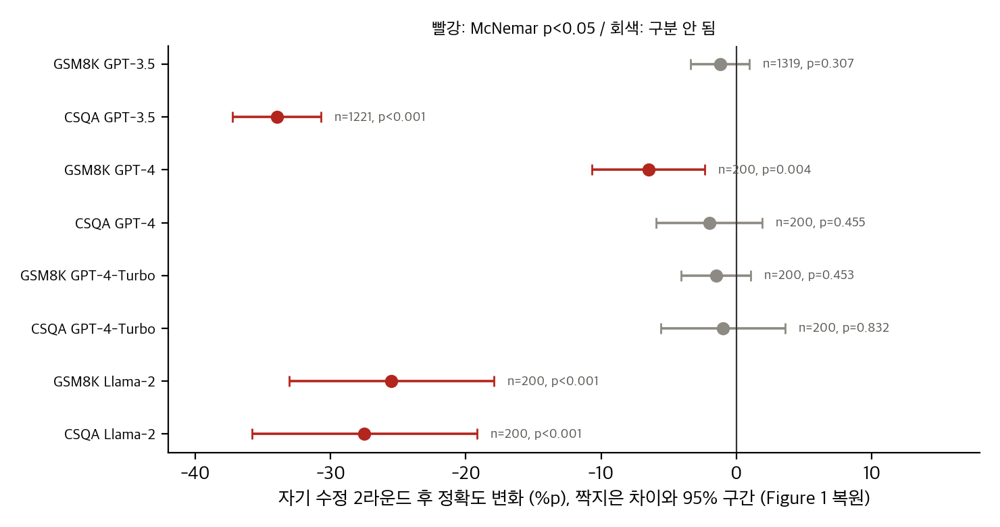

# 03. 재계산과 통계 검정

문항 단위 결과(모델 응답, 문항별 정오)는 공개되지 않았습니다. 논문 표 2–8과 Figure 1의 공개 수치만으로 계산했고, 모델 호출은 하지 않았습니다. 스크립트는 `analysis/recheck_tables.py`, 결과는 `analysis/recheck_tables_results.json`입니다 (scipy, 수 초).

## 1. 격자 검사: 보고된 정확도가 문항 수의 정수 개수로 나오는가

표 2–5, 7의 정확도 42개를 문항 수 n(1,319 / 1,221 / 200 / 100)의 정수 개수로 환산해 소수 첫째 자리로 반올림하면 모두 같은 값이 나옵니다. 불일치 0건. 예: GSM8K 75.9 = 1,001/1,319, 74.7 = 985/1,319, CSQA 41.8 = 510/1,221. 문항 수 서술(Sec 3.1)이 표와 맞습니다.

## 2. Figure 1로 짝지은 분할표를 복원하고 표 3·4와 대조 (V2)

Figure 1의 파이 라벨은 두 라운드 후 답의 변화를 (변화 없음, 정답→오답, 오답→정답, 오답→다른 오답)으로 나눕니다. 라벨 합이 8개 파이 모두 100%입니다. 여기서 정답→오답 개수 b와 오답→정답 개수 c를 구하면 (정확도 변화) = (c − b) / n 이고, 이것이 표 3·4의 변화와 같아야 합니다.

| 설정 (n) | b (정답→오답) | c (오답→정답) | Figure 1 순변화 | 표 3·4 변화 | McNemar 정확 p | 짝지은 차이 95% 구간 (%p) |
|---|---|---|---|---|---|---|
| GSM8K GPT-3.5 (1,319) | 116 | 100 | −1.2 | −1.2 | **0.307** | [−3.4, +1.0] |
| CSQA GPT-3.5 (1,221) | 486 | 71 | −34.0 | −34.0 | <0.001 | [−37.3, −30.7] |
| GSM8K GPT-4 (200) | 16 | 3 | −6.5 | −6.5 | 0.004 | [−10.7, −2.3] |
| CSQA GPT-4 (200) | 10 | 6 | −2.0 | −2.0 | **0.455** | [−5.9, +1.9] |
| GSM8K GPT-4-Turbo (200) | 5 | 2 | −1.5 | −1.5 | **0.453** | [−4.1, +1.1] |
| CSQA GPT-4-Turbo (200) | 12 | 10 | −1.0 | −1.0 | **0.832** | [−5.6, +3.6] |
| GSM8K Llama-2 (200) | 62 | 11 | −25.5 | −25.5 | <0.001 | [−33.1, −17.9] |
| CSQA Llama-2 (200) | 71 | 16 | −27.5 | −27.5 | <0.001 | [−35.8, −19.2] |

- **Figure 1과 표 3·4는 8/8 일치합니다.** 두 그림표가 같은 실행에서 나왔다는 내부 일관성 근거입니다.
- **"모든 모델·벤치마크에서 정확도가 내려간다"는 점추정으로만 맞습니다.** 8개 중 4개(CSQA GPT-3.5, GSM8K GPT-4, Llama-2 두 개)만 구분됩니다. GSM8K GPT-3.5(75.9→74.7), CSQA GPT-4, GPT-4-Turbo 두 개는 하락이 표본 오차 안입니다. 같은 문항을 쓰는 짝지은 검정이어서 비짝 검정보다 검정력이 높은데도 그렇습니다.
- 정답→오답 대 오답→정답 비는 GSM8K GPT-3.5에서 1.16배(116 대 100)로 거의 같습니다. 저자의 서술 "정답을 오답으로 바꾸는 경우가 더 많다"(Sec 3.3)는 이 칸에서 방향만 맞습니다.
- 라운드 1 값(표 3의 round 1)은 짝지은 자료가 없어 짝지은 검정을 못 했습니다. §3의 비짝 검정이 보수적 대안입니다.
- 정수 개수는 Figure 1 라벨(소수 첫째 자리)에서 반올림한 값이라 ±1개 오차가 있을 수 있습니다. GSM8K GPT-3.5의 116/100은 표 3의 75.9→74.7(1,001→985, 차이 16)과 정확히 맞습니다.

그래프: Figure 1 라벨에서 우리가 복원한 짝지은 변화와 95% 구간. 논문 그림이 아니라 우리가 그렸습니다.

## 3. 표 3–6: 표준 프롬프트 대비 비짝 검정 (V3)

짝지은 자료가 없는 칸을 위한 보수적 검정입니다(두 정확도의 비짝 z 검정; 실제 짝지은 상관이 양수이면 이보다 유의하기 쉽습니다). p는 양측입니다.

| 칸 | 표준 → 수정 | 변화 | p (비짝) | 판단 |
|---|---|---|---|---|
| GSM8K GPT-3.5 r1 / r2 (1,319) | 75.9 → 75.1 / 74.7 | −0.8 / −1.2 | 0.63 / 0.47 | 구분 안 됨 |
| CSQA GPT-3.5 r1 / r2 (1,221) | 75.8 → 38.1 / 41.8 | −37.7 / −34.0 | <0.001 | 구분됨 |
| HotpotQA GPT-3.5 (100) | 26.0 → 25.0 / 25.0 | −1.0 | 0.87 | 검출 불가 |
| GSM8K GPT-4 r1 / r2 (200) | 95.5 → 91.5 / 89.0 | −4.0 / −6.5 | 0.10 / 0.015 | r2만 구분 (짝지은 p=0.004) |
| CSQA GPT-4 (200) | 82.0 → 79.5 / 80.0 | −2.5 / −2.0 | 0.53 / 0.61 | 구분 안 됨 |
| HotpotQA GPT-4 (100) | 49.0 → 49.0 / 43.0 | 0 / −6.0 | 1.0 / 0.39 | 검출 불가 |
| GSM8K GPT-4-Turbo 6칸 (200) | 91.5 → 88.0–91.0 | −3.5 ~ −0.5 | 0.25–0.86 | 모두 구분 안 됨 |
| CSQA GPT-4-Turbo 6칸 (200) | 84.0 → 74.5–83.5 | −9.5 ~ −0.5 | 0.02(프롬프트2 r1만)–0.89 | 한 칸만 구분 |
| GSM8K Llama-2 6칸 (200) | 62.0 → 30.5–58.0 | −31.5 ~ −4.0 | 5개 <0.01, 1개 0.41 | 대부분 구분됨 |
| CSQA Llama-2 6칸 (200) | 64.0 → 24.0–43.0 | −40 ~ −21 | 모두 <0.001 | 구분됨 |

- 정리하면, **GPT-4와 GPT-4-Turbo의 "하락"은 대부분 표본 오차 안**이고, 분명한 하락은 GPT-3.5의 CSQA, GPT-4의 GSM8K 2라운드, Llama-2에서 나옵니다. 이 논문의 가장 강한 증거는 GPT-4급 모델의 일반적 하락이 아니라 **약한 모델의 큰 하락**입니다.
- v1 부록 B 표 6 (GPT-3.5, GSM8K, n=1,319)의 세 피드백 프롬프트 6칸은 75.9에서 74.4–75.5로 모두 ±1.5%p 이내입니다. 표본 오차 안입니다.
- 표 5·6의 피드백 프롬프트를 바꾼 칸은 표준 프롬프트와 같은 200개 문항에서 나왔으므로 칸끼리 독립이 아닙니다. 여러 칸을 보고 가장 낮은 칸을 고르면 우연 하락도 크게 보입니다. 다중 비교 보정은 하지 않았습니다.

## 4. 표 7: 다중 에이전트 토론 대 자기 일관성 (n = 1,319) (V4)

응답 수가 같은 쌍으로 비짝 검정했습니다. 표 7의 표준 프롬프팅은 gpt-3.5-turbo-0301이고, 표 3의 0613과 다릅니다.

| 비교 | 값 | 차이 | z | p |
|---|---|---|---|---|
| 표준 → 자기 일관성 3 | 76.7 → 82.5 | +5.8 | 3.7 | <0.001 |
| 자기 일관성 3 대 토론 r1 (에이전트 수 같음) | 82.5 vs 83.2 | +0.7 | 0.48 | 0.63 |
| 토론 r1 (6응답) 대 자기 일관성 6 | 83.2 vs 85.3 | −2.1 | 1.48 | 0.14 |
| 토론 r2 (9응답) 대 자기 일관성 9 | 83.0 vs 88.2 | −5.2 | 3.8 | <0.001 |
| 토론 r2 (9응답) 대 자기 일관성 3 | 83.0 vs 82.5 | +0.5 | 0.34 | 0.73 |

- 논문 문장 "응답 수가 같은 자기 일관성보다 **유의하게** 못하다"(Sec 4)는 **9응답에서만 통계적으로 성립합니다.** 6응답의 2.1%p 차이는 구분되지 않습니다. 토론의 추가 라운드가 이득을 주지 못한다(83.2→83.0)는 쪽이 더 안전한 서술입니다.
- 토론은 3응답에서 시작해 라운드를 더해도 83%에서 멈추고, 자기 일관성은 응답이 늘면 계속 오릅니다(82.5, 85.3, 88.2). 이 추세가 논문 Sec 4의 핵심 근거이고 방향은 성립합니다.
- 표본 규모 참고: 표준 프롬프팅 GSM8K의 이항 표준오차는 1.16%p입니다. v1은 9회 반복의 SD를 0.91%p로 보고했습니다(v2에서는 삭제). 약 1%p 이하 차이는 실행 간 잡음 수준입니다.
- 자기 일관성의 표본 추출 온도와 다수결 규칙이 본문에 없어 재현 조건이 불완전합니다.

## 5. 오라클 이득은 어디서 오는가 (V5)

표 2의 향상을 표 3·Figure 1과 이어서 분해했습니다. 오라클 실행과 내재적 실행은 서로 다른 표본 추출(온도 1)이라 근사입니다.

| | 초기 정확도 | 오라클 최종 | 오라클이 고친 비율 (초기 오답 중) | 내재적으로 고친 비율 | 내재적으로 깨뜨린 비율 (초기 정답 중) |
|---|---|---|---|---|---|
| GSM8K GPT-3.5 | 75.9 | 84.3 | 34.9% | 31.5% | 11.6% |
| CSQA GPT-3.5 | 75.8 | 89.7 | 57.4% | 24.0% | 52.5% |

- GSM8K에서는 모델이 오답의 31.5%를 라벨 없이도 고치고(오라클 34.9%와 비슷), 이득이 사라지는 이유는 **정답 11.6%를 깨뜨리기 때문**입니다. 오라클 이득의 대부분은 "맞은 답은 건드리지 않는" 중단 규칙에서 나옵니다. 저자의 "정답 여부를 아는 것이 핵심"이라는 서술(Sec 3.3)을 수치로 뒷받침합니다.
- CSQA에서는 오라클이 고친 비율(57.4%)이 내재적(24.0%)보다 훨씬 큽니다. 오지선다에서 오답이면 다른 선택지를 고르는 것만으로도 오르기 때문입니다. v1의 무작위 기준선(§7)이 이를 직접 보였습니다.
- 이 분해는 "수정 능력이 아예 없다"는 뜻이 아닙니다. 수정 능력은 있으나 **정오 판별 능력이 없어서** 이득이 순손실이 됩니다.

## 6. 최소 검출 차이와 검정력 (V6)

비짝 두 비율의 최소 검출 차이(검정력 80%, 양측 5%):

| 설정 | 최소 검출 차이 |
|---|---|
| n=1,319, 정확도 76% | 4.7%p |
| n=1,221, 76% | 4.8%p |
| n=200, 90% | 8.4%p |
| n=200, 60% | 13.7%p |
| n=100, 26% (HotpotQA GPT-3.5) | 17.4%p |
| n=100, 49% (HotpotQA GPT-4) | 19.8%p |

- 짝지은 검정은 비짝보다 검정력이 높으므로 위 값은 보수적입니다. 그래도 200문항 설정에서 GPT-4급의 2–4%p 하락은 비짝으로는 볼 수 없고, 짝지은 자료가 있는 라운드 2도 4칸 중 1칸만 구분됩니다 (§2).
- HotpotQA는 100문항이라 표 2의 오라클 향상(GPT-4 +10)조차 검정력 밖이고, 내재적 하락(−1, −6)은 검출 불가입니다. 저자도 이 이유로 HotpotQA 분석을 생략했습니다 (Sec 3.3 각주 1).

## 7. v1 무작위 기준선 식 검산 (V7, v1에만 있음)

v1 Sec 3.1.3은 CommonSenseQA 오라클의 무작위 기준선을 정의합니다. 라운드 k(초기가 0)의 정확도를 x라 하면 다음 정확도가 x + (1−x)/(5−k) 라고 씁니다. 표 2는 초기 75.8%(GPT-3.5)와 82.0%(GPT-4)에서 2라운드 87.9/91.0, 4라운드 100을 보고합니다.

- 식 그대로 계산하면 GPT-3.5는 80.6, 85.5, 90.3, 95.2이고 **4라운드에 100%가 되지 않습니다.**
- 분모를 (4−k)로 바꾸면 GPT-3.5는 81.8, 87.9, 94.0, 100이고 GPT-4는 86.5, 91.0, 95.5, 100입니다. **v1의 보고값(87.9, 91.0, 100)과 정확히 일치합니다.**
- 결론: 인쇄된 식의 (5−k)는 오타(또는 라운드를 1부터 센 표기)이고, 보고된 수치는 (4−k)로 계산한 것입니다. 틀린 오라클 선택지를 하나씩 지워 가는 논리상 (4−k)가 맞습니다. 이 기준선은 v2에서 삭제되었습니다.
- 의미: 정답 라벨로 멈추는 설정에서는 **무작위 추측도 2라운드에 87.9%**로 LLM의 오라클 향상(89.7)과 거의 같습니다. 오지선다에서 오라클 향상이 수정 능력을 보여 주지 못한다는 점을 보여 주는 가장 직접적인 증거이고, v2에서 사라진 것이 아쉽습니다.

## 8. 불일치와 모호함 목록

| # | 내용 | 위치 | 심각도 |
|---|---|---|---|
| 1 | "모든 모델·벤치마크에서 하락"은 8설정 중 4개만 통계적으로 구분됨 | 표 3, 4, Sec 3.2; 03 §2 | 해석상 주의 |
| 2 | 토론이 자기 일관성보다 "유의하게" 못하다는 서술은 9응답에서만 성립 | 표 7, Sec 4; 03 §4 | 해석상 주의 |
| 3 | 같은 GSM8K 표준 프롬프팅이 75.9(0613)와 76.7(0301)로 다른 모델 버전 | 표 3, 표 7 | 사소 |
| 4 | v1 무작위 기준선 식의 (5−k)와 수치의 (4−k) 불일치 | v1 Sec 3.1.3 | 인쇄 오류 (v2에서 삭제) |
| 5 | 시드, 반복 횟수, 자기 일관성의 온도, CommonGen-Hard 문항 수 미기재 | Sec 3.1, 4, 5 | 재현성 |
| 6 | Figure 1 라벨은 소수 첫째 자리 반올림이라 정수 개수에 ±1 오차 | Figure 1 | 사소 |
