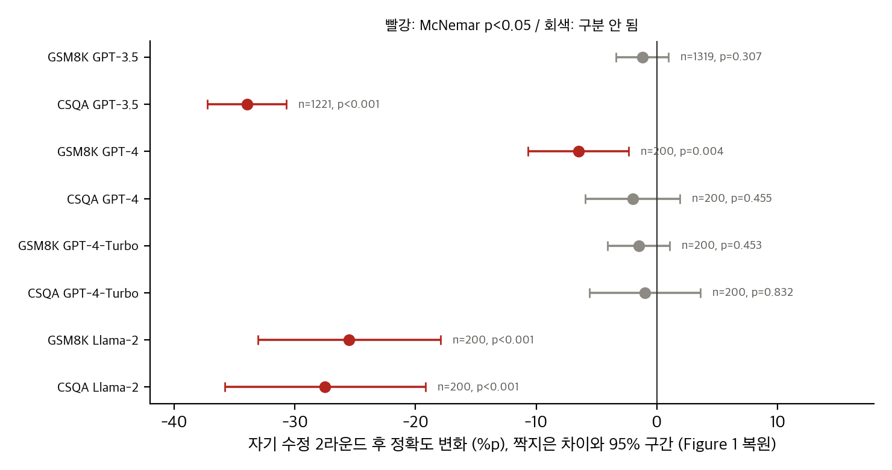

# LLM의 자기 수정은 정말 안 되나: 숫자로 다시 본 Huang et al.

Huang et al. (ICLR 2024)은 "정답 라벨 없이 LLM이 자기 추론을 고치는 일(내재적 자기 수정)은 아직 안 된다"고 주장합니다. 선행 연구(RCI, Reflexion)의 향상은 정답 라벨로 루프를 멈춘 덕이었다는 지적이 핵심입니다. 이 글은 논문의 공개 표와 Figure 1로 그 주장을 다시 계산하고, 비판 대상이 된 선행 연구의 원문과 코드를 읽어 확인한 결과입니다. 논문의 코드와 응답 로그는 공개되어 있지 않아 문항 단위 재계산은 하지 못했습니다.

## 무엇을 확인했나

- **내부 일관성.** 표 2–5, 7의 정확도 42개는 모두 문항 수(1,319 / 1,221 / 200 / 100)의 정수 개수와 맞습니다. Figure 1의 파이 라벨(정답 → 오답 등)은 표 3·4의 변화와 8/8 설정에서 정확히 일치합니다.
- **짝지은 분할표 복원.** Figure 1 라벨에서 정답 → 오답 개수 b와 오답 → 정답 개수 c를 구하면 McNemar 검정이 가능합니다.

## 결과: "모두 나빠졌다"는 점추정으로만 맞다

- 하락이 구분되는 설정은 8개 중 4개입니다. GPT-3.5의 CommonSenseQA(b=486, c=71), GPT-4의 GSM8K(16 대 3, p=0.004), Llama-2의 두 벤치마크입니다.
- GSM8K GPT-3.5의 75.9 → 74.7은 b=116, c=100으로 McNemar p=0.31입니다. GPT-4의 CSQA, GPT-4-Turbo의 두 벤치마크도 구분되지 않습니다.
- 200문항 설정의 최소 검출 차이는 8–14%p입니다. 이 논문의 가장 강한 증거는 GPT-4급의 일반적 하락이 아니라 **약한 모델의 큰 하락**입니다.
- 토론 대 자기 일관성(GSM8K 1,319문항)에서 "응답 수가 같은 자기 일관성보다 유의하게 못하다"는 9응답(83.0 대 88.2, p<0.001)에서만 성립하고 6응답(83.2 대 85.3)은 p=0.14입니다.

## 오라클 이득은 어디서 오나

GSM8K GPT-3.5에서 모델은 라벨 없이도 초기 오답의 31.5%를 고칩니다(오라클 설정 34.9%). 이득이 사라지는 이유는 정답의 11.6%를 깨뜨리기 때문입니다. 오라클의 핵심 역할은 맞은 답을 건드리지 않게 막는 중단 규칙이고, 이는 수정 능력이 아니라 **정오 판별 능력**의 문제입니다. 논문 v1에는 오지선다에서 정답 라벨로 멈추는 무작위 추측 기준선(2라운드 87.9%)이 있었는데, 인쇄된 식의 분모 (5−k)는 보고된 수치와 맞지 않고 (4−k)로 계산해야 재현됩니다. 이 기준선은 v2에서 삭제되었습니다.

## 선행 연구 원문과 코드를 읽어 보니

- **RCI (Kim et al.).** 정답 라벨 사용은 arXiv v1에 서술이 없고, v2 부록에만 있으며, v3(2023-11)에 본문과 표 17(라벨 없는 RCI는 GSM8K 77.95 → 72.83, CSQA 64.56 → 46.06)로 올라왔습니다. Huang et al.이 인용한 "CSQA +15%"는 v1·v2의 제로샷 기준선(53.15)에서만 맞고, v3 기준선(64.56)에서는 +3.6입니다.
- **Reflexion (Shinn et al.).** 공개 코드(HotpotQA)는 정답과의 EM이 맞으면 반성을 건너뛰고, 정답 여부를 "Answer is CORRECT/INCORRECT"로 scratchpad에 넣습니다. 라벨이 중단 규칙을 넘어 모델의 입력으로 들어갑니다.
- **Self-Refine (Madaan et al.).** CommonGen-Hard 44.0 → 67.0은 원문과 일치합니다. 같은 표의 수학 추론은 +0.2로 원 논문도 이득이 거의 없다고 보고합니다.

## 인용할 때 주의

- "모든 모델이 모든 벤치마크에서 나빠졌다"는 통계적 주장으로 쓰지 않습니다. 약한 모델의 큰 하락과 라벨 의존 평가의 지적이 안전한 인용입니다.
- 프롬프트만 쓴 내재적 자기 수정에 한정한 결과입니다. 이후 연구는 온도 0과 공정한 프롬프트, 확신 기반 프롬프트, RL 학습, 오류 주입 같은 조건에서 일부 개선을 보고합니다. 초록만 읽은 상태라 인용 전에 본문을 확인해야 합니다.
- 시드와 반복 횟수가 없어 각 칸은 한 번의 실행값입니다.

분석 노트 전체(재계산 스크립트, 주장별 판정 C1–C9, 이후 문헌 목록)는 함께 게시한 저장소에 있습니다.

## 자료

- [통합 리포트 PDF](report/report_public.pdf)
- [01. 논문 분석](analysis/01_paper_analysis.md)
- [02. 계보와 관련 자료](analysis/02_prior_work.md)
- [03. 재계산과 통계 검정](analysis/03_analysis.md)
- [04. 주장 검증 (C1–C9)](analysis/04_claim_verification.md)
