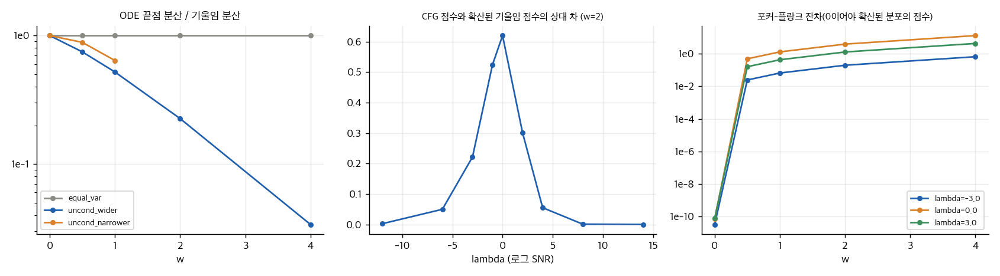
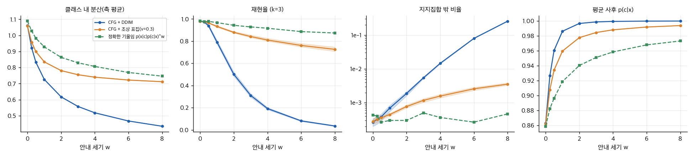
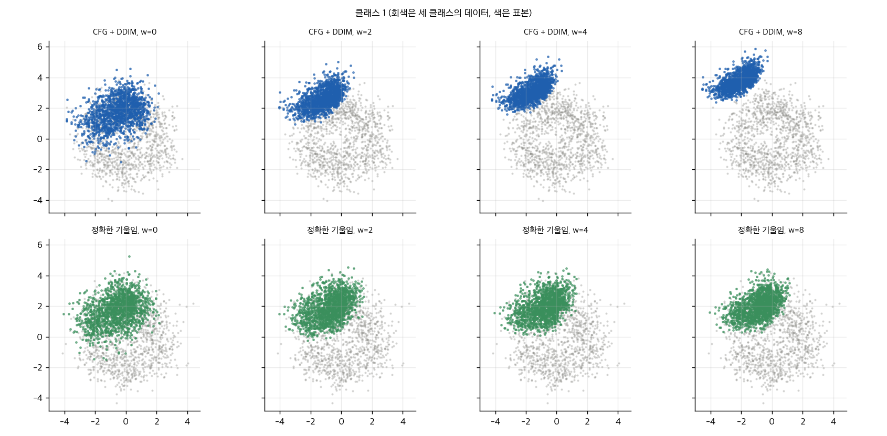
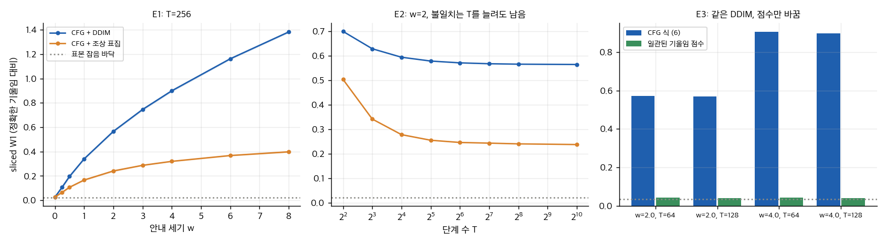
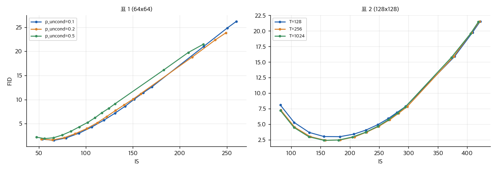

# Classifier-free guidance를 정확한 점수로 검산했습니다

*Classifier-Free Diffusion Guidance*(Ho & Salimans, NeurIPS 2021 워크숍 단편의 arXiv 확장판)는 조건부 예측과 무조건 예측을 ε̃ = (1+w)ε_c − wε_u로 섞어 표본 품질과 다양성을 맞바꿉니다. 이 글은 그 식과 해석을 **학습 없이** 다시 확인한 기록입니다. 신경망 대신 2차원 클래스 조건부 가우시안 혼합에서 닫힌 식으로 나오는 정확한 ε_c, ε_u를 썼습니다. 그래서 "정확한 점수를 줘도 CFG가 무엇을 하는가"만 남습니다. 차원 2의 토이이고 이미지 결과가 아닙니다. 논문 그림은 arXiv 라이선스가 CC가 아니라서 싣지 않았고 그래프는 모두 직접 그렸습니다.

## 식은 맞습니다

분류기 안내의 표적 p(z|c)p(c|z)^w에서 ε̃ = ε_c − wσ∇log p(c|z)이고, 베이즈에서 ∇log p(c|z) = −(ε_c − ε_u)/σ이므로 식 (6)이 나옵니다. 토이에서 자동미분과 베이즈 사후로 따로 계산한 값이 3.5e-14(항등식), 1.3e-13(식 (6) = 암시적 분류기 안내) 안에서 같습니다. 흔한 γ 규약(ε_u + γ(ε_c − ε_u))은 γ = 1 + w입니다. 다른 논문의 guidance scale과 이 논문의 w를 비교하기 전에 규약부터 확인해야 합니다.

## 그러나 안내된 장은 어떤 확산된 분포의 점수도 아닙니다

각 잡음 수준에서 안내된 장은 p_λ(z|c)^{1+w}p_λ(z)^{-w}의 점수이지만, 이 가족이 순방향 확산을 따르려면 포커-플랑크 방정식의 잔차가 z에 무관해야 합니다. 선형 항은 상쇄되고 제곱항만 남아서 잔차는 정확히

(σ²/2) · w(1+w) · ‖∇_z log p_λ(c|z)‖² + (λ만의 함수)

입니다. 분류기 기울기의 크기가 z마다 다르면 일관되지 않습니다(자동미분 값과 2.3e-9 안에서 일치). 분산이 같은 두 가우시안에서는 이 기울기가 상수라서 CFG가 평균을 정확히 외삽합니다. 분산이 다르면(조건부가 주변보다 좁은 보통의 경우) ODE 끝점 분산이 의도한 기울임의 분산보다 w = 2에서 0.23배, w = 4에서 0.034배로 줄어듭니다.

## 토이에서 보이는 것

클래스 3개, 클래스마다 성분 2개인 혼합에서 w를 0–8로 스윕했습니다(T = 256, 시드 5개, 클래스당 10,000개). 비교 대상은 의도한 표적 p(x|c)p(c|x)^w(격자에서 정확히 계산)입니다.

- **충실도는 오르고 다양성은 줄어듭니다**(논문의 교환). 분산 수축은 모든 시드에서 w에 단조입니다.
- **하지만 DDIM 표집은 표적보다 훨씬 더 줄어듭니다.** w = 2에서 재현율 0.501(표적 0.943), 분산 0.618(표적 0.863). 정밀도는 거의 그대로(0.98)라서 품질이 아니라 다양성만 무너집니다.
- **지지집합 밖 표본**: 표적은 w = 8에서도 0.05%인데 CFG-DDIM은 w = 4에서 1.5%, w = 8에서 25.7%입니다.
- **조상 표집(v = 0.3)은 같은 식 (6)으로 훨씬 약하게 안내됩니다**(w = 2 재현율 0.879). 같은 장이 표집기에 따라 다른 분포를 만듭니다(시드 쌍 t 검정, 홀름 p ≤ 3.8e-4).

## 불일치는 단계 수가 아니라 장에서 옵니다

w = 2에서 단계 수를 4에서 1024까지 늘려도 표적 대비 sliced W1이 DDIM 0.699 → 0.564, 조상 0.503 → 0.238에서 멈추고 표본 잡음 바닥 0.022에 닿지 않습니다. 같은 DDIM, 같은 단계 수에서 **점수만** "표적을 순방향 확산시킨 분포의 정확한 점수"로 바꾸면 sW1이 0.572 → 0.042(바닥 0.033)로 떨어집니다(w = 4도 0.906 → 0.043, n = 2000, 시드 2로 규모를 줄였음). 원인은 이산화가 아니라 식 (6)입니다.

## 후속 문헌이 말한 것과의 대조

초록 수준으로만 확인했습니다(본문 미열람). Chidambaram 외 2024는 안내가 기울인 분포를 표집하지 못하고 큰 w가 지지집합 경계, 점수 오차가 있으면 밖으로 보낸다고 증명하고, Bradley & Nakkiran 2024는 어느 표집기와 CFG도 γ 거듭제곱 분포를 만들지 못한다고 보입니다. 위 결과는 둘과 방향이 같습니다. Kynkäänniemi 외 2024의 구간 안내를 토이에 옮기면, 높은 잡음(λ < −3.38)에서 안내를 끄는 것만으로 w = 4의 지지집합 밖 비율이 1.46%에서 0.08%로, sW1이 0.899에서 0.595로 줄고 낮은 잡음 쪽을 끄는 것은 영향이 없습니다. 다만 분산은 오히려 더 줄어듭니다(0.518 → 0.455).

## 논문의 표

FID와 IS는 재계산할 수 없습니다. 표의 산술과 서술은 다음과 같습니다(모두 단일 실행, 시드 분산 없음).

- 최적 w는 64×64에서 0.1, 128×128에서 0.3(T = 256)입니다. T = 256에서 w = 0.3과 0.4(2.43 대 2.49)는 구별되지 않습니다. 안내가 FID를 7.27에서 2.43으로 줄이는 효과는 견고합니다.
- **본문의 "FID monotonically decreasing and IS monotonically increasing with w"는 표와 맞지 않습니다.** FID는 여섯 곡선 모두 최적 w 이후 증가합니다.
- p_uncond = 0.5는 IS–FID 전선의 13개 점 모두에서 0.1보다 나쁩니다(평균 +1.2 FID). 0.1 대 0.2는 구별되지 않습니다(0.04–0.47, 잡음 대리값 T = 256 대 1024의 차이(중앙값 0.03, 최대 0.21)와 같은 자릿수).
- 그림 5의 범례는 T = 512인데 표 2와 본문은 T = 1024입니다.
- "공정한 비교(T = 128)에서 ADM-G보다 나쁘다"는 3.02 대 2.97, 차이 0.05라 구별되지 않습니다.

## 한계

- 토이는 2차원 가우시안 혼합이고 점수가 정확합니다. 학습된 신경망의 오차와 비보존성, 이미지의 구조를 반영하지 않습니다. 시드 구간은 표집 잡음만 반영하며 학습 분산이 없습니다.
- 지표(재현율, 지지집합 밖, 가우시안 적합 Fréchet 거리, IS 모사)는 FID, IS와 같지 않습니다. 이 토이의 Fréchet 거리는 w = 0에서 최소인데, 논문의 FID가 w = 0.1–0.3에서 최소인 것은 모델 오차나 지표 쪽 사정일 가능성이 높습니다(추정).
- 포커-플랑크 잔차의 닫힌 식은 이 노트의 유도이고 문헌에서 같은 꼴을 확인하지 못했습니다.
- p_uncond의 영향 원인(학습 오차 증폭)은 학습 없이 시험하지 못했습니다.

코드와 테스트(15개), 결과는 이 글과 함께 올린 노트 저장소에 있습니다.

## 자료

- [최소 구현](analysis/minimal_impl.py)
- [01. 논문 분석: Classifier-Free Diffusion Guidance](analysis/01_paper_analysis.md)
- [02. 계보와 관련 분석, 자료 표](analysis/02_prior_work.md)
- [03. 검산과 재계산](analysis/03_analysis.md)
- [04. 주장 검증 (C1–Cn)](analysis/04_claim_verification.md)
