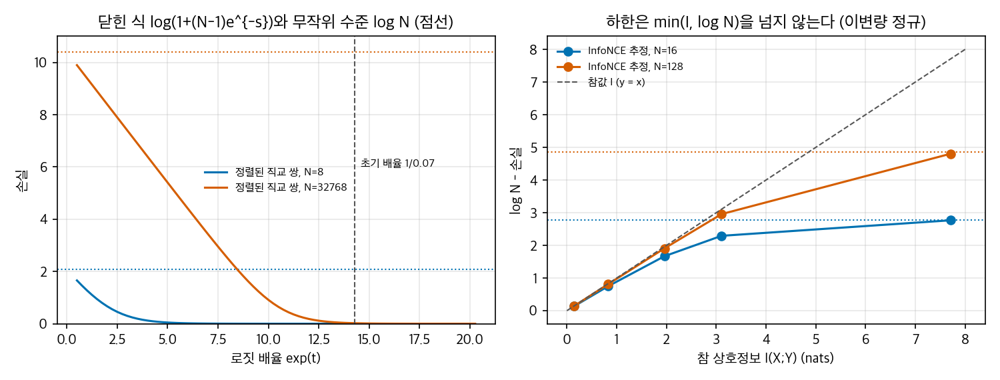
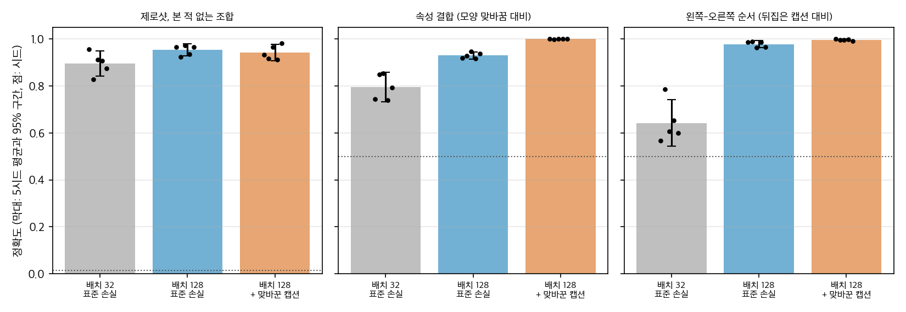

# CLIP의 대칭 InfoNCE를 직접 짜 보면

Radford et al.의 *Learning Transferable Visual Models From Natural Language Supervision*(OpenAI, ICML 2021)은 웹의 (이미지, 텍스트) 쌍 4억 개에서 "배치 안의 어느 텍스트가 이 이미지의 짝인가"를 맞히게 하는 대칭 대조 목적으로 이미지·텍스트 인코더를 함께 학습하고, 클래스 이름을 문장에 끼운 프롬프트로 분류기를 합성해 제로샷 분류를 합니다. 이 글은 방법의 핵심을 식으로 검산하고, 작은 PyTorch 구현과 합성 데이터로 성질을 확인하고, 공식 코드와 맞춰 본 기록입니다. **토이는 논문 재현이 아닙니다.** 논문의 수치는 하나도 확인하지 않았습니다.

## 식 검산: 손실, 온도, 정보 하한

배치 N개에서 이미지 임베딩 u_i와 텍스트 임베딩 v_j(L2 정규화)의 코사인 C_ij에 배율 s = exp(t)를 곱해 로짓 s·C_ij를 만들고, 행과 열 두 방향의 cross entropy를 평균합니다(논문 그림 3).

- 무작위 임베딩의 손실은 log N + s²/(2d)로 근사됩니다. N이 크고 s²/d가 1 안팎 이하일 때 맞고(N = 256, d = 512, s = 14.3에서 측정 5.76, 근사 5.74), N = 16, d = 64처럼 작으면 어긋납니다(측정 3.53, 근사 4.37). 그래서 무작위 초기화 모델의 첫 손실은 log N 바로 위입니다.
- 정렬되고 서로 직교하는 쌍의 손실은 닫힌 식 log(1 + (N−1)e^{−s})입니다. 오답 쌍이 코사인 c를 가지면 e^{−s(1−c)}가 되어 N = 32,768, s = 100에서 c = 0.8이면 0.0001이지만 0.9면 0.91, 0.95면 5.4입니다. 학습되는 온도의 기울기 ∂L/∂t = s(Σ_j P_ij C_ij − C_ii)는 정렬이 좋을수록 s를 키우는 쪽이라 논문이 말한 배율 상한 100이 의미를 가집니다.
- InfoNCE의 상호정보 하한 log N − L은 L ≥ 0이므로 log N을 넘을 수 없습니다. 이변량 정규에서 최적 비판자로 확인하면 I가 작을 때는 I에 붙고(N = 128, I = 1.96에서 1.91), 클 때는 log N에 포화합니다(N = 16, I = 7.7에서 2.77). 배치 크기가 정보 추정의 상한을 정합니다. 단 CLIP 논문 자체는 이 하한을 쓰지 않고 InfoNCE를 계보로만 언급합니다.

## 공식 코드에 없는 것

공식 `openai/CLIP`(MIT)은 **모델과 추론만** 있습니다. 저장소 전체에서 cross entropy, clamp, backward, 옵티마이저 호출이 한 번도 나오지 않습니다. 그림 3의 손실과 "배율 100 상한"은 논문 서술이 유일한 출처이고, OpenCLIP의 `ClipLoss`와 `train.py`(스텝 뒤에 ln 100으로 clamp, 주석 "as in the original paper")가 이를 구현합니다. 이 두 줄은 OpenAI 쪽 코드로 확인할 수 없다는 뜻입니다. 텍스트 풀링은 `text.argmax(-1)`으로 EOT 위치를 찾으므로 EOT가 어휘에서 가장 큰 id라는 암묵적 계약에 기댑니다. 그 밖에 논문은 어휘 49,152와 최대 길이 76이라 적었는데 코드는 49,408과 77이고, 활성 함수는 QuickGELU입니다. 프롬프트 앙상블은 공식 notebook의 80개 템플릿과 "임베딩, 정규화, 평균, 재정규화" 절차가 논문 서술과 같습니다.

## 합성 도형 토이

색 8 x 모양 8 = 64 조합의 16x16 장면(한 물체 또는 좌우 두 물체)과 그것을 설명하는 토큰 열로 21만 파라미터 모델을 학습했습니다. 대각선 8개 조합은 학습에서 뺐습니다. 설정은 세 가지(표준 배치 128, 맞바꾼 캡션을 부정 예시로 추가, 표준 배치 32)이고 각 5시드입니다. 구간은 5시드 평균의 t 95% 구간입니다.

- **구성적 일반화.** 이미지에서 본 적 없는 조합이 텍스트 이름만으로 64-way 95.3% [92.8, 97.9]로 분류됩니다(본 조합은 100%). 개념별 특징을 따로 배우면 새 조합을 얻는다는 논문 §3.1.2의 해석과 같은 방향이지만, 이 토이의 개념 공간은 곱 구조라 아주 규칙적입니다. 프롬프트 앙상블의 이득은 시험되지 않았습니다(평가 템플릿이 학습 템플릿 그대로이고 다의어가 없음).
- **속성 결합.** 참 캡션과 같은 단어 가방의 다른 캡션(두 물체의 모양을 맞바꿈)을 가려내는 정확도는 표준 손실에서 93.0% [91.5, 94.5](우연 50%)입니다. 문헌(Winoground, ARO)의 bag-of-words 경향은 이 토이에서 약하게만 나옵니다. 위치 임베딩이 있는 ViT, 좌우로 분리된 물체, 왼쪽부터 쓴 캡션이 결합을 쉽게 했을 것입니다. 맞바꾼 캡션을 부정 예시로 넣으면 5시드 모두 99.9% 이상(+7.0%p [5.4, 8.5], 짝지은 t 검정 p = 0.0003)이고 보지 못한 조합 제로샷은 −1.1%p로 구별되지 않습니다. 배치 안에 맞바꾼 쌍이 들어오는 비율은 배치 128에서 1.4%, 32에서 0.4%였습니다.
- **배치 32**에서는 결합 79.6% [73.3, 85.9], 순서 64.3% [54.4, 74.2]로 낮습니다. 단 이 설정은 본 이미지 수도 4분의 1이라 배치 크기 효과와 분리되지 않습니다.
- **모달리티 간격.** 초기화 직후 이미지·텍스트 임베딩 평균 사이 거리는 1.48(입력 간 평균 코사인 0.99), 학습 후 0.097입니다. 좁은 원뿔 효과는 확인되지만 대조 학습이 간격을 유지한다는 Liang et al.의 주장은 이 토이에서 확인되지 않았습니다(반박도 아닙니다).

## 이후 문헌이 바꾼 것 (arXiv 초록 수준)

대조가 예측보다 4배 효율적이라는 그림 2의 결론은 한 설정의 값이고, 데이터·연산·모델 용량을 맞춘 후속 비교(Tschannen et al.)는 캡션 사전학습이 분류에서 경쟁적이고 시각-언어 과제에서 앞선다고 보고합니다. 분포 이동에 대한 강건함의 원인은 "제로샷"이 아니라 학습 데이터의 다양성이라는 결과(Fang et al.)와, 데이터 큐레이션이 핵심이라는 연구선(MetaCLIP, DataComp, DFN)이 이어졌습니다. 같은 구조와 비슷한 레시피여도 OpenAI와 OpenCLIP의 스케일링이 다르다는 보고(Cherti et al.)도 같은 방향입니다.

## 한계

토이는 21만 파라미터, 합성 도형 64 조합, 2,500스텝이며 5시드의 t 구간은 자유도 4라 넓습니다. 예비 실행에서 색 4 x 모양 4일 때 표준 손실의 결합이 거의 100%여서 조합 공간을 8 x 8로 키웠고, 그래서 baseline의 93%는 설정 선택에 의존합니다. 사전학습 가중치와 데이터셋은 받지 않았고 공식 코드는 정적으로만 읽었습니다.

## 자료

- [최소 구현](analysis/minimal_impl.py)
- [01. 논문 분석: Learning Transferable Visual Models From Natural Language Supervision (CLIP, arXiv:2103.00020)](analysis/01_paper_analysis.md)
- [02. 계보와 관련 자료: CLIP (arXiv:2103.00020)](analysis/02_prior_work.md)
- [03. 식 검산과 최소 구현 결과: CLIP (arXiv:2103.00020)](analysis/03_analysis.md)
- [04. 주장 검증: CLIP (arXiv:2103.00020)](analysis/04_claim_verification.md)
