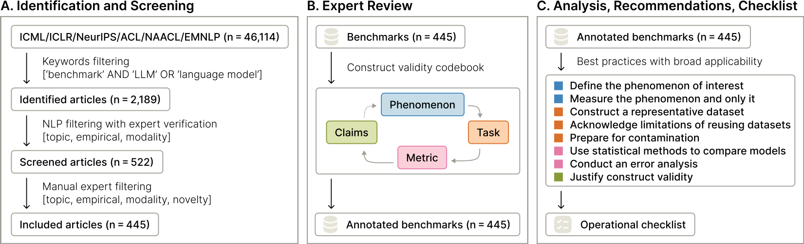
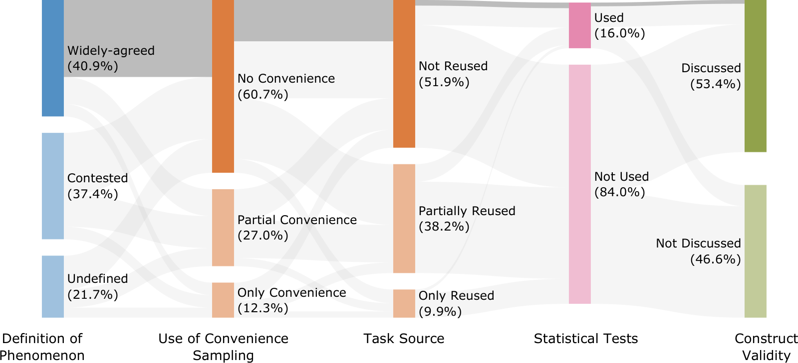
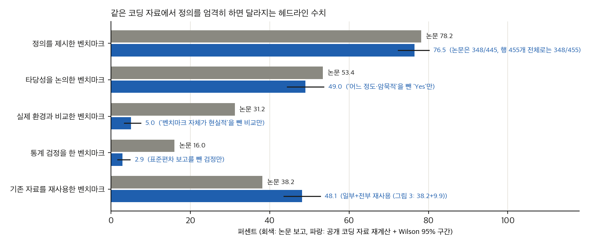
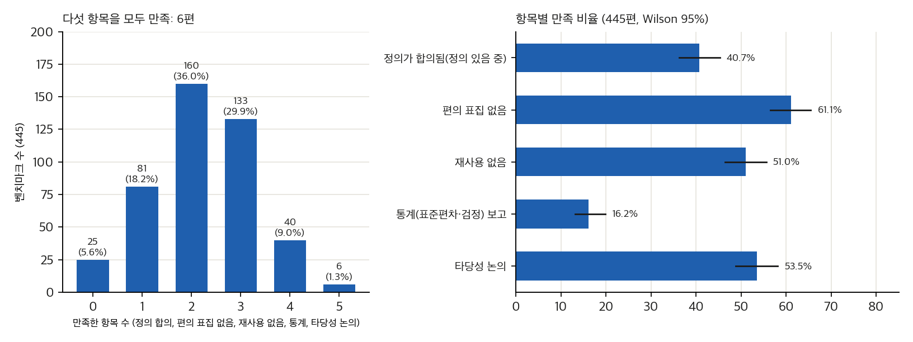
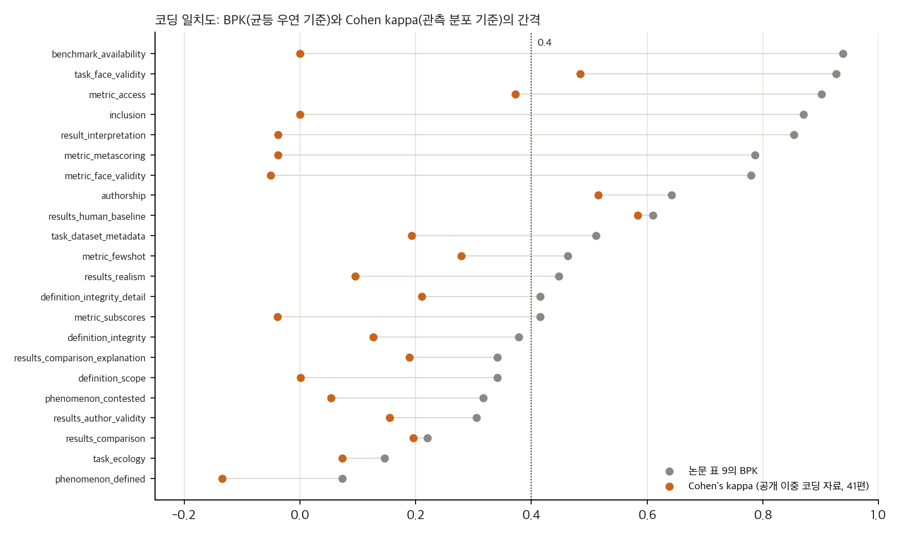

# LLM 벤치마크의 구성 타당도 검토를 다시 계산해 보니

벤치마크 점수는 "추론"이나 "안전성" 같은 추상 현상의 대리 측정입니다. Bean et al.(NeurIPS 2025 D&B)은 ICML·ICLR·NeurIPS·ACL 계열 논문에서 LLM 벤치마크 445편을 뽑아 29명이 코딩하고, 현상 정의·과제 대표성·재사용·통계·정당화에 관한 권고 8개를 냈습니다. 저자가 코딩 결과와 정리 코드를 공개해서 이 글에서는 그 집계를 다시 계산했습니다. 저자 노트북은 읽기만 했고, LLM 호출은 하지 않았습니다.

## 검토 흐름은 맞다

*그림: 논문 그림 1. © 저자, CC BY 4.0, 출처 arXiv:2511.04703.*

표 7의 제외 수(1,251 + 92 + 324)는 2,189 → 522로 맞고, 공개 `included_papers_r2.csv`의 라벨에서 단계별 수가 그대로 재구성됩니다. 키워드 규칙(제목·초록에 'benchmark'와 'LLM' 또는 'language model')을 저자 원본 목록에 적용하면 ICLR은 연도별로 모두 일치하고 ACL·NeurIPS는 한 편씩만 다릅니다(ICML 목록은 저장소에 없음). LLM 선별의 정밀도 80%, 재현율 89%는 맞지만 사람이 라벨한 50편 중 적격이 9편뿐이라 재현율 8/9의 95% 구간은 56–98%입니다. 이 표본으로 "놓친 논문이 적다"고 말할 수는 없습니다.

## 비율은 대부분 재현되지만 분모가 445가 아니다

*그림: 논문 그림 3. © 저자, CC BY 4.0, 출처 arXiv:2511.04703.*

공개 코드북은 455행이고 bibkey는 445개입니다. 중복 코딩된 9편의 10행이 남아 있는데, §4와 그림 3의 비율은 **455행을 분모로 해야 소수 첫째 자리까지 재현**됩니다(논문 값이 있는 51개 항목 중 39개가 ±0.15%p). 분모를 445로 바꾸면 12개만 재현됩니다. 영향은 평균 0.36%p로 작아서 결론은 바뀌지 않지만, 같은 논문의 두 코딩이 서로 다른 값을 내는 사례(9편 중 3편은 "현상을 정의했는가"부터 다름)가 데이터에 그대로 들어 있습니다.

## 서술이 실제와 다른 수치

| 논문 서술 | 코딩 자료로 다시 센 값 |
|---|---|
| 통계 검정을 한 벤치마크 16.0% | 표준편차·분산 보고를 포함한 값. 검정은 13건, **2.9%**(Wilson 1.7–4.8%) |
| 더 현실적인 환경과 비교 31.2% | 142건 중 119건은 "벤치마크 자체가 현실적". 실제 비교는 **5.1%** |
| 이전 벤치마크·시험을 재사용 38.2% | 38.2%는 일부 재사용. 전부 재사용(9.9%)을 더하면 **48.1%** |
| 편의 표집 27.0% | 27.0%는 일부만. 편의 표집만(12.3%)을 더하면 **39.3%** |

방향은 제각각입니다. 재사용과 편의 표집은 문제가 논문보다 더 크고, 통계 검정과 현실 비교는 실제로 더 드뭅니다. 다섯 모범 사례(정의 합의, 편의 표집 없음, 재사용 없음, 통계 보고, 타당성 논의)를 모두 만족하는 벤치마크는 445편 중 6편(1.35%)입니다.

## 코딩 신뢰도는 낮다

논문은 무작위 46편을 두 번 코딩해 평균 Brennan–Prediger κ(BPK) 0.524를 보고합니다. 공개된 이중 코딩 자료는 **41쌍**(445편의 9%)이고, 같은 정의로 다시 계산하면 평균 BPK는 약 0.50입니다. 표 9의 일부 필드는 한 쌍을 빈 응답으로 어떻게 세느냐로 설명되는 것으로 보입니다(가설). 더 중요한 것은 지표입니다.

BPK는 우연 일치를 균등 분포로 가정하므로 한 범주로 쏠린 문항에서 후하고, Cohen κ는 반대로 쏠림에 가혹합니다. 같은 41쌍의 Cohen κ 평균은 0.15(단일 라벨 22필드 중 19개가 0.4 미만)입니다. 저자 노트북은 κ와 α, AC1을 계산했지만 논문은 BPK만 보고했습니다. 첫 발견인 "78.2%가 현상을 정의했다"의 근거 문항(`phenomenon_defined`)의 BPK는 **0.073**, Cohen κ는 −0.13입니다. 두 검토자가 이 문항에서는 우연 수준으로만 일치한 것입니다.

## 권고 8개는 어디에서 나왔나

8개 중 6개(정의, 교란 통제, 대표성, 재사용, 통계, 정당화)는 코드북 집계와 이어집니다. **오염 대비(5)와 오류 분석(7)은 코드북에 대응 항목이 없고** 문헌과 귀납 코딩에서 온 권고입니다. "445편 검토의 결과"로 8개를 묶어 인용하면 과장입니다. 점검표를 따르면 벤치마크가 실제로 더 타당해지는지는 검증되지 않았습니다. 또 타당성을 논의한 비율은 2022–2024에 증가하지 않았습니다(55.9%, 58.3%, 50.8%; 추세 검정 p = 0.26).

## 인용할 때

- 비율은 "공개 코딩 자료 기준(분모 455행)"으로 적고, 통계는 "표준편차 보고 포함 16.0%, 검정 2.9%"로 구분하세요.
- 평가자 일치도는 BPK만 인용하지 말고 κ를 함께 적으세요.
- 이 글의 재계산은 저자의 공개 자료와 노트북 저장 출력에 기대고 있습니다. ICML 원본 목록과 LLM 선별 재실행은 하지 않았습니다.

## 재계산 자료

스크립트와 요약 JSON은 이 글과 함께 게시된 폴더에 있습니다. 저자 자료는 HF `ambean/construct-validity-review`(CC BY-SA 4.0)와 GitHub `am-bean/benchmark_review`(라이선스 파일 없음)에서 받을 수 있고, 라이선스가 불분명한 원자료는 게시본에 넣지 않았습니다.

## 자료

- [통합 리포트 PDF](report/report_public.pdf)
- [01. 논문 분석: Measuring what Matters: Construct Validity in Large Language Model Benchmarks](analysis/01_paper_analysis.md)
- [02. 계보와 관련 연구](analysis/02_prior_work.md)
- [03. 재계산과 통계 검증](analysis/03_analysis.md)
- [04. 논문 대 공개 자료·코드 정적 대조 (D1–D10)](analysis/04_code_verification.md)
