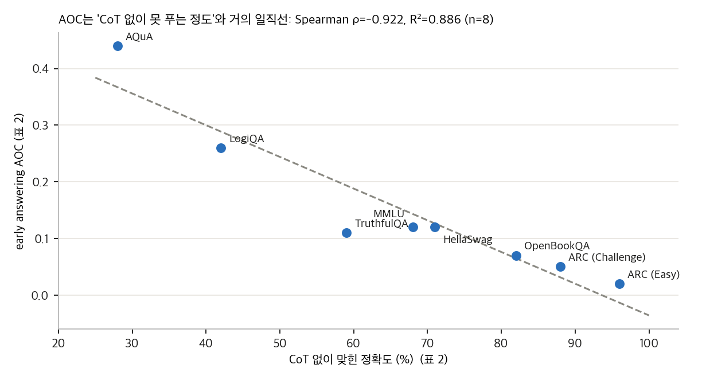
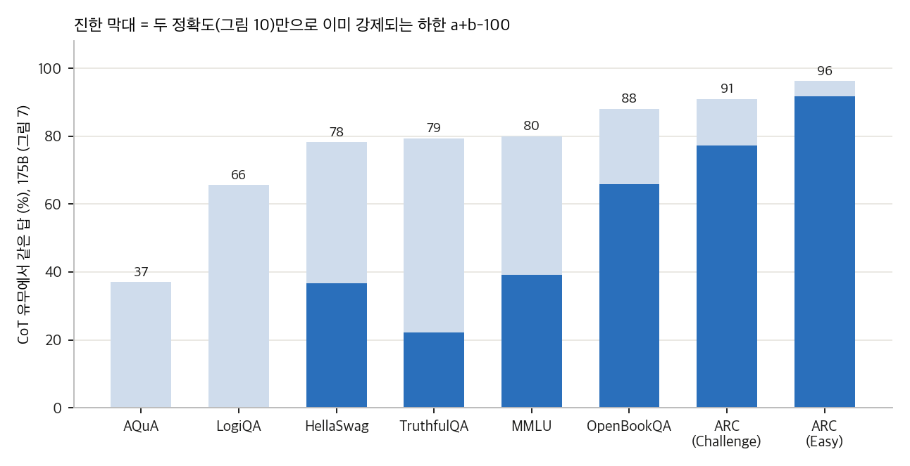
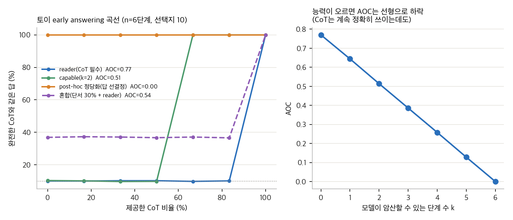

# CoT 충실성 지표 AOC는 무엇을 재는가

Lanham et al.(2023)은 모델이 쓴 CoT(단계별 추론)가 실제 답의 원인인지 모델 내부를 보지 않고 묻기 위해 CoT에 개입합니다. 중간에 자르고(early answering), 틀린 문장을 넣고(adding mistakes), 바꿔 쓰고(paraphrasing), 필러 토큰으로 채웁니다. 모델은 비공개 175B RLHF 모델이라 공식 코드와 결과 파일이 없습니다. 그래서 **논문 PDF의 벡터 그림 좌표**에서 곡선 값을 추출해 다시 계산했습니다(그림 3–7, 10, 11).

## 표 2의 AOC는 재현됩니다

그림 3·4의 길이별 곡선에서 `1 − (점 평균)`으로 AOC를 구해 표 2와 비교하면 early answering 최대 차이 0.037, adding mistakes 0.009입니다. 다만 MMLU, HellaSwag, TruthfulQA의 AOC는 0.03 안에 몰려 있고 6문장 패널의 셀 표본이 115–561개(그림 값의 k/N 격자에서 역산)라 이 세 과제의 순서는 지지되지 않습니다.

## AOC는 "CoT 없이 못 푸는 정도"와 거의 일직선입니다

과제 8개에서 AOC와 CoT 없는 정확도의 Spearman ρ는 -0.92(p=0.001), 직선 R²는 0.89입니다. CoT가 주는 정확도 이득과는 ρ=0.35(p=0.40)로 약합니다. 논문의 "post-hoc 정도는 이득과 무관하다"는 맞지만, post-hoc 정도는 난이도와 얽혀 있습니다. 이 지표는 충실성이 아니라 **CoT에 대한 의존도**에 가깝습니다.

## 같은 답 비율에는 정확도가 만드는 하한이 있습니다

CoT 없는 답 A와 CoT 답 B의 정확도를 a, b라 하면 P(A=B) ≥ P(둘 다 정답) ≥ a+b−1입니다. 175B ARC Easy의 같은 답 비율 96.2% 가운데 91.8%가 이 하한입니다.

64개 (과제, 크기) 모두에서 관측값이 하한 이상이었습니다. 정확도 범위 안에서의 위치로 정규화하면 13B에서 175B로 CoT 의존이 줄어드는 방향은 6/8 과제에서 남지만 크기는 크게 줄고, ARC Easy는 변화가 없습니다.

## 역 스케일링은 재현되지만 해석에 단서가 있습니다

13B가 175B보다 CoT를 더 쓰는 과제는 7/8이고 차이는 오차막대의 12–65배입니다(그림 10의 오차막대에서 역산한 문항 수가 ARC Easy 약 2,370, ARC Challenge 약 1,160, OpenBookQA 약 500으로 표준 분할 크기와 가까워 1표준오차 이항 막대로 읽었습니다). 그러나 0.81B–1.6B 모델은 정확도가 우연 수준이고 같은 답 비율이 83–99.8%라 전 구간은 U자형입니다. 이후 연구(Bentham et al., TMLR 2024)는 세 모델군에서 이 경향을 "특정 조건에서" 재현하되 답 편향 보정 후 작은 모델의 불충실성이 크게 줄고 보정 지표가 정확도와 R²=0.74로 상관한다고 보고합니다(초록 기준).

## 토이: 지표가 놓치는 것

누적합 과제의 규칙 기반 모델로 확인했습니다. 암산 능력 k가 오르면 CoT를 정확히 쓰는데도 AOC가 0.77에서 0으로 선형으로 내려갑니다. 실수를 복구하는 모델은 CoT가 필요한데도 adding mistakes에서 post-hoc으로 읽힙니다. 숨은 단서를 30% 따르는 모델은 AOC 0.54로 "꽤 충실"해 보입니다. 두 개입 검사를 함께 쓰는 이유가 설명되지만, 부분적 숨은 영향은 이 지표로 구별되지 않습니다. 또 완전한 CoT 답이 항상 정답이면 TRACE식 절단 AUC는 1 − AOC(같은 적분 규약)와 같습니다.

## 필러와 바꿔 쓰기

필러 정확도는 8과제 모두 CoT 없는 정확도 이하이고(AQuA 27.2 대 28, TruthfulQA 45.8 대 59), 바꿔 쓰기 정확도와 원본의 평균 차이는 +0.27%p입니다. 두 결과는 재현됩니다. 단 필러는 분포 이탈이라 "해롭다"가 섞이고, 바꿔 쓰기는 의도적 인코딩 제거를 시험하지 않습니다.

## 인용할 때

- 인용 가능: 과제별 CoT 의존도 편차, 필러·바꿔 쓰기로 정확도가 변하지 않음, 13B가 175B보다 CoT를 더 쓰는 과제 7/8(단서 포함).
- 인용 주의: "큰 모델일수록 덜 충실"의 일반화, AOC만으로 "충실하다" 결론, 그림 8(덧셈, 래스터라 정량 확인 못 함).
- 이후 연구는 대부분 초록만 읽었습니다. 공식 재현은 불가능하고 공개 모델 재현은 제안만 했습니다.

## 자료

- [통합 리포트 PDF](report/report_public.pdf)
- [01 논문 분석: Measuring Faithfulness in Chain-of-Thought Reasoning (arXiv:2307.13702)](analysis/01_paper_analysis.md)
- [02 선행 연구와 이후 연구 (Lanham et al. 2023, arXiv:2307.13702)](analysis/02_prior_work.md)
- [03 검산과 재계산 (Lanham et al. 2023)](analysis/03_analysis.md)
- [04 주장 검증: Lanham et al. 2023](analysis/04_claim_verification.md)
