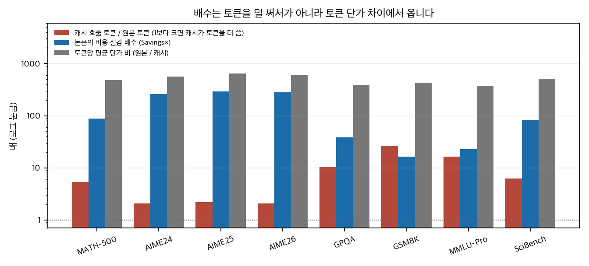
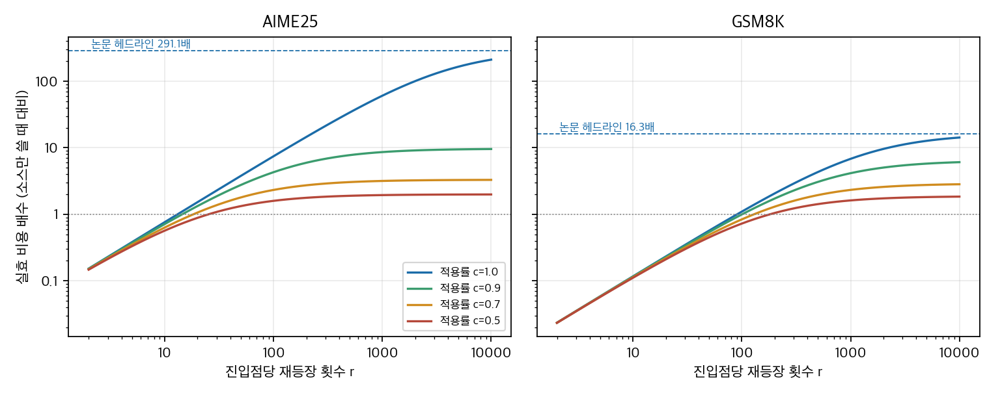
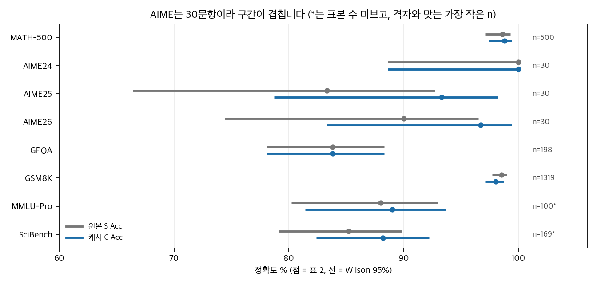

# 16–291배 싸다는 말을 믿으려면

NVIDIA의 *CPU-ARC* (Belcak, Heinrich, Muralidharan, Diao, Molchanov, arXiv:2611.09891)는 LLM이 풀이를 만들고 작은 모델이 풀이를 **실행만** 하게 하자는 주장을 처음 실험으로 옮긴 논문입니다. 한 문제의 추론 전사를 빌더 모델이 파이썬 "의미 함수"로 바꿔 두면, 말만 바꾸거나 숫자만 바꾼 새 입력은 1B 모델과 CPU 실행으로 풀 수 있고 호출 비용이 원본의 1/16–1/291이라고 합니다. 공식 코드와 문항별 결과가 공개되어 있지 않아, 이 글은 논문 표 2와 부록 C의 표를 다시 계산하고 통계와 토이 모형으로 주장의 조건을 확인한 기록입니다(코드 실행과 API 호출은 하지 않았습니다).

## 비용 수치는 다시 나옵니다

부록 C는 역할별 평균 토큰 수를 줍니다. 여기에 3.5절 단가(Opus 4.5 입력 5, 출력 25달러/백만 토큰, 파인튜닝한 Llama 3.2 1B 입력 0.023, 출력 0.194)를 곱하면 원본 비용과 캐시 비용이 8개 벤치마크 모두 4자리까지 맞고 Savings×(16.3–291.1)가 ±0.1 안에서 나옵니다. 손익분기 식 B/(S − C)도 "AIME 약 13번, GSM8K 약 90번"을 그대로 줍니다. 한 가지, 빌더 비용은 토큰 표에서 보고값이 6.5–7.2% 작게 나와 어떤 읽기에서도 정확히 맞지 않습니다. 표의 4자리 반올림 캐시 비용으로 나누면 배수가 최대 9% 달라지므로, 표만 가진 독자는 AIME의 "262–291배"를 ±15% 범위로 읽어야 합니다.

## 배수는 토큰 단가에서 옵니다

캐시 호출은 원본 풀이보다 **토큰을 더 씁니다**. 원본이 486토큰으로 푸는 GSM8K 문항에 캐시 호출은 12,864토큰(추출기 입력이 대부분)을 쓰고, AIME도 2.1–2.2배입니다. 16–291배는 Opus 4.5 확장 사고의 출력 단가 대 1B 모델의 출력 단가 같은 토큰 단가 차이(약 375–644배)에서 나옵니다. 같은 1B나 Haiku급 모델이 원본 문항을 직접 푼 정확도와 비용이 있으면 "코드 캐시의 몫"과 "싼 모델의 몫"을 가를 수 있지만 논문에는 없습니다. 캐시 비용을 CPU 시간과 인프라까지 넣어 보고값의 10배로 두면 AIME '25는 29배, GSM8K는 1.6배가 됩니다. 이 논문에는 CPU 실행 시간이나 지연의 측정이 없습니다.

## 헤드라인은 적용률 1과 무한 재등장의 극한입니다

보고된 배수는 호출 1회의 비용 비이고 구축비, 적용률, 재등장 횟수는 그 밖에 있습니다. 한 항목이 N번 호출될 때 S/(C + B/N)로 구축비를 분산하면 N = 100번에서 AIME '25는 8.1배, GSM8K는 1.1배입니다. 질의가 확률 c로 캐시에 적중하고 나머지는 원본이 푼다고 두는 토이 모형(`analysis/toy_cache_model.py`)에서 극한은 c = 1일 때만 291배이고 c = 0.9이면 9.7배, 0.7이면 3.3배, 0.5이면 2.0배입니다.

논문은 구축비와 손익분기를 따로 적었고 비용을 역할별 토큰으로 공개했습니다. 그 점은 높게 칠 만합니다. 다만 초록의 "16–291배"는 이 조건들을 뺀 값입니다. 적용률은 어디에도 보고되지 않으며, 실제 서비스 측정으로는 의미 캐시의 적중률 67%(arXiv:2601.11687 초록) 같은 사례가 있을 뿐입니다.

## "프런티어와 비슷하다"는 무엇을 잰 것인가

문항 수는 논문에 적혀 있지 않아 알려진 벤치마크 크기(MATH-500 500, AIME 각 30, GPQA Diamond 198, GSM8K 테스트 1,319)와 보고 백분율의 정수 격자로 복원했습니다. 점추정은 원본과 비슷하지만 ±5%p 동등은 MATH-500, GSM8K, GPQA에서만 성립하고 AIME 세 칸은 30문항이라 검출 가능한 최소 차이가 17–26%p입니다. AIME '25의 "캐시 93.3 대 원본 83.3"은 30문항 중 3문항 차이이고 Holm 보정 후 어느 칸에서도 C ≠ S의 근거가 없습니다. 또 MMLU-Pro와 SciBench에서는 정확도 차이가 답 불일치 비율(100 − Fidelity)을 넘어 세 열이 한 문항 집합에서 나온 값일 수 없습니다.

더 근본적인 문제는 설계입니다. 캐시는 **평가 문항 하나하나로** 만들어지고, 구축 단계의 시험은 정답 라벨에 대해 판정합니다(Sec 2.2.1 Phase 5). 그러므로 표 2의 C Acc는 "그 문항으로 구축한 캐시가 그 문항을 푸는 비율"이고 새 문항의 정확도가 아닙니다. AIME '25에서 캐시가 원본보다 높은 것(93.3 대 83.3)을 논문은 결정적 코드가 계산 실수를 피해서라고 설명하지만, 빌더가 정답 라벨을 보고 원본의 오답을 고쳐 쓴다는 더 단순한 설명이 같은 수치를 만듭니다. 문항별 결과가 없어 둘을 가를 수는 없습니다. 1B 실행 모델도 평가 로그 20%에서 만든 합성 변형으로 학습되었습니다.

교란 시험은 이 약점을 메우려는 것이지만 분모(변형 수)와 시드, 구간이 없고, 원본에서 이미 맞은 문항에만 적용되며, 변형 정답을 원본 모델(Opus 4.5)이 만들고 판정자도 같은 계열입니다. 원본에서 틀린 문항이 변형에서도 틀린다고 두고 문항 전체로 환산하면 복합 교란 정확도가 원본 정확도보다 낮은 칸이 8개 중 7개입니다(MATH-500 −8.1%p, GSM8K −7.8%p). 원본 모델의 변형 문항 정확도가 없어 이 비교는 불완전합니다.

## 넘김과 조용한 오답

논문의 사용 패턴(그림 1)은 캐시를 먼저 시도하고, 미적중이나 `CacheInvocationError`일 때만 LLM으로 넘깁니다. 끝까지 실행되어 틀린 답을 내는 경우를 알아채는 단계는 설명되어 있지 않고, 적용률, 임계값, 오적중률, 조용한 오답률도 보고되지 않았습니다. 같은 토이에서 적중 정확도를 87%로 두고 감지기가 없으면 재등장 질의의 약 12%가 조용한 오답이고, 감지율 0.9이면 1.2%이며 넘긴 질의의 비용이 늘어납니다. 이 값들은 우리가 둔 모형의 결과이고 논문의 값이 아닙니다. 캐시를 첫 단 모델로 둔 캐스케이드에서 가장 중요한 질문("싼 쪽의 답을 언제 믿는가")이 이 논문에서는 열린 채입니다.

## 인용할 때

- 인용할 수 있음: 설계 아이디어(전사에서 의미 함수 코드를 자동 구축), 비용을 역할별 토큰으로 분해한 방식, 표 2의 비용 수치와 손익분기(재계산 일치).
- 단서가 필요함: 정확도 "대등"(구축 문항 위 점추정), 교란 견고성(분모와 외부 정답 없음), 16–291배(호출 1회 단가 환산).
- 쓰면 안 됨: "새 문제에서 원본만큼 맞는다", "미적중 시 안전하다", "CPU에서 빠르다".

전체 계산과 근거 위치는 [분석 노트](https://github.com/jacoblee1214/ai-paper-notes)의 `01`–`04` 문서에 있습니다. 논문 그림은 arXiv 비독점 배포 라이선스와 PDF의 회사 저작권 고지 때문에 넣지 않았고, 그래프는 모두 직접 그렸습니다.

## 자료

- [통합 리포트 PDF](report/report_public.pdf)
- [01. CPU-ARC 논문 분석](analysis/01_paper_analysis.md)
- [02. 선행 연구와 관계](analysis/02_prior_work.md)
- [03. 재계산과 통계](analysis/03_analysis.md)
- [04. 주장 검증 (공식 코드 없음)](analysis/04_claim_verification.md)
