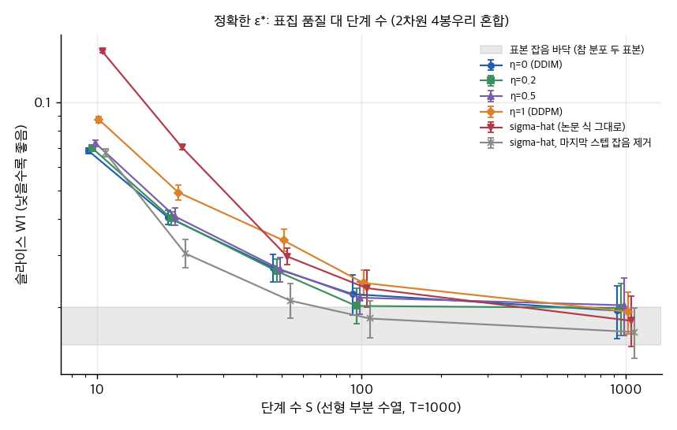
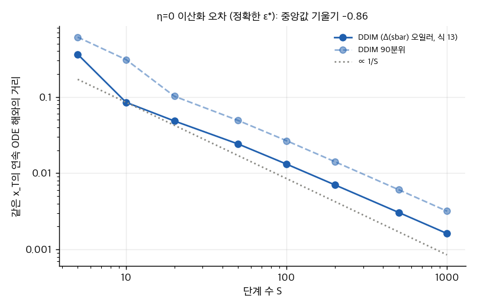
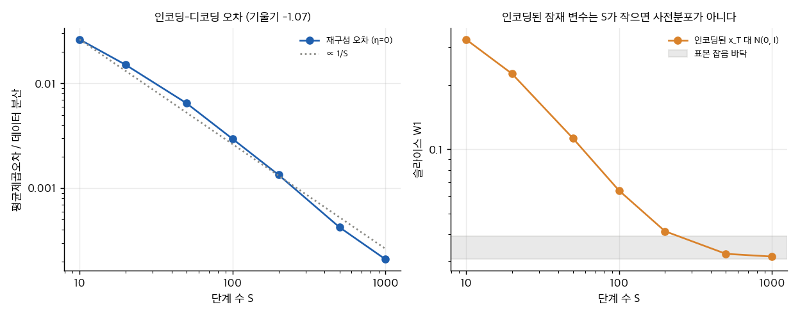

# DDIM의 η=0 우위는 모델 오차 없이도 성립하는가

*Denoising Diffusion Implicit Models*(Song, Meng, Ermon, arXiv:2010.02502, ICLR 2021)는 DDPM 학습을 그대로 두고 표집기만 바꿔 단계를 10×–50× 줄입니다. 이 글은 식을 다시 검산하고, 표 1의 "η=0이 작은 S에서 가장 좋다"가 **학습된 모델의 성질인지 표집기 자체의 성질인지**를 가르는 기록입니다. **모델 학습, 가중치·데이터 다운로드, 설치, 공식 코드 실행, API 호출은 하지 않았습니다.** 논문 그림은 arXiv 라이선스가 CC BY가 아니라서 싣지 않았고 그래프는 모두 직접 그렸습니다.

## 학습 없이 확인하는 방법

데이터가 가우시안 혼합이면 모든 노이즈 수준에서 E[x_0|x_t]가 닫힌 식이라 정확한 잡음 예측기 ε*(x_t) = (x_t − √ᾱ_t E[x_0|x_t])/√(1−ᾱ_t)를 신경망 대신 쓸 수 있습니다. 모델 오차가 0이므로 남는 차이는 이산화와 확률성의 오차입니다. 2차원, 봉우리 4개(가중치 0.4/0.3/0.2/0.1, 표준편차 0.1), DDPM 선형 스케줄 T=1000, float64 CPU, pytest 24개입니다. 지표는 슬라이스 W1이고 표본 잡음 바닥은 0.0173입니다. 표본 3000개 × 20 시드이고 짝지은 비교에 Holm 보정을 썼습니다.

## 식은 맞고, 정리 1 부록의 가중치는 틀립니다

- 보조정리 1(임의 σ에서 같은 주변분포)은 T=1000 전부에서 1e-16, η=1이 DDPM 조상 표집인 것은 분산 1e-17·계수 1e-13, DDIM이 ODE의 오일러 스텝인 것은 스텝별 1e-13에서 맞습니다. 조건 σ_t² ≤ 1−ᾱ_{t−1}이 필요한데 논문은 적지 않았습니다.
- 정리 1의 결론(모델 하나가 모든 σ를 푼다)은 유지됩니다. 두 가우시안 KL이 γ_t(σ)‖ε−ε_θ‖²이고 모든 σ>0에서 γ_t>0이기 때문입니다. 그러나 부록 식 30–35는 평균 계수 A_t를 빠뜨려 γ_t = 1/(2dσ_t²ᾱ_t)가 틀립니다. 올바른 γ_t = A_t²(1−ᾱ_t)/(2σ_t²ᾱ_t)는 DDPM 가중(Ho 등 식 12)과 1e-9에서 일치하고, 논문의 값과는 t에 따라 1.5e4–6e7배 다릅니다.
- 데이터가 한 점이면 ε*가 궤적을 따라 상수라서 σ̄에 대한 오일러가 정확합니다. 한 스텝으로도 x_0가 나옵니다(오차 2e-2 이내).

## 모델 오차가 없어도 η=0은 η=1보다 낫지만 η=0.2와는 구별되지 않습니다

S=10에서 슬라이스 W1은 η=0 0.0683, η=0.2 0.0699(+0.0015, Holm p=0.62), η=0.5 0.0725(+0.0041, p=5e-4), η=1 0.0872(+0.0189, p=3e-11), σ̂ 0.149입니다. 표 1의 순서는 학습된 모델 없이도 나타나는 표집기의 성질입니다. S≥50에서는 SW1으로 η=0.2, 0.5, 1이 η=0과 구별되지 않고, S=1000에서는 모든 설정이 바닥과 구별되지 않습니다.

σ̂의 급락은 "잡음이 크다"가 아니라 **마지막 큰 스텝에 남는 잡음**입니다. σ̂은 방향 항을 η=1 그대로 두고 잡음만 키워서 x_{τ_{i−1}}의 잡음 분산이 모델 가정보다 σ̂²−σ(1)²만큼 큽니다. S=10 선형 격자에서는 한 스텝에 0.185로 모델 가정 0.10의 두 배에 가깝습니다. 마지막 스텝 잡음을 지우면 급락이 사라지고 S=20에서 η=0보다 좋았습니다(−0.0100, p=0.0014). 공식 코드는 σ̂ 경로에서 마지막 스텝 잡음을 마스크하고 x_0를 클리핑하며 격자도 논문 정의와 다릅니다. 선형은 range(0, T, T//S)라 끝점이 T가 아니고 S=30이면 31스텝이며, 이차는 끝점이 0.8T이고 앞쪽 스텝이 겹칩니다. 이 토이는 한 데이터입니다. 봉우리 폭·간격·차원을 바꿔 보지 않았습니다.

## 이산화 오차, 일관성, 보간, 재구성

같은 x_T에서 연속 ODE 해와의 거리 중앙값은 S=10 0.085에서 S=1000 0.0016으로 S^−0.86으로 줄고, 같은 오일러라도 식 15(확률 흐름 오일러)는 S=10에서 RMS가 10배 큽니다(1.90 대 0.18). 같은 x_T에서 S=1000 결과와 봉우리 라벨이 같은 비율은 S=10 97.6%, S=100 99.7%이고 η=1은 우연 수준(31%, 이론 30%)입니다. x_T를 slerp로 보간한 경로의 98.6%가 이미 지난 봉우리로 돌아가지 않고(독립 표본 0%), 평균 라벨 전환은 0.92회 대 14.05회입니다. 논문 그림 5·6의 "일관성"과 "의미 있는 보간"이 정확한 모델에서 정량적으로 성립합니다.

재구성 오차(표 2의 토이판)는 S^−1.07로 줄어 논문 표 2의 −1.19(S=10–200)와 같은 모양입니다. 그러나 **작은 S의 인코딩은 사전분포가 아닙니다.** S=10으로 인코딩한 x_T는 E‖x_T‖²=0.67(참값 2), S≥500에서야 바닥과 구별되지 않습니다. 공식 저장소에는 인코딩 코드도 FID 계산 코드도 없어 표 2는 코드로 대조하지 못했습니다.

## 논문 표 다시 읽기

표 1·3은 FID 한 줄이라 신뢰구간이 없습니다. S<1000의 8개 열에서 η에 따라 FID가 단조 증가(8/8)하고 같은 S 비교에서 DDIM이 18개 중 17개를 이깁니다. 그러나 초록의 "10×–50×"는 데이터셋마다 다릅니다. 같은 데이터의 DDIM S=1000 대비 S=100(10배)의 FID 손해는 CIFAR10 +3.0%, Bedroom +4.1%(DDPM 기준), Church +34%, CelebA +86%이고, 20단계(50배)는 CIFAR10에서 +69%입니다. σ̂는 S=1000에서 DDIM보다 CIFAR10 21%, CelebA 7% 좋아서 "marginally worse"(§5.1)는 CIFAR10에는 맞지 않습니다. FID 표집 잡음을 0.5–2%로 가정하면 η=0 대 0.5, 1의 순위는 유지되지만 η=0 대 0.2는 판단할 수 없습니다.

## 한계

2차원 4봉우리 한 데이터라 이차 격자 우위나 σ̂ 방향은 데이터에 따라 달라질 수 있습니다. 정확한 ε*는 모델 오차를 0으로 만들므로 확률 표집이 모델 오차를 덮는 효과는 측정하지 못했습니다. 이후 문헌(PNDM, DPM-Solver, EDM, Improved DDPM, 일관성 모델)은 arXiv 초록만 확인했습니다.

코드와 재현 방법은 `ddim` 노트 저장소의 `analysis/`에 있습니다(`python3 -m pytest -q`로 24개 테스트, 전체 실험은 CPU 약 4분).

## 자료

- [최소 구현](analysis/minimal_impl.py)
- [01. 논문 분석: Denoising Diffusion Implicit Models (arXiv:2010.02502)](analysis/01_paper_analysis.md)
- [02. 계보, 가까운 대안, 구성 요소의 출처, 관련 분석](analysis/02_prior_work.md)
- [03. 분석: 식 유도 검산, 정확한 $\epsilon^*$ 최소 구현, 논문 표 재계산](analysis/03_analysis.md)
- [04. 코드 대조와 이후 문헌의 확인·수정](analysis/04_code_verification.md)
