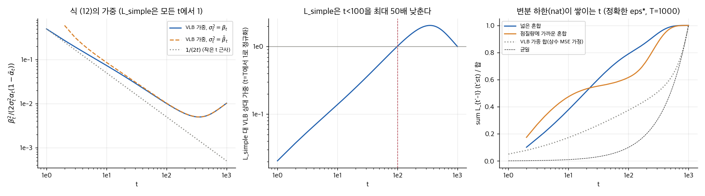
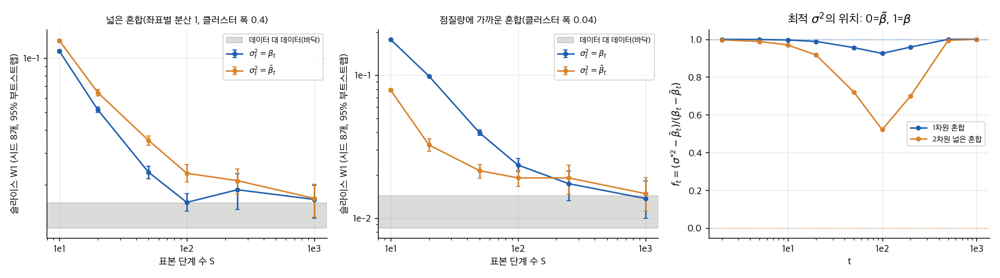
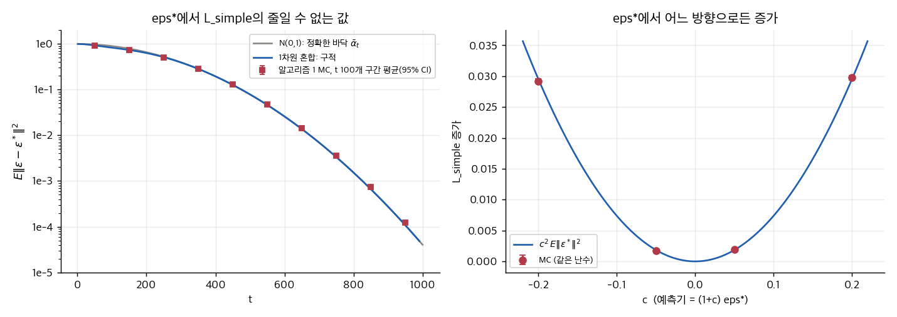
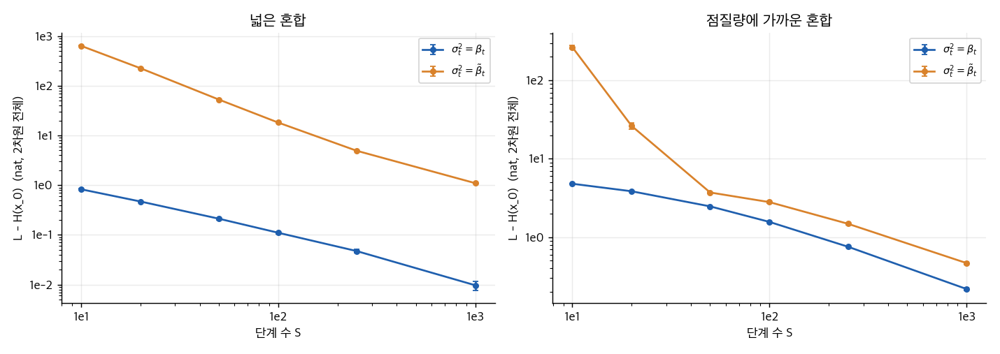

# 03. 식 검산, 정확한 denoiser 토이, 표 재계산 (구현 모드)

**학습은 하지 않았습니다.** 신경망 대신 가우시안 혼합 데이터에서 닫힌 식으로 나오는 정확한 잡음 예측기를 썼고, 모든 계산은 CPU float64입니다. 최대 메모리 582 MB(`memguard` 가드 4096 MB), 전체 계산 약 6분. 코드는 `analysis/*.py`, 결과는 `analysis/*_results.json`입니다.

## 0. 입력과 전제

- 스케줄: 선형 β_t(1e-4에서 0.02까지), T = 1000(논문 §4). 인덱스는 논문의 t = 1..T.
- **정확한 잡음 예측기.** 데이터가 Σ_k w_k N(m_k, S_k)이면 x_t\|k ~ N(√ᾱ m_k, ᾱ S_k + (1−ᾱ) I)이고 E[x_0\|x_t]가 닫힌 식입니다. 그러면 최적 예측기는 ε*(x_t,t) = E[ε\|x_t] = (x_t − √ᾱ_t E[x_0\|x_t])/√(1−ᾱ_t)입니다. 신경망이 학습으로 근사하려는 대상이 오차 없이 주어집니다.
- 데이터 세 가지(모두 좌표별 분산 1, 평균 0으로 표준화): 1차원 2성분 혼합, **넓은** 2차원 혼합(비등방 성분 4개, 폭 약 0.2–0.6), **점질량에 가까운** 2차원 혼합(성분 5개, 표준편차 0.04).
- 한계: 저차원 가우시안 혼합이며 이미지가 아닙니다. 신경망 오차, 고차원, 이산 데이터는 없습니다. 이 토이가 보이는 것은 **식과 정확한 최적해의 성질**이지 CIFAR10 수치가 아닙니다.
- 시드와 표본 수는 각 절에 적었습니다. 신뢰구간은 시드 단위 부트스트랩(10,000회, 95%), 여러 비교는 홀름 보정입니다.

## 1. 식 검산

### 1.1 식 (4), 순방향 닫힌 식 (`derivation_checks.py` B)

- 분산 점화식 Var_t = α_t Var_{t-1} + β_t가 닫힌 식 ᾱ_t v_0 + 1 − ᾱ_t와 최대 절대 오차 1.0e-15로 일치합니다(T = 1000).
- 식 (2)의 사슬을 20만 경로로 직접 돌려 t = 1, 10, 100, 500, 1000에서 x_t − √ᾱ_t x_0의 분산을 식 (4)와 비교했습니다. 분산 z 점수는 −1.17 ~ 1.77(\|z\| < 2), 평균은 표준오차 안입니다(시드 1).

### 1.2 식 (6), (7), 사후 (B)

- 결합 가우시안 (x_{t-1}, x_t \| x_0)을 사슬(식 2)에서 직접 만들어 조건부 평균과 분산을 계산한 값과 식 (7)의 μ̃_t, β̃_t를 t = 2..1000에서 비교했습니다. 최대 오차 평균 2.1e-13, 분산 3.5e-16.

### 1.3 식 (3) = 식 (5), 식 (16)

- **식 (3) 대 (5)** (T = 3, 임의의 reverse 과정, 같은 경로 n = 2,000,000, 시드 2): 식 (3)의 경로 로그 비율 평균 2.08617 ± 0.00121(표준오차), 식 (5)의 닫힌 식 KL 평균 2.08616 ± 0.00152. 같은 경로에서의 쌍 차이 1.9e-5 ± 1.2e-3. 일치합니다. 이 임의의 reverse 과정에서는 식 (5)의 표준편차가 식 (3)보다 1.25배 큽니다(식 (5)가 분산을 줄인다는 보장은 없습니다).
- **식 (16)** (L − H(x_0) = KL(q(x_T)‖p(x_T)) + Σ_t E KL(q(x_{t-1}\|x_t)‖p_θ(x_{t-1}\|x_t))): 1차원 혼합, 100단계, σ_t² = β_t, ε*. 항마다 n = 100,000(시드 31). 식 (16)의 합은 **1.31347 ± 0.00040**, 식 (5)의 합(시드 32)은 1.3192 ± 0.0040, 엔트로피(격자 구적) H = 1.30520 nat입니다. 두 합의 차 0.0057은 1.4 표준오차입니다. 간격은 0.0083 nat이고 100개 항은 모두 0 이상이어야 하는데 29개가 음수 추정을 냈지만 가장 음수인 것이 −1.48 표준오차라 몬테카를로 잡음입니다.
- 같은 표본 수에서 식 (16)의 표준오차(0.0004)가 식 (5)의 합(0.0040)보다 열 배 작습니다. 간격을 재려면 식 (16) 쪽이 낫습니다(§4.2에서 이 방법을 씁니다).

### 1.4 식 (8)–(12), 알고리즘 2, 점수와의 관계 (E, G, H)

- 식 (10): μ̃_t(x_t,x_0) = (x_t − β_t/√(1−ᾱ_t) ε)/√α_t, 무작위 10만 점에서 최대 오차 9e-13.
- 식 (12): ‖μ̃ − μ_θ‖²/(2σ²) = β_t²/(2σ²α_t(1−ᾱ_t))‖ε − ε_θ‖², **임의의** ε_θ 예측에 대해 최대 상대 오차 4e-10. σ² = β_t와 σ² = β̃_t 모두에서 성립합니다(테스트).
- 알고리즘 2의 한 걸음 (x_t − β_t/√(1−ᾱ_t) ε_θ)/√α_t는 "x̂_0 = (x_t − √(1−ᾱ_t) ε_θ)/√ᾱ_t를 만들어 사후 평균 식 (7)에 넣는" 공식 코드의 형태와 최대 오차 9e-13으로 같습니다.
- **ε*는 점수입니다.** 1차원·2차원 혼합에서 autograd로 ∇log q_t(x_t)를 구해 ε* = −√(1−ᾱ_t) ∇log q_t를 확인했습니다. 최대 오차 5.4e-14(1차원), 4.7e-14(2차원), ᾱ = 0.9999 ~ 4e-5. 알고리즘 2의 갱신식은 x_{t-1} = (x_t + β_t s(x_t))/√α_t + σ_t z가 되어, 논문이 "Langevin을 닮았다"고 쓴 것의 정확한 형태입니다(`04` C4).
- 점질량 극한에서 ε*(x_t) = (x_t − √ᾱ x_0)/√(1−ᾱ)입니다. 이는 Diffusion Policy(Chi 외, arXiv:2303.04137)의 선형 피드백 설명(식 9)을 표준 DDPM 표기로 바로잡은 형태 (x_k + √ᾱ_k K s)/√(1−ᾱ_k)와 같습니다(x_0 = −K s 한 점).

### 1.5 스케줄 산술: ᾱ_T, SNR, L_T (A)

| 양 | 값 |
|---|---|
| Σβ_t, Σβ_t² | 10.05, 0.1341 |
| ᾱ_T | **4.036e-5** (근사 exp(−Σβ − Σβ²/2) = 4.039e-5) |
| √ᾱ_T, SNR_T | 6.35e-3, 4.04e-5 = **−43.94 dB** |
| ᾱ_t < 0.5가 되는 첫 t | 260 |
| t = 100, 250, 500, 800, 900에서 SNR | 8.71, 1.10, 0.0853, 1.53e-3, 2.75e-4 |
| SNR < 1e-2인 t의 비율 | 32.6% |

- q(x_T\|x_0) = N(√ᾱ_T x_0, (1−ᾱ_T)I)는 N(0,I)와 거의 같습니다. 좌표당 L_T = ½[−ᾱ_T − ln(1−ᾱ_T) + ᾱ_T E‖x_0‖²/D] ≈ ᾱ_T E[x_0²]/2입니다.
- CIFAR10 화소를 [−1, 1]로 스케일한 E[x_0²]를 널리 알려진 채널 평균·표준편차(0.4914, 0.4822, 0.4465 / 0.2470, 0.2435, 0.2616; **이 저장소에서 재계산하지 않은 상수**)에서 계산하면 0.256이고 L_T = 5.2e-6 nat = **7.5e-6 bits/dim**입니다. 논문의 "≈ 10⁻⁵ bits/dim"과 같은 자릿수이고, 논문의 값을 그대로 맞추려면 E[x_0²] = 0.34가 필요합니다(반올림 차이로 봅니다). L_T는 상수라 학습에는 영향이 없습니다(§3.1).
- 정보량 관점: 단위 분산 데이터에서 I(x_0; x_t) = ½ln(1 + SNR) 좌표당. t = 800에서 7.7e-4 nat, t = 900에서 1.4e-4 nat입니다. 후반 20%의 스텝은 신호가 거의 없습니다(`04` C5).

## 2. L_simple과 진짜 VLB의 t별 가중 (`derivation_checks.py` F, H)

식 (12)에서 σ_t² = β_t이면 가중 w_t = β_t/(2α_t(1−ᾱ_t)), σ_t² = β̃_t이면 w_t = β_t²/(2β̃_t α_t(1−ᾱ_t))입니다. L_simple(식 14)은 모든 t에서 가중이 같습니다(균일 t 표본, 상수 배 제외).

### 2.1 가중표

| t | w_t (σ² = β_t) | w_t (σ² = β̃_t) | L_simple 대 VLB 상대 가중 w_T/w_t |
|---|---|---|---|
| 1 | 0.5000 | (정의 안 됨, β̃_1 = 0) | 0.020 |
| 2 | 0.2727 | 0.5997 | 0.037 |
| 10 | 0.0737 | 0.0864 | 0.138 |
| 50 | 0.01858 | 0.01928 | 0.549 |
| 100 | 0.01008 | 0.01027 | 1.012 |
| 200 | 0.00598 | 0.00603 | 1.71 |
| 500 | 0.00550 | 0.00551 | 1.85 |
| 1000 | 0.01020 | 0.01020 | 1.000 |

- 작은 t에서 w_t ≈ 1/(2t)입니다. 최댓값 0.50(t=1)과 최솟값 0.00497(t = 349)의 비가 **100.7배**입니다.
- t ≥ 89에서는 w_t가 w_T의 1.1배 안(t = 89가 처음 w_t < 1.1 w_T)이고, 이후에는 0.0050–0.0102의 평평한 구간입니다. 그래서 L_simple은 "t < 100 쪽을 최대 49배(= 1/0.0204) 낮추고, 나머지는 거의 그대로"입니다. 논문의 말("작은 t 항을 낮춘다", §3.4)이 정량으로 맞습니다.
- VLB 가중의 합 중 t ≤ 10이 17.3%, t ≤ 100이 37.4%입니다(균일이면 1%, 10%).
- σ² = β̃_t의 가중은 β_t의 가중의 1.0000008 ~ 2.20배입니다(2.20배는 t = 2).

### 2.2 변분 하한이 실제로 쌓이는 t (정확한 ε*, T = 1000, σ² = β_t)

가중 w_t에 정확한 ε* 오차 E‖ε − ε*‖²를 곱한 L_{t-1}을 직접 몬테카를로로 구했습니다(항마다 n = 10,000, 시드 21). 오른쪽 패널의 곡선입니다. ΣL_{t'-1} 중 t ≤ 100에 쌓이는 비율은 **넓은 혼합 79%, 점질량에 가까운 혼합 62%**이고 t ≤ 10에서 각각 38%, 47%입니다. 즉 하한의 대부분이 작은 t(지각할 수 없는 세부)에서 나옵니다. 이는 논문의 "부호 길이의 절반 이상이 지각 불가능한 왜곡"(§4.3)과 N&D 2021의 "처음 몇 스텝이 하한에 가장 크게 기여"(그림 2)와 같은 방향입니다(`04` C2).

### 2.3 SNR 형태, VDM과의 연결 (H)

x_0 형태의 손실로 바꾸면 ε-MSE × ᾱ_t/(1−ᾱ_t) = ‖x_0 − x̂_0‖²입니다. 그러면

- **σ_t² = β̃_t**: L_{t-1} = ½ (SNR_{t-1} − SNR_t) E‖x_0 − x̂_0‖² (정확히). 상대 오차 7.7e-13(t = 2..1000에서 계수 w_t·ᾱ_t/(1−ᾱ_t) 대 ½ΔSNR).
- **σ_t² = β_t**: 같은 꼴에 (1−ᾱ_{t-1})/(1−ᾱ_t) 배. 식과 수치가 4.7e-13 안에서 맞고, 비는 0.4547(t = 2) ~ 0.9999992(t = 1000)입니다.

이것이 Kingma 외(2021, VDM)의 식 (13)과 같은 구조입니다(`04` C6). 논문은 SNR로 쓰지 않았지만 식 (12)에 이미 들어 있습니다.

## 3. §3.2의 σ_t² 주장 (`derivation_checks.py` I, `toy_experiments.py` E1, E2)

### 3.1 최적의 뜻을 정하기

reverse 분산만 σ²로 두고 평균은 최적(μ_θ = E[μ̃_t\|x_t])일 때, L_{t-1}을 최소화하는 σ²를 구합니다. 기댓값 KL = (D/2)(β̃/σ² − 1 + ln(σ²/β̃)) + c_0² m_t/(2σ²), 여기서 c_0 = √ᾱ_{t-1}β_t/(1−ᾱ_t), m_t = E tr Var(x_0\|x_t)입니다. 따라서

σ*² = β̃_t + c_0² m_t / D = Var(x_{t-1}\|x_t) (좌표당 평균).

- **x_0 ~ N(0,I)**: m_t/D = 1 − ᾱ_t이고 σ*² = β_t입니다. 결합 가우시안(x_{t-1}, x_t)의 조건부 분산을 직접 계산해 모든 t에서 \|Var − β_t\| ≤ 5.6e-17입니다.
- **x_0가 한 점**: m_t = 0이고 σ*² = β̃_t입니다(식 7에서 직접).
- **일반 데이터**: 위치 f_t = (σ*² − β̃_t)/(β_t − β̃_t) = m_t/(D(1−ᾱ_t))입니다. 좌표별 분산 1이면 f_t ≤ 1입니다(선형 최소제곱 상계: 고유값 λ_i에 대해 Σ λ_i(1−ᾱ)/(1−ᾱ+ᾱλ_i)는 오목이므로 Jensen으로 ≤ D(1−ᾱ), 등호는 등방 가우시안). 그래서 β̃_t ≤ σ*² ≤ β_t이고, 논문이 말한 "상한과 하한"의 정확한 의미입니다.
- 수치 확인: 1차원 혼합 f_t = 0.925 ~ 1.000(t = 100에서 최소 0.925), 넓은 2차원 혼합 f_t = 0.52(t = 100) ~ 1.00. 표본 10만 개로 σ²를 격자에서 직접 최소화한 값이 닫힌 식과 0.4% 안에서 같습니다(18개 점 중 최대 편차 0.43%). Rao-Blackwell 추정과 단순 MC 추정의 비는 0.99–1.01.

### 3.2 정확한 표본기 분산 (1차원 가우시안, MC 없음)

x_0 ~ N(0, s²)이면 ε* = √(1−ᾱ) x_t/v_t (v_t = ᾱ s² + 1 − ᾱ)이고 알고리즘 2는 선형이라 각 t의 표본 분산 V_t가 점화식 V_{t-1} = c_t² V_t + σ_t²로 정확히 나옵니다.

| 데이터 | σ² | 순방향 주변 분산 v_t 대비 V_t/v_t |
|---|---|---|
| s² = 1 | β_t | **모든 t에서 1 ± 2.4e-15**(최종 V_0 = 0.9999, 마지막 단계가 잡음 없음 때문) |
| s² = 1 | β̃_t | 최대 편차 0.89%, 최종 0.9911 |
| s² = 1e-12(점질량) | β̃_t | 최대 편차 4.0e-5(사전 N(0,I) 대 q(x_T)의 차이) |
| s² = 1e-12 | β_t | t = 1에서 1.85배, t = 10에서 1.105배, t = 100에서 1.012배 |

논문의 두 주장("x_0 ~ N(0,I)에서 β_t 최적, 한 점에서 β̃_t 최적")이 표본기의 정확한 분산 추적으로도 성립합니다.

단계 수를 줄인 표본기(건너뛴 스케줄, ᾱ는 그대로, β'_i = 1 − ᾱ_{τ_i}/ᾱ_{τ_{i-1}}, t = 1과 T 포함)에서 최종 분산의 상대 오차(V_0/s² − 1):

| S | s² = 1: β / β̃ | s² = 0.25: β / β̃ | s² = 0.01: β / β̃ |
|---|---|---|---|
| 10 | −1e-4 / −0.479 | +0.434 / −0.583 | +11.6 / −0.928 |
| 50 | −1e-4 / −0.145 | +0.072 / −0.214 | +0.655 / −0.536 |
| 100 | −1e-4 / −0.079 | +0.035 / −0.124 | +0.277 / −0.371 |
| 1000 | −1e-4 / −0.0089 | +0.0030 / −0.0155 | +0.0154 / −0.0724 |

작은 s²(=데이터가 좁음)에서는 **β가 크게 넘치고(+11.6 = 12.6배), β̃는 모자랍니다.** 둘 다 마지막 단계(z = 0)가 x_1에서 사후 평균 E[x_0\|x_1]을 내놓아 분산을 s²/(s²+β_1)배로 줄이는 효과를 공유합니다(s² = 1e-4, 1000단계에서 V_0/v_0 = 0.705(β), 0.430(β̃)).

### 3.3 혼합 데이터, 표본 비교 (`toy_experiments.py` E1)

2차원 혼합 두 개, 건너뛴 스케줄 S ∈ {10, 20, 50, 100, 250, 1000}, 정확한 ε*, 두 σ²를 같은 x_T와 z로 비교합니다. **시드마다 n = 10,000 표본, 시드 8개**(표본기 시드 0–7, 기준 데이터 시드 1000–1007), 슬라이스 1-Wasserstein(방향 64개, 고정). 바닥은 데이터 대 데이터(같은 n)의 같은 통계입니다.

| S | 넓은: β | 넓은: β̃ | 점질량에 가까운: β | 점질량에 가까운: β̃ |
|---|---|---|---|---|
| 10 | 0.109 | 0.125 | 0.178 | **0.079** |
| 20 | 0.052 | 0.065 | 0.099 | **0.033** |
| 50 | 0.0235 | 0.0352 | 0.0395 | **0.0215** |
| 100 | 0.0160 | 0.0231 | 0.0235 | 0.0191 |
| 250 | 0.0187 | 0.0210 | 0.0174 | 0.0191 |
| 1000 | 0.0166 | 0.0168 | 0.0137 | 0.0148 |
| 바닥(95% CI) | 0.0137 [0.0115, 0.0159] | | 0.0111 [0.0085, 0.0143] | |

- **어느 쪽이 좋은가는 데이터에 따라 뒤집힙니다.** 넓은 혼합(f_t ≈ 1에 가까움)에서는 β가 S ≤ 250에서 모두 유의하게 낫고(짝 차이 β − β̃ = −0.0157(S=10) … −0.0023(S=250), 홀름 p ≤ 0.009), 점질량에 가까운 혼합에서는 S ≤ 100에서 β̃가 낫습니다(짝 차이 +0.099(S=10), +0.066, +0.018, +0.0044, 홀름 p ≤ 2.2e-5). S = 250부터는 방향이 β 쪽으로 바뀝니다(−0.0017, 홀름 p = 0.0027).
- **S = 1000에서는 차이가 사라집니다.** 넓은 혼합: 짝 차이 −0.0002 [−0.0005, 0.0000], 홀름 p = 0.13. 점질량 쪽은 β가 0.0011 낫지만(홀름 p = 1.1e-4) 두 값 모두 바닥(0.0111) 근처이고 차이는 바닥의 10% 수준이라 실질 효과로 보기 어렵습니다. 논문의 "비슷한 결과"(§3.2)는 T = 1000에서의 말로 맞고, 단계 수를 줄이면 성립하지 않습니다.
- 실제 훈련된 CIFAR10 모델은 DDIM 표 1에서 β̃ 쪽(η = 1.0)이 σ̂ = √β 쪽보다 S = 10에서 FID 41.07 대 367.43으로 훨씬 낫습니다(`04` C1). 이 방향은 우리 점질량 쪽 토이와 같고(이미지는 좁은 다양체에 가까움), 넓은 쪽 토이와는 반대입니다. **토이가 이미지의 결과를 설명한다고 말할 수는 없고, 방향을 가르는 변수가 f_t라는 것만 보입니다.**
- 공분산 오차(‖Σ̂ − Σ‖_F)는 `toy_results.json`에 있습니다. 점질량 쪽 공분산은 클러스터 위치가 지배해서 S ≥ 100에서 구별되지 않습니다(홀름 p ≥ 0.05).

## 4. 정확한 denoiser로 한 구현 (`minimal_impl.py`)

구성: 선형·건너뛴 스케줄, q 표본(식 4), 사후(식 6–7), GMM 정확한 E[x_0\|x_t]와 ε*, 알고리즘 1의 손실 평가 `l_simple_samples`, 알고리즘 2 `sample`(σ² = β_t 또는 β̃_t), 변분 하한 항 `vlb_terms`(식 5)와 `marginal_kl_terms`(식 16), 슬라이스 W1. 테스트 16개(`test_minimal_impl.py`)가 §1–§3의 성질을 고정 시드로 점검합니다(통과).

### 4.1 L_simple의 줄일 수 없는 값 (`toy_experiments.py` E3)

ε*에서 손실은 E‖ε − ε*‖² = ᾱ_t/(1−ᾱ_t) · E tr Var(x_0\|x_t) (t별)입니다.

- **N(0,1)** (해석 바닥 ᾱ_t): 알고리즘 1을 시드 20개 × 500,000으로 평가한 평균 **0.27510 ± 0.00024**(시드 간 표준오차), 해석값 E_t[ᾱ_t] = 0.27551. 시드별 z 점수 평균 −0.42, 표준편차 1.09(범위 −2.33 ~ 1.37)로 잘 보정되어 있습니다.
- **1차원 혼합** (바닥은 x_t 구적으로 정확히): MC(시드 10개 × 400,000) 0.26480 ± 0.00035, 구적 0.26509. z 평균 −0.27, 표준편차 1.01. t 100개씩 10구간 z는 −1.38 ~ 1.34.
- **2차원 넓은 혼합** (n = 400,000, 시드 13): MC 0.41107 ± 0.00153, 조건부 분산 닫힌 식(Rao-Blackwell, t당 2,000, 시드 14) 0.41056, z = 0.33. t별 바닥은 t = 1에서 1.996(= D, 거의 전부 잡음), t = 100에서 0.941, t = 500에서 0.157.
- **최소성(섭동).** 같은 난수에서 ε* → (1+c)ε*로 바꾸면 손실 증가가 c²E‖ε*‖²와 같습니다(직교성). 1차원 혼합 n = 400,000, 시드 15, c = ±0.05: 0.00177 ± 0.00004, 0.00191 ± 0.00004 대 예측 0.00184. c = ±0.2: 0.02920 ± 0.00018, 0.02976 대 0.02948. 임의의 다른 함수(ε* + 0.1 tanh x_t)도 손실을 키웁니다(테스트).

### 4.2 변분 하한과 참 엔트로피의 간격 (E4)

2차원 혼합, 정확한 ε*. 항마다 n = 10,000(식 5, 시드 21)와 n = 20,000(식 16, 시드 22). 간격 = L − H(x_0)는 식 (16)의 합(분산이 작음)으로 보고합니다. H는 격자 구적(1601²)입니다. **연속 데이터의 미분 엔트로피 대 연속 가우시안 밀도의 하한**이므로 이미지의 bits/dim과 비교하지 마세요.

넓은 혼합(H = 1.3327 nat = 0.961 bits/dim). T = 1000, σ² = β_t: L_T = 4.0e-5, ΣL_{t-1} = 7.727, L_0 = −6.366, 합 1.361 ± 0.014(식 5). **간격 0.0097 ± 0.0011 nat = 0.0070 bits/dim**.

| S | 넓은: β | 넓은: β̃ | 점질량에 가까운: β | 점질량에 가까운: β̃ |
|---|---|---|---|---|
| 10 | 0.829 ± 0.008 | 637 ± 8 | 4.80 ± 0.01 | 266 ± 8 |
| 20 | 0.471 ± 0.007 | 226 ± 2 | 3.85 ± 0.01 | 26.2 ± 1.2 |
| 50 | 0.212 ± 0.0045 | 52.9 ± 0.4 | 2.47 ± 0.01 | 3.72 ± 0.04 |
| 100 | 0.111 ± 0.003 | 18.2 ± 0.1 | 1.565 ± 0.010 | 2.80 ± 0.03 |
| 250 | 0.0474 ± 0.0021 | 4.94 ± 0.04 | 0.756 ± 0.008 | 1.48 ± 0.02 |
| 1000 | 0.0097 ± 0.0011 | 1.099 ± 0.013 | 0.218 ± 0.005 | 0.467 ± 0.008 |

(nat, 표준오차 ±, 2차원 전체. 점질량에 가까운 혼합의 H = −3.092 nat)

- 간격은 거의 1/S로 줄어듭니다(넓은 혼합, β: S × 간격 = 8.3, 9.4, 10.6, 11.1, 11.9, 9.7). VDM의 "단계가 많을수록 하한이 좋아진다"와 일치합니다(`04` C6).
- **σ_t² = β_t가 하한 기준으로는 모든 S, 두 데이터에서 β̃_t보다 훨씬 낫습니다.** T = 1000에서 넓은 혼합은 113배, 점질량에 가까운 혼합은 2.1배 낮은 간격입니다. 같은 점질량 토이에서 표본 품질(슬라이스 W1)은 S ≤ 100에서 β̃가 낫기 때문에 **likelihood 하한에서 좋은 σ²와 표본 품질에서 좋은 σ²가 다릅니다.** 공식 코드가 CIFAR10 하한 평가에 `fixedlarge`(σ² = β_t)를 쓰고 "더 나은 decoder log likelihood를 위해"라고 주석한 것과 같은 방향입니다(`04` D3).
- 식 (5)와 식 (16)의 간격은 두 계열 모두 표준오차의 2배 이내에서 같습니다(예: 점질량 S = 20, β̃: 24.56 ± 1.6 대 26.25 ± 1.23). 마이너스 추정 항이 있는 이유는 §1.3과 같습니다.
- 이 간격은 reverse 과정이 가우시안이라는 가정과 단계 수에서 오는 것입니다(모델 오차 0). 신경망이 있는 실제 NLL 3.70–3.75 bits/dim과 직접 비교하지 않습니다.

## 5. 이 토이가 말해 주지 못하는 것

- 신경망의 t별 ε 오차: 정확한 ε*에서는 0입니다. 실제 모델에서는 작은 t(잡음이 적은 구간)와 큰 t의 x̂_0 증폭에서 오차가 생기고(§6.2), 이것이 σ_t² 선택과 단계 수 민감도를 바꿉니다(`04` C1).
- 이미지의 고차원성: 이 토이는 D = 1–2입니다. f_t(§3.1)가 이미지에서 어떤 값인지는 모릅니다.
- 학습 목적 간 차이(L 대 L_simple 대 x_0 예측): 최적해에서는 같은 해(ε*)로 수렴하므로 토이로는 구별되지 않습니다. 차이는 유한한 용량과 최적화에서 나옵니다. 그래서 가중표(§2)와 정확한 하한(§4.2)만 확인했습니다.

## 6. 논문 수치 재계산 (`paper_arithmetic.py`)

FID, IS는 이미지와 Inception이 필요해 **재계산할 수 없습니다.** 산술과 구조만 확인했습니다.

### 6.1 표 1

NLL 간격: L 3.70 − 3.69 = 0.01, L_simple 3.75 − 3.72 = 0.03. "훈련과 시험의 간격은 최대 0.03 bits/dim"(§4.3)과 일치합니다.

### 6.2 §4.3, 표 4, 그림 5

- rate 1.78 + distortion 1.97 = **3.75** = 표 1의 L_simple NLL. 표 4의 T−t+1 = 1000 행(rate 1.77581, RMSE 0.95136)이 본문의 1.78, 0.95와 같습니다. 왜곡이 전체 부호 길이의 52.5%("절반 이상")입니다.
- 표 4는 rate가 단조 감소, RMSE가 단조 증가입니다(10행). rate의 **93.2%가 마지막 100 스텝**(1000 → 900 행)에서 쓰입니다. 이는 §2.2의 토이 비율(t ≤ 100에 62–79%)과 같은 방향이고 더 극단적입니다.
- **이산 디코더로 왜곡 1.97 bits/dim 맞춰 보기.** RMSE 0.95(255 스케일)의 오차를 가우시안(또는 같은 RMS의 라플라스)으로 가정하고 식 (13)의 기대 NLL을 계산했습니다. σ_1² = β_1이면 σ = 1.275(255 스케일)이고 **2.094 bits/dim**, 공식 코드의 t = 1 분산 β̃_2 = 5.45e-5이면 σ = 0.942이고 **1.977 bits/dim**(라플라스 1.980)입니다. 어떤 σ에서도 최소 1.975(σ = 0.905)입니다. 즉 1.97은 코드의 σ_1에서만 설명되고 σ_1² = β_1에서는 설명되지 않습니다(+0.12 bits/dim). 단 오차의 실제 분포를 모르므로 **간접 증거**입니다(`04` D4).
- **0율 왜곡.** 표 4의 마지막 행(T−t+1 = 100, t = 901, ᾱ = 2.70e-4)에서 RMSE 67.6입니다. 데이터 평균만 예측하는 상수 예측기의 RMSE는 CIFAR10 채널 표준편차(위의 알려진 상수)에서 63.96입니다. 즉 이 행의 x̂_0는 상수 예측보다 **11.7% 더 나쁩니다**(MSE 비 1.117). x̂_0 = (x_t − √(1−ᾱ)ε_θ)/√ᾱ는 ε 오차를 1/√ᾱ_t = 60.8배 증폭하므로, ε-MSE 환산으로 약 8e-6(데이터가 [−1,1]일 때 ε-MSE의 최소값 약 6.9e-5의 11%)입니다. L_simple에서는 보이지 않는 크기이지만 x̂_0 왜곡에서는 커집니다. 그림 5의 오른쪽 끝 왜곡을 "정보량"으로 읽으면 안 됩니다. 이 수치는 추정(CIFAR 상수와 E[x_0²] = 0.256)입니다.

### 6.3 표 2, 표 3, 표 1의 비교

- 표 2의 IS ±(0.09–0.13)는 IS 표준 코드의 10분할 표준편차로 보이지만 논문이 밝히지 않았습니다. 이를 가정하면 표준오차 = ±/√10입니다. 그러면 ε 예측 L_simple 대 L(고정 Σ)의 IS 차 1.79는 **33표준오차**, μ̃ 예측 대 ε 예측(둘 다 L, 고정 Σ)의 IS 차 0.39는 7.8표준오차입니다. 그러나 이 표준오차는 **표본 추출 잡음뿐**이고 **학습 시드 분산을 포함하지 않습니다**. 최종 실험은 한 번 학습했고(부록 B) "학습 중 평가한 최소 FID"를 골랐으므로 낙관 편향도 있습니다.
- FID 차이: μ̃ 예측 대 ε 예측(L, 고정 Σ) 13.22 대 13.51은 0.29로 **구별 불가**로 보는 것이 맞고(논문도 "approximately as well"), L_simple(3.17)과 L(13.51)의 10.34, 학습 Σ(23.69)와 고정 Σ(13.22)의 10.47은 크기가 훨씬 커서 학습 시드 잡음으로 설명되지 않을 것입니다. **크기 비교는 이 정도만 가능합니다.**
- 학습 시드 잡음의 크기: 논문에는 없습니다. N&D 2021이 같은 설정(T = 1000, 선형, L_simple, CIFAR10)을 다른 코드로 50만 스텝 학습해 FID 3.29, NLL 3.73을 얻었습니다(표 2). 논문의 3.17, 3.75와 FID 0.12, NLL 0.02 차이이고, 이는 시드가 아니라 구현·학습 길이 차이를 함께 담은 값입니다. 학습 시드 하나의 표준편차는 못 구합니다. 검색으로 얻은 CIFAR10 단일 체크포인트의 표본 시드별 FID(2.652, 2.637, 2.608; ±0.022)는 표본 잡음일 뿐이고 요약만 확인해 **미검증**입니다(arXiv:2605.26032의 부록으로 알려짐).
- 표 1: 논문의 FID 3.17은 StyleGAN2+ADA(v1) 비조건부 3.26보다 0.09 낮을 뿐입니다(조건부 2.67보다는 0.50 높음). 이 차이는 위의 구현 차이(0.12)보다 작아서 "state-of-the-art"를 순위로 인용하기 어렵습니다. 시험 집합 기준 FID 5.24는 훈련 집합 기준 3.17보다 2.07 큽니다.
- 표 3: LSUN Bedroom 6.36 < ProgressiveGAN 8.34, Cat 19.75 < 37.52이지만 **Church 7.89 > 6.42**. 초록의 "ProgressiveGAN과 비슷"은 Church에서 지는 점을 가립니다. 큰 Bedroom 4.90은 StyleGAN 2.65보다 2.25 높습니다.

### 6.4 부록 B: 시간과 모수

- CIFAR 800,000스텝 ÷ 21 스텝/초 = **10.58시간**(논문 10.6시간). 배치 128 × 80만 = 1.02억 장, 50,000장 기준 2,048 에폭.
- 표본: 256장 17초 → 장당 66 ms, 1000 NFE. FID 5만 장은 **55분**. LSUN·CelebA 256: 128장 300초 → 장당 2.34초, FID 5만 장 32.6시간. 학습은 2.2 스텝/초에서 Bedroom 240만 스텝 12.6일, Cat 9.5일, Church 6.3일, CelebA-HQ 2.6일.
- **모수 수.** 공식 코드(`unet.py`)의 구조를 따라 센 값: CIFAR10 `unet2d16b2` **35,746,307**(논문 35.7M, +0.13%), LSUN·CelebA `unet2d16b2c112244` **113,673,219**(논문 114M, −0.29%). 논문의 "대략 2.56억"인 큰 Bedroom 모델은 공식 코드에 설정이 없고, ch를 128에서 192로 올리면 255,677,955(−0.13%)로 일치하므로 **ch = 192로 추정**합니다.

## 7. 재현 여부와 이유

- 논문 규모(CIFAR10 80만 스텝, LSUN)는 GPU·TPU가 필요해 하지 않았습니다.
- 정확한 denoiser 토이는 학습이 필요 없고 CPU에서 6분이었습니다.
- 학습이 필요한 확인(작은 MLP로 ε-예측 학습, L 대 L_simple의 토이 비교, 학습 시드 분산)은 승인 전이라 하지 않았습니다.
- 공식 코드는 실행하지 않았습니다.
