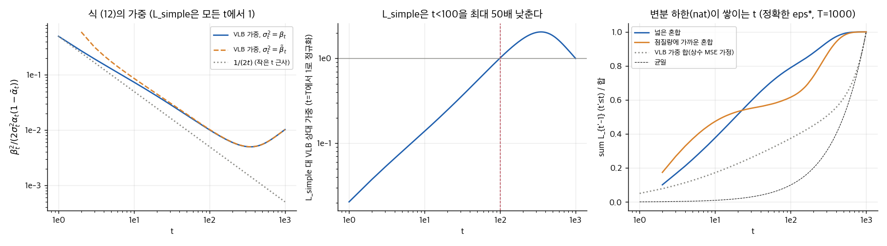
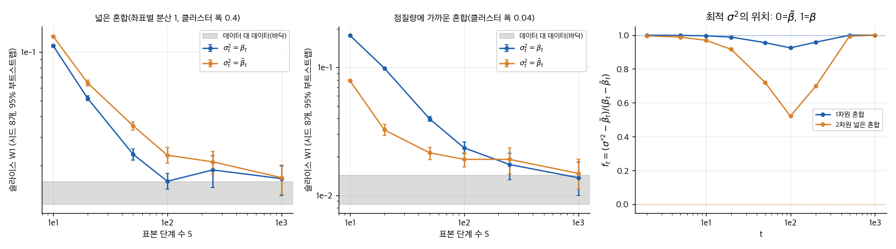
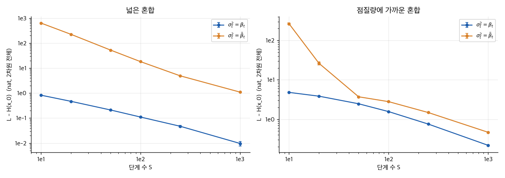
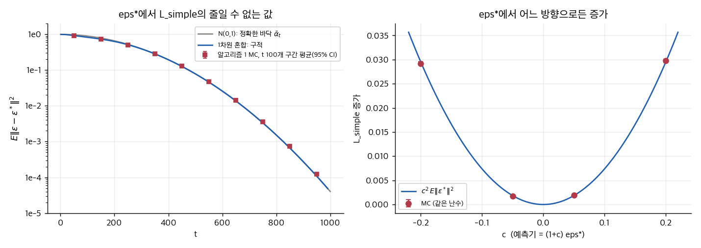

# DDPM의 식과 σ² 주장을 학습 없이 검산했습니다

*Denoising Diffusion Probabilistic Models*(Ho, Jain, Abbeel, NeurIPS 2020)는 잡음 예측기 ε_θ와 단순화 목적 L_simple로 CIFAR10 FID 3.17을 얻었습니다. 이 글은 그 식과 주장을 **학습 없이** 다시 확인한 기록입니다. 신경망 대신 가우시안 혼합 데이터에서 닫힌 식으로 나오는 정확한 잡음 예측기 ε*(x_t, t) = (x_t − √ᾱ_t E[x_0\|x_t])/√(1−ᾱ_t)를 썼습니다. 신경망이 학습으로 근사하려는 대상이 오차 없이 주어지므로 식과 최적해의 성질만 남습니다. 차원 1–2의 토이이고 이미지 결과가 아닙니다. 논문 그림은 arXiv 라이선스가 CC가 아니라서 싣지 않았고, 그래프는 모두 직접 그렸습니다.

## 식은 맞고, 알고리즘 2는 점수의 이산화입니다

식 (4), (6), (7)은 1e-13 안에서, 식 (3) = 식 (5)는 몬테카를로 표준오차(0.0012) 안에서, 임의의 ε_θ에 대해 식 (12)는 4e-10 안에서 일치합니다. 정확한 denoiser에서 ε*는 −√(1−ᾱ_t)∇log q_t(x_t)와 5e-14 안에서 같습니다. 그래서 알고리즘 2의 한 걸음은 x_{t-1} = (x_t + β_t ∇log q_t(x_t))/√α_t + σ_t z입니다. 논문이 "Langevin을 닮았다"고 쓴 것의 정확한 형태이고, Song 외 2021이 말한 역방향 VP SDE의 한 이산화입니다.

σ_t² = β̃_t로 두면 식 (12)는 L_{t-1} = ½(SNR_{t-1} − SNR_t)E‖x_0 − x̂_0‖²로 정확히 쓰입니다(오차 7.7e-13). 논문은 SNR로 쓰지 않았지만 이후 Kingma 외 2021(VDM)이 쓴 꼴이 이미 식 (12)에 들어 있습니다.

## L_simple은 작은 t를 최대 49배 낮춥니다

진짜 VLB의 가중 β_t/(2α_t(1−ᾱ_t))는 t=1에서 0.500, t=349에서 0.00497까지 100.7배 변하고 t≥89에서는 평평합니다. L_simple은 모든 t에서 가중이 같으므로 t<100 쪽만 최대 49배 낮춥니다. "작은 t 항을 낮춘다"는 논문의 설명(§3.4)이 정량으로 맞습니다. 정확한 ε*로 L_{t-1}을 직접 재면 하한의 62–79%가 t ≤ 100에서 쌓입니다. 부호 길이의 절반 이상이 지각 불가능한 세부에 쓰인다는 §4.3의 해석과 같은 방향입니다.

## σ_t² 주장은 정확히 맞고, "비슷한 결과"는 T=1000에서만 맞습니다

최적 reverse 분산은 σ*² = β̃_t + c_0² E[tr Var(x_0\|x_t)]/D(= Var(x_{t-1}\|x_t))입니다. x_0 ~ N(0,I)이면 β_t이고, 한 점이면 β̃_t이며, 좌표별 단위 분산 데이터에서는 그 사이입니다. 정확한 가우시안 표본기의 분산 점화식으로도 확인됩니다. N(0,1) 데이터에서 σ² = β_t는 모든 t에서 순방향 주변 분산과 1 ± 2.4e-15로 같고, 점질량에 가까운 데이터(s² = 1e-12)에서 σ² = β̃_t는 4e-5 안에서 따라가지만 β_t는 t=10에서 10.5%, t=1에서 1.85배 넘칩니다.

단계 수를 줄이면(건너뛴 스케줄) 선택이 표본 분포를 바꿉니다. 2차원 혼합 두 개에서 정확한 ε*로 표본을 뽑아 슬라이스 W1을 재면(시드 8개, 시드당 10,000개, 홀름 보정) 방향이 데이터에 따라 뒤집힙니다.

넓은 혼합에서는 S ≤ 250에서 β_t가 낫고(홀름 p ≤ 0.009), 점질량에 가까운 혼합에서는 S ≤ 100에서 β̃_t가 낫습니다(S=10: 0.079 대 0.178, 홀름 p ≤ 2.2e-5). S=1000에서는 차이가 바닥 근처로 줄어듭니다. 방향을 가르는 변수는 위치 f_t = (σ*² − β̃_t)/(β_t − β̃_t)입니다(오른쪽 패널). 실제 훈련된 CIFAR10 모델에서는 DDIM 표 1이 S=10에서 β̃ 쪽(η=1.0) FID 41.07 대 σ̂=√β 쪽 367.43으로 보여 이미지는 점질량 쪽 토이와 같은 방향입니다. 이 토이가 그 결과를 설명한다고는 말할 수 없습니다. 방향을 가르는 변수가 무엇인지만 보입니다.

변분 하한으로 보면 판이 다릅니다. 2차원 혼합 전체의 하한 간격 L − H(x_0)는 σ² = β_t에서 T=1000일 때 넓은 혼합 0.0097 ± 0.0011 nat(0.007 bits/dim)로 거의 0이고 단계 수에 거의 반비례합니다. β̃_t는 113배(넓은 혼합), 2.1배(점질량에 가까운 혼합) 큰 간격입니다. **하한에서 좋은 σ²와 표본에서 좋은 σ²가 다릅니다.** 공식 코드가 하한 평가에 σ² = β_t(`fixedlarge`)를 쓰고 "더 나은 decoder log likelihood를 위해"라고 주석한 것과 같은 방향입니다.

## L_simple의 최소값은 해석값과 맞습니다

ε*에서 알고리즘 1의 손실은 E‖ε − ε*‖² = ᾱ_t/(1−ᾱ_t)·E tr Var(x_0\|x_t)이고 어떤 방향으로 흔들어도 늘어납니다.

N(0,1)에서 시드 20개 × 500,000으로 평균 0.27510 ± 0.00024(해석 0.27551), 1차원 혼합에서 시드 10개 × 400,000으로 0.26480 ± 0.00035(구적 0.26509)입니다. 예측기를 (1+c)ε*로 바꾸면 증가가 c²E‖ε*‖²와 같습니다(c=±0.05: 0.00177, 0.00191 대 예측 0.00184, 표준오차 0.00004).

## 논문의 산술과 코드

- **L_T**: ᾱ_T = 4.04e-5(SNR −43.9 dB)에서 7.5e-6 bits/dim(논문 "약 1e-5", CIFAR10 화소 통계는 알려진 상수 가정). SNR < 1e-2인 스텝이 32.6%입니다.
- **§4.3**: rate 1.78 + distortion 1.97 = 3.75 = 표 1의 NLL, rate의 93.2%가 마지막 100 스텝입니다. 이산 디코더로 계산하면 왜곡 1.97 bits/dim은 공식 코드의 t=1 분산(β̃_2 = 5.45e-5)에서 1.977, β_1에서 2.094이므로 코드의 선택과 맞습니다(오차 분포를 가우시안으로 가정한 간접 증거).
- **모수 수**: 공식 U-Net 구조에서 센 값이 35,746,307(논문 35.7M), 113,673,219(114M)입니다.
- **표 2**: ε 예측 대 μ̃ 예측의 FID 차 0.29는 구별 불가이고 L_simple과의 차 10.34는 큽니다. 단일 학습, 학습 중 최소 FID 선택, 학습 시드 분산이 없습니다. 같은 설정을 다른 코드로 재학습한 N&D 2021은 FID 3.29, NLL 3.73입니다.
- **공식 코드(정적 읽기)**: t=1 분산이 β̃_2, 샘플링·평가에서 x̂_0를 [−1,1]로 자름(정확한 denoiser에서는 항등), 학습률 웜업 5000과 경사 클리핑 1.0, CIFAR10은 σ²=β_t지만 LSUN·CelebA는 β̃_t, 평가는 TF-GAN 구현입니다. 모두 논문에 없습니다.

## 한계

- 토이는 차원 1–2의 가우시안 혼합이고 신경망 오차가 없습니다. 이미지의 f_t나 FID에 대한 증거가 아닙니다.
- FID와 IS는 재계산할 수 없었습니다. 학습 시드 분산은 측정하지 못했습니다.
- 학습이 필요한 확인(토이 MLP, 사전학습 가중치의 t별 오차)은 하지 않았습니다.

코드와 테스트(16개), 결과는 이 글과 함께 올린 노트 저장소에 있습니다.

## 자료

- [최소 구현](analysis/minimal_impl.py)
- [01. 논문 분석: Denoising Diffusion Probabilistic Models (arXiv:2006.11239)](analysis/01_paper_analysis.md)
- [02. 계보와 관련 분석, 자료 표](analysis/02_prior_work.md)
- [03. 식 검산, 정확한 denoiser 토이, 표 재계산 (구현 모드)](analysis/03_analysis.md)
- [04. 코드 대조(D1–D15)와 이후 문헌의 주장 검증(C1–C8)](analysis/04_claim_verification.md)
