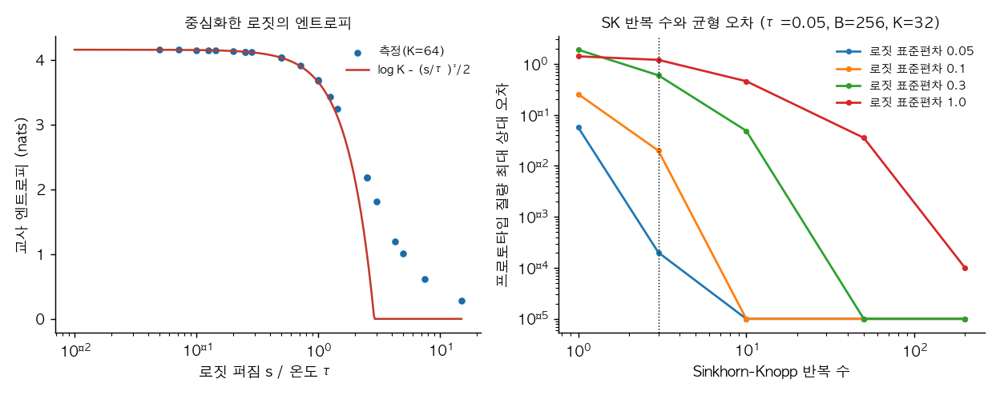
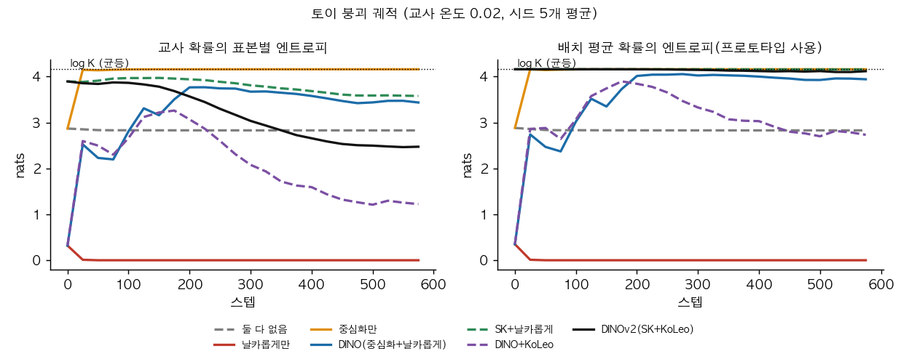
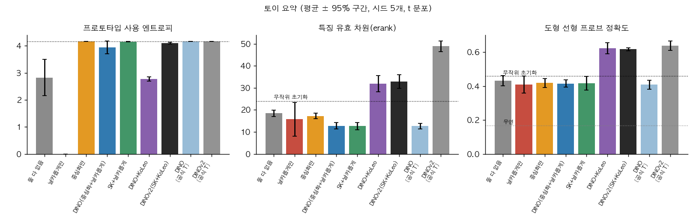
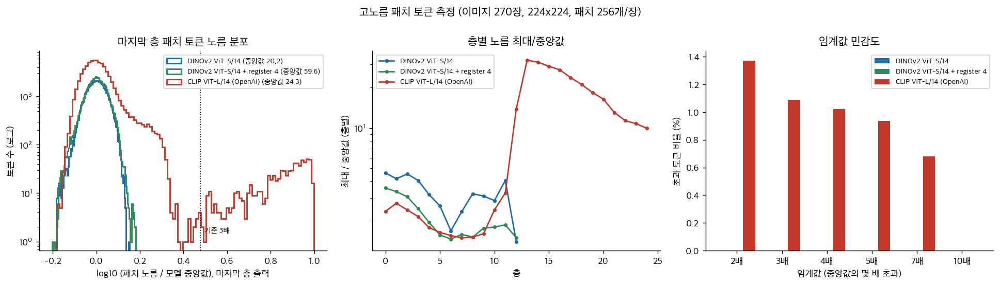

# DINOv2의 붕괴 방지 장치를 직접 짜 보기

DINOv2(Oquab 외, TMLR 2024)는 새 부품보다 **조합**이 기여입니다. DINO의 이미지 단위 자기 증류와 iBOT의 가린 패치 손실을 합치고, Sinkhorn-Knopp 중심화, KoLeo 정규화, 머리 분리, 검색으로 만든 정제 데이터(LVD-142M)로 규모를 키웠습니다. 이 글은 목적 함수를 작은 ViT로 직접 짜서(`minimal_impl.py`, 테스트 29개) 식을 검산하고, 합성 도형으로 어떤 장치가 무엇을 막는지 본 기록입니다. 논문 그림은 쓰지 않았고 그래프는 모두 직접 그렸으며, 공식 코드는 읽기만 하고 실행하지 않았습니다. **토이는 논문 재현이 아닙니다**(0.17M 파라미터, 32×32, 프로토타입 64개, 600 스텝).

## 식 검산

- **손실 분해.** 교차 엔트로피는 H(p_t) + KL(p_t‖p_s)입니다. 상수 출력으로 가는 자명한 해가 둘 있습니다. 모든 입력이 한 프로토타입이면(H = 0, KL = 0), 모든 입력이 균등이면(L = log K, KL = 0).
- **중심화는 앞의 것을, 날카롭게 하기는 뒤의 것을 막습니다.** 교사 로짓을 공통 편향 b와 입력 의존 성분 δ로 나누면 중심화가 b를 지웁니다. 그런데 입력 의존 성분이 작으면 softmax(δ/τ)는 균등에 가깝고, 2차 전개로 **H ≈ log K − s²/(2τ²)**(s: 중심화한 로짓 퍼짐)입니다. 측정과 일치합니다(s = 0.05, τ = 0.07: 예측 3.90, 측정 3.91). 사실상 균등이 되는 경계는 s/τ ≲ 0.2이고, 날카롭게 하려면 τ ≲ s여야 합니다. 그래서 **적정 교사 온도는 머리 구조와 프로토타입 수에 의존**합니다.
- **Sinkhorn-Knopp.** 해는 exp(z/τ)에 양쪽 대각 스케일링을 곱한 꼴이고, 마지막 단계가 샘플 정규화라 샘플별 확률분포(행 합 1)는 정확하고 프로토타입 질량은 근사입니다. 3회 반복의 오차는 로짓 퍼짐에 크게 의존합니다(퍼짐 0.1: 2%, 0.3: 60%, 1.0: 120%). 3회는 코사인 로짓 규모에서 근사 균형을 주는 값입니다.
- **KoLeo.** 최근접 이웃 거리의 로그 평균에 음수를 붙인 이 항은 Kozachenko-Leonenko 엔트로피 추정량 Ĥ = ψ(n) + γ + log V_d + (d/n) Σ log ρ_i의 아핀 변환입니다. N(0, I)에서 편향은 d = 2, n = 8000에서 0.006입니다.
- **EMA 교사.** 학생 이력의 지수 가중 평균이고 m = 0.994의 유효 창은 167 스텝입니다. 논문은 m을 1까지 코사인으로 올립니다.

## 토이: 무엇이 붕괴를 막는가

합성 도형 6종(색·크기·위치 무작위)을 학습 신호로 쓰고, 증강은 채널 순열로 색 불변을 강제합니다. 교사 온도는 0.02입니다(공식 0.04 → 0.07에서는 아래처럼 균등 붕괴가 나서 시드 0 예비 실험으로 낮췄고, 설정 선택에 약한 선택 편향이 있습니다). 시드 5개, 평균 ± 95% 구간입니다. 기준선은 무작위 초기화 백본(프로브 0.458 ± 0.030, 유효 차원 24.0 ± 1.7)입니다.

| 조건 | 프로토타입 사용 엔트로피 (log K = 4.16) | 특징 유효 차원 | 도형 프로브 |
|---|---|---|---|
| 날카롭게만 | 0.00 (5/5 시드가 한 프로토타입) | 15.7 ± 7.7 | 0.41 ± 0.05 |
| 중심화만 | 4.16 (5/5 시드가 균등) | 17.3 ± 1.2 | 0.42 ± 0.03 |
| DINO (둘 다) | 3.94 ± 0.24 | 12.8 ± 1.5 | 0.41 ± 0.02 |
| SK + 날카롭게 | 4.15 ± 0.01 | 12.6 ± 1.6 | 0.42 ± 0.04 |
| DINO + KoLeo | 2.77 ± 0.07 | 31.9 ± 3.6 | 0.62 ± 0.03 |
| DINOv2 (SK + KoLeo) | 4.10 ± 0.04 | 32.9 ± 3.1 | 0.62 ± 0.01 |

- **출력 수준 붕괴 두 가지는 식의 예측대로 재현됩니다.** 둘 다 쓰면 어느 쪽으로도 완전히 무너지지 않습니다.
- **그러나 출력이 붕괴하지 않았다고 특징이 좋아지지는 않았습니다.** 중심화 + 날카롭게 하기만 쓴 조건의 유효 차원과 프로브는 무작위 초기화보다 낮거나 같았습니다. 특징 품질을 올린 것은 **KoLeo**였습니다(유효 차원 +19, 프로브 +0.21).
- 공식 교사 온도 0.04 → 0.07에서는 날카롭게 하는 4개 조건의 교사 출력이 5/5 시드에서 균등이 되었는데, KoLeo가 있는 두 조건은 그런데도 유효 차원 50, 프로브 0.64였습니다. 이 토이에서 KoLeo의 이득은 교사 출력 엔트로피와 무관하게 나타났습니다.
- SK와 softmax 중심화의 차이는 구분되지 않았습니다. 논문 표 1의 SK 행도 k-NN, 선형 모두 변화가 없습니다.

한계: 이 결과는 작은 코사인 머리, 짧은 학습, 합성 과제의 것입니다. "중심화 + 날카롭게 하기만으로는 특징 차원 붕괴를 못 막는다"를 ImageNet 규모의 DINO 결과에 대한 반박으로 읽을 수 없습니다. iBOT 손실의 소거는 하지 않았습니다.

## 공개 가중치로 잰 고노름 토큰

Registers 논문(Darcet 외)이 보고한 "큰 ViT의 배경 패치에 노름이 큰 토큰이 생긴다"를 공개 가중치에서 직접 쟀습니다. MMVP-VLM 이미지 270장(224×224, 패치 256개/장), 마지막 층 출력(최종 정규화 앞)의 패치 토큰 노름, 임계값은 로그 히스토그램의 골에 맞춘 중앙값의 3배입니다.

| 모델 | 최대/중앙값 | 3배 초과 비율 |
|---|---|---|
| DINOv2 ViT-S/14 | 1.42 | 0 |
| DINOv2 ViT-S/14 + register 4 | 1.52 | 0 |
| CLIP ViT-L/14 (OpenAI) | 9.95 | 1.09% |

- CLIP ViT-L/14에는 뚜렷한 고노름 토큰이 있습니다. 층 12(24층 중)에서 갑자기 생기고, 픽셀 분산이 낮은 패치에 몰리며(이미지 내 백분위 0.22), CLS attention 질량의 40.6%를 받습니다(1.09% 토큰). 비율은 Darcet의 약 2%보다 작지만 모델과 정의가 달라 직접 비교하지 않습니다.
- DINOv2 ViT-S/14는 원본과 register 변형 모두 없습니다. "ViT-L 이상에서만"과 일치하지만, **S 규모에서는 register가 artifact를 없애는지 시험할 수 없습니다.** DINOv2 L/14 쌍이 필요합니다(미측정). register 변형의 register 4개 중 하나의 노름이 패치 중앙값의 2.7배였습니다.
- 최종 정규화를 거친 뒤에 재면 CLIP의 차이도 사라집니다(최대/중앙값 1.06): 고노름은 정규화 앞의 잔차 흐름 현상입니다.
- 한계: 이미지 270장, 해상도 224 한 가지, 모델당 가중치 한 벌입니다. SigLIP은 재지 않았습니다.

## 논문 표 재계산과 주장 검증

- **OpenCLIP-G 대비 승수.** DINOv2 ViT-g는 인스턴스·밀집 23/23, 이미지 수준 18/26이고, 증류 ViT-L은 23/23과 14/26입니다. ImageNet 선형 86.5 대 86.2의 +0.3%p는 5만 장 표본 오차의 경계입니다.
- **정제 데이터(표 2).** 비정제 대비 7개 중 6개에서 높지만(ADE20k는 비정제가 높음), 정제가 평가 벤치마크의 학습 분할을 질의로 써서 "정제"와 "평가 도메인을 겨냥한 정제"가 섞입니다.
- **증류(그림 5).** 12개 벤치마크에서 처음부터보다 낫지만 ViT-g 학습 비용을 세지 않았습니다.
- **표 1.** 12행의 증가분은 재계산과 모두 일치하고, SK 행은 0.0입니다. 0.5 이하의 항목별 증가분은 단일 실행이라 구분되지 않습니다.
- **산술.** 표 14의 탄소(9.69 MWh, 3.73 tCO2eq)는 일치하고 "10배"는 OpenCLIP-G(12.3배)에만 맞습니다. 표 17의 ViT-B 블록 18은 오기로 보입니다(코드 12, 계산 86.6M).
- **후속 문헌.** 같은 저자들의 Registers 논문은 DINOv2의 배경 패치에 고노름 토큰이 생기고 register로 해결된다고 보고했고(공식 코드에 register 변형이 있음), DINOv3 초록은 긴 학습에서 밀집 특징이 나빠지는 문제를 Gram anchoring으로 푼다고 씁니다(초록 수준). 같은 데이터로 통제한 Web-SSL은 시각 SSL이 VQA에서 CLIP 수준에 이른다고 보고합니다(초록 수준). VLM 쪽에서는 Prismatic과 Cambrian-1의 통제 비교에서 DINOv2가 일반 이득을 주지 않고, SigLIP과 결합할 때 위치 지정에서만 이득이 보였습니다.
- **공식 코드와의 차이.** 본문에 없는 교사 온도(0.04 → 0.07), 마스크, 머리 구조는 코드에서 확인했습니다. KoLeo는 논문이 "첫 번째 전역 크롭"이라고 쓰지만 코드는 두 전역 크롭 각각에 적용해 합산하고, 증류와 데이터 정제 코드는 공개되지 않았습니다.

## 파일

`minimal_impl.py`(최소 구현), `test_minimal_impl.py`(29개 테스트), `formula_checks.py`(재계산), `toy_experiment.py`(토이), `high_norm_tokens.py`(고노름 토큰 측정), `04_claim_verification.md`(주장 C1–C12와 코드 대조 D1–D14)가 함께 있습니다.

## 자료

- [최소 구현](analysis/minimal_impl.py)
- [01. 논문 분석: DINOv2: Learning Robust Visual Features without Supervision](analysis/01_paper_analysis.md)
- [02. 계보와 관련 연구: DINOv2](analysis/02_prior_work.md)
- [03. 분석: 표 재계산, 식 유도 검산, 최소 구현과 토이](analysis/03_analysis.md)
- [04. 주장 검증과 코드 대조: DINOv2](analysis/04_claim_verification.md)
