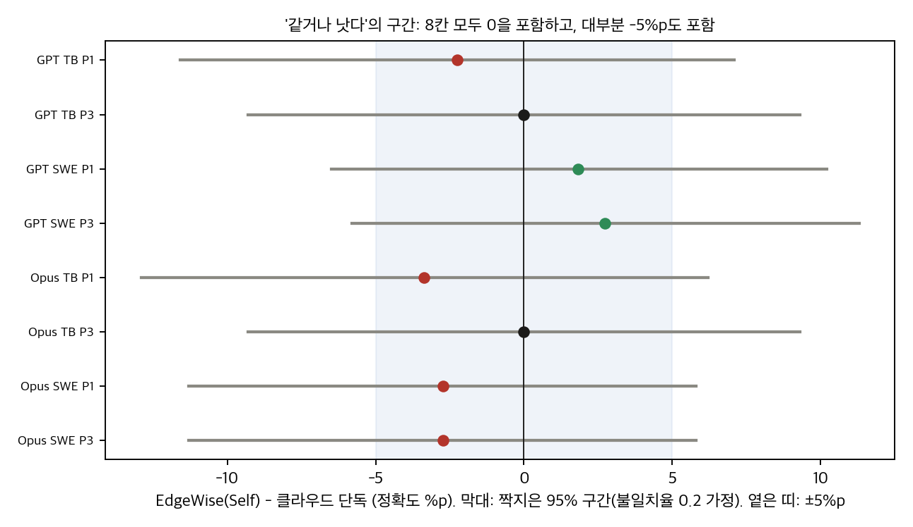
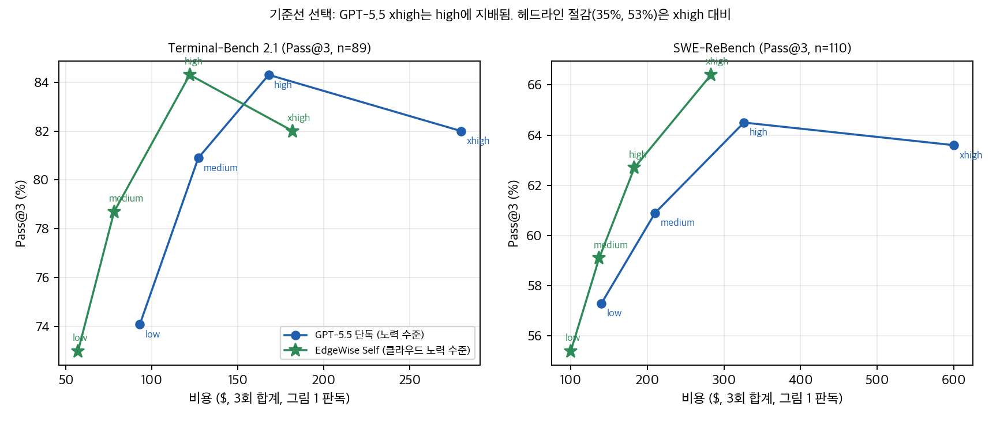
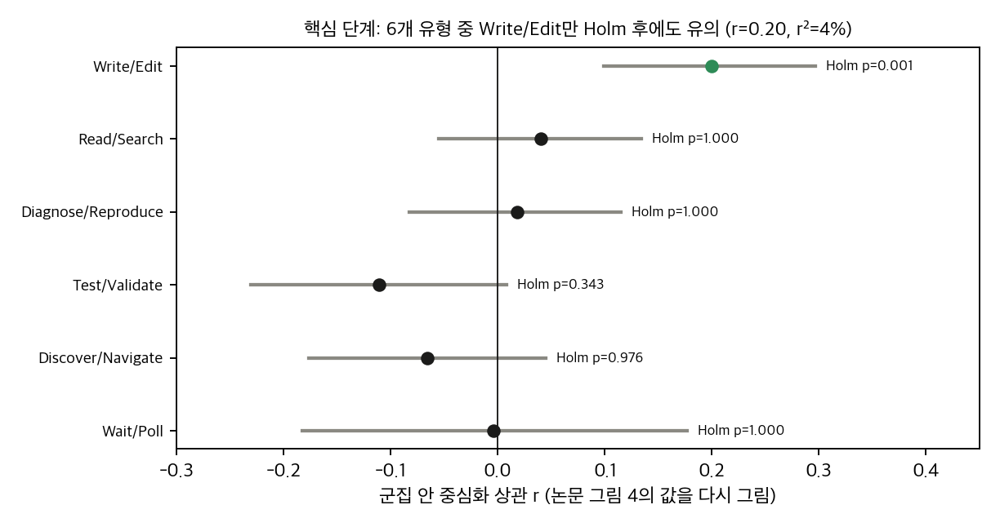
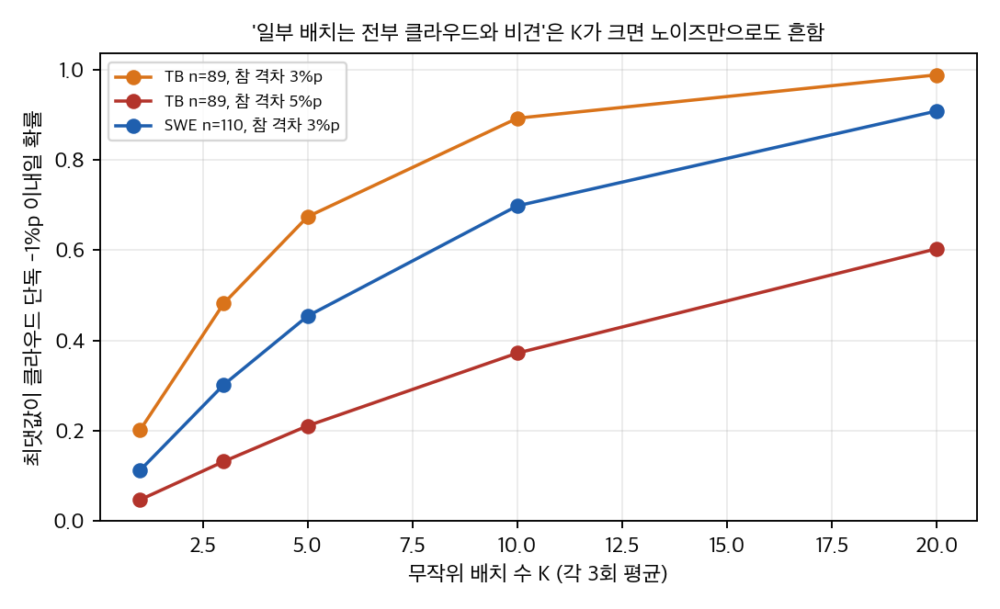

# 클라우드 비용을 62% 줄였다는 EdgeWise, 표를 다시 계산했습니다

긴 코딩 에이전트 과제를 매 단계 클라우드 LLM으로 돌리면 비쌉니다. NVIDIA의 *EdgeWise*(Shi 외, arXiv:2610.17560)는 **로컬 SLM(Qwen3.5-9B)이 주로 풀고 핵심 단계만 클라우드 LLM(GPT-5.5, Opus 4.8)에 한 단계씩 넘기면** 클라우드 단독과 비슷한 성능에 비용이 크게 준다고 주장합니다. 이 글은 공식 코드와 궤적이 공개되지 않은 이 논문의 표와 그림 값을 옮겨 적어 다시 계산하고, 주장이 표본 오차와 비용 회계에서 얼마나 버티는지 확인한 기록입니다. 코드 실행이나 API 호출은 하지 않았습니다.

## 무엇을 주장하나

- **관찰.** 단계의 일부를 무작위로 LLM에 맡겨도 일부 배치는 전부 클라우드와 비견되고 비용은 25% 이상 줄어든다고 합니다.
- **핵심 단계.** 무작위 위임 궤적 2.4k개에서 행동 유형별 클라우드 커버리지와 성공의 군집 안 상관을 재서 Write/Edit이 핵심 단계라고 정합니다.
- **위임 방식 둘.** 훈련 없이 외부 판정자(GPT-5.4-mini)가 매 단계 위임 여부를 정하는 이진 위임, 그리고 SFT 후 RL로 SLM이 직접 위임 행동을 내는 자기 위임. RL의 보상은 R = V + 1[V=1]/(1+λC)이고 위임 결정마다 비평가(GPT-5.4-mini)와의 일치로 ±1 이점을 더합니다.
- **결과.** Terminal-Bench 2.1과 SWE-ReBench에서 자기 위임이 Pass@3 API 비용을 33–62% 줄이면서 "클라우드 단독과 같거나 낫다"고 합니다.

## 헤드라인 숫자는 표에서 나옵니다

표 1의 Δ 8칸(정확도 %p, 비용 %)이 모두 재계산되고 평균 절감은 45.86%로 논문의 "46%"와 맞습니다. 문항 수는 표의 정확도에서 역산해 Terminal-Bench 2.1이 89개, SWE-ReBench가 110개입니다(논문은 적지 않았습니다). 다만 집계가 일관되지 않습니다. 초록의 SWE "62%"는 Pass@3 최댓값(Opus 62.14)이고 TB "34%"는 두 클라우드 모델의 평균(33.79)이며 최댓값은 36.93입니다. 프로젝트 페이지의 "45.16%"는 어떤 평균으로도 나오지 않았습니다(45.60, 45.86).

## "같거나 낫다"는 표본 오차와 구분되지 않습니다

- Pass@1 14칸은 모두 k/89 격자에 놓여 단일 실행으로 보이고, Pass@3은 세 번 중 한 번이라도 성공한 과제의 비율이며 비용은 세 번의 합계입니다. 시드와 샘플링 설정은 없습니다.
- 정확도 한 칸의 Wilson 95% 반폭이 ±8–9%p이고, 두 방법의 성공 여부가 다른 과제 비율(불일치율)을 0.2로 두면 최소 검출 차이는 TB 13.3%p, SWE 11.9%p입니다. 같은 구성의 3회 평균과 Pass@3에서 역산한 실행 간 불일치율은 0.06–0.20이었습니다.
- 자기 위임 대 클라우드 단독 8칸(2 클라우드 × 2 벤치마크 × Pass@1·Pass@3)은 모두 0을 포함하고 Holm 후 유의한 칸이 없습니다. −5%p 비열등은 Pass@3에서 4칸 중 1칸, Pass@1에서 0칸이고 −10%p는 각각 4칸, 2칸입니다. Pass@1은 4칸 중 3칸이 음수(−2.25, −3.38, −2.73%p)입니다.
- 같은 이진 위임이 3회 평균(그림 5)으로는 SWE에서 −4.0%p이고 Pass@3(표 1)으로는 +2.7%p입니다. 지표를 바꾸면 부호가 바뀝니다.

## 비용 62%·53%·35%는 기준선에 달려 있습니다

비용은 클라우드 API 입출력 토큰 단가로 계산하고 로컬 SLM은 0원, 학습 비용은 빠집니다. 그림 1의 노력 수준별 GPT-5.5 곡선을 읽어 보면 **xhigh는 두 벤치마크 모두에서 high보다 비싸고 덜 정확합니다**(TB 280달러/82.0 대 168달러/84.3, SWE 약 600달러/63.6 대 326달러/64.5, 그림 판독). 헤드라인 절감(TB 35%, SWE 53%)은 이 지배된 기준선 대비이고, high 대비로는 TB −8%(더 비쌈), SWE 13%입니다. 같은 노력 수준끼리 비교하면 TB 27–39%, SWE 29–53%의 절감이 남으므로 절감 자체는 사라지지 않지만 큰 숫자는 기준선 선택의 결과입니다.

입력·출력·캐시 토큰 수가 논문에 없어 단가 가정에 대한 민감도는 구조적 범위로만 줄 수 있습니다. 위임이 출력(추론) 토큰에 몰리면 TB 절감이 17–40%, SWE가 35–58%로 움직입니다. 표 3으로 계산한 위임 한 호출의 비용은 위임이 많은 모델에서 0.069달러, 적은 모델에서 0.110달러(1.6배)로, 호출 수 절감이 비용 절감으로 1:1 환산되지 않습니다. 학습(롤아웃 22,400개, 40×A100)의 비용은 비교에 없습니다.

## 핵심 단계 관찰은 Write/Edit만 지지됩니다

그림 4의 신뢰구간에서 p를 복원해 여섯 유형에 Holm 보정을 하면 Write/Edit(r = 0.200, Holm p = 0.0005, r² = 4%)만 유의합니다. 논문이 핵심 단계 기준에 함께 넣은 "복잡한 Read/Search"는 근거가 되는 통계가 없습니다. 분석에 쓴 궤적 "2.4k개"는 199과제 × 4 예산 × 3회 = 2,388개와 맞아서 **평가에 쓰인 두 벤치마크의 무작위 위임 궤적**으로 보이며, 핵심 단계 기준이 평가 과제에서 정해진 셈입니다.

"일부 배치는 전부 클라우드와 비견된다"는 여러 무작위 배치 중 좋은 것을 고른 문장입니다. 3회 평균의 노이즈를 같은 구성 불일치율에서 환산해 모의하면, 모든 배치의 참 성능이 클라우드 단독보다 3%p 낮아도 배치 10개 중 최댓값이 −1%p 이내일 확률이 TB에서 89%입니다. 표 1의 무작위 위임과 자기 위임의 정확도 차이도 유의하지 않습니다(Pass@3, +2.2~+7.9%p, 불일치율 0.2에서 p = 0.17–0.81). 비용은 자기 위임이 모든 칸에서 낮습니다. 고정 간격 위임이나 행동 유형 규칙 기준선은 없습니다.

## 단계별 RL은 무엇을 더하나

- 식 (1)의 위임 벌점은 성공 보상 (1, 2] 안에서 호출당 −0.040(λ = 0.1, 호출 5.8회)입니다. 호출 하나가 이득이려면 성공 확률이 상대적으로 2.5% 올라야 합니다. λ를 바꾼 결과가 없습니다.
- 식 (2)의 위임 토큰 이점 합은 β·N·(평균 A)이라 위임 토큰 수와 무관합니다(설계 의도와 맞음). β 값은 논문에 없습니다.
- 식 (3)의 ±1 일치 보상은 본문("로컬이 충분하면 이점 없음")과 어긋나고, 비평가 기준과 보상 기준이 같아 일치율 90% 이상은 모방의 증거입니다.
- 절제: SFT만 57.30 대 RL 71.91은 13과제 차이로 비교적 단단합니다(짝지은 p < 0.02). 반면 **토큰 이점(단계별 신용 할당) 있음 71.91 대 없음 65.17은 6과제, 짝지은 p ≈ 0.24**입니다. 위임의 성질(Write/Edit 위임 비율 42.8% 대 29.2%)은 유의하게 바뀌지만 정확도 이득은 통계적으로 약합니다.

## 로컬 배치

DGX Spark에서 BF16, vLLM, 생성 처리량 11.19 tokens/s, Terminal-Bench 과제당 평균 11.72분입니다. Pass@3 비용 절감은 TB 41.1%, SWE 54.1%로 A100의 35.0%, 52.7%와 같은 수준이고 정확도는 1–2과제 낮습니다. 같은 SLM이 다른 하드웨어에서 낸 비용 차이가 TB −9.4%, SWE −3.0%이므로 "비슷한 절감"은 비용 측정 변동 안입니다. 클라우드 단독이나 A100과의 지연 비교는 없습니다.

## 같은 그룹의 AgentBaton과 모순인가

같은 그룹의 AgentBaton(arXiv:2610.35959)은 약한 모델에서 강한 모델로 **한 번 넘기면** 손해라고 봤습니다. EdgeWise는 약→강 위임을 **단계마다 하고 복귀**합니다. 두 논문은 문맥 전달, 비용 규약, 기준선이 다르고 서로를 인용하지 않으며, 같은 Terminal-Bench 2.1을 쓰지만 모델과 하네스가 달라 직접 비교가 안 됩니다. 비용 비대칭이 정확도가 아니라 비용 회계(로컬 0원, 기준선, 호출당 비용)에서 나온다는 점은 두 논문에서 같습니다. 반대로 SLM의 추론을 지우면 EdgeWise에서는 나빠지고(−7.5%p, 비용 −23%) AgentBaton과 *The Handoff Tax*에서는 약한 모델의 흔적을 줄이는 쪽이 나았습니다.

## 정리와 읽을 때의 단서

- 인용해도 되는 것: "자기 위임은 두 벤치마크, 두 클라우드 모델에서 Pass@3 API 비용을 33–62% 줄이고 정확도는 클라우드 단독과 구분되지 않는다"(표 1, 로컬 0원, 학습 비용 제외, xhigh 기준선), "Write/Edit 단계의 클라우드 커버리지가 성공과 양의 상관을 보인다"(그림 4, r² = 4%).
- 인용하지 말아야 할 것: "같거나 낫다"를 동등성으로, "비용 62%"를 기준선 없이, "단계별 신용 할당이 정확도를 올린다"를.
- 확인하고 싶은 것: 공개될 코드와 과제별·실행별 결과(짝지은 검정), 토큰·캐시 보고, λ·β 절제, 학습-평가 사이 저장소 겹침, 위임률의 정의.

분석 노트(01–04), 재계산 스크립트와 결과, 공개용 리포트는 함께 올린 git 폴더에 있습니다. 논문 PDF에 "© 2026 NVIDIA. All rights reserved."가 있어 논문 그림은 싣지 않았고, 그래프는 모두 우리가 그렸습니다.

## 자료

- [통합 리포트 PDF](report/report_public.pdf)
- [01. 논문 분석: EdgeWise (arXiv:2610.17560 v2)](analysis/01_paper_analysis.md)
- [02. 계보와 관련 연구](analysis/02_prior_work.md)
- [03. 분석: 표본 수, 통계, 비용 식, 핵심 단계, RL 식, AgentBaton 대조, 로컬 배치](analysis/03_analysis.md)
- [04. 주장 검증 (공식 코드 없음)](analysis/04_claim_verification.md)
