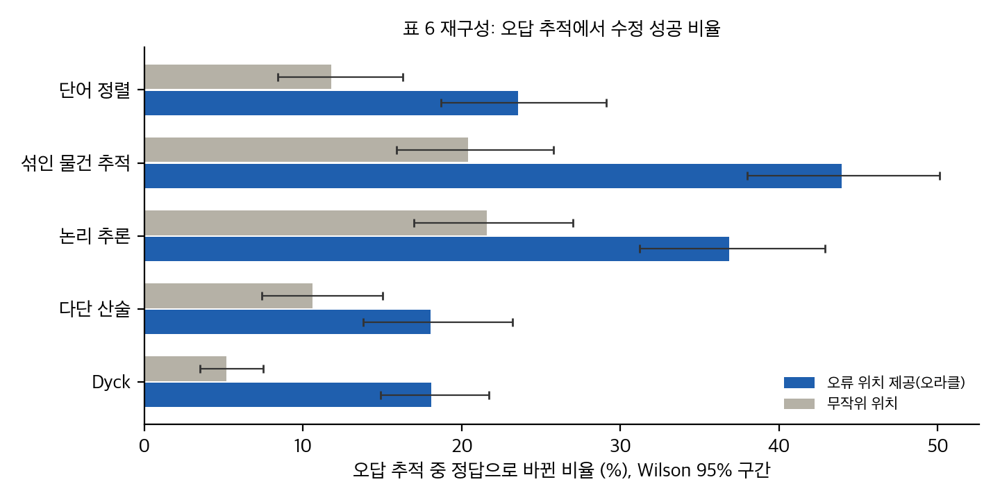

# LLM은 오류 위치를 못 찾지만, 위치를 주면 고친다

Tyen et al. (ACL 2024 Findings)은 자기 수정이 추론에서 실패하는 이유를 두 능력으로 나눠 봅니다. 하나는 **오류 위치를 찾는 능력**이고, 다른 하나는 **알려진 오류를 고치는 능력**입니다. 저자들은 찾는 쪽이 약하고 고치는 쪽은 충분하다고 주장합니다.

## 무엇을 측정했나

- **BIG-Bench Mistake**: PaLM 2 Unicorn이 만든 CoT 추적 2,186개. 과제는 다섯 가지(단어 정렬, 섞인 물건 추적, 논리 추론, 다단 산술, Dyck 언어)이고, 각 추적에 첫 논리 오류의 단계 번호가 주석으로 달려 있습니다.
- **찾기**: 모델에게 오류 단계를 묻습니다. 최고 정확도는 GPT-4 direct step의 52.87%(과제 평균)입니다. 오류가 없다고 항상 답하는 기준선은 약 16%이므로, 모델이 그보다 낫긴 하지만 높지는 않습니다.
- **수정**: 오류 위치를 정답으로 알려 주고 그 단계부터 다시 생성합니다. 오답 추적 중 정답으로 바뀌는 비율은 과제마다 18–44%입니다. 같은 조건에서 위치를 무작위로 고르면 5–21%입니다.

## 우리가 확인한 것

공개 원자료로 표를 다시 계산했습니다. 모델 예측은 공개되어 있지 않아 모델 정확도 셀 값은 확인하지 못했습니다.

- 데이터 구성(표 2)은 모든 과제에서 맞습니다.
- 오답 추적에서 오라클 위치가 무작위 위치보다 낫다는 결과는 5/5 과제에서 성립합니다(Fisher p ≤ 0.022). 다만 무작위 기준선은 한 번 실행한 값입니다.
- 작은 분류기로 찾기를 개선한 결과(표 7)는 단어 정렬과 섞인 물건 추적에서만 강합니다. 산술은 차이가 우연과 구별되지 않습니다.

## 인용할 때 주의할 점

- 표 4의 "Overall"은 추적 단위 정확도가 아니라 과제 평균입니다. PaLM 2 Unicorn의 direct trace 값(17.09)은 과제 값의 평균(13.86)과 맞지 않아 오기일 가능성이 큽니다.
- 표 6의 논리 추론 정답 추적 손실(−11.43)은 분모 45로 정수가 되지 않습니다.
- 표 7의 Dyck 두 값은 서로 다른 표본(986개, 592개)에서 나왔습니다.
- "찾기가 자기 수정의 주된 병목"은 저자의 가설이며, 이 논문은 자기 수정 전체 루프를 측정하지 않았습니다.
- 과제가 인위적이고 샘플이 300개 규모입니다. 저자도 이를 한계로 적었습니다.

## 정리

찾기와 고치기를 나눠 재면 실패의 원인이 달라집니다. 이 논문은 "고치는 능력이 있는데 찾지 못해 실패한다"는 그림을 줍니다. 근거는 강하지만, 세부 수치 가운데 몇 가지는 논문 안에서 맞지 않아 인용 전에 확인이 필요합니다.

원문: arXiv 2311.08516, ACL Anthology 2024.findings-acl.826. 데이터: `WHGTyen/BIG-Bench-Mistake` (Apache-2.0).

## 자료

- [통합 리포트 PDF](report/report_public.pdf)
- [LLMs cannot find reasoning errors, but can correct them given the error location — 논문 분석](analysis/01_paper_analysis.md)
- [02 선행 연구와 계보](analysis/02_prior_work.md)
- [03 재계산과 검정](analysis/03_analysis.md)
- [04 주장 검증](analysis/04_claim_verification.md)
