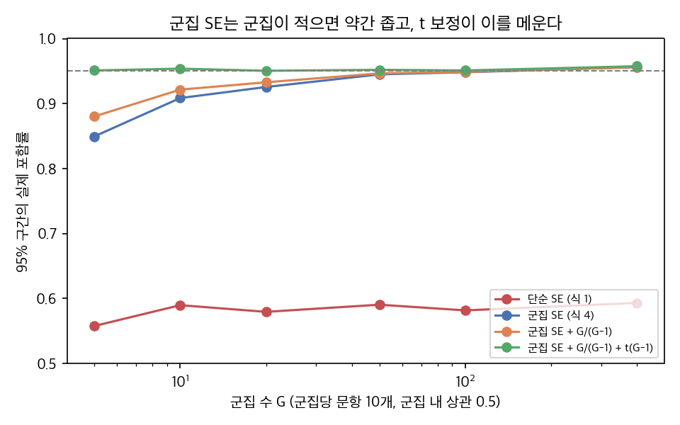
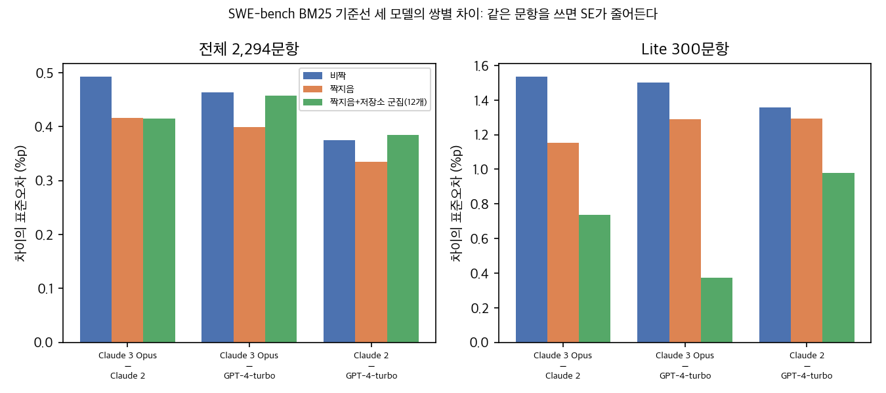
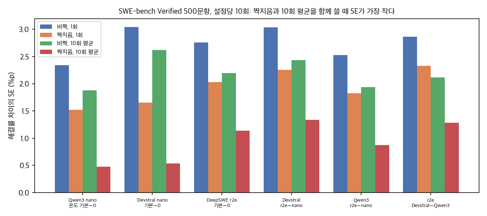

# LLM 평가에 오차 막대를 붙이는 식을 직접 구현해 보면

Evan Miller(Anthropic)의 *Adding Error Bars to Evals*는 LLM 평가 점수를 "가장 높은 숫자가 최고"로 보고하는 관행에 표준오차, 군집 보정, 짝지은 차이, 검정력 분석을 들여오자는 14쪽짜리 방법 논문입니다. 이 글은 그 식을 numpy와 scipy로 직접 구현해(신경망이 없는 통계 방법이라 PyTorch를 쓰지 않았습니다) 번호 그대로 검산하고, 몬테카를로로 성질을 확인한 뒤, 공개된 문항별 결과에 적용한 기록입니다. 코드 실행이나 LLM 호출은 하지 않았습니다(공식 코드가 없습니다). 논문의 표 1·2·3·5는 가상 모델의 가상 수치이고 표 4만 실제 수치라서, 논문에서 직접 확인할 수 있는 것은 산술뿐이고 나머지는 시뮬레이션과 공개 데이터로 확인했습니다.

## 틀: 문항은 초모집단의 표본

문항 i의 점수를 s_i = x_i + ε_i로 쓰고(x_i는 문항 난이도에 해당하는 조건부 평균, ε_i는 같은 문항을 다시 샘플링할 때의 잡음), 문항이 보이지 않는 초모집단에서 독립으로 뽑혔다고 봅니다. 그러면 평균의 분산은 (Var(x) + E[σ²])/n입니다. 문항 수를 늘리면 둘 다 줄고, 문항당 K번 샘플링하면 문항 안 분산만 1/K로 줄입니다.

권고는 다섯 가지입니다: CLT 표준오차 보고(식 1), 같은 지문을 공유하는 문항은 군집 SE(식 4), 문항 안 분산 줄이기(K번 재샘플링, 다음 토큰 확률), 두 모델은 문항별 짝지은 차이로 비교(식 7, 8), 검정력으로 문항 수 정하기(식 9, 10).

## 검산에서 나온 것

- **군집 SE는 유도와 일치합니다.** 부록 A의 샌드위치 추정량에서 교차항 합 = Σ_c(Σ_i u)² − Σu²이고, 12문항 예에서 삼중합과 일치합니다. 표 4의 세 비율(3.05, 1.10, 1.88)은 SE 값에서 다시 계산해도 맞고, 설계 효과 = 비율²에서 내재 군집 내 상관을 역산하면 DROP 0.54, MGSM 0.28, RACE-H 0.10입니다.
- **4.2절 산술 예가 틀렸습니다.** U[0,1] 점수 두 개, 상관 0.5, 조건부 분산 0이면 짝지은 분산은 1/12 + 1/12 − 2·(1/24) = **1/12**입니다. 논문은 1/6에서 1/9로 1/3 줄어든다고 했지만 비짝 1/6에서 1/12로 **1/2 줄고**, 일반적으로 두 분산이 같을 때 감소율은 상관 ρ입니다. 몬테카를로로 ρ = 0, 0.25, 0.5, 0.75, 0.9에서 감소율이 0, 0.25, 0.50, 0.75, 0.90임을 확인했습니다.
- **5절 문항 수 예도 같은 오류를 물려받았습니다.** n = (z_{α/2} + z_β)²·ω²/δ²에 ω² = 1/9, δ = 0.03을 넣으면 968.998이라 "≈ 969" 산술은 맞습니다. 그런데 "4.2절의 조건"에서의 올바른 ω²는 1/12라서 같은 조건의 n은 **727**입니다. "새 평가에는 약 1,000문항"이라는 방향은 유지되지만 근거 수치는 과대입니다. MDE 예(13.2% → 7.5%)는 13.27% → 7.57%로 반올림 차이뿐입니다.
- **부록 C의 분산 성분 추정에는 편향이 있습니다.** 문항 평균 x̂로 ω²를 추정하면 x̂의 잡음 σ²/K만큼 과대입니다. K가 작은 이전 데이터로 문항 수를 정하면 필요 문항 수가 부풀려집니다. 구현은 이 항을 뺍니다.
- 3.1절의 분산 감소(K = 2, 4, 6에서 1/3, 1/2, 5/9, 한계 2/3)와 §3.3의 온도 예(1/12 → 1/4, 약 5배)는 산술이 맞고, 후자의 "p = 1/4"는 3/4의 오타입니다. 표 2·5의 HumanEval 행은 식과 맞지 않습니다(표 2의 SE 3.2%는 n = 164에서 2.89%).

## 시뮬레이션: 군집 SE는 군집이 많아야 맞다

군집 내 상관 0.5, 군집당 문항 10개인 데이터에서 95% 구간의 실제 포함률입니다.

- 단순 SE는 군집 수와 상관없이 0.56–0.59로 심하게 과소입니다.
- 식 (4)의 군집 SE는 군집 50개 이상에서 0.945 이상이지만 군집이 5개면 0.85, 10개면 0.91입니다. G/(G−1)과 t(G−1) 임계값을 쓰면 군집이 5개여도 0.95 근처로 회복됩니다.
- 군집이 없는 평가에서도 작은 n이면 식 (1)이 과소입니다(θ ~ U[0,1], 이진 점수): n = 10/30/100/1000에서 포함률 0.78/0.87/0.92/0.95(Wilson 구간은 전부 0.95 전후). n = 100에서 0.923은 이 문제를 다룬 Bowyer et al.(ICML 2025 포지션 페이퍼, arXiv:2503.01747)의 92.5%와 일치합니다. 논문은 "문항 수가 크면" CLT가 적용된다고만 쓰고 문턱을 주지 않았습니다.

## 공개 결과에 적용: SWE-bench BM25 기준선

같은 문항에서 세 모델(Claude 3 Opus, Claude 2, GPT-4-turbo, 전체 2,294문항)의 해결 여부 공개 파일에 구현을 적용했습니다. 군집은 저장소(12개)입니다.

- 짝지음의 이득은 작습니다. 해결률이 1–4%라 이진 점수의 상관이 0.2–0.3뿐이라 비짝 SE 대비 짝지은 SE가 11–15%만 작습니다(식 7). Claude 2 대 GPT-4-turbo는 짝지은 z = 1.70(p ≈ 0.09), 정확 McNemar는 p = 0.067로 같은 결론입니다.
- 저장소로 군집하면 단일 모델 SE가 단순 SE의 1.5–1.7배(설계 효과 2.3–2.8)가 되는데, 저장소를 **고정된 층**으로 보는 층화 SE는 단순 SE와 같습니다. 군집 SE는 "12개 저장소를 모집단에서 뽑았다"고 가정해 저장소 구성의 변동까지 불확실성으로 세기 때문입니다. 12개가 인기 저장소를 고른 고정 집합이라면 후자가 더 맞을 수 있어, 초모집단 가정이 결과를 바꿉니다.
- Lite 300문항에서는 군집 SE가 짝지은 SE의 0.29–0.76배로 줄어 Opus − GPT-4-turbo의 z가 4.48이 되는데, 불일치 쌍이 15개(10 대 5)뿐이라 정확 McNemar p는 0.30입니다. 군집 12개, 불일치 15개에서는 군집 SE를 믿으면 안 됩니다.

## 공개 결과에 적용: 반복 실행

SWE-bench Verified 500문항에서 에이전트 설정 12개를 각각 10회 돌린 공개 결과(On Randomness in Agentic Evals의 데이터)로 문항 안 분산과 K의 효과를 봤습니다.

- 12설정 중 10개에서 문항 간 분산(Var(x) 0.08–0.17)이 문항 안 분산(0.05–0.12)보다 큽니다. 실행별 해결률의 변동은 문항 안 분산으로 예측한 sqrt(E[σ²]/n)의 0.7–1.4배로 맞습니다. 그래서 10회 평균으로 줄어드는 것은 일부이고 SE는 1회 대비 1.15–1.36배만 작아집니다.
- 짝지음과 10회 평균을 함께 쓰면 효과가 큽니다. 같은 모델의 온도 쌍(문항 점수 상관 0.94–0.96)에서 짝지은 10회 SE는 비짝 1회 SE의 약 1/5(2.34 → 0.48 %p, 3.04 → 0.54 %p).
- 식 (10)으로 최소 검출 효과를 계산하면 문항 500개, K = 1에서 4.1–6.5 %p, K = 10에서 1.3–3.7 %p입니다. 문항을 고정하고 실행 잡음만 센 "10회면 약 2 %p" 계산과 달리 문항 표본 오차(ω²)가 들어가므로, 서로 다른 설정끼리는 2 %p를 K = 10으로 검출하려면 743–1,744문항이 필요합니다.

## 인용해도 되는 것과 조심할 것

- 군집 SE의 형태, 짝지은 비교의 유용성(분산 감소율은 점수 상관), K번 샘플링이 문항 안 분산만 줄인다는 분해, 보고 형식은 확인됩니다.
- CLT와 군집 SE는 문항·군집 수가 큰 근사이므로 수백 개 미만이면 Wilson·베이즈를 병용하고 군집이 적으면 t 보정을 쓰세요. 4.2절 감소율(ρ)과 5절 n(727)은 고쳐 인용하세요.
- 표집 오차만 다룹니다. 디코딩·시드·하드웨어 같은 구성 변동, 채점 오류, 다중 비교는 이 틀 밖입니다. 다음 토큰 확률(§3.2)과 K번 샘플링의 실제 분산 감소는 LLM 호출이 필요해 이번에는 확인하지 못했습니다.

## 재현

`analysis/minimal_impl.py`(식 (1)–(10)과 부록 C), `test_minimal_impl.py`(pytest 19개, 약 3초), `mc_experiments.py`(몬테카를로 4종), `apply_public_results.py`(공개 결과 적용)와 결과 JSON이 함께 있습니다. 논문은 arXiv 비독점 배포 라이선스라 논문 그림은 쓰지 않았고 그림은 모두 직접 그렸습니다.

## 자료

- [최소 구현](analysis/minimal_impl.py)
- [01. 논문 분석: Adding Error Bars to Evals (arXiv:2411.00640)](analysis/01_paper_analysis.md)
- [02. 계보와 관련 연구](analysis/02_prior_work.md)
- [03. 식 검산, 최소 구현, 공개 결과 적용](analysis/03_analysis.md)
- [04. 주장 검증: 이후 문헌과 이 저장소 재계산의 확인·수정·반박 (C1–C10)](analysis/04_claim_verification.md)
