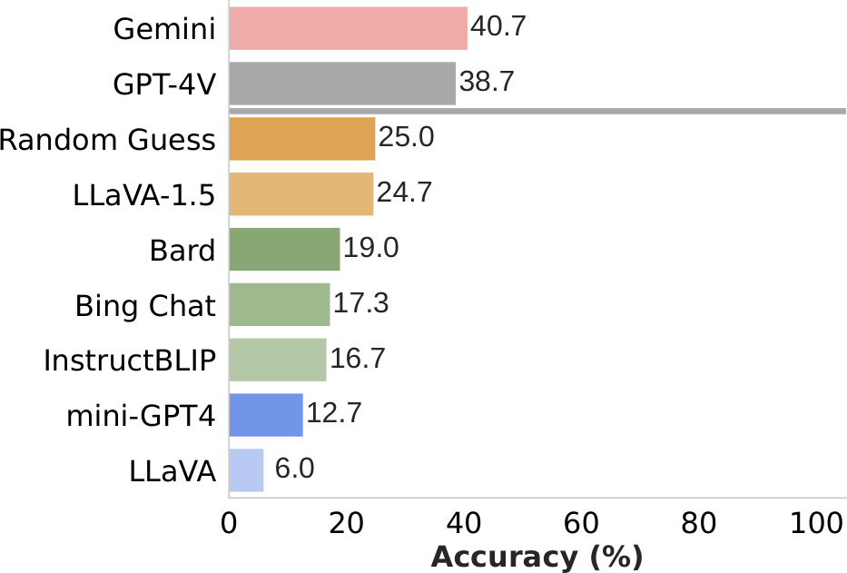
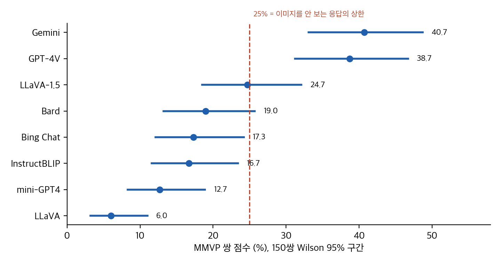
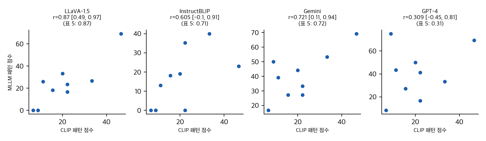
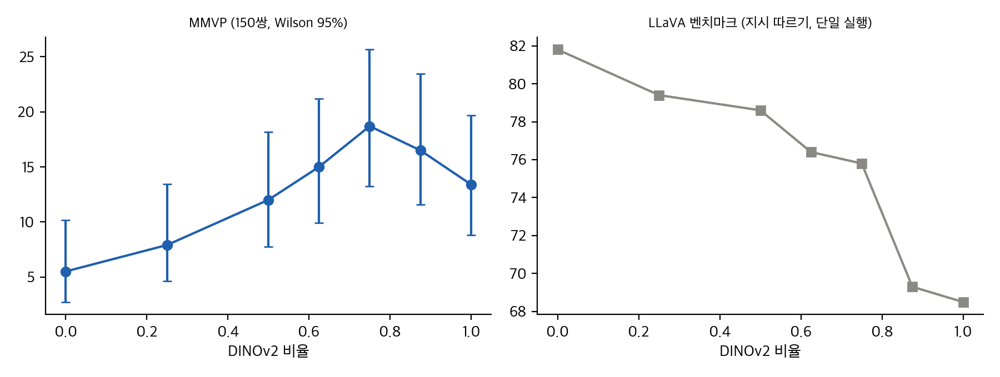
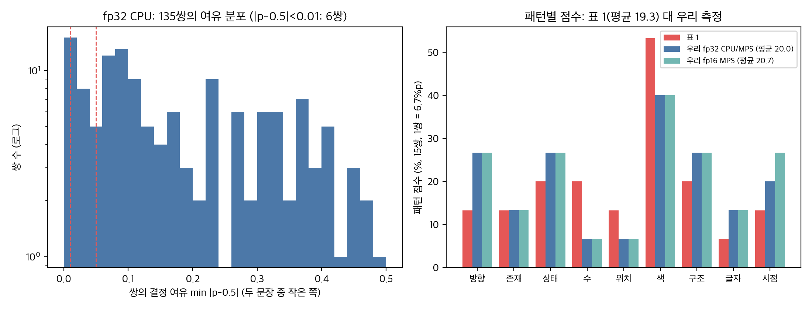

# Eyes Wide Shut? MMVP의 150쌍을 다시 계산했습니다

*Eyes Wide Shut?*(Tong, Liu, Zhai, Ma, LeCun, Xie, CVPR 2024 구두)는 CLIP-ViT-L-14 임베딩은 거의 같고(코사인 > 0.95) DINOv2-ViT-L-14 임베딩은 다른(< 0.6) "CLIP-blind" 이미지 쌍을 찾아, 사람이 차이를 질문으로 만든 벤치마크 MMVP(150쌍, 300문항)로 GPT-4V·Gemini 등이 쉬운 시각 질문에 체계적으로 실패함을 보입니다. 실패를 9개 시각 패턴으로 묶고(MMVP-VLM), CLIP과 DINOv2 특징을 섞는 Mixture-of-Features(MoF)로 일부를 회복합니다. 이 글은 공개 데이터(HF `MMVP/MMVP`, `MMVP/MMVP_VLM`)와 공식 코드(`tsb0601/MMVP`, 정적으로만 읽음)로 수치를 다시 계산한 기록입니다. 가중치 다운로드와 API 호출은 하지 않았고, 모델 실행은 표 1 첫 행을 확인하려고 CLIP ViT-L/14(HF 변환본) 하나를 돌린 것이 전부입니다.

## 쌍 단위 채점의 "우연 수준 25%"

한 쌍의 두 질문을 모두 맞혀야 1점입니다. 공개 CSV를 보면 **150쌍 전부에서 첫 질문의 정답이 (a), 둘째가 (b)**입니다. 따라서 "항상 (a)", "항상 Yes" 같은 이미지를 안 보는 응답은 정확히 0점(문항 단위로는 50%)입니다. 이미지와 무관하게 P((a)) = p로 답하는 응답의 쌍 점수는 p(1−p)라서 25%는 **이미지를 안 보는 모든 응답의 상한**입니다. 논문이 "무작위(25%)보다 낮다"고 한 모델들(LLaVA 6.0, mini-GPT4 12.7 등)은 환각이 아니라 이미지에 둔감한 정상 결과와 같습니다. 의미 있는 말은 "25%보다 높은 모델은 GPT-4V(p=2e-4)와 Gemini(p=3e-5) 둘뿐"입니다. 쌍의 d만큼을 이미지로 맞힌다면 d ≥ (점수−25)/75이므로 GPT-4V는 최소 18%, Gemini는 21%입니다.

## 150쌍의 구간

GPT-4V 38.7 [31.2, 46.7], Gemini 40.7 [33.1, 48.7]이고 둘의 차이는 p=0.81입니다. 같은 문항에서 비교하는 짝지은 검정의 최소 검출 차이는 불일치율에 따라 7–16%p라서 **10%p 아래 차이는 구별되지 않습니다.** PaliGemma의 MMVP 47.3도 Gemini 대비 p=0.30입니다. 논문의 점수 일부는 150쌍 격자(k/150) 밖에 있습니다(Bard 19.0, 표 2의 5.5·7.9·15.0·16.5·13.4).

## 선별이 만드는 편향

모든 쌍이 CLIP ViT-L-14가 구별하지 못하게, 그리고 DINOv2 ViT-L-14가 구별하도록 골라졌습니다. 그래서 이 인코더를 쓰는 LLaVA 계열이 낮고, DINOv2를 섞으면 좋아지는 것이 부분적으로 시험의 구조입니다. 합성 토이(40시드)에서 한 인코더에 불리한 선별만으로 세부를 담은 인코더를 더하는 이득이 약 4%p 부풀었고, DINOv2로 선별한 경우와 다른 인코더로 선별한 경우의 차이는 0.4 ± 0.7로 순환 이득은 확인되지 않았습니다. 표 6의 MAE(+2.6)와 MoCo v3(+2.0)도 비슷한 이득이지만 3–5쌍이라 어느 것도 단독으로 유의하지 않습니다.

## 패턴별 상관은 점 9개

그림 6의 "CLIP"은 표 1의 OpenAI ViT-L-14 224·336과 EVA01 세 행의 평균입니다(차 0.02). 상관은 LLaVA-1.5 0.87 [0.49, 0.97], Gemini 0.72, GPT-4 0.31이 표 5와 맞고 **InstructBLIP은 그림에서 0.61 [−0.10, 0.91]**로 표 5의 0.71과 다릅니다. CLIP이 아닌 Gemini·Bard도 0.7대여서 패턴 공통 난이도로도 설명됩니다.

## MoF의 교환 관계

지시 따르기는 7점에서 단조로 내려가고(p=0.0004) 0.875 이상의 −12.5, −13.3은 표본 오차 밖입니다. MMVP 이득은 0.75와 0.875에서만 불일치율 0.3 이하에서 유의하고 정점(0.75)은 표본 변동입니다. 교차 MoF의 LLaVA-1.5 이득 +3.3은 5쌍이고 해상도(224 대 336)와 토큰 수(512 대 576)가 달라 인코더 효과만이 아닙니다. 224² 교차 MoF는 MMBench −6.1, TextVQA −6.0을 잃어 "비슷한 성능"은 성립하지 않습니다.

## 표 1의 첫 행을 직접 돌려 보았습니다

공식 스크립트에 대해 이슈 #5(외부 보고)는 표 1의 OpenAI ViT-L-14 행(평균 19.3)을 재현하지 못했다고 하고, 실행마다 일부 패턴이 달라진다는 보고도 있습니다. 우리 가설은 "CLIP-blind 쌍은 두 이미지 점수가 비슷해 softmax가 0.5 근처에서 갈리고, 정밀도·장치 차이로 뒤집힌다"였습니다. 공식 채점 규칙(두 문장이 모두 맞아야 1쌍, 이미지1 확률 > 0.5)을 같게 구현해 HF 변환 CLIP ViT-L/14로 135쌍을 CPU·MPS에서 돌렸습니다. 공식 `clip` 패키지는 쓰지 않았습니다.

- **평균 20.0(27/135쌍, Wilson 95% [14.1, 27.5])** 대 표 1의 19.3(26쌍). 존재는 같고 나머지 패턴 8개가 1–2쌍씩 다릅니다(차이의 합 11쌍). 패턴 하나는 15쌍이라 구간이 겹칩니다.
- **0.5 근처 쌍은 실제로 많습니다.** 결정 여유 < 0.01이 6쌍, < 0.02가 15쌍, < 0.05가 27쌍(20%)입니다.
- **그러나 뒤집힘은 거의 없습니다.** fp32 CPU, fp32 MPS, 재실행, 직접 구현한 OpenAI식 전처리는 모두 같은 예측을 냈고(MPS와의 확률 차 최대 3.6e-5, 최소 여유 1.3e-3), fp16 MPS에서만 시점 쌍 하나가 0.5015에서 0.5000으로 바뀌며 정답이 되었습니다(평균 +0.74%p). 이 이미지는 모두 224×224라 전처리 구현 차이도 결과를 바꾸지 못합니다.
- **판정:** 전제(0.5 근처 쌍이 많다)는 맞지만, 장치·정밀도 차이만으로 표 1과의 11쌍 차이나 이슈 #5의 "실행마다 다르다"는 보고를 설명하지는 못합니다. 남는 후보(OpenAI `clip` 패키지와 HF 변환의 차이, 사용자가 CUDA fp16으로 돌렸을 가능성, 판본 차이)는 시험하지 못했습니다. 이 측정에서 표 1의 값 자체가 틀렸다고 말할 수는 없습니다. 쌍 수가 적어 구간이 겹칩니다. SigLIP 등 다른 모델은 돌리지 않았습니다.

## 공개물과 데이터

- 채점용 GPT-4 판정자(`gpt-4-0314`, 온도 0.2)와 샘플링 디코딩(온도 0.2)은 논문에 없고, A-MoF 코드, 쌍 선별 코드, 패턴 라벨 매핑이 저장소에 없습니다.
- MMVP와 MMVP-VLM의 이미지는 전부 224×224라서 336·384 해상도 비교는 정보를 늘리지 않습니다.
- 정답이 뒤바뀐 것으로 보이는 2쌍(99/100, 279/280)이 있고 열린 이슈로도 보고되어 있습니다(저자 확인 없음). 표 1 재현 실패 보고(이슈 #5)는 위의 재측정에서 일부만 확인되었고(평균 20.0, 패턴 8개가 ±1–2쌍), MoF 재현 실패 보고(#27)는 우리가 확인하지 않았습니다.
- 사람 성능 95.7%는 4명의 질문 단위 평균으로 읽히며 모델은 쌍 단위입니다.

재계산 스크립트와 결과는 `analysis/`에 있습니다(CLIP 측정은 `mmvp_vlm_clip.py`, 결과는 쌍 번호와 확률만 담았고 데이터 이미지는 싣지 않았습니다). 한계: 그림 6은 PDF 벡터에서 읽은 값이고 MMVP 패턴 라벨이 없어 문항 단위로 재계산하지 못했습니다. 표 2·3·6·7의 p는 문항별 결과 없이 불일치율을 가정한 근사입니다.

## 자료

- [통합 리포트 PDF](report/report_public.pdf)
- [01 논문 분석: Eyes Wide Shut? (arXiv:2401.06209)](analysis/01_paper_analysis.md)
- [02 계보와 관계: Eyes Wide Shut? (arXiv:2401.06209)](analysis/02_prior_work.md)
- [03 검증: 표 재계산, 통계, 토이 (arXiv:2401.06209)](analysis/03_analysis.md)
- [04 논문 ↔ 공식 코드·데이터 대조 (D1–D14)](analysis/04_code_verification.md)
