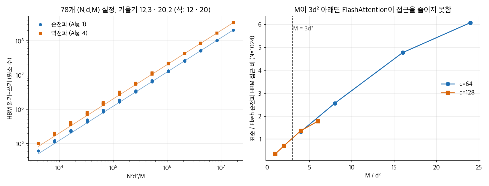
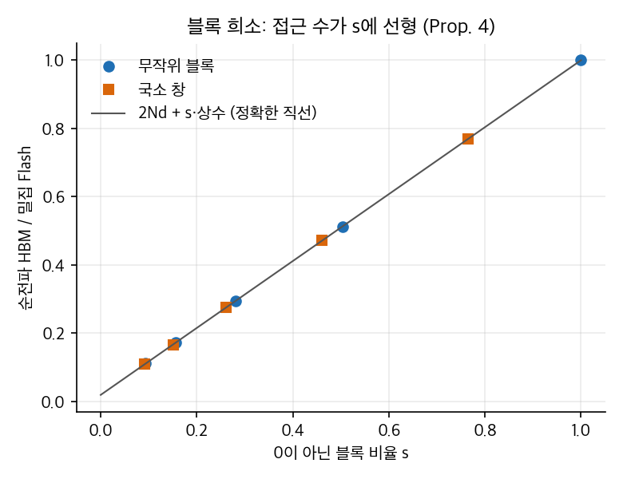
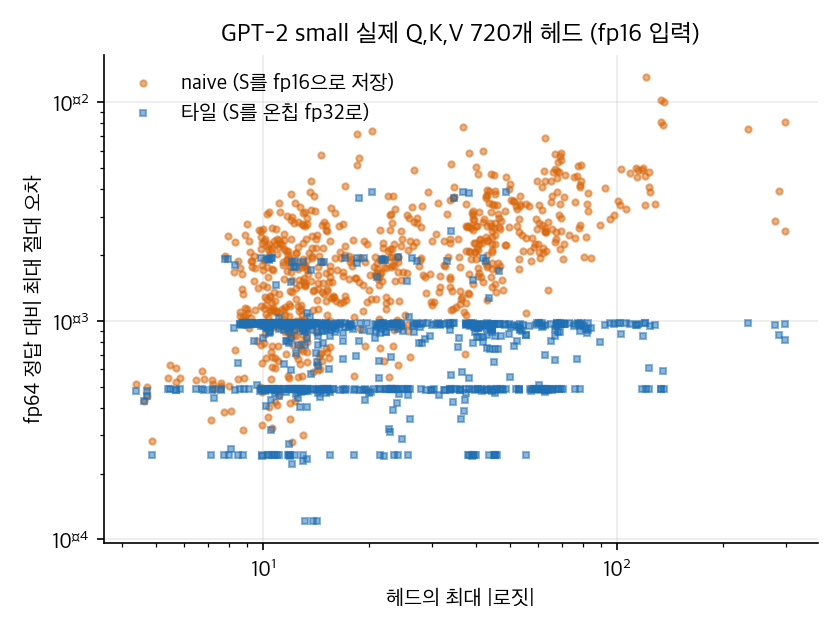
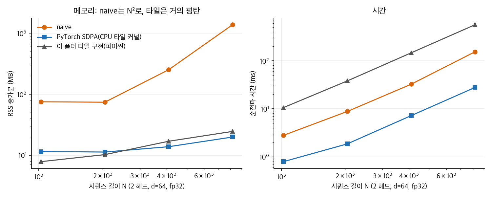

# FlashAttention이 줄이는 것은 FLOPs가 아니라 HBM 접근이다

FlashAttention(Dao et al., NeurIPS 2022)은 attention의 결과를 바꾸지 않고 GPU 메모리 접근을 줄입니다. 이 글은 알고리즘을 PyTorch로 직접 짜서(`minimal_impl.py`, CPU, 테스트 24개) 논문의 이론 결과를 숫자로 확인한 기록입니다. 논문 그림은 쓰지 않았고(arXiv 라이선스가 CC가 아님) 그래프는 모두 직접 그렸습니다. GPU 속도는 재현하지 않았고 공식 코드는 읽기만 했습니다.

## 알고리즘과 구현

표준 attention은 S = QKᵀ와 P = softmax(S)를 HBM에 쓰고 읽습니다. FlashAttention은 K, V를 블록으로 나눠 SRAM에 올리고, 행마다 최댓값과 합(m, ℓ)을 들고 다니며 출력 O를 블록마다 다시 척도해 갱신합니다(online softmax). 역전파는 S, P를 저장하지 않고 O와 통계로 블록마다 다시 계산하며, 핵심 식은 D_i = dO_i · o_i입니다(길이 N 합이 길이 d 내적이 됨).

구현은 위 알고리즘 그대로이고, 줄마다 "HBM에서 올린 원소 수"와 "HBM에 쓴 원소 수"를 세는 계수기를 붙였습니다. float64에서 정답 attention과 1e-12, 역전파는 autograd와 1e-11 이내로 일치했고, 블록 크기 5가지, 인과 마스크, 블록 희소 마스크, 로짓이 수백인 입력에서도 같았습니다. 역전파에는 (m, ℓ) 두 벡터 대신 logsumexp L = m + log ℓ 하나면 충분하다는 것도 시험했습니다.

## HBM 접근 수를 직접 세면

계수기의 값은 다음 닫힌 식과 78개 (N, d, M) 설정에서 정확히 같았습니다.

- 표준 순전파 4Nd + 4N², 역전파 8Nd + 7N²
- Flash 순전파 2Nd + T_c(3Nd + 4N), 역전파 4Nd + T_c(5Nd + 2N), T_c = ⌈N/⌈M/4d⌉⌉

T_c ≈ 4Nd/M이므로 주항은 순전파 12N²d²/M, 역전파 20N²d²/M입니다. 논문은 Θ만 쓰고 상수를 쓰지 않습니다. 로그-로그 적합 지수는 N 1.96, d 1.93, M −0.96(이론 2, 2, −1, 차이는 2Nd와 올림 항 때문)이고 두 항 모형의 주항 계수는 12.3과 20.2로 유도값과 맞습니다.

**이득에는 문턱이 있습니다.** Flash 순전파가 표준보다 접근이 적으려면 2Nd + T_c(3Nd + 4N) < 4Nd + 4N², 즉 M ≳ d(3d + 4)입니다. 격자 탐색에서 교차점은 M/d² = 3.0–3.2였습니다. 논문은 "d²가 M보다 훨씬 작다"고만 씁니다. A100의 SM당 192KB(fp16 원소 98,304개)를 다 써도 d = 64에서는 접근이 6.1배(N = 1024) 줄지만, d = 128에서는 1.8배뿐입니다. 이는 논문의 블록 규칙(B_c = ⌈M/4d⌉)으로 센 값이고, 현재 공식 커널은 타일이 다르며(head dim 64에서 128×128, Q 블록이 병렬 축) 이 값이 곧 실측 이득은 아닙니다. 또 이 블록 규칙은 SRAM을 M의 최대 1.28배까지 씁니다. Θ 안에서는 무해하지만 M을 엄밀한 용량으로 읽으면 안 됩니다.

## 블록 희소

0이 아닌 블록 비율을 s라 하면 접근 수는 2Nd + s·T_c·N(3d + 4)로 **정확히 직선**이었습니다(적합 잔차 6e-16). 논문 Prop. 4의 Θ(Nd + N²d²M⁻¹s)가 상수까지 맞습니다. s = 0.09이면 밀집의 11%입니다.

## 정확성: 타일링은 정밀도를 바꾸지 않는다

float32에서는 flash와 naive의 오차가 같았습니다(무작위 입력 시드 20개, 로짓 크기 3가지). float16에서는 flash가 20/20 시드 모두 더 정확했습니다(부호 검정 p = 1.9e-6, Holm 보정 5.7e-6, 오차비 3.2–11배). 이유는 타일링이 아니라 S를 어디서 반올림하느냐입니다. naive는 S를 fp16으로 저장하고 flash는 온칩 fp32로 둡니다. 텐서코어 입력용으로 P̃를 fp16으로 내려도 결과는 거의 같았습니다.

사전학습 GPT-2 small의 실제 Q, K, V(논문과 같은 N = 1024, d = 64, pile-10k 문서 5개, 12층 × 12헤드 = 720개)에서도 같았습니다. 헤드 최대 로짓은 중앙값 19.6, 최댓값 298.7(층 4)이었고, float16에서 flash가 더 정확한 헤드가 99.2%, 오차비 기하평균 2.5배(문서 부트스트랩 95% [2.45, 2.55])였습니다. 로그 최대 로짓과 로그 오차비의 상관은 0.67입니다.

이 결과는 "S, P를 fp16으로 저장하는 naive"를 기준으로 한 것입니다. Golden et al.(arXiv:2405.02803)은 BF16 순전파에서 Flash가 baseline보다 약 한 자릿수 큰 수치 편차를 보인다고 보고했습니다. 기준 구현과 정밀도가 달라 방향이 반대로 나올 수 있으며, 이 글은 그 설정을 재현하지 않았습니다.

## 논문 표 재계산

- Table 2·4의 속도비(HF 대비 3.52×/3.04×, Megatron 대비 1.74×/1.67×, 문맥 1k/2k/4k 1.74×/1.57×/1.31×)는 시간 열에서 다시 계산해 일치했습니다. 서론의 "1.8× over Megatron"은 표의 1.67–1.74와 다릅니다.
- Table 1(BERT 20.0 ± 1.5 대 17.4 ± 1.4분, 10회)은 ±가 표준편차인지 표준오차인지 적혀 있지 않습니다. 표준편차면 Welch p = 0.0008이고 표준오차면 p = 0.22로 결론이 갈립니다.
- Table 3(LRA) 평균은 모두 맞습니다. 그런데 수학적으로 같은 Transformer와 Flash가 과제별 최대 1.6점, 평균 절대 0.66점 다릅니다. 이 한 쌍이 LRA의 잡음 크기를 알려 줍니다.
- Fig. 2 왼쪽: HBM 40.3 → 4.4 GB, FLOPs 66.6 → 75.2 G. 행렬곱 FLOPs 비는 14/12 = 1.17로 보고 1.13과 방향이 맞지만, 절대값은 보고된 설정에서 우리가 센 824.6 GFLOPs와 12배 다릅니다. 우리 시뮬레이터의 Flash HBM은 4.06 GB(보고 4.4)로 가깝고 표준은 25.2 GB(보고 40.3)로, 보고 측정에 마스크·드롭아웃 같은 Alg. 0에 없는 단계가 들어갔을 수 있으나 확인하지 못했습니다.

## 산술 강도로 본 "FLOPs보다 메모리 이동"

표준 attention 순전파(N = 1024, d = 64, fp16)는 약 30 FLOP/byte이고, A100의 능선점은 fp16 텐서코어 312 TFLOP/s(NVIDIA 사양, 논문 밖의 값)를 HBM 1.5–2.0 TB/s(논문 §2.1)로 나눈 156–208 FLOP/byte입니다. 표준은 능선점의 1/5–1/7이라 memory-bound이고, 우리 모형의 Flash 순전파는 약 183 FLOP/byte로 능선점 근처입니다. 계산량 검산에서 쓸 수 있는 규칙은 단순합니다. 연산의 FLOP/byte가 능선점보다 훨씬 낮으면 FLOPs가 아니라 접근 수를 셉니다.

## CPU 메모리와 시간 (예비 측정)

PyTorch의 CPU 타일 커널(`SDPBackend.FLASH_ATTENTION`, 공식 FlashAttention 코드가 아님)과 naive를 비교했습니다(2헤드, d = 64, float32). N = 4096에서 8192로 두 배가 될 때 naive의 메모리 증가는 5.5배, 타일은 1.4배였고, N = 8192에서 타일 커널이 순전파 5.5배, 순·역전파 2.8배 빨랐습니다. 이 글의 파이썬 타일 구현은 naive보다 느립니다(561 ms 대 154 ms). 파이썬 루프의 오버헤드이고, IO 인식 이득은 SRAM을 직접 제어하는 커널에서만 실현된다는 논문 §1의 요지와 맞습니다. RSS는 할당자 영향이 있고 1회 측정입니다.

## 이후 문헌이 바꾼 것

- **최적성은 M ≥ d²에서만 맞습니다.** 논문 Prop. 3은 M = Θ(Nd) 한 점의 자명한 하한입니다. Saha & Ye(arXiv:2402.07443)는 M ≥ d²에서 Flash와 상수 배 안에서 맞는 하한을 증명했고 M < d²에서는 더 나은 알고리즘이 있다고 보였습니다(초록 수준으로만 읽음).
- **v1의 속도는 하드웨어 한계에 한참 못 미쳤습니다.** FlashAttention-2(arXiv:2307.08691)는 v1이 이론 최대 FLOPs/s의 25–40%라고 진단했고, FlashAttention-3(arXiv:2407.08608)은 H100에서 FA2가 35% 활용이라며 1.5–2.0배(FP16 최대 740 TFLOPs/s)를 보고했습니다.
- 공식 코드의 현재 판은 Q 블록이 병렬 축이고 K 블록이 커널 안의 루프이며, 통계는 `softmax_lse` 하나만 저장합니다(정적으로 읽음). 이 글의 시뮬레이터는 논문 Alg. 1/4의 모형이라 현재 커널의 접근 수가 아닙니다.

## 한계

- 접근 수는 알고리즘이 요구하는 원소 수입니다. 캐시, 레지스터, 병합 접근을 모형화하지 않았고 접근 수와 시간은 같지 않습니다. GPU 시간은 재현하지 않았습니다.
- 드롭아웃과 PRNG 재생성은 구현하지 않았습니다. 가려지지 않은 원소가 하나도 없는 행은 지원하지 않습니다(0/0).
- GPT-2 실험은 문서 5개, 학습 없이 순전파만이며, 비교 기준(naive의 S를 fp16으로 저장)에 따라 결과 방향이 달라질 수 있습니다.
- Saha & Ye, Golden et al., FA2, FA3는 초록까지만 읽었습니다.

## 자료

- [최소 구현](analysis/minimal_impl.py)
- [FlashAttention (arXiv:2205.14135) 논문 분석](analysis/01_paper_analysis.md)
- [02. 계보와 이웃 연구 (FlashAttention, arXiv:2205.14135)](analysis/02_prior_work.md)
- [03. 식 유도 검산과 최소 구현 (FlashAttention, arXiv:2205.14135)](analysis/03_analysis.md)
- [04. 이후 문헌의 확인·수정·반박 (C1–C8)과 공식 코드 정적 대조 (D1)](analysis/04_claim_verification.md)
