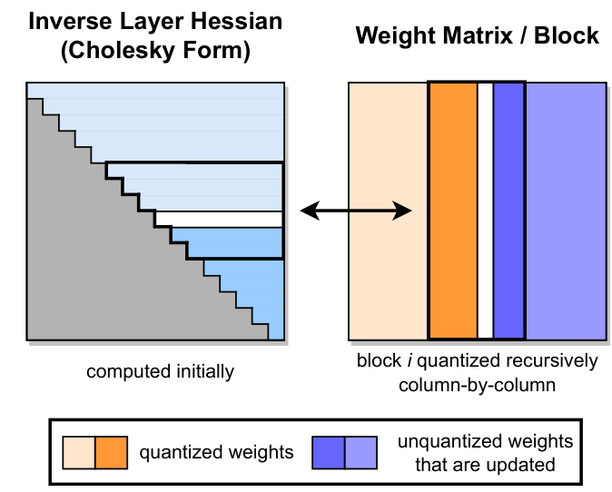
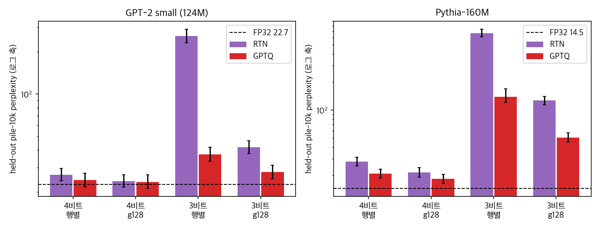
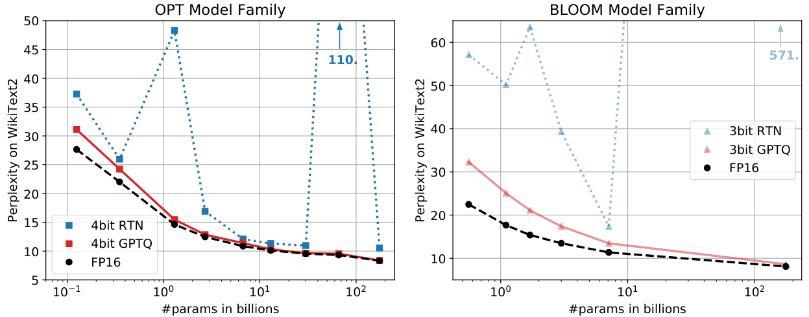

# GPTQ를 선형층 하나부터 직접 짜서 확인한 것

GPTQ(Frantar et al., ICLR 2023)는 재학습 없이 LLM의 가중치를 3–4비트로 줄이는 방법이고, 175B 모델을 약 4 GPU 시간에 양자화했다고 보고합니다. 이 글은 방법을 선형층 하나짜리 PyTorch 코드(`minimal_impl.py`, pytest 31개)로 짜서 알고리즘이 정말 순차 OBQ와 같은 계산인지, 소형 모델에서 논문의 정성적 주장이 어떻게 보이는지 확인한 기록입니다. 논문의 OPT·BLOOM, WikiText2, A100 결과를 재현한 것이 아니라 로컬에 있는 GPT-2 small, Pythia-160M과 pile-10k로 같은 질문을 던졌습니다. GPU 속도, 공식 코드 실행, 추가 가중치 다운로드는 하지 않았습니다. 논문 그림 1, 2는 arXiv 라이선스(CC BY 4.0)에 따라 그대로 실었습니다.

## 방법: OBS에서 GPTQ까지

*논문 그림 2(CC BY 4.0). 블록(굵은 선) 단위로 열을 양자화하고, 나머지 가중치(파랑)는 블록이 끝날 때 한 번에 갱신합니다. 왼쪽은 미리 계산해 둔 H⁻¹의 Cholesky 인자입니다.*

한 행 w에서 가중치 하나(w_q)를 격자 값으로 고정하고 나머지를 층 출력 오차가 최소가 되게 움직이는 문제는 라그랑주 승수로 풀리고, 보상 갱신은 δ = −(w_q − quant(w_q))/[H⁻¹]_qq · H⁻¹_{:,q}, 손실 증가는 ½c²/[H⁻¹]_qq입니다(논문 식 2, `03` §1.1에 유도). OBQ는 행마다 손실 증가가 가장 작은 가중치부터 고르므로 비용이 O(d_row·d_col³)입니다. GPTQ의 세 변경은 다음과 같이 이해됩니다.

1. **모든 행이 같은 열 순서**: H_F는 가중치가 아니라 입력에만 의존하므로 H_F⁻¹ 갱신을 열마다 한 번만 하면 됩니다 → O(d_row·d_col² + d_col³).
2. **128열씩 늦게 갱신**: 갱신은 이후 열에 대한 선형 연산이라 블록 안만 즉시 갱신하고 나머지는 모아서 적용해도 결과가 같습니다. 우리 구현은 블록 크기 1, 16, d_col에서 결과가 1e-8 이내로 같았습니다.
3. **Cholesky**: H⁻¹의 가우스 소거 한 단계는 Cholesky 인자의 한 행을 만드는 것과 같고(U의 j행 = H_{F_j}⁻¹의 j행 / √[H_{F_j}⁻¹]_jj, 테스트로 확인), 위삼각 인자 한 번으로 식 3의 반복 오차 누적을 없앱니다.

## 구현이 알고리즘 1과 같은 계산을 하는가

가장 강한 시험은 **같은 열 순서의 순차 OBQ와의 일치**입니다. 이 순차 OBQ는 식 2를 말 그대로 구현해 단계마다 H_F를 새로 역행렬로 계산하는 느린 코드이고, GPTQ와 bits 2–4 × 블록 크기 1–100, act-order 순열, 그룹(g = 2, 4, 8)에서 모두 1e-8 이내로 일치했습니다. 예측 손실 Σ(w−q)²/U_jj²/2는 ½ΔW(H+λI)ΔWᵀ와 1e-9 상대 오차로 같았습니다.

## 층 하나: 합성과 실제 GPT-2 층

- 합성(상관 있는 활성, 시드 10개): GPTQ의 층 오차는 RTN의 0.61–0.65배(10/10)입니다. 우리 탐욕 OBQ(OBQ의 보조 휴리스틱 없음)는 0.83배로 **고정 순서 GPTQ보다 나빴습니다**. 논문 4절은 탐욕 순서의 이득이 작다고만 했는데 작은 층(d_col ≤ 64)에서는 부호가 반대였습니다. 휴리스틱 없는 구현이라 일반화는 하지 않습니다.
- dampening: 표본이 열보다 적을 때(n = 64 < 96) λ = 0은 Cholesky가 실패했고(10/10), 1%도 새 표본의 오차가 RTN보다 컸습니다. dampening이 수치 안정화이자 정규화임을 보여 줍니다. 언어 모델 설정(보정 토큰 32768 ≫ 열 3072)에서는 λ = 1e-3과 1e-2가 구분되지 않았습니다(Δ −0.0002 nat, p = 0.99).
- GPT-2의 블록 0, 5, 11의 선형 12개 × 4·3비트에서 **24개 조합 모두 GPTQ < RTN**이었고 오차는 1.7–7.6배 낮았습니다. GPTQ는 보정 입력에서 오차를 줄이므로 held-out 입력의 층 오차가 보정 입력보다 24–44% 컸습니다(일부 층).

## 소형 모델 전체: GPTQ 대 RTN

GPT-2 small(124M)과 Pythia-160M의 블록 안 선형 4개를 논문 5절처럼 블록 단위로 순차 양자화했습니다(앞 블록이 양자화된 상태의 입력으로 Hessian을 모음, 블록 안 층 간 순차는 안 함, 모의 양자화). 보정은 pile-10k 문서에서 길이 512 구간 64개(논문의 약 1/8), 평가는 겹치지 않는 held-out 문서 150개의 첫 512토큰입니다. 신뢰구간은 문서 부트스트랩, 방법 비교는 같은 문서 짝 비교와 Holm 보정입니다.

| 설정 | GPT-2 RTN → GPTQ (FP32 22.7) | Pythia-160M RTN → GPTQ (FP32 14.5) |
|---|---|---|
| 4비트 행별 | 26.6 → 24.4 | 28.0 → 20.9 |
| 4비트 g128 | 24.0 → 23.6 | 21.4 → 18.3 |
| 3비트 행별 | 260 → 37.2 | 672 → 140 |
| 3비트 g128 | 42.0 → 27.9 | 126.5 → 50.7 |

- 8개 중 7개에서 GPTQ가 분명히 낫습니다(같은 문서 짝 비교 Holm p ≤ 2e-4). GPT-2 4비트 g128은 경계입니다(Δ −0.017 nat, CI [−0.032, +0.002], Holm 0.031).
- **4비트도 FP32보다 유의하게 나쁩니다**: GPT-2 +4–7%, Pythia-160M +26–44%(논문의 "거의 무손실"은 175B의 관찰이고, 논문 표 3에서도 OPT-125M 4비트는 +12.6%).
- 논문 OPT-125M(RTN 1.35배, GPTQ 1.13배, 3비트 GPTQ 1.95배)과 BLOOM-560M(1.16, 1.07, 1.44)의 추세와 방향은 같습니다(4비트에서 GPTQ가 손실을 절반 이하로, 3비트 RTN 붕괴, 그룹이 격차를 줄임). 모델마다 취약성이 크게 달라서(GPT-2 3비트 GPTQ 1.64배, Pythia-160M 9.6배) 크기 추세는 확인하지 못했습니다.

### act-order (논문에 없는 후속 휴리스틱)

열을 활성 크기 순으로 양자화하는 act-order는 공식 저장소에 camera-ready 이후 추가된 것입니다. 3비트에서 GPT-2 37.2 → 34.8(−6.3%), Pythia-160M 140 → 89(−36%), 4비트 GPT-2 24.40 → 24.07(Holm 모두 ≤ 0.004)였습니다. 보정 문서 시드를 바꾸면 GPT-2 3비트 perplexity가 ±1.6% 변하므로(시드 3개) 효과가 작은 비교에는 시드 반복이 필요합니다.

## 논문 산술 재계산

*논문 그림 1(CC BY 4.0). OPT 4비트와 BLOOM 3비트에서 RTN과 GPTQ의 WikiText2 perplexity.*

- OPT-175B(d = 12288, 96층)의 3비트 가중치는 62.0 GiB(행별 FP16 scale + 3비트 zero 포함, 임베딩은 FP16)이고 KV 캐시 2048토큰은 9.0 GiB로 합계 71.0 GiB입니다. 80 GiB GPU 한 장에 들어가고 4비트(91.3 GiB)는 안 들어갑니다. 논문의 "약 63 GB, 약 9 GB"와 일치합니다.
- 그룹 오버헤드(scale FP16 + zero b비트): 3비트 g1024 +0.019, g128 +0.148비트로 논문의 ≈0.02, ≈0.15와 맞고, 2비트 g128 2.14, g32 2.56비트는 ≈2.2, ≈2.6과 맞습니다.
- 표 6의 속도비 4.53, 3.24는 지연 값(589/130, 230/71)에서 재계산해 일치합니다. 토큰마다 가중치를 한 번 읽는다고 보면 3비트 커널은 A100에서 약 0.94 TB/s, A6000에서 0.51 TB/s의 유효 대역폭이고, 순수 대역폭 한계 속도비는 16/3 ≈ 5.2배입니다.
- 175B를 4.2시간에 양자화한다는 주장은 FLOPs 모델(Hessian 누적이 약 89%)로 A100 FP32 피크 기준 2.6시간이라 효율 61%에 해당하며 plausible합니다. 표 2의 시간은 파라미터 수에 거의 선형(약 1.4–1.6분 / 10억 파라미터)입니다.
- 사소한 불일치: OPT-125M FP16가 표 3에서 27.65, 표 8에서 27.66. 본문의 "g128이 추가로 0.1 개선"은 OPT에서 0.07, g128과 FP의 차이 "0.1–0.3"은 OPT PTB에서 0.36입니다.
- **24 GB 맥에서 들어가는 크기**(GPU 한도를 RAM의 2/3 = 16 GiB로 가정, 런타임 1.5 GiB, KV 2 GiB 포함): 4비트 g128(4.156 비트/가중치)이면 약 25.8 B 파라미터, 3비트 g128이면 약 34.1 B, FP16이면 약 6.7 B입니다. 가중치 용량만의 계산이고 정확도(위 결과)와 속도(GPTQ 커널은 CUDA 전용)는 별도입니다.

## 공식 코드와의 대조 (정적, 실행 안 함)

알고리즘 본체(Cholesky 순서, B = 128, λ = 1%)는 논문과 일치합니다. 재현성의 변수는 다음입니다. 첫 인자 데이터셋이 보정 데이터이고 평가는 세 세트를 모두 돌려 같은 실행의 C4 평가는 zero-shot이 아닙니다. act-order, true-sequential은 논문에 없는 후속 추가입니다. 그룹 격자는 블록 시작 시점의 가중치로 잡혀(g < B에서 우리 측정 차이 최대 1%) 있습니다. 3비트 커널은 행별 격자와 토큰 한 개만 지원하므로 표 6의 속도와 그룹 결과는 같은 범위가 아닙니다.

## 한계

보정이 논문의 1/8이고 모델이 두 개이며 평가가 WikiText2가 아닌 pile-10k 문서 앞 512토큰입니다. 모의 양자화라 실제 저장 크기와 커널 속도는 보지 않았습니다. 변형 비교(act-order, dampening)는 보정 시드 1개(일부 3개)이고 act-order와 그룹의 조합은 측정하지 않았습니다.

## 자료

- [최소 구현](analysis/minimal_impl.py)
- [01. 논문 분석: GPTQ (arXiv:2210.17323)](analysis/01_paper_analysis.md)
- [02. 계보, 구성 요소의 출처, 이 저장소의 다른 분석과의 관계](analysis/02_prior_work.md)
- [03. 분석: 식 유도 검산, 최소 구현 시험, 소형 모델 측정, 논문 산술 재계산](analysis/03_analysis.md)
- [04. 코드 검증: 논문 ↔ 공식 코드 정적 대조 (D1–D11), 이후 문헌이 확인·수정한 주장](analysis/04_code_verification.md)
