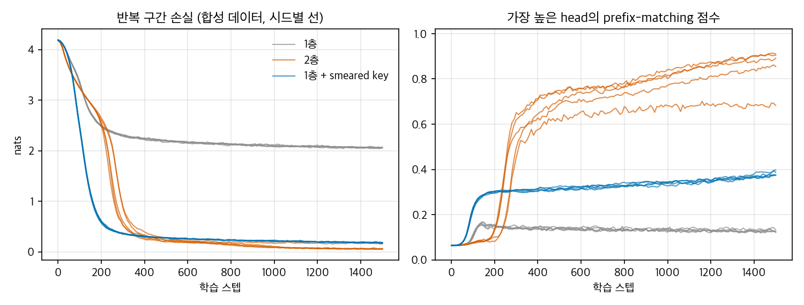
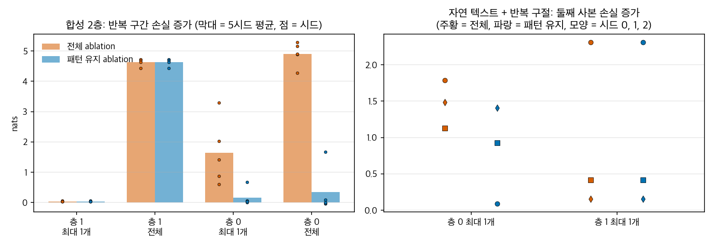
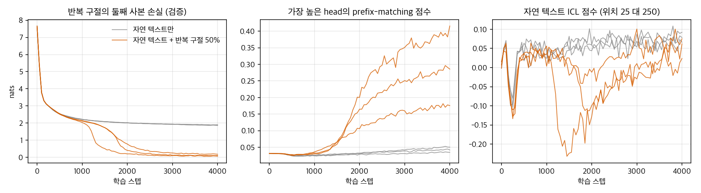
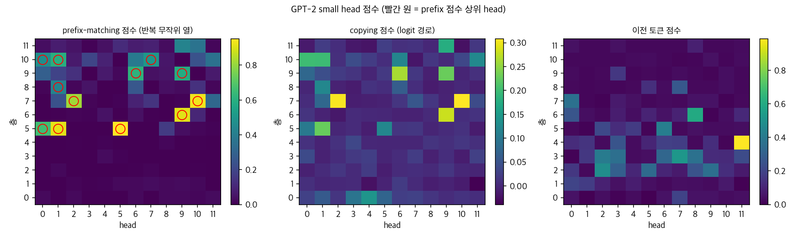
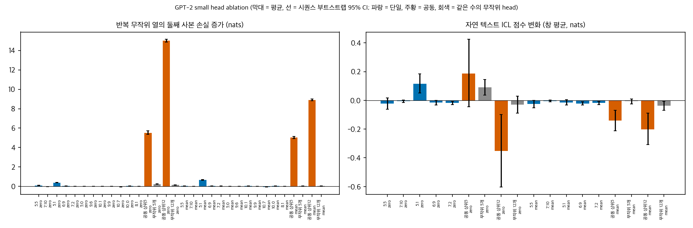

# induction head는 정말 ICL의 원인인가

Olsson et al.의 *In-context Learning and Induction Heads*(Anthropic, 2022)는 두 가지를 주장합니다. 하나는 "`[A][B] … [A]`에서 `[B]`를 완성하는 attention head(induction head)"가 학습 초기의 좁은 구간에서 형성되고, 그때 in-context learning(문맥이 길수록 손실이 줄어드는 정도)이 함께 급증한다는 관찰입니다. 다른 하나는 거기서 나아가 "induction head가 ICL의 상당 부분을 담당한다"는 여섯 가지 간접 논거입니다. 이 글은 정의를 식으로 검산하고, 직접 짠 작은 PyTorch 모델(`minimal_impl.py`, pytest 10개)로 어디까지 확인되는지 본 기록입니다. 논문의 모델과 수치를 재현한 것이 아니라 **메커니즘이 작은 규모에서 성립하는지** 본 것입니다. 공식 코드와 가중치는 없습니다(Anthropic 내부 모델). 대신 마지막 절에서 공개 사전학습 모델(GPT-2 small)에 같은 정의를 적용해 봤습니다.

## 정의를 먼저 검산했습니다

- **ICL 점수.** 논문은 "500번째 토큰 손실 − 50번째 토큰 손실"이라 정의하는데 보고하는 값(약 0.4 nats)은 양수입니다. 부호가 정의 문장과 반대라서 이 글은 "이른 위치 손실 − 늦은 위치 손실"로 씁니다. 한 위치의 손실이 앞쪽 k 토큰에만 의존하는 모델(n-gram)은 이 점수의 기대값이 0이므로, 점수는 "k 토큰을 넘는 문맥을 쓴 정도"를 재는 거친 척도입니다.
- **prefix matching.** 반복 열에서 둘째 사본 이후의 각 위치가, 이전 사본에서 현재 토큰 바로 다음 위치에 둔 attention 질량의 평균입니다. 이상적인 head는 1, 균등 attention은 L = 12에서 0.062입니다. 논문 본문의 정의 문장이 모호해서 구현은 "이전 A 바로 다음 토큰 B로 attend"로 고정했습니다.
- **copying.** 두 가지를 구현했습니다. OV 회로의 양의 고유값 비율과, 실제로 attend한 토큰의 logit 몫입니다. 논문 evaluator의 정규화에는 식이 없어 논문 표의 점수와 직접 비교할 수 없습니다.
- **왜 두 층인가.** 1층의 점수 `s_ij = x_iᵀ W_QK x_j`는 키 위치 j의 토큰과 위치만 보므로 앞 토큰을 볼 수 없습니다. 2층에서는 층 0의 이전 토큰 head가 앞 토큰 정보를 키 쪽 잔차에 써 넣고(K-composition) 층 1의 점수가 `e(t_i) B (e(t_{j−1}) W_OV)ᵀ` 항을 갖습니다. pytest가 1층에서 "앞 토큰을 바꿔도 두 키 위치의 attention 비가 그대로"임을 정확히 확인합니다.

## 합성 반복 데이터: 단계 변화는 재현됩니다

무작위 토큰 열(길이 6–20, 시퀀스마다 다름)을 순환 반복한 데이터에 attention-only 모델을 5시드로 학습했습니다(d = 128, head 4개).

- 1층은 반복 손실이 4.19에서 약 2.05에서 멈춥니다. "이미 나온 토큰을 복사"하는 전략은 되지만 prefix matching은 안 됩니다(점수 0.12–0.14, 우연 0.062).
- 2층은 이 평탄 구간(약 2.75)을 지난 뒤 반복 손실이 0.05–0.16으로 급락하고, 손실 기준 중간점이 5시드에서 220–250 스텝(평균 236), prefix 점수가 오르는 시점은 260–300 스텝입니다. 시드 변동은 평균의 약 13%입니다. 논문은 모델당 1회 학습이라 이 변동을 보고하지 않았습니다. 손실이 prefix 점수보다 30–50 스텝 먼저 떨어집니다(측정 간격 10 스텝).
- **smeared key**(키를 앞 토큰 키와 보간)를 넣은 1층은 반복 손실이 0.18까지 떨어지고 110–120 스텝으로 2층보다 일찍 일어납니다. 논문 Argument 2의 예측과 같습니다.

## head를 끄면: 중복과 K 경로

- 2층 모델의 층 1 head 4개는 **모두** induction head(prefix 0.62–0.91)입니다. 하나씩 끄면 반복 손실이 +0.03–0.06뿐이고 4개를 함께 끄면 +4.4–4.7 오릅니다. 논문이 경고한 "비슷한 head가 있으면 하나씩 끄는 ablation은 중요도를 가린다"가 그대로 나옵니다.
- 층 0은 전체 ablation에서 +4.3–5.3이지만 **패턴 유지 ablation**(깨끗한 실행의 attention 패턴을 고정)에서는 거의 0입니다(5시드 중 4시드). 층 0의 기여가 거의 전부 층 1의 attention 패턴, 곧 K-composition 경로를 통한다는 뜻이고, 이 방식의 ablation은 이전 토큰 head의 중요도를 가립니다.
- K-composition 대각합(논문 부록의 수학적 지표)과 prefix 점수의 상관은 20개 head에서 r = 0.77로 중간 정도입니다.

## 자연 텍스트: 안 생겼습니다

31번 분석에서 쓸 작은 언어 모델도 같이 만들었습니다. 파이썬 표준 라이브러리 소스와 pydoc 문서 영어 산문(약 267만 토큰, 코드와 문서가 섞임)으로 2층 MLP 모델(d = 128, 문맥 256, 약 95만 파라미터)을 학습했습니다.

- **자연 텍스트만으로는 induction head가 생기지 않았습니다.** 3시드, 4,000 스텝(약 3,300만 토큰)에서 prefix 점수 0.04–0.05(우연 0.031), 같은 구절의 둘째 사본 손실이 첫 사본과 같습니다. 8,000 스텝(lr 2e-3), 배치 4배(약 1억 토큰)도 시험했고 모두 음성이었습니다. 논문의 소형 모델은 약 10–30억 토큰에서 단계 변화가 일어나므로 규모가 20–100분의 1입니다. "생기지 않는다"가 아니라 "이 규모와 코퍼스에서는 생기지 않았다"입니다.
- 학습 창의 50%를 `[BOS, 구절, 같은 구절]`로 바꾸면 둘째 사본 손실이 약 2.1에서 0.07–0.18로 떨어지고 prefix 점수가 함께 오르는 단계 변화가 3시드에서 나옵니다. 시점은 500 스텝가량 갈립니다(손실 중간점 1,300 / 1,800 / 1,800). 층 1의 head 하나가 induction head이고 K-composition 대각합이 3시드 모두 그 head를 가장 크게 고릅니다.
- **그런데 자연 텍스트의 ICL 점수는 오르지 않았습니다**(증강 모델 0.06, 0.03, 0.00, 자연 텍스트만 0.07, 0.06, 0.08). 반복 구절로 만든 회로가 자연 텍스트의 ICL 점수로 옮겨가지 않았고, 논문이 보인 "자연 텍스트에서 ICL 점수 급증과 head 형성의 동시 출현"은 이 토이로 재현하지 못했습니다.
- 그 head를 끄면 둘째 사본 손실이 시드 0에서 +2.31 오르지만 시드 1에서는 +0.41, 시드 2에서는 거의 무영향이고 층 0의 다른 head가 크게 작용했습니다. **head 하나의 ablation 크기를 일반화하면 안 됩니다.**

## 공개 모델에서: GPT-2 small

직접 짠 토이가 아니라 공개 사전학습 모델 GPT-2 small(추론만, API 호출 없음)에 위 정의를 그대로 적용했습니다. TransformerLens 없이 transformers와 PyTorch 훅(attention 패턴, head별 출력, 평균·0 ablation)으로 구현했고(`gpt2_induction.py`), 반복 무작위 열(25토큰 × 4)로 head를 채점했습니다.

- **prefix 점수 상위 5개가 5.5(0.95), 7.10(0.93), 5.1(0.91), 6.9(0.91), 7.2(0.82)**로, 문헌에서 흔히 인용되는 GPT-2의 induction head와 같은 head입니다(우연 0.031). 이전 토큰 점수가 큰 head는 4.11(0.99)입니다. copying 점수는 정의에 따라 갈립니다: logit 경로 점수는 0.12–0.31로 낮고, OV 고유값 점수는 7.2에서 −0.36으로 음수인데 같은 head의 logit 경로 점수는 +0.31입니다. 고유값 점수를 "복사하지 않음"으로 읽으면 안 됩니다.
- **ICL 점수**는 pile-10k 문서 120개의 위치 50과 500 손실로 쟀습니다. 논문 정의 문장(500 − 50)은 음수가 되므로 이 글은 (위치 50 손실 − 위치 500 손실)로 써서 ±5토큰 창 평균 0.53(95% CI 0.28–0.78)입니다. 논문이 보고한 약 0.4와 같은 자릿수라는 말까지만 할 수 있습니다.

- **복사는 induction head 묶음이 담당합니다.** 평균 ablation으로 상위 5개를 함께 끄면 반복 열의 둘째 사본 손실이 0.24에서 5.3으로 오르고(복사 이득 12.9 nats의 39%), 상위 12개는 9.1(69%)입니다. 같은 수의 무작위 head는 +0.03–0.05입니다. head 하나씩 끄면 5.1만 +0.4–0.7이고 나머지는 ±0.06 이내라서 중복이 효과를 가립니다.
- **하지만 ICL 점수는 일부만 줄었습니다.** 같은 평균 ablation에서 5개는 −0.14(−0.21–−0.07), 12개는 −0.20(−0.31–−0.09), 곧 점수의 약 1/4–1/3입니다. 무작위 head는 −0.01, −0.04입니다. "ICL의 대부분이 induction head"는 GPT-2 small에서 지지되지 않았습니다.
- 0 ablation은 모델을 망가뜨립니다(12개를 끄면 통제 지표인 첫 사본 손실도 +3.4). 그래서 평균 ablation만 해석했습니다. 한계: 모델 하나, 문서 120개, head 집합 크기(5, 12)는 점수 분포를 보고 골랐고 K-composition 경로와 패턴 유지 ablation은 시험하지 않았습니다. Pythia-14m·70m도 같은 방향이지만 집합이 2–4개라 참고용입니다.

## 이후 문헌이 바꾼 것

초록 수준으로만 읽었습니다. function vector head가 few-shot ICL 성능의 다수를 설명한다는 보고(Yin & Steinhardt, ICML 2025)와, induction head가 "답이 문맥에 있는 경우"만 설명한다는 지적(Minegishi et al., ICML 2025)은 "대형 모델 ICL의 대부분이 induction head"라는 논문의 외삽을 수정합니다. 반대로 Llama-3-8B에서 induction head를 ablation하면 추상 패턴 과제의 ICL 성능이 최대 약 32% 떨어진다는 보고(Crosbie & Shutova)는 큰 모델에서의 기여를 지지합니다. 데이터의 반복 구조가 출현을 좌우한다는 연구(Chan et al., NeurIPS 2022)는 우리 토이의 "자연 텍스트만으로는 안 생기고 반복을 넣으면 생긴다"와 같은 방향입니다. 자세한 판정은 `04_claim_verification.md`에 있습니다.

## 인용할 때

- 소형 attention-only 모델의 거시 ICL에 대한 주장으로는 근거가 강하고(ablation), 대형 모델의 "대부분"은 근거가 상관과 유추뿐이며 이후 연구가 수정했습니다.
- 논문의 ICL 점수 정의와 지표 정규화는 문장만으로 재현하기 어렵습니다(부호, 합과 평균, copying 정규화).
- 공개 모델(GPT-2 small)에서 induction head를 끄면 복사 이득은 크게(39–69%) 사라지지만 거시 ICL 점수는 약 1/4–1/3만 줄었습니다. 이는 우리 측정이고 논문의 주장이 아닙니다.
- 같은 층에 비슷한 head가 여럿이면 하나씩 끄는 ablation은 효과가 0에 가까울 수 있고, 패턴 유지 ablation은 K 경로를 가립니다.

## 자료

- [최소 구현](analysis/minimal_impl.py)
- [01. 논문 분석: In-context Learning and Induction Heads (arXiv:2209.11895)](analysis/01_paper_analysis.md)
- [02. 계보와 관련 자료: In-context Learning and Induction Heads (arXiv:2209.11895)](analysis/02_prior_work.md)
- [03. 정의·식 검산과 최소 구현 결과: In-context Learning and Induction Heads (arXiv:2209.11895)](analysis/03_analysis.md)
- [04. 주장 검증: In-context Learning and Induction Heads (arXiv:2209.11895)](analysis/04_claim_verification.md)
