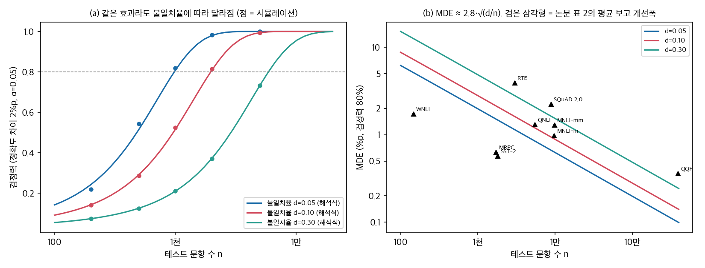
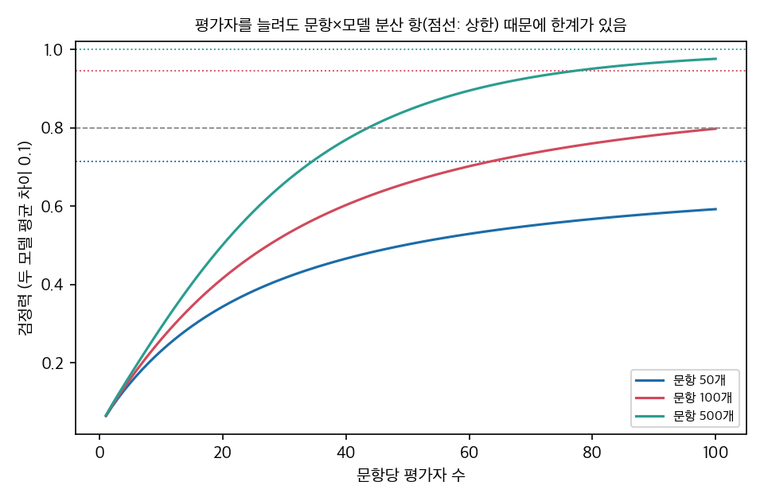

# 문항이 몇 개면 두 모델의 차이를 볼 수 있나

벤치마크에서 새 모델이 기준 모델보다 2%p 높게 나왔을 때, 이 차이를 믿으려면 시험 문항이 몇 개 있어야 할까요? Card, Henderson, Khandelwal, Jia, Mahowald, Jurafsky의 *With Little Power Comes Great Responsibility* (EMNLP 2020)는 이 질문을 **검정력(power)**으로 다룹니다. 진짜 차이가 있을 때 검정이 그것을 잡아낼 확률입니다. 이 글은 논문의 방법을 numpy와 scipy로 직접 짜고(약 300줄, CPU에서 수 초), 식을 유도해 검산하고, 저자가 공개한 데이터로 표와 그림 수치를 다시 계산한 기록입니다. 코드와 테스트는 함께 올렸습니다(`minimal_impl.py`, `test_minimal_impl.py`).

## 짝지은 검정의 검정력을 정하는 것

같은 시험 문항으로 두 모델을 비교하면 McNemar 검정을 씁니다. 이 검정은 두 모델의 답이 **엇갈린 문항**만 봅니다(M1만 맞은 b개, M2만 맞은 c개). 정확도 차이를 Δ, 엇갈린 문항의 비율(불일치율)을 d라 하고 n문항에서 맞는 부호 쪽의 검정력을 정규 근사하면

> power ≈ Φ( (√n·Δ − 1.96·√d) / √(d − Δ²) )

입니다. 두 가지가 바로 읽힙니다. 첫째, 기준 정확도는 식에 직접 들어가지 않고 **d와 Δ, n만** 들어갑니다. 둘째, 같은 Δ에서 d가 클수록 검정력이 낮습니다. 이 식을 검정력 80%에 대해 Δ로 풀면 닫힌 형태의 **최소 검출 효과(MDE)**가 나오고, n이 크면

> MDE ≈ 2.80 · √(d / n)

입니다. 저자의 R 코드가 쓰는 Connett·Duffy 정규식과 대수적으로 같고, 5개 (n, d)에서 수치 근과 1e-6 안에서 일치했습니다. MDE를 반으로 줄이려면 문항이 4배 필요하다는 뜻이기도 합니다.

왼쪽은 정확도 차이 2%p일 때의 검정력입니다. 곡선이 해석식이고 점이 시뮬레이션입니다. 두 모델이 5%만 엇갈리면 문항 1,000개로 80%에 도달하지만, 30%가 엇갈리면 5,000개로도 80%에 못 미칩니다. 오른쪽에서 검은 삼각형은 논문 표 2의 최근 평균 개선폭으로, MRPC·SST-2·WNLI는 세 곡선(d = 0.05, 0.10, 0.30) 모두 아래에 있습니다. 즉 이 데이터셋에서는 보통의 개선폭이 검출 한계보다 작습니다.

표준 크기에서의 MDE(%p, 80%, α = 0.05):

| n \ d | 0.05 | 0.10 | 0.20 | 0.30 |
|---|---|---|---|---|
| 164 (HumanEval 크기) | 4.9 | 6.9 | 9.7 | 11.9 |
| 500 | 2.79 | 3.95 | 5.59 | 6.85 |
| 2,000 | 1.40 | 1.98 | 2.80 | 3.43 |
| 10,000 | 0.63 | 0.89 | 1.25 | 1.53 |

## 논문 수치는 얼마나 재현되나

저자가 공개한 주석 CSV, SQuAD 리더보드 쌍별 결과, lme4 결과로 다시 계산했습니다.

- **표 2·9의 MDE.** 회귀·이항 MDE 18개 중 16개가 소수점 둘째 자리까지 일치합니다. 예외는 SST-2 회귀(1.02 대 1.04)와, 불일치 쌍이 9개 정도라 정규식이 해를 못 내는 WNLI입니다. 표 9의 Lachenbruch 최소·최대는 "주변 합만 알 때 가능한 불일치율의 양 끝"에서 구한 MDE와 같습니다.
- **번역.** 2000문장에서 1 BLEU 차이의 검정력 "약 75%"가 시뮬레이션 0.743, 정규 근사 0.747로 재현됩니다.
- **사람 평가 메타분석.** EMNLP 2019의 117개 비교(41편) 중 항목 100개 이하 68.8%(논문 69%), 유의성 검정 보고 23.7%(24%), 효과 크기와 항목 수의 Kendall τ −0.070(−0.07) 등 일곱 수치가 모두 일치합니다.
- **SQuAD 2.0.** 개발 세트와 시험 세트의 EM 차이 상관 0.992(논문 0.992). 리더보드 분류(그림 10)는 시험 쌍별 결과가 비공개라 근사로만 비슷한 크기가 나옵니다.

## 읽을 때 조심할 세 곳

**1. 부록 C의 숫자는 본문 검정으로 나오지 않습니다.** n = 500, Δ = 0.02, 일치율 0.9에서 검정력 약 0.25, Type-M 1.9라고 합니다(Type-M은 유의한 결과가 참값을 부풀리는 배수). 본문 식의 χ² McNemar로는 0.29와 1.83이 나오고, **정확 이항 검정이나 연속성 보정을 쓰면 0.249와 1.89**로 논문과 맞습니다. 저자 노트북이 statsmodels의 기본값(정확 검정)을 쓰기 때문입니다. 결론이 바뀌는 차이는 아니지만, 이 논문의 수치로 계획을 세울 때는 정확 검정을 쓰는 편이 안전합니다.

**2. 표 10의 "46%"는 검정력이 부족한 쪽의 비율입니다.** 14편의 SOTA 개선 주장 57개를 leave-one-out 회귀로 예측한 검정력으로 분류한 표입니다. 저자 코드를 그대로 따라 하면 논문의 수치(유의 50.9%, 검정력 충분하면서 유의 36.8%, 검정력 평균 0.698)가 정확히 나옵니다. 그런데 "% Powered 45.6%"는 코드에서 `Power < 0.8`인 비율입니다. 검정력이 충분한 주장은 57개 중 31개(54%)이고, 그중 21개(68%)가 유의합니다. 본문의 "46%만이 충분한 검정력"과 "충분한 실험의 약 80%가 유의"는 코드 기준과 반대로 읽힙니다. (저자에게 확인하지는 않았습니다. 코드에는 leave-one-out에서 빼는 행의 인덱싱 문제도 있지만 결론은 거의 같습니다.)

**3. 사람 평가 그림 6의 효과 크기는 평균 차이의 절반입니다.** 저자 R 코드는 모델을 −1과 +1로 부호화하고 계수를 그대로 "평균 차이"로 그렸습니다. 공개된 lme4 결과를 우리 시뮬레이션과 비교하면 두 모델 평균 차이를 계수의 2배로 놓을 때 RMSE가 0.042, 계수 그대로 놓으면 0.373입니다. 그러면 "3명·100문항은 평균 차이 0.2 이상이어야 충분하다"는 실제 평균 차이로 약 0.4 이상이 되어 논문의 결론이 오히려 더 강해집니다. 또 평가자가 3명이면 t > 1.96 기준의 1종 오류율이 우리 추정기에서 약 0.18이어서, 작은 평가자 수 곡선에는 거짓 양성이 섞였을 수 있습니다.

평가자를 늘리면 검정력이 오르지만 한계가 있습니다. 분산을 알 때 효과 추정의 분산은 σ_w1²/W + σ_i1²/I + σ_e²/(2WI)이고, 문항×모델 변동 항 σ_i1²/I는 평가자 수와 무관합니다. 높은 분산 설정에서 문항 50개로 차이 0.1을 보려면 평가자를 무한히 늘려도 검정력이 0.71을 넘지 못합니다.

## 이 방법을 어디에 쓰나

- 작은 평가에서 "차이가 있다"고 주장하기 전에 n과 d를 넣어 MDE를 먼저 계산합니다. 불일치율은 같은 모델을 두 번 돌린 결과나 다른 모델 쌍의 공개 결과로 잴 수 있습니다.
- 문항별 결과 없이 주변 합(정확도)만 있을 때도 d의 가능 범위(|Δ|에서 min(a1 + a2, 2 − a1 − a2)까지)로 검정력의 상·하한을 낼 수 있습니다. 예컨대 300문항에서 54개 대 33개를 푼 두 에이전트는 d가 0.07–0.29 어디든 가능하고, 관측한 차이가 참값일 때 검정력은 0.997에서 0.616 사이입니다(정확 McNemar의 p는 1e-6에서 0.031).
- 다중 비교를 보정하면 MDE가 비교 3개에 1.16배, 10개에 1.30배 커집니다.
- 이 논문의 검정력은 시험 세트 표본의 변동만 반영합니다. 학습·실행 간 변동과 같은 원문에서 나온 문항의 상관은 빠져 있습니다.

최소 구현과 24개 테스트(귀무가설에서의 1종 오류율, 검정력의 n·효과·불일치율에 대한 단조성, 해석식과 시뮬레이션의 일치, MDE의 닫힌 형태 등)는 `minimal_impl.py`와 `test_minimal_impl.py`에 있고 CPU에서 약 4초에 끝납니다. 전체 계산 과정과 저자 코드 대조는 `03_analysis.md`와 `04_claim_verification.md`에 있습니다.

## 자료

- [최소 구현](analysis/minimal_impl.py)
- [01. 논문 분석: With Little Power Comes Great Responsibility (arXiv:2010.06595)](analysis/01_paper_analysis.md)
- [02. 계보와 관련 연구: With Little Power Comes Great Responsibility](analysis/02_prior_work.md)
- [03. 분석: 식 유도 검산, 최소 구현, 논문 수치 재계산](analysis/03_analysis.md)
- [04. 주장 검증과 공식 코드 대조](analysis/04_claim_verification.md)
