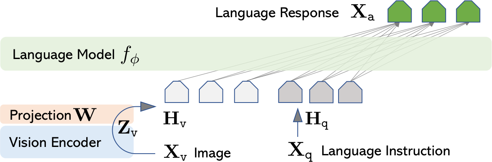
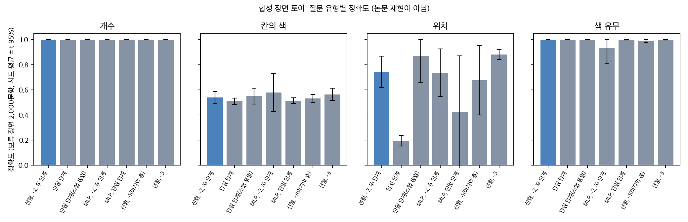
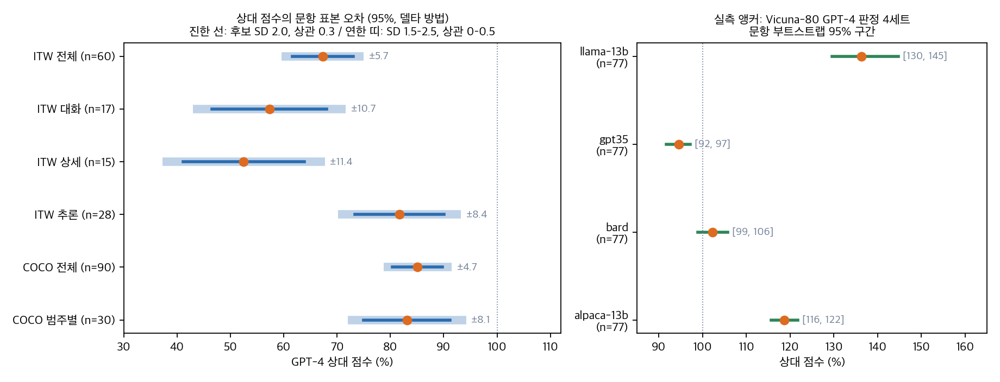

# LLaVA의 연결을 직접 짜 보면

Liu, Li, Wu, Lee의 *Visual Instruction Tuning*(NeurIPS 2023 구두)은 동결된 CLIP ViT-L/14의 패치 특징을 **선형 투영 하나**로 LLM의 입력 임베딩 공간에 옮겨 텍스트 앞에 붙이고, 텍스트 전용 GPT-4가 만든 시각 지시 데이터 158K로 두 단계 학습하는 레시피입니다. 이 글은 식과 산술을 검산하고, 작은 PyTorch 구현과 합성 장면으로 성질을 확인하고, 공식 코드와 논문을 맞춰 보고, 평가 벤치마크의 문항 수가 만드는 불확실성을 계산한 기록입니다. **토이는 논문 재현이 아닙니다.** 논문 수치는 재현하지 않았고 모델 가중치와 데이터셋은 받지 않았습니다(평가 질문 파일 16 KB만 받음).

## 식과 산술: 투영은 작고, 시각 토큰은 비싸다

식 1은 H_v = W · Z_v입니다. Z_v는 ViT-L/14의 격자 특징이고 CLS는 쓰지 않습니다(공식 코드는 `hidden_states[-2][:, 1:]`). 224px면 시각 토큰이 256개, 336px(LLaVA-1.5)면 576개입니다.

- **파라미터.** Vicuna-7B(은닉 4096)에서 선형 투영은 4,198,400개, 2층 MLP는 20,979,712개로 LM(6,738,415,616개)의 0.062%와 0.311%입니다. CLIP ViT-L/14 비전 타워는 303,179,776개이고, 이 값은 식으로 계산한 값과 같은 구조를 `meta` 장치에서 만든 모듈의 파라미터 수가 정확히 일치합니다.
- **비용은 연결 방식에서 나옵니다.** 7B LM이 시각 토큰 576개를 prefill하는 데 7.76 TFLOPs로, ViT-L/14@336의 0.38 TFLOPs의 20.3배입니다. Q-Former처럼 32토큰으로 줄이면 18분의 1입니다. 이미지당 KV 캐시는 fp16으로 7B에서 288 MB(576토큰)입니다.
- **문맥 예산.** 공식 학습은 `model_max_length 2048`이고 시각 토큰을 끼운 뒤 뒤를 자릅니다. 576토큰이면 텍스트는 1,472토큰이 한도이고, LLaVA-NeXT의 2,880토큰은 2048에 들어가지 않습니다.
- **학습 시간의 일관성.** 부록 C의 8×A100 4시간(1단계)은 13B, 캡션 20토큰 가정에서 MFU 약 24%, 10시간(2단계)은 샘플당 455–819토큰이면 MFU 25–45%로 계산량과 모순되지 않습니다.

## 공식 코드와 논문이 다른 곳

공식 저장소(`haotian-liu/LLaVA`, Apache-2.0, 커밋 `c121f04`)를 정적으로만 읽었습니다.

- **1단계가 질문 없는 캡션 복사입니다.** 논문 §4.2는 "간단한 설명을 요청하는 질문을 무작위로 뽑아" X_instruct를 만든다고 쓰지만, `scripts/pretrain.sh`의 `--version plain`("DO NOT CHANGE")에서 `preprocess_plain`은 질문을 `<image>`로 바꿔 버리고 `<image>` + 캡션 + 구분자만 이어 붙입니다. 시스템 메시지도 종료 토큰도 없습니다.
- 이미지는 항상 질문 앞에 놓입니다(식 2는 무작위). 현재 학습 스크립트는 Vicuna v1.x 템플릿과 LLaVA-Instruct-80K 1에폭이고 논문의 158K 3에폭 레시피(Vicuna-13B-v0)는 가중치 표에만 있습니다.
- 일치하는 것: 시각 인코더 동결(`requires_grad_(False)`와 `no_grad`), 1단계에서 투영기만 학습, 답과 종료 토큰만 손실(그 외는 `IGNORE_INDEX`), 층 `-2`와 CLS 제외.
- 마스킹 경로에는 토큰 길이가 어긋나면 그 샘플의 라벨을 전부 무시하고 경고만 찍는 분기가 있어 샘플이 조용히 빠질 수 있습니다.

## 작은 LLaVA: 1단계, 투영기, 층 선택

5x5 칸에 색 물체 1–4개를 놓은 합성 장면과 질문 4종(개수, 칸의 색, 위치, 색 유무)으로, CLS 전역 목적으로 먼저 학습해 동결한 4층 ViT(패치 25개)와 텍스트로 사전학습한 3층 LM을 이었습니다. 1단계(캡션, 투영만) 1200스텝 뒤 2단계(투영 + LM) 2000스텝입니다. 7설정 x 5시드, 구간은 t 95%(자유도 4)입니다. 개수와 색 유무는 모든 설정이 거의 100%이고 칸의 색은 기준선(약 52%)을 못 넘어, 설정 간 차이는 사실상 **위치 질문**에서 나옵니다. 예비 실험에서 처음 설정(8x8 칸, 학습되는 LM 위치)은 위치 질문이 우연 수준이어서 칸 수와 위치 인코딩을 바꿨고, 이는 결과를 보고 설정을 고른 것입니다.

- **1단계를 빼면 크게 떨어지지만 스텝을 맞추면 사라집니다.** 공간 질문 평균이 두 단계 0.761에서 단일 단계(2단계 스텝 동일) 0.568로 -0.193 [-0.250, -0.135]이고 5시드 모두 낮습니다. 총 스텝을 맞춘 단일 단계는 0.807로 +0.047 [+0.005, +0.088]이고 5시드 중 4가 앞섭니다. 논문 표 8의 -5.11(ScienceQA에서 1단계 생략)은 이런 스텝·데이터 통제가 설명되지 않은 비교이고, 후속 Prismatic(단일 단계로 충분)과 같은 방향의 토이 결과입니다.
- **선형 대 2층 MLP는 구분되지 않았습니다.** +0.011 [-0.083, +0.106](3/5 양). 보존할 정보가 색과 위치뿐이라 MLP의 비선형이 필요한 과제를 만들지 못했습니다. LLaVA-1.5의 MLP 이득(MME +31.4, GQA +0.5)도 작고 단일 실행입니다.
- **마지막 층 대 끝에서 두 번째 층도 구분되지 않았습니다.** -0.025 [-0.098, +0.048]. 층별 선형 탐침에서는 깊을수록 한 패치 토큰으로 읽히는 전역 정보(물체 수)가 0.51에서 0.89로 늘고 위치 정보가 0.96에서 0.90으로 줄어, 논문의 "마지막 층은 더 전역적"이라는 설명과 방향이 같습니다. 하류 정확도의 차이로는 이어지지 않았고 -3층이 약간 낫다는 약한 경향(+0.055, 하한 +0.003)만 있었습니다.

## LLaVA-Bench: 문항 60개의 상대 점수

LLaVA-Bench(COCO)는 30장 x 3유형 = 90문항, In-the-Wild는 24장 60문항(대화 17, 상세 15, 추론 28)입니다. 상대 점수는 점수 합의 비이고 표 5의 "전체"는 문항 수 가중 평균과 맞습니다(BLIP-2 38.10 대 38.1). 표 4의 괄호 차이 16칸 중 4칸은 뺄셈과 0.2–0.8점 다릅니다.

문항별 판정 점수는 공개되지 않아, 후보 점수의 산포를 가정(SD 1.5–2.5, 참조와의 상관 0–0.5)하고 델타 방법으로 구간을 냈습니다. 같은 저장소의 Vicuna-80 판정 4세트(같은 GPT-4 1–10점 프로토콜)의 문항 부트스트랩(반폭 3–7점)을 앵커로 삼았습니다.

- **In-the-Wild 전체 67.3의 95% 반폭은 ±5.7점(범위 ±3.9–7.7), COCO 전체 85.1은 ±4.7(±3.2–6.4)입니다.** 논문의 67.3 ± 2.0은 3번의 추론 실행의 표준편차라 문항 표본 오차를 포함하지 않습니다. 약 3배 작습니다.
- LLaVA 대 BLIP-2(+29.2점)와 OpenFlamingo(+48.2점)의 순위는 문항 오차로도 견고합니다(z = 7–16). 반대로 표 4의 학습 데이터 절제(85.1 대 81.9 등)는 두 설정의 문항 점수 상관이 0.8에 이르지 않으면 구분되지 않습니다.
- 판정 구성의 세부: 참조 답이 항상 Assistant 1이고(순서 교환 없음), 판정 모델은 단종된 `gpt-4-0314`, 파싱 실패 `[-1,-1]`은 평균에 들어갑니다(영향은 -0.06 – -0.22점으로 작음). 판정자는 이미지를 보지 않고 정답 설명만 봅니다.
- ScienceQA(4,241문항)에서 92.53%의 Wilson 95% 구간은 [91.70, 93.28]이고 MM-CoT-Large 91.68과의 0.85점 차이는 독립 z = 1.45입니다. 끝에서 두 번째 층의 0.96점은 두 모델의 불일치율이 6% 이상이면 짝지은 검출력 최소 효과(1.05점) 아래입니다.

## 이후 문헌이 바꾼 것

arXiv 초록과 LLaVA-1.5 본문, 그리고 이 저장소의 Prismatic·Cambrian-1 분석에서 읽은 내용입니다.

- **LLaVA-1.5**: 선형 → 2층 MLP, 336px, 학술 VQA 데이터와 "단어 하나로 답하라" 형식 프롬프트. 표 2의 증분 절제에서 MLP는 MME 1323.8 → 1355.2입니다(단일 실행). 원 LLaVA의 yes 편향은 학습 분포에 이진 질문이 없어서라는 설명이 붙어, "bag of patches"를 연결 구조의 한계로 읽을 근거는 약해졌습니다.
- **Prismatic**: 정렬 단계 없는 단일 단계가 12개 벤치마크 평균 z +0.15로 성능을 유지(재현 격차 ±0.17과 같은 크기), 시각 백본 미동결은 나쁘다고 보고했습니다. **Cambrian-1**은 OpenAI CLIP-336에서는 어댑터 데이터 0 → 0.5M이 +0.66(표본 오차 수준)이지만 16개 인코더 평균은 +3.22이고 미동결이 이득(+1.20)이라 둘이 갈립니다. 정렬 단계의 필요는 인코더와 데이터 양에 의존합니다.
- **MM1**(초록): 이미지 인코더·해상도·토큰 수의 영향이 크고 연결기 설계는 상대적으로 덜 중요합니다.
- 이 연결 방식("모든 패치 토큰 + MLP 투영")은 Prismatic을 거쳐 로봇 VLA의 백본으로 이어졌습니다.

## 한계

토이는 CLS 전역 목적의 4층 ViT와 25칸 합성 장면이라 CLIP·Vicuna·자연 이미지와 다르고, 시드 5개의 구간이 넓으며 6개 비교에 다중 비교 보정을 하지 않았습니다. 상대 점수의 구간은 후보 점수 산포의 가정에 의존합니다. 공식 코드는 정적으로만 읽었고 현재 커밋(2024-05)의 서술입니다. 후속 문헌은 본문을 읽은 LLaVA-1.5를 빼면 초록과 이 저장소의 분석 수준입니다.

## 자료

- [최소 구현](analysis/minimal_impl.py)
- [01. 논문 분석: Visual Instruction Tuning (LLaVA, arXiv:2304.08485)](analysis/01_paper_analysis.md)
- [02. 계보와 관련 연구: 이후 논문이 무엇을 바꿨나](analysis/02_prior_work.md)
- [03. 분석: 식·산술 검산, 최소 구현, 공식 코드 대조, LLaVA-Bench 통계](analysis/03_analysis.md)
- [04. 주장 검증 (C1–C13)](analysis/04_claim_verification.md)
