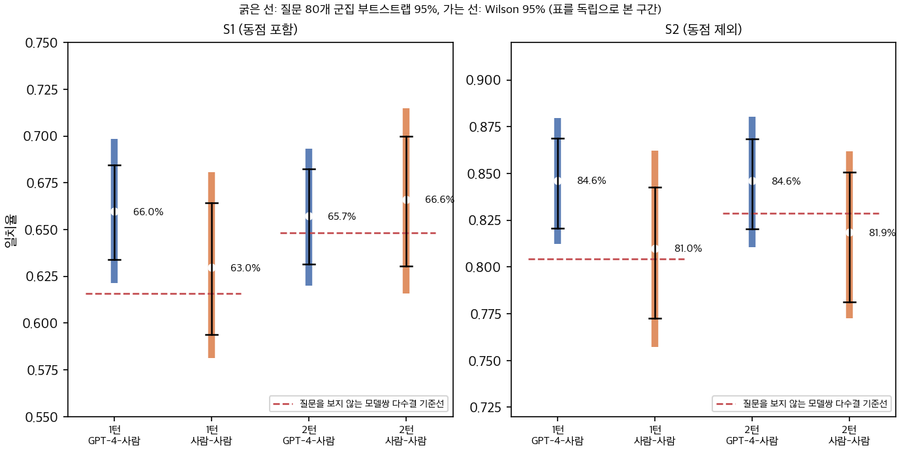
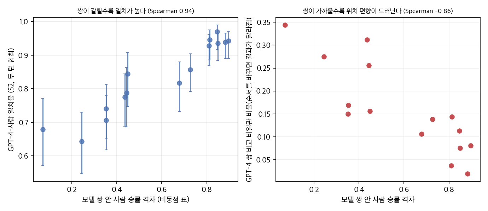
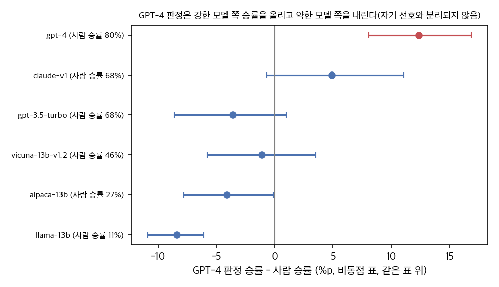
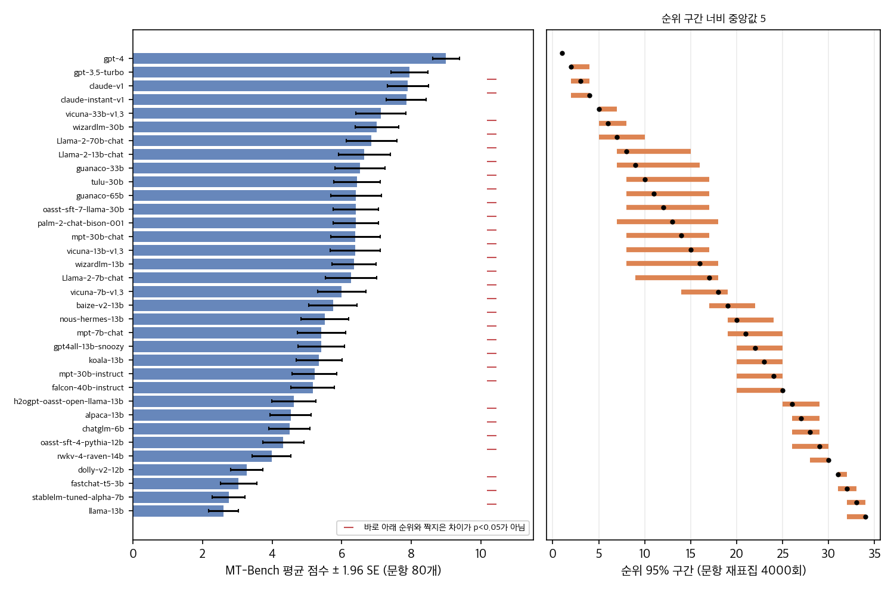

# 03. 재계산과 통계 검증

데이터: HF `lmsys/mt_bench_human_judgments`(전문가 3,355표 + GPT-4 쌍 비교 2,400개, CC BY 4.0), HF space `lmsys/mt-bench`의 GPT-4 단일 채점(34개 모델 x 160). Chatbot Arena 대화(33K)는 게이트(약관 동의)라 받지 못해 표 6은 논문 숫자로만 봅니다. API 호출, 코드 실행, 설치는 없었습니다.

| 스크립트 | 결과 | 내용 |
|---|---|---|
| `analysis/agreement_recompute.py` | `agreement_results.json` | §1, §2, §4.3(자기 선호), 쌍별 분해 |
| `analysis/bias_tables.py` | `bias_tables_results.json` | §3, §4.1–4.2, §4.4(표 6) |
| `analysis/mtbench_scores.py` | `mtbench_scores_results.json` | §5 |
| `analysis/plot_figures.py` | `report/figures/own_*.png` | 그림 4장 |

**불확실성 단위.** 표 하나하나는 독립이 아닙니다. 같은 질문 80개를 15개 모델 쌍, 2턴, 여러 사람이 공유합니다. 그래서 구간은 **질문 80개를 단위로 한 군집 부트스트랩**(4,000회, 시드 0)을 주 구간으로, 표를 독립으로 본 Wilson 구간을 참고로 함께 적습니다(`eval_error_bars`의 문항 단위 군집 SE와 같은 취지). 이 저장소 21번 `minimal_impl.py`의 식 (1), (7)을 `mtbench_scores.py`에 다시 짰습니다.

## 1. 표 5·13 재계산: 일치도와 구간

### 1.1 재현

공식 `compute_agreement.py`와 같은 규칙(전문가 = judge 이름이 `expert`, GPT-4의 `tie (inconsistent)`는 동점, S2는 양쪽 비동점)으로 계산했습니다. **GPT-4-사람과 사람-사람의 표 수와 비율이 표 5와 모두 일치**합니다.

| 턴 | 설정 | 짝 | 일치 | n | Wilson 95% | 질문 군집 95% | 논문 | 설계 효과 |
|---|---|---|---|---|---|---|---|---|
| 1 | S1 | G4-사람 | 66.0% | 1,343 | 63.4–68.5 | 62.1–69.9 | 66%, 1343 | 2.3 |
| 1 | S2 | G4-사람 | 84.6% | 859 | 82.1–86.9 | 81.2–88.0 | 85%, 859 | 1.9 |
| 1 | S1 | 사람-사람 | 63.0% | 721 | 59.4–66.4 | 58.1–68.1 | 63%, 721 | 2.0 |
| 1 | S2 | 사람-사람 | 81.0% | 479 | 77.3–84.3 | 75.7–86.2 | 81%, 479 | 2.2 |
| 2 | S1 | G4-사람 | 65.7% | 1,325 | 63.1–68.2 | 62.0–69.3 | 66%, 1325 | 2.1 |
| 2 | S2 | G4-사람 | 84.6% | 864 | 82.1–86.9 | 81.1–88.1 | 85%, 864 | 2.1 |
| 2 | S1 | 사람-사람 | 66.6% | 707 | 63.1–70.0 | 61.6–71.5 | 67%, 707 | 2.0 |
| 2 | S2 | 사람-사람 | 81.9% | 474 | 78.1–85.1 | 77.3–86.2 | 82%, 474 | 1.7 |

- 설계 효과 = (군집 구간 너비 / Wilson 너비)^2입니다. 표를 독립으로 보면 구간 너비가 약 30% 좁게(분산이 약 2배 과소) 나옵니다.
- 저자 표(표 13 `Author`)와 사람 다수결(`Human-M`)도 재계산했습니다. 저자 S2는 1턴 91.5%(201표), 2턴 88.3%(205표)로 표 13과 일치하고, S1 1턴만 346표로 논문(345)과 1표 차이입니다. G4-`Human-M` S2는 550, 561개로 논문 546, 557과 4개 차이이고 비율은 모두 반올림으로 일치합니다(동수 처리 규칙을 코드 없이 추정해 생긴 차이로 봄).
- S1 혼동표(두 턴 합침, 행 GPT-4, 열 사람, 순서 A/B/동점): A행 763/126/123, B행 139/695/152, 동점행 188/183/299. GPT-4의 동점(비일관 포함)은 25.1%, 사람 동점은 21.5%이며, 사람이 동점이라고 한 574표 중 GPT-4도 동점인 것은 52%입니다.

### 1.2 "GPT-4와 사람의 일치가 사람끼리의 일치와 비슷하다"

| 비교 | G4-사람 − 사람-사람 | 질문 군집 95% | 0 이하인 부트스트랩 비율 |
|---|---|---|---|
| 1턴 S1 | +3.0%p | −2.1 ~ +7.8 | 12.9% |
| 1턴 S2 | +3.6%p | −0.3 ~ +7.6 | 3.6% |
| 2턴 S1 | −0.9%p | −6.2 ~ +4.1 | 62.8% |
| 2턴 S2 | +2.8%p | −1.2 ~ +6.8 | 8.3% |

- **"비슷하다"는 표본 오차 안에서 성립합니다.** 네 비교 모두 구간이 0을 포함합니다. 단 논문의 "사람끼리보다 높다"(85% 대 81%)는 구간이 0을 포함하거나 걸쳐 있어 확인되지 않습니다(방향만 +).
- **추정량이 다릅니다.** G4-사람은 사람 표 하나하나를 GPT-4 한 표와 비교하고 사람-사람은 서로 다른 두 사람 쌍을 비교합니다. 부록 D.3 스스로 인정합니다. 표가 2개 이상인 항목만으로 G4-사람 일치를 다시 계산해도(같은 항목) 1턴 S2 +3.0%p(−0.8 ~ +6.6), 2턴 S2 +2.1%p(−2.0 ~ +6.2)로 같은 결론입니다.
- **S2의 선택 효과.** S2는 양쪽이 모두 비동점일 때만 남아 G4-사람 표의 64.0%(1턴), 65.2%(2턴), 사람-사람 쌍의 66.4%, 67.0%만 살아남습니다. 비동점 구간에서만의 일치입니다.
- **초록의 "80% 이상"은 S2 한정입니다.** S1은 66%(Wilson 63–69)로 나머지 약 1/3 표에서는 불일치 또는 동점 불일치가 있습니다.

### 1.3 민감도: 사람이 GPT-4 판정을 본 뒤의 표가 기록됐다면

데이터 수집에서 사람이 GPT-4와 다르게 고르면 GPT-4의 판정문을 보여 주고 "합리적인가"를 묻고 "34%의 경우 선택을 바꿀 의향이 있다"고 합니다(§4.2). 기록된 표가 노출 **전**인지 **후**인지 논문과 데이터 카드에 없습니다. 후라고 가정하고, 노출 전 불일치 중 34%가 일치로 바뀌었다면 S2 일치는 노출 전 약 76.7%(1턴, 2턴 모두)였을 것입니다(관찰 84.6%에서 역산). 이것은 **가정 시나리오이지 추정치가 아닙니다.** 사람-사람 일치도 같은 방향으로 부풀 수 있습니다. 확인하려면 저자에게 수집 파이프라인을 묻거나 노출 전 표가 있는 로그가 필요합니다.

### 1.4 쌍별 분해 (그림 2)

15개 모델 쌍별 G4-사람 S2 일치(`by_model_pair`)는 쌍 안 사람 승률 격차가 클수록 높습니다(Spearman 0.94, n=15). 가장 낮은 쌍은 Claude-v1 대 GPT-4 64%(n=101, Wilson 55–73), Claude-v1 대 GPT-3.5 68%(n=81, 57–77), GPT-3.5 대 GPT-4 71%(n=119, 62–78)이고 LLaMA가 낀 쌍은 94% 안팎입니다. 논문의 "70%에서 거의 100%로"는 방향과 범위가 맞습니다. 단 쌍 하나의 구간은 ±10%p 정도로 넓고(그림 `own_pair_gap.png`), 격차 축은 같은 사람 표에서 얻은 값이라 완전히 독립이 아닙니다.

## 2. 우연 보정: 결론이 달라지는가

논문의 R = 33%, 50%는 "무작위로 고르면"의 일치입니다. 하지만 모델 쌍이 15개이고 대부분 한쪽이 확실히 강해서(LLaMA 대 GPT-4 등) 아무 질문도 보지 않고 "원래 강한 쪽"을 찍어도 높은 일치가 나옵니다. 세 가지 기준으로 다시 보았습니다(`chance_corrected`).

| 설정 | 관찰 일치 | 논문 R 기준 κ | 모델쌍 층화 우연 일치 p_e | 층화 κ (군집 95%, p_e 고정) | 질문 무시 기준선 |
|---|---|---|---|---|---|
| 1턴 S1, G4-사람 | 66.0% | 0.49 | 0.514 | **0.30** (0.22–0.38) | 61.6% |
| 2턴 S1, G4-사람 | 65.7% | 0.49 | 0.554 | **0.23** (0.14–0.32) | 64.8% |
| 1턴 S2, G4-사람 | 84.6% | 0.69 | 0.772 | **0.33** (0.17–0.47) | 80.4% |
| 2턴 S2, G4-사람 | 84.6% | 0.69 | 0.819 | **0.15** (−0.05–0.34) | 82.9% |
| 1턴 S1, 사람-사람 | 63.0% | 0.44 | 0.514 | 0.24 | |
| 2턴 S1, 사람-사람 | 66.6% | 0.50 | 0.525 | 0.30 | |
| 1턴 S2, 사람-사람 | 81.0% | 0.62 | 0.723 | 0.31 | |
| 2턴 S2, 사람-사람 | 81.9% | 0.64 | 0.745 | 0.29 | |

- **층화 κ**: 모델 쌍x턴 층마다 GPT-4 표와 사람 표의 주변분포 곱으로 기대 일치를 구해 가중평균한 p_e로 (p_o − p_e)/(1 − p_e)를 계산했습니다. **질문 무시 기준선**: 같은 층의 다른 질문들의 사람 표 다수결을 그대로 찍는 규칙(해당 질문은 제외)과 사람 표의 일치율입니다.
- **결론의 구조:** (a) "GPT-4-사람 ≈ 사람-사람"이라는 상대 비교는 층화 κ에서도 유지됩니다(0.15–0.33 대 0.24–0.31, 구간이 겹침). (b) 그러나 "85% 일치로 높다"의 절대 해석은 크게 달라집니다. 모델 쌍의 강약만 아는 규칙이 S2에서 80.4%, 82.9%로 GPT-4(84.6%)와 4.2, 1.7%p 차이밖에 안 납니다. 같은 질문 내용을 보고 얻은 이득은 작습니다. (c) 이 기준선이 쌍별 다수결 라벨을 사람 표에서 얻으므로 GPT-4에게 불리한 비교입니다(사람 표 정보를 쓰는 오라클에 가깝다). 그래서 "GPT-4가 질문 단위에서 사람을 못 따라간다"가 아니라 "일치율 한 숫자로는 질문 단위 판별력을 말할 수 없다"로 읽어야 합니다.
- 층화 κ의 구간은 p_e를 점추정치로 고정한 근사입니다. 2턴 S2는 0을 포함합니다.
- 그래서 같은 데이터의 다른 면(그림 2의 70%→100%)이 중요합니다. 이득은 **격차가 작은 쌍**에서 판가름나는데, 거기서는 일치가 64–71%입니다(§1.4).

## 3. 위치 편향 표의 산술과 구간 (표 2, 9, 10, 11, 12)

`bias_tables.py`. 표 2·9·11·12의 모든 퍼센트가 n=80의 k/80을 0.1%p 반올림한 값으로 정확히 복원되고, 각 행의 합도 80(또는 반올림 100.0–100.1)입니다. 즉 분모 80(첫 턴 질문 80개)이 산술상 맞습니다.

| 판정자·프롬프트 | 일관 | Wilson 95% |
|---|---|---|
| Claude-v1 default | 23.8% (19/80) | 15.8–34.1 |
| Claude-v1 rename | 56.2% (45/80) | 45.3–66.6 |
| GPT-3.5 default | 46.2% (37/80) | 35.7–57.1 |
| GPT-4 default | 65.0% (52/80) | 54.1–74.5 |
| GPT-4 rename | 66.2% (53/80) | 55.4–75.7 |
| GPT-4 few-shot(표 12) | 77.5% (62/80) | 67.2–85.3 |

- **이름 편향(Claude)**: default 19/80 대 rename 45/80, 비쌍 Fisher p < 1e-4. 동일한 80개 문항의 반복 측정이라 쌍 검정이 더 맞으나 격차가 커서 결론은 같습니다.
- **GPT-4 대 GPT-3.5 default**: 52/80 대 37/80, p = 0.026. 판정자 순서(GPT-4가 가장 일관)는 성립하지만 구간이 많이 겹칩니다.
- **GPT-4의 default 대 rename**: p = 1.0(차이 1/80)이라 "이름이 아니라 위치 편향"이 GPT-4에서는 구분되지 않습니다.
- **퓨샷 효과**: GPT-4 52→62(65.0→77.5%), 비쌍 p = 0.115, "score" 프롬프트 52→41(p = 0.109), 모두 80문항에서는 확정이 안 됩니다. 논문은 "significantly"라 썼는데 GPT-4 퓨샷은 비쌍 검정으로 유의하지 않습니다(쌍 검정은 원자료가 없어 못 함, Claude의 23.8→63.7%는 확실).
- **표 10(범주별)의 분모가 맞지 않습니다.** 범주당 문항은 10개(§2.2)라서 퍼센트가 10%p 단위여야 하는데 표 10은 2%p 단위(42.0, 68.0, 76.0, …)라 범주당 n = 50이 필요하고, 8개 범주 합 400은 표 2의 n = 80과 다릅니다. 범주 평균 일관성은 64.5%로 GPT-4 default 65.0%와 가깝습니다. 부록 D.1은 분모를 설명하지 않으므로 질문 하나를 5번 샘플링했을 가능성 정도의 추정만 가능합니다. n = 50이라 해도 범주당 Wilson 폭이 ±12–15%p(예: 인문 36% → 24–50)이므로 "인문·글쓰기·STEM에서 더 두드러진다"는 방향 이상은 말하기 어렵습니다.
- **표 11을 공개 GPT-4 쌍 판정과 대조**(`table11_vs_released_gpt4_pair`, 공개 파일의 모델은 vicuna-13b-v1.2): GPT-3.5 대 Claude-v1 일관이 1턴 63.7%, 2턴 67.5%(논문 67.5%), GPT-3.5 대 Vicuna 67.5%, 70.0%(논문 73.8%), GPT-3.5 대 LLaMA 93.8%, 90.0%(논문 98.8%). 순서와 경향(점수 차이가 크면 일관 ↑)은 같지만 LLaMA 쌍은 논문 값(79/80)이 공개 파일 구간(1턴 86–97%) 밖입니다. 판정 실행 시기·GPT-4 버전이 달랐을 가능성이 있습니다(`04` D5, D6).
- **GPT-4 쌍 비교 전체의 비일관은 15.8%**(380/2,400, Wilson 14.4–17.4). 표 2의 "비슷한 답" 조건(GPT-4 비일관 35%)보다 훨씬 낮고, 쌍별로 1.9%(GPT-4 대 LLaMA)–34.4%(GPT-3.5 대 Claude-v1)이며 쌍 안 사람 승률 격차와 강한 음의 상관(Spearman −0.86, n=15)입니다. 즉 "위치 편향은 비슷한 모델끼리 비교할 때 두드러진다"(부록 D.1, 표 11)는 공개 판정으로 확인됩니다.

## 4. 장황함, 수학 채점, 자기 선호, Arena 표

### 4.1 장황함 공격 (표 3)

23개 답, 실패 = 판정자가 인위적으로 늘린 쪽이 낫다고 함. Claude-v1과 GPT-3.5는 21/23(91.3%, Wilson 73–98), GPT-4는 2/23(8.7%, 2–27). GPT-4 대 GPT-3.5 Fisher p = 1.6e-8로 격차는 확실합니다. 다만 (a) 표본이 23개이고 판정자 하나(GPT-4)가 만든 공격입니다. (b) 공격이 **GPT-4가 다시 쓴** 목록이라 GPT-4 판정자에게 유리하게(또는 불리하게) 작용할 수 있습니다. (c) 위치를 바꿨는지 본문에 없습니다. (d) 실제 모델 간 길이 차이로 일어나는 장황함 편향의 크기는 이 실험이 보여 주지 않습니다(이후 길이 보정 연구, `02` §1.2).

### 4.2 수학 채점 (표 4)

10문항 x 위치 2 = 20개 판정: 기본 14/20(70%, Wilson 48–86), CoT 6/20(30%, 15–52), 참조 답 3/20(15%, 5–36). 기본 대 참조 Fisher p = 0.0011, 기본 대 CoT p = 0.026, CoT 대 참조 p = 0.45. 20개가 아니라 문항 10개가 독립이라고 보면 기본 7/10의 Wilson은 40–89%, 참조는 약 6–51%로 더 넓어집니다. 결론("참조 답 안내가 낫다")은 유지되나 "70%에서 15%로"의 크기는 불확실합니다. 또 참조 답은 GPT-4가 만든 것이고 정답 검증이 본문에 없으며, 공개 코드에서 추론·코딩 질문도 참조 답을 씁니다(`04` D3).

### 4.3 자기 선호 (그림 3(b)): 공개 판정으로 재계산

같은 쌍 비교 표 위에서, 각 판정자의 비동점 표만 써서 모델별 평균 승률(상대별 승/(승+패)를 상대 평균)을 만들고 GPT-4 판정 − 사람 승률을 질문 군집 부트스트랩으로 보았습니다(두 턴 합침).

| 모델 | GPT-4 판정 승률 | 사람 승률 | 차이 | 군집 95% |
|---|---|---|---|---|
| GPT-4 | 92.1% | 79.7% | **+12.4%p** | +8.1 ~ +16.9 |
| Claude-v1 | 73.2% | 68.2% | +4.9%p | −0.7 ~ +11.1 |
| GPT-3.5 | 64.1% | 67.8% | −3.6%p | −8.6 ~ +1.0 |
| Vicuna-13B | 45.0% | 46.1% | −1.1%p | −5.8 ~ +3.5 |
| Alpaca-13B | 23.0% | 27.1% | −4.1%p | −7.8 ~ −0.1 |
| LLaMA-13B | 2.7% | 11.1% | −8.4%p | −10.9 ~ −6.1 |

- 논문의 "GPT-4는 자기에게 약 10% 높다"는 재현됩니다(+12.4%p, 1턴 +11.6, 2턴 +13.1, 구간이 0을 제외). **그러나 자기 선호로 분리되지 않습니다.** GPT-4 판정은 승률 상위 두 모델(GPT-4, Claude-v1)을 올리고 하위 모델(LLaMA, Alpaca)을 내립니다. 즉 사람보다 **더 극단적**인 판정 분포입니다(동점이 적고 격차를 키움). 이 패턴은 "강한 쪽이 더 강하게 보인다"로도 설명되며, GPT-4가 자기에게 후하다는 주장과 구분하려면 자기 외 모델의 강도가 통제된 비교가 필요합니다(논문도 §3.3에서 "결정할 수 없다"고 함).
- Claude-v1 판정자의 자기 선호(+25%p)는 이 데이터에 Claude 판정이 없어 재계산하지 못했습니다.

### 4.4 Chatbot Arena 표 6 (논문 숫자만)

S2 사람 일치: GPT-4 87%(n=1,944, Wilson 85.4–88.4), GPT-4 단일 85%(1,761), GPT-3.5 83%(1,567), Claude 84%(1,475). GPT-4 대 GPT-3.5 비쌍 Fisher p = 0.001이지만 두 판정자가 남긴 비동점 표의 집합이 다릅니다(GPT-4 1,944표 대 1,567표). 즉 "비동점 구간에서의 일치"를 같은 표 위에서 비교한 것이 아닙니다. S1 G4-사람은 64%(n=3,066, 62.3–65.7%)입니다. 부록 F는 "GPT-4 66%와 87%"를 비교 기준으로 쓰는데 표 6의 G4-사람 S1은 64%(66%는 G4-G3.5, G4-Claude 칸)로 2%p 차이입니다. 미세조정 Vicuna-13B(S1 56.8%, S2 85.5%, 부록 F)는 GPT-4(64%, 87%)와 비슷한 수준이라고 하는데, 학습은 시드 반복이 없는 한 번의 실행이고 평가 표본 수(S1 약 3K)만 알려져 있습니다. Arena는 표당 사람이 한 명이라 사람-사람 일치가 없고, 우리는 이 데이터를 받지 못해 위의 군집·κ 분석을 하지 못했습니다.

## 5. MT-Bench 80문항 점수의 모델 간 차이는 표본 오차를 넘는가

`mtbench_scores.py`. 공개된 사전 생성 GPT-4 단일 채점(1–10점, 34개 모델, 문항 80 x 2턴)에서 문항 평균 s_i = (1턴 + 2턴)/2의 80개 값으로 계산했습니다(논문 표 8의 160개 평균과 같은 값).

### 5.1 표 8 재현과 구간

- 공개 파일의 GPT-4 8.991, GPT-3.5 7.944, Alpaca-13B 4.531, LLaMA-13B 2.606이 표 8의 8.99, 7.94, 4.53, 2.61과 **일치**합니다. 이 파일이 논문의 점수 산출물과 같은 것이라는 근거입니다.
- 문항 단위(80개) 표준오차 SE는 모델별 0.20–0.37(예: GPT-4 0.198, GPT-3.5 0.268, LLaMA 0.219)입니다. 두 턴이 상관(중앙값 0.57)이라 턴을 독립 160개로 본 SE보다 1.23배 큽니다.
- 점수 -1(판정문에서 점수 추출 실패)이 4개 모델에 1개씩 있고 평균에 그대로 들어갑니다. 공식 `show_result.py`는 -1을 빼고 평균하므로 해당 모델 점수가 0.04–0.06 높아집니다(`04` D4). 표 8에 들어 있는 모델에는 -1이 없습니다.

### 5.2 모델 쌍 비교 (문항별 짝지은 차이)

| 항목 | 값 |
|---|---|
| 모델 쌍 수 | 561 (34개 모델) |
| 짝지은 비교, 쌍별 p < 0.05 | 462 (82%) |
| 비짝 z > 1.96 | 380 |
| 짝지은 p, Holm 보정(다중 비교 561) 후 유의 | 385 |
| 중앙값 SE: 짝지음 / 비짝 | 0.270 / 0.462 (상관 중앙값 0.66) |
| 짝지은 p < 0.05가 되려면 필요한 평균 점수 차이(중앙값) | 약 0.54점 |
| **순위가 바로 이웃한 33쌍 중 유의** | **4쌍** (GPT-4 대 GPT-3.5, claude-instant 대 vicuna-33b, falcon-40b 대 h2ogpt, rwkv 대 dolly) |
| 문항 재표집 순위 95% 구간 너비 중앙값 | 5 |

- **논문이 쓴 6개 모델**(GPT-4, GPT-3.5, Claude-v1, Vicuna-13B v1.3, Alpaca-13B, LLaMA-13B)의 15쌍 중 14쌍은 짝지은 p ≤ 3e-7로 확실히 구분됩니다. 유일하게 구분되지 않는 것은 GPT-3.5 대 Claude-v1(차이 0.044, SE 0.226, p = 0.85)입니다. "GPT-4 > {GPT-3.5 ≈ Claude} > Vicuna > Alpaca > LLaMA"라는 거친 서열은 80문항으로 충분히 구분됩니다.
- **미세한 순위는 80문항으로 정해지지 않습니다.** GPT-4만 1위로 확정(순위 구간 1–1)이고, 2–5위는 서로 가려지지 않습니다(구간 너비 2). 8–17위는 순위 구간 너비가 8–11, 18–25위도 5–6으로 이웃 모델과 크게 겹칩니다(`own_mtbench_ranking.png`). 짝지은 SE가 비짝의 약 0.58배라 짝지음이 검정력을 크게 올리지만(유의 쌍 380→462), 이웃 순위를 가르기에는 0.2–0.3점의 SE가 너무 큽니다.
- 한계: 이 판정은 GPT-4 단일 호출 하나(문항·모델당 1회)라 **판정자 쪽 변동은 구간에 들어 있지 않습니다**(temperature 0에서도 호출마다 달라질 수 있음, `04` D5). 구간은 문항 표본 오차(초모집단 가정)만 반영하며 80문항의 고정된 집합으로 보면 구간이 과대일 수 있습니다.

## 6. 주장 판정 요약

| # | 주장 (위치) | 판정 |
|---|---|---|
| V1 | 표 5(GPT-4-사람 66/85%, 사람-사람 63/81%)의 표 수와 비율 | **재현됨**(공개 데이터와 `compute_agreement.py` 규칙) |
| V2 | "GPT-4-사람 일치가 사람끼리와 같은 수준"(§4.2) | **성립**(차이 +3%p 안팎, 군집 구간 0 포함). "사람끼리보다 높다"는 **확인되지 않음** |
| V3 | "80% 이상 일치"(초록, §1) | **S2(동점·비일관 제외, 표의 약 65%) 한정.** S1은 66%. 군집 구간 S2 81–88% |
| V4 | 일치율이 높아 LLM 판정이 사람 선호의 대리가 된다 | **일치율만으로는 약함.** 질문을 안 보는 모델쌍 규칙이 S2 80–83%, 쌍 층화 κ 0.15–0.33. 격차가 작은 쌍에서 일치 64–71% |
| V5 | 위치 편향이 크다(표 2): GPT-4 일관 65% 등 | **산술 일치**(k/80). Claude 이름 편향은 확실(p < 1e-4), GPT-4 대 GPT-3.5 p = 0.026. 표 10은 분모가 설명되지 않음 |
| V6 | 장황함: GPT-4가 방어(8.7% 대 91.3%) | **산술 일치**(2/23, 21/23), 격차 확실(p = 1.6e-8). 표본 23개, GPT-4가 만든 공격 |
| V7 | 자기 선호: GPT-4 +10%p | **재현**(+12.4%p). 그러나 강한 모델 쪽으로의 일반적 확대와 분리되지 않음. 논문도 결론 보류 |
| V8 | 참조 답으로 수학 채점 실패율 70%→15% | **방향 확인**(p = 0.001), 크기는 문항 10개 기준으로 불확실. 참조 답은 GPT-4 산출 |
| V9 | MT-bench가 모델을 구분한다 / 표 8 점수 | **표 8 점수 재현.** 거친 서열은 구분, 이웃 순위는 80문항으로 구분되지 않음 |
| V10 | 격차가 클수록 일치 ↑(그림 2) | **확인**(Spearman 0.94, n=15 쌍). 쌍 하나의 구간은 ±10%p |
