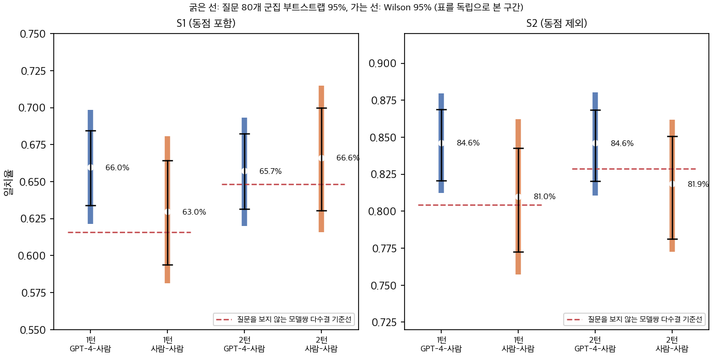
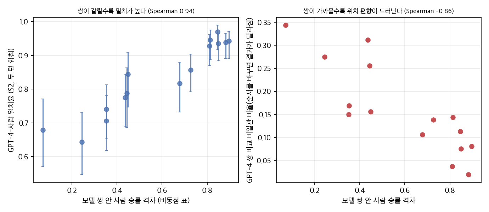
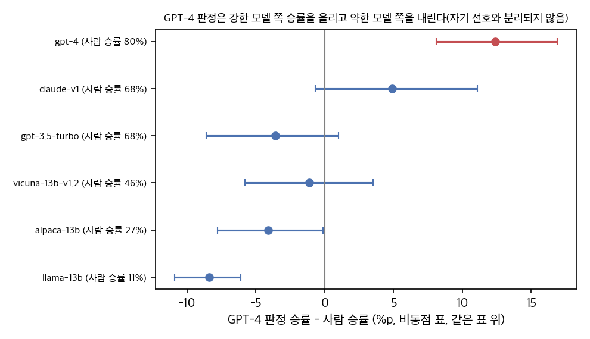
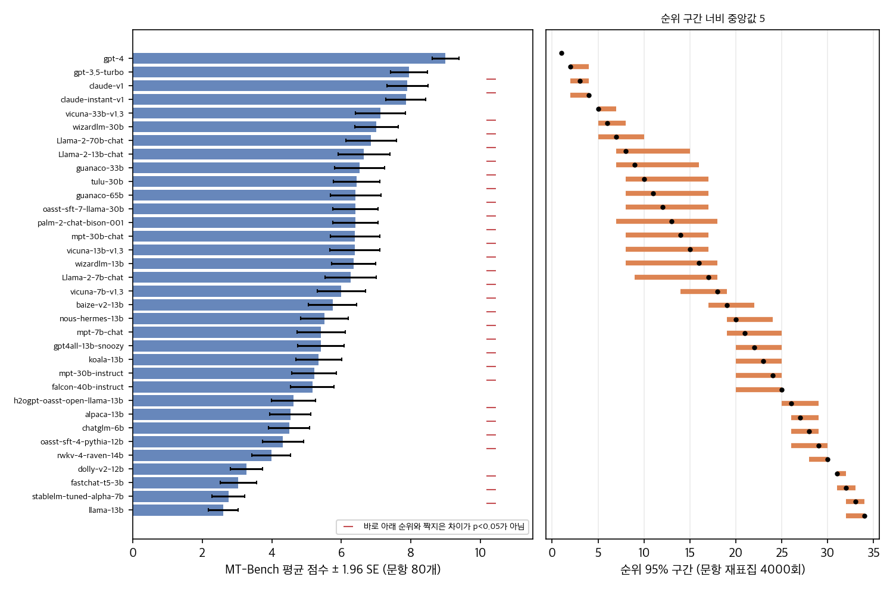

> **논문:** Zheng et al. *Judging LLM-as-a-Judge with MT-Bench and Chatbot Arena.* NeurIPS 2023 Datasets and Benchmarks, arXiv:2306.05685 (v4). 논문은 arXiv 비독점 배포 라이선스라 논문 그림은 싣지 않았고, 그림은 모두 우리가 직접 그린 것입니다. 공개 전문가 판정(HF, CC BY 4.0)과 사전 생성 GPT-4 채점으로 계산했고 API 호출이나 코드 실행은 하지 않았습니다.

## 논문이 묻는 것

강한 LLM에게 두 답 중 어느 쪽이 나은지 판정시키면 사람 판정을 대신할 수 있을까요? 저자들은 80문항 2턴 MT-bench에서 전문가 58명의 쌍 비교 표 약 3K와 GPT-4 판정을 비교하고, 위치·장황함·자기 선호 편향을 측정했습니다. 요약은 "GPT-4가 사람과 80% 넘게 일치하고, 사람끼리의 일치와 같은 수준"입니다.

## 1. 숫자는 정확히 재현되고, 같은 수준이라는 말도 성립합니다

공개 데이터로 표 5의 표 수와 비율이 모두 맞습니다(GPT-4-사람 66%/85%, 사람-사람 63%/81%). 같은 질문 80개를 여러 표가 공유하므로 질문 단위 군집 부트스트랩 구간을 붙이면 표를 독립으로 본 구간보다 약 30% 넓습니다(설계 효과 약 2). GPT-4-사람과 사람-사람의 차이는 +3.6%p(−0.3~+7.6)로 0을 포함합니다. "같은 수준"은 맞고 "사람끼리보다 높다"는 확인되지 않습니다.

*굵은 선은 질문 군집 95%, 가는 선은 표를 독립으로 본 Wilson 95%, 붉은 점선은 질문을 보지 않는 모델쌍 다수결 기준선입니다.*

## 2. 그러나 "80%"는 생각보다 약한 숫자입니다

- **동점 제외 값입니다.** 80%는 양쪽이 모두 비동점인 표만 남긴 값(표의 약 65%)입니다. 동점과 순서 비일관을 포함하면 66%입니다.
- **질문을 안 봐도 높게 나옵니다.** 같은 모델 쌍의 다른 질문 사람 표 다수결을 그대로 찍는 규칙이 동점 제외 일치 80–83%를 냅니다. 모델 쌍의 강약만으로 설명되는 부분이 큽니다.
- **우연 보정하면 낮습니다.** 모델 쌍별 기대 일치를 뺀 κ는 GPT-4-사람 0.15–0.33, 사람-사람 0.24–0.31로 둘이 비슷합니다. 상대 비교는 유지되지만 "높은 일치"를 판별력으로 읽을 수는 없습니다.
- **격차가 작은 쌍에서 약합니다.** 모델 쌍의 승률 격차가 클수록 일치가 높아지고(Spearman 0.94) Claude-v1 대 GPT-4는 64%, GPT-3.5 대 GPT-4는 71%입니다.

또 사람이 GPT-4와 다르게 고르면 GPT-4의 판정문을 보여 주고 34%가 바꿀 의향을 보였다고 하는데, 기록된 표가 노출 전인지 후인지는 밝혀져 있지 않습니다. 가정 시나리오로 후라면 노출 전 일치는 약 77%였을 수 있습니다(추정이 아닌 민감도 계산).

## 3. 편향 표: 산술은 맞고, 표본이 작습니다

표 2·9·11·12의 모든 퍼센트가 n=80의 k/80으로 복원됩니다. Claude의 이름 편향(23.8→56.2%)은 확실하지만 GPT-4의 default 대 rename, 퓨샷 효과(65.0→77.5%, p=0.115)는 80문항에서 확정되지 않습니다. 표 10의 범주별 퍼센트는 2%p 단위라 범주당 문항 10개로는 설명되지 않습니다. 공개 GPT-4 쌍 판정 2,400개에서는 순서를 바꾸면 결과가 달라지는 비율이 15.8%이고, 비슷한 모델 쌍일수록 높습니다(최대 34%).

장황함 공격은 23개 답에서 GPT-4가 2개, 다른 두 판정자가 21개에서 실패했습니다(격차는 확실하나 표본이 23개). 수학 채점은 참조 답을 주면 14/20에서 3/20으로 줄지만 20판정은 문항 10개이고, 참조 답도 GPT-4가 만든 것입니다.

## 4. 자기 선호는 분리되지 않습니다

같은 표 위에서 GPT-4 판정의 GPT-4 승률은 사람보다 +12.4%p 높습니다(논문의 약 10%p와 같은 방향). 그러나 Claude-v1은 +4.9%p, LLaMA와 Alpaca는 각각 −8.4, −4.1%p로, 강한 쪽을 올리고 약한 쪽을 내리는 더 극단적인 판정입니다. 논문도 이 부분의 결론을 보류했습니다.

## 5. 80문항 MT-Bench는 큰 서열만 가립니다

공개 GPT-4 단일 채점이 표 8을 그대로 재현합니다(GPT-4 8.991 등). 문항별 짝지은 차이로 34개 모델 561쌍을 비교하면 짝지음이 비짝보다 SE를 약 0.58배로 줄여 462쌍을 구분합니다. 논문의 6개 모델은 15쌍 중 14쌍이 구분되고 GPT-3.5와 Claude-v1만 구분되지 않습니다. 그러나 순위가 이웃한 33쌍 중 29쌍은 구분되지 않고 순위 95% 구간 너비의 중앙값이 5입니다.

## 코드 대조에서 눈에 띈 점

공개 코드는 판정 프롬프트와 순서 교환 규칙, 일치도 계산이 논문과 일치합니다. 다만 수학뿐 아니라 추론·코딩까지 80문항 중 30문항이 GPT-4가 만든 참조 답을 쓰고, 모든 판정이 반복 없는 단일 호출이며, 공식 점수 평균은 추출 실패(-1)를 빼지만 공개 판정 파일에는 남아 있습니다(점수 0.04–0.06 차).

## 인용할 때

- "GPT-4와 사람의 일치가 사람끼리와 같은 수준"은 표본 오차 안에서 인용할 수 있습니다. "80% 일치"는 동점 제외 값이라고 밝히세요.
- 선호 판정입니다. 사실 판정에 옮기려면 참조 기준과 우연 보정, 질문 군집 구간이 필요합니다.
- 계산 스크립트와 결과 JSON은 함께 올린 폴더에 있습니다.

## 자료

- [통합 리포트 PDF](report/report_public.pdf)
- [01. 논문 분석: Judging LLM-as-a-Judge with MT-Bench and Chatbot Arena](analysis/01_paper_analysis.md)
- [02. 선행 연구와 계보, 이 저장소의 관련 분석, 자료 표](analysis/02_prior_work.md)
- [03. 재계산과 통계 검증](analysis/03_analysis.md)
- [04. 논문과 공식 코드 대조 (FastChat `fastchat/llm_judge/`)](analysis/04_code_verification.md)
