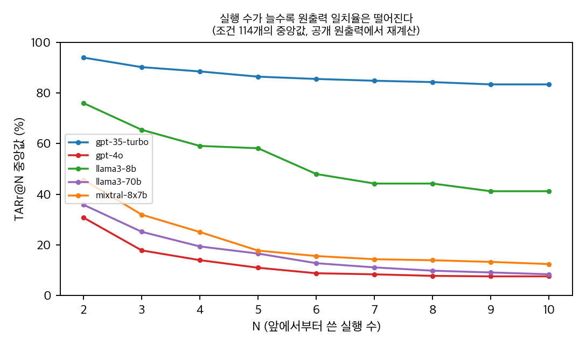
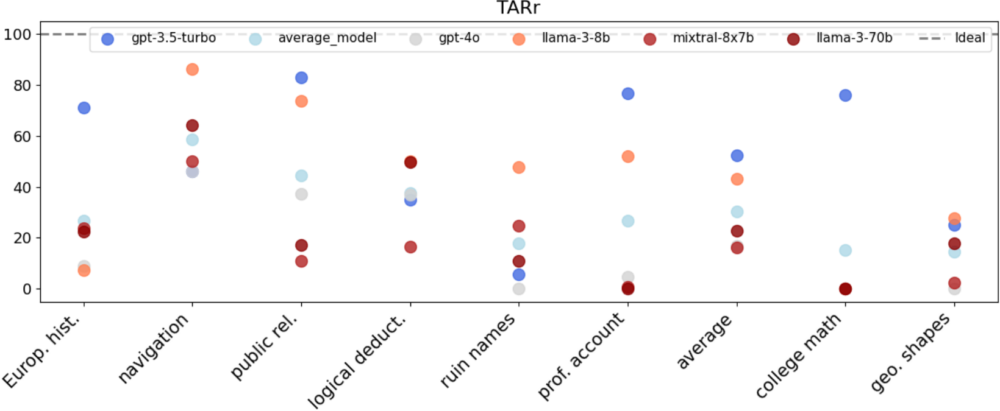
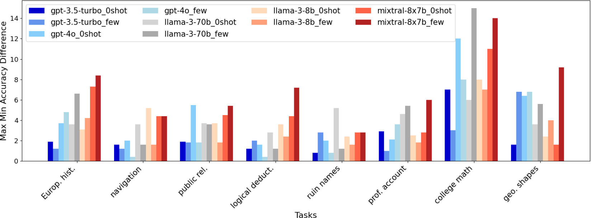
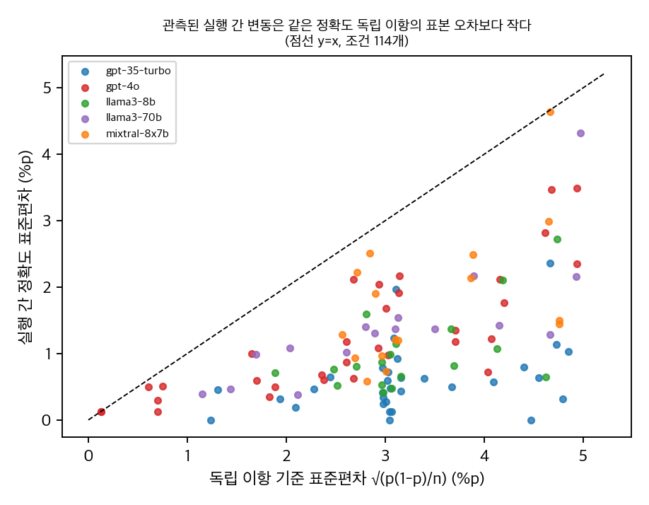
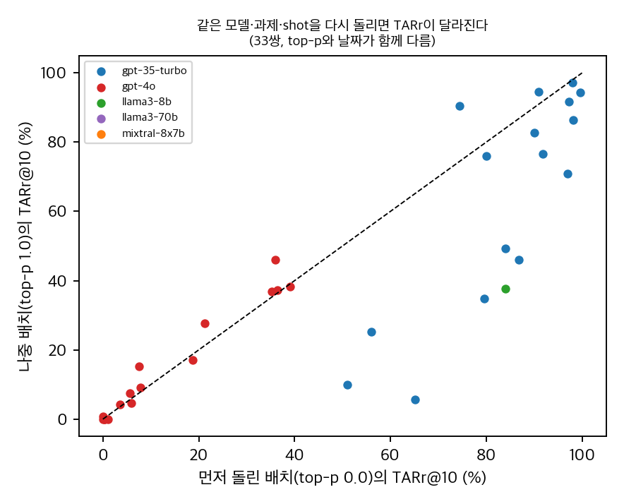

# temperature 0은 결정적이지 않다: 공개 원출력으로 다시 계산한 LLM 비결정성

Atil 등(Eval4NLP 2025 워크숍)은 GPT-3.5, GPT-4o, Llama-3-70B·8B, Mixtral-8x7B를 temperature 0, top-p 1, 시드 고정으로 BBH 4과제와 MMLU 4과제에서 조건마다 10회 돌렸습니다. 같은 입력인데 출력 문자열과 정확도가 실행마다 다르다는 것이 논문의 결론이고, 이를 재는 지표 **TARr@N**(N회 모두 원출력이 같은 문항의 비율)과 **TARa@N**(추출한 답이 모두 같은 문항의 비율)을 제안했습니다. 저자들이 공개한 실행별 원출력(114개 배치)으로 핵심 수치를 다시 계산했습니다. 공식 코드는 실행하지 않고, 답 추출 규칙을 읽고 직접 다시 구현했습니다.

## 표는 그대로 재현됩니다

- 논문 표 2(few-shot)와 표 3(zero-shot)의 80개 조건에서 BestAcc, 중앙값, WorstAcc, TARa, TARr가 모두 공개 원출력의 한 배치와 정확히 일치합니다. 공식 평가 결과 파일과도 114개 배치가 전부 일치합니다.
- TARr@10이 99% 이상인 조건은 0개이고 0%인 조건이 9개, 중앙값은 18.7%입니다. 실행 수를 늘릴수록 TARr은 떨어집니다(N=2 중앙값 55.6%, N=10 24.8%).

모델별로는 GPT-3.5의 TARr 중앙값이 83.4%로 가장 높고 GPT-4o 7.6%, Llama-3-70B 8.5%, Mixtral 12.5%, Llama-3-8B 42.6%입니다(공개 114개 배치 전체). 논문 그림 3은 few-shot의 모델별 TARr@10입니다.

그림: 논문 그림 3. © 저자, CC BY 4.0, 출처 arXiv:2408.04667 (v5).

## 최대 15%p와 70%p는 서로 다른 양입니다

- 그림 1의 "최대 15%p"는 **실행별 정확도의 최대−최소**이고, 우리 재계산 최대는 15.0%p(Llama-3-70B 대학 수학 few-shot)입니다.
- 초록의 "70%p"는 **BestAcc − WorstAcc**(Mixtral 대학 수학 few-shot, 72.0%p)입니다. 본문 §8은 이 값을 "최대-최소 차"라고 불러 두 정의가 섞입니다. 후자는 "문항 중 정답 여부가 갈릴 수 있는 비율의 상한"이지 "단일 실행 점수가 흔들리는 폭"이 아닙니다.

그림: 논문 그림 1. © 저자, CC BY 4.0, 출처 arXiv:2408.04667 (v5).

## 실행 간 변동은 문항 수만으로 설명되는가

문항이 매번 같으므로 "같은 정확도의 독립 이항"은 느슨한 기준입니다. 두 기준을 함께 썼습니다.

- **독립 이항 기준:** 관측 분산이 기대 분산의 중앙값 0.105배이고 최대 1.0004배입니다. 과분산인 조건은 114개 중 0개입니다.
- **문항별 정답률 고정 + 독립 뒤집힘(문항 안에서 실행 순서를 섞는 순열 검정):** 비율 중앙값 1.00, p<0.05가 111개 중 8개(우연으로 기대되는 5.6개), 다중 비교 보정 후 0개입니다.

한 배치 안에서는 "문항마다 독립적으로 뒤집힘"으로 변동이 설명되고, 실행 전체가 함께 움직이는 효과의 증거는 없습니다. 문항이 100개인 대학 수학에서 최대-최소가 15%p까지 나오는 것은 이 크기의 표본에서 뒤집힘만으로 가능한 값입니다.

## 배치 사이에서는 크게 달라집니다

공개 데이터에는 같은 모델·과제·shot을 두 번 돌린 쌍이 33개 있습니다. 설정 열을 보면 먼저 돌린 배치는 `top_p_k=0.0`, 나중 배치는 `1.0`이고 날짜도 다릅니다. 논문의 표는 모두 나중 배치입니다.

- TARr 차이의 절댓값이 중앙값 5.2%p, 최대 59.6%p입니다(GPT-3.5 ruin names few-shot: 65.2% 대 5.6%). 평균 정확도 차이는 중앙값 0.64%p, 최대 7.9%p입니다.
- top-p와 날짜가 함께 바뀌어 원인은 분리되지 않습니다. 논문은 top-p가 결정성에 영향이 거의 없다고만 쓰고 결과를 싣지 않습니다. 이 데이터는 그 서술을 확인해 주지 못하고, TARr이 설정과 시점에 따라 재현되지 않을 수 있다는 점만 분명히 합니다.

## 지표의 구현 세부

- 답 추출에 실패한 응답(복수 답, 답 없음)은 TARa에서 서로 다른 값으로 취급됩니다. 그래서 표 3의 GPT-3.5 ruin names zero-shot에서 TARr 97.2%가 TARa 95.6%보다 큽니다(정의상 불가능). 논문 배치의 응답 3.0%가 복수 답이고, 응답 하나라도 추출에 실패한 문항 비율은 GPT-3.5 3.5%에서 Mixtral 19.8%까지입니다. 이 값이 모델별 TARa의 상한이라서 TARa 차이의 일부는 불안정이 아니라 출력 형식 차이입니다.
- 빈 응답(GPT 계열 167개)은 정답도 답 집합의 원소도 아닙니다. 표 3의 GPT-4o 논리 연역 zero-shot에서 Best−Worst가 100−TARa보다 큰 것이 이 때문입니다. 논문에 언급이 없습니다.

## 정규성 기각은 재현되지 않습니다

논문은 20회 정확도에 KS 정규성 검정을 해서 p<10⁻⁹로 정규가 아니라고 하고 그래서 표준편차를 보고하지 않습니다. 공개 20회 데이터로 표본 평균·표준편차로 표준화한 KS(Lilliefors 몬테카를로), Shapiro-Wilk를 하면 p는 0.42–0.99로 기각되지 않습니다. p≈0은 표준화하지 않고 N(0,1)과 비교할 때나 나옵니다. 논문이 이렇게 했는지는 알 수 없습니다.

## 원인 주장은 추정입니다

논문은 입력 버퍼 공유, 연속 배칭, 청크 프리필, 프리픽스 캐싱을 원인으로 들지만 닫힌 모델이라 "추측할 수밖에 없다"고 직접 씁니다. 이후 연구(Thinking Machines의 배치 불변 커널, vLLM·SGLang의 결정적 모드, Yuan 등 2025)가 배치 크기 의존 수치를 실험으로 좁혔습니다(웹 검색 요약으로 확인했으며 수치는 원문 확인이 필요합니다). 우리 토이는 같은 행렬곱이 함께 계산되는 행의 수에 따라 비트가 달라질 수 있음(MPS float32에서 로짓 원소의 97%)을 확인했지만, 호스팅 서빙 스택을 재현한 것은 아니므로 논문 데이터의 원인이라는 증거는 아닙니다. 로컬 Llama-8B가 결정적이라는 주장과 파인튜닝이 불안정을 줄인다는 주장은 논문에 표가 없고 저장소에 조건 1–2개뿐입니다.

## 인용할 때

- 인용해도 되는 것: T=0·시드 고정의 호스팅 API에서 출력과 정확도가 실행마다 다르다(표 2·3, 재계산 일치), TARr·TARa 지표의 정의.
- 단서: TARr은 설정·시점에 따라 달라지고, TARa는 파서에 의존하며, 정규성 기각은 인용하지 말 것, 원인은 추정.

분석 자료와 재계산 코드는 이 글의 git 폴더에 있습니다.

## 자료

- [통합 리포트 PDF](report/report_public.pdf)
- [01. 논문 분석](analysis/01_paper_analysis.md)
- [02. 계보와 관련 자료](analysis/02_prior_work.md)
- [03. 검산과 재계산](analysis/03_analysis.md)
- [04. 논문 ↔ 공식 저장소 대조 (D1–D10)](analysis/04_code_verification.md)
