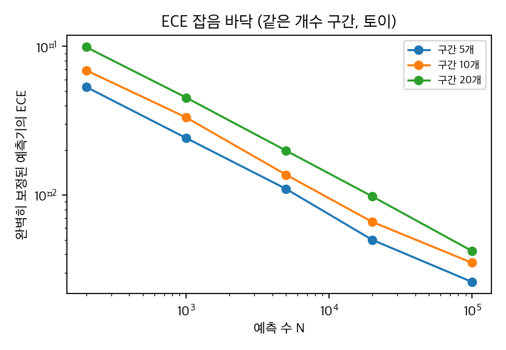
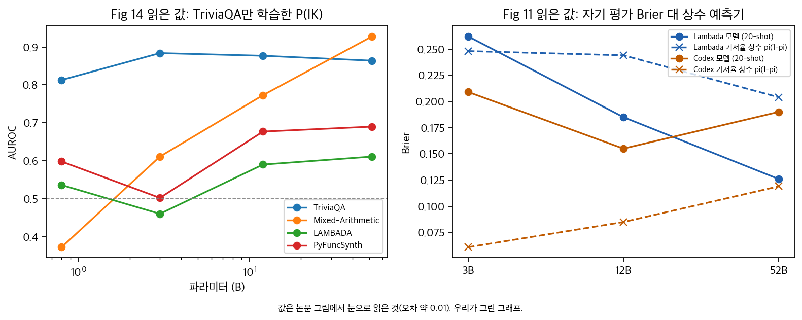

# LM은 자기가 아는 것을 얼마나 아는가: 숫자로 다시 본 Kadavath et al.

Kadavath et al.(Anthropic, 2022)은 큰 언어 모델이 (1) 객관식에서 보정되어 있고, (2) 자기가 만든 답이 맞을 확률 P(True)로 정오를 구분하며, (3) 질문만 보고 답할 수 있을 확률 P(IK)를 학습할 수 있다고 보고합니다. 모델이 내부 모델이고 코드와 결과 파일이 없어 재현할 수 없습니다. 이 글은 논문 표(Table 1–3)와 그림에서 읽은 값(오차 약 0.01)을 다시 계산하고, 직접 짠 numpy 토이로 지표의 성질을 확인한 결과입니다.

## 무엇을 확인했나

- **내부 일관성.** Fig 14의 52B 점(TriviaQA 0.864, Mixed-Arithmetic 0.928)이 Table 1의 같은 칸과 판독 오차 안에서 맞습니다.
- **ECE는 편향 추정량입니다.** 완벽히 보정된 예측기도 예측 5,000개, 10구간에서 ECE가 약 0.014이고 200개면 0.069입니다. 논문의 52B True/False ECE 0.011은 이 바닥 근처입니다.

## 크기 추세는 얼마나 단단한가

- "TriviaQA만 학습한 P(IK)의 OOD AUROC가 크기와 함께 증가"는 Mixed-Arithmetic(0.372 → 0.928)에서만 단조입니다. LAMBADA(0.536, 0.460, 0.590, 0.611)와 Python 함수 합성(0.598, 0.502, 0.677, 0.690)은 3B에서 꺾입니다. 점이 4개이고 학습은 한 번입니다.
- P(True)>0.5 조건부 정확도의 격차가 크기와 함께 커진다는 서술은 LAMBADA에서 절대 격차가 12B와 52B 모두 0.105입니다. 선택된 비율(coverage)은 보고되지 않았고, 정확도 = coverage × 조건부 정확도 + (1 − coverage) × 나머지 정확도에서 coverage ≤ 기저/조건부이므로 52B Codex에서는 표본의 53% 이상이 "False"로 분류된 셈입니다.

## 기저율 예측기보다 나쁜 자기 평가

상수(기저율 π)만 내는 예측기의 Brier는 π(1−π)입니다. 그림에서 읽은 20-shot 자기 평가 Brier와 비교하면 LAMBADA 12B(0.185 대 0.244)와 52B(0.126 대 0.204)는 상수 예측기를 이기지만, Codex는 모든 크기에서 모델이 0.07–0.15 나쁩니다(52B: 0.19 대 0.119).

## 토이: 자기 표본 k개를 보여 줄 때

오답이 퍼지고 정답이 한 가지로 모이는 합성 가정에서는 같은 질문의 표본 k개의 일치도로 AUROC가 0.60(k=1)에서 0.99(k=20)로 오릅니다. 정답도 4가지 표현으로 갈라지면 같은 k에서 0.90입니다(k=5는 0.96 대 0.74). 코드처럼 정답 표현이 다양한 과제에서 이 방법의 이득이 작다는 논문의 관찰과 같은 방향이지만, 합성 가정의 결과이지 실제 모델의 증거가 아닙니다.

## Table 2, 3과 이후 문헌

- Table 2의 대각 − 비대각 차이는 0.055와 0.068이고 표본 오차 바깥으로 보이나 작습니다. 두 모델의 사전학습 분포가 달라 "그 모델에게 쉬운 질문"을 배운 것일 수 있다는 대안이 남습니다.
- Table 3은 A 시험에서 0.8633 대 0.8631(차이 없음), B 시험에서만 0.8460 대 0.8717입니다.
- 초록 수준으로 읽은 이후 문헌은 RLHF 뒤 보정 붕괴(온도 스케일링으로 상당 부분 회복된다는 보고와 보상 모델의 과신 선호 편향이라는 보고)와 에이전트의 성공 예측이 구분력은 우연 이상이나 일관되게 과신이라는 결과를 냅니다. 이 논문의 낙관은 순수 사전학습 모델의 것으로 좁혀 읽어야 합니다.

## 인용할 때

"모델이 자기 지식을 안다"가 아니라 "큰 사전학습 모델에서 구분력은 대체로 우연 이상이고 보정은 형식과 학습 분포에 달려 있다. 크기 추세는 점 3–4개, 단일 학습"으로 인용하는 편이 안전합니다. 전체 계산은 같이 올린 분석 노트와 스크립트에 있습니다.

## 자료

- [통합 리포트 PDF](report/report_public.pdf)
- [01. 논문 분석: Language Models (Mostly) Know What They Know](analysis/01_paper_analysis.md)
- [02. 계보와 이후 문헌](analysis/02_prior_work.md)
- [03. 검산과 재계산](analysis/03_analysis.md)
- [04. 주장 검증 (C1–C12)](analysis/04_claim_verification.md)
