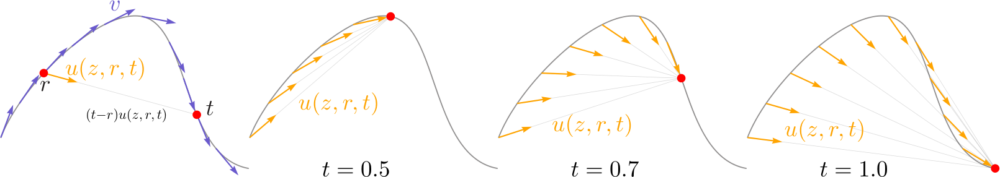
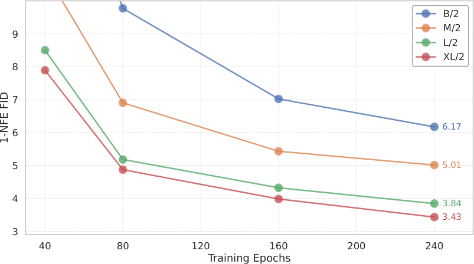
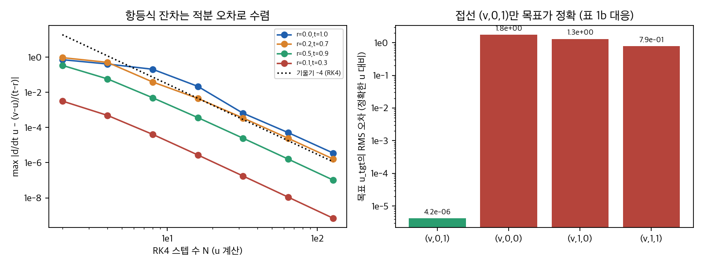
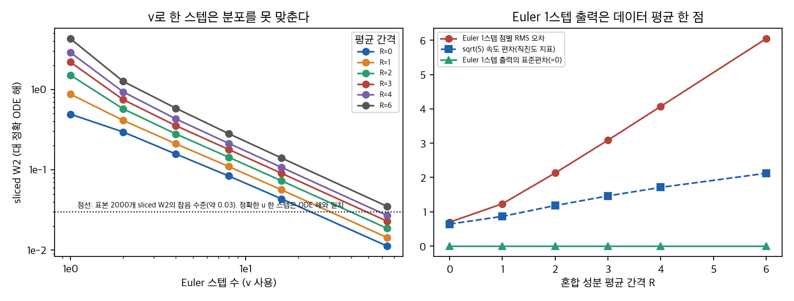
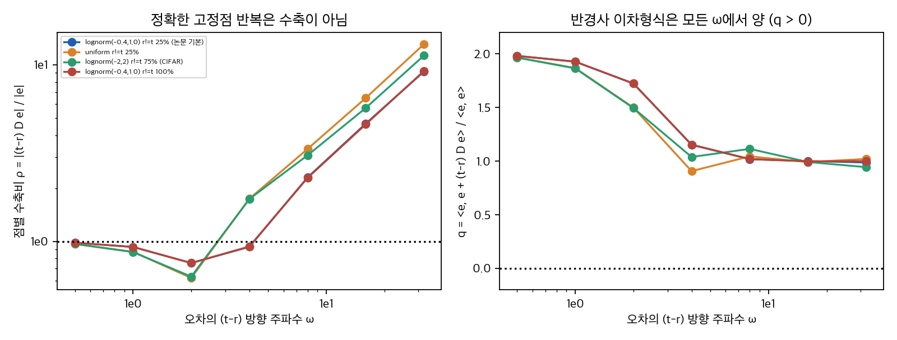
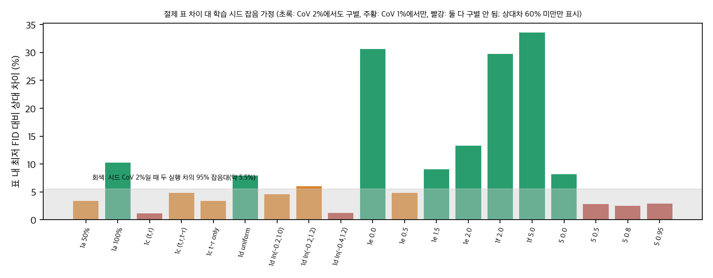

# MeanFlow의 식은 맞고, 학습이 왜 되는지는 아직 열려 있습니다

*Mean Flows for One-step Generative Modeling*(Geng, Deng, Bai, Kolter, He, arXiv:2505.13447, NeurIPS 2025 구두)은 flow matching이 학습하는 순간 속도 $v$ 대신 두 시각 $r<t$ 사이의 **평균 속도** $u(z_t,r,t)=\frac1{t-r}\int_r^t v(z_\tau,\tau)\,d\tau$를 학습합니다. 그러면 한 스텝 샘플링이 $z_0=z_1-u(z_1,0,1)$입니다. 이 글은 식을 닫힌 식 속도장에서 직접 검산하고, 학습 목표가 어떤 연산자인지 따져 보고, 논문 표와 공식 JAX 코드를 대조한 기록입니다. **모델 학습, 가중치·데이터 다운로드, 설치, 공식 코드 실행, API 호출은 하지 않았습니다.** 논문 그림은 arXiv 라이선스가 CC BY 4.0이고 PDF에 저작권 고지가 없어서, 도식인 그림 3과 차트인 그림 4만 싣고 출처를 적었습니다.

## 방법 한눈에

*논문 그림 3: 평균 속도 장 $u(z,r,t)$. © 저자, CC BY 4.0, 출처 arXiv:2505.13447.*

- 정의 (식 3)에서 $(t-r)u=\int_r^tv$ (식 4)를 $t$로 미분하면 **항등식** $u=v-(t-r)\frac{d}{dt}u$ (식 6). 전미분은 $\frac{d}{dt}u=v\,\partial_zu+\partial_tu$로 접선 $(v,0,1)$의 JVP입니다(식 8).
- 학습: $L=\|u_\theta-\mathrm{sg}(u_{tgt})\|^2$, $u_{tgt}=v_t-(t-r)\,\mathrm{JVP}$ (식 9–11). $r=t$이면 Flow Matching과 같습니다.
- CFG는 목표의 장에 넣어 1-NFE를 유지합니다(식 13–19, 부록 B.1).
- 보고 결과: ImageNet 256 1-NFE FID 3.43(XL/2, 240 에폭), 2-NFE 2.93, 크기별 단조 개선(그림 4).

*논문 그림 4: 크기별 1-NFE FID(점 4개, 각 한 번의 실행). © 저자, CC BY 4.0, 출처 arXiv:2505.13447.*

## 식은 맞습니다

3개 성분 가우시안 혼합($d=2$, 선형 경로)에서 $v$는 닫힌 식이고 $u$는 높은 정확도의 적분으로 구할 수 있습니다. 단일 가우시안의 닫힌 식 유량 맵으로 적분기를 먼저 확인했습니다(RK4 64 스텝 오차 1.2e-9, DOP853 3.3e-13).

- 항등식 잔차는 RK4 스텝 수에 따라 4차로 줄고(최대 3.5e-6 at N=128) 적분기와 무관한 DOP853 유한차분 확인에서 5.5e-7, 자동미분 야코비안 전개와는 2.7e-15, 반군 성질 $(t-r)u(z_t,r,t)=(s-r)u(z_s,r,s)+(t-s)u(z_t,s,t)$는 1.6e-13입니다.
- 정확한 $u$를 목표에 넣어 접선을 바꿔 보면 $(v,0,1)$만 목표가 정확합니다(오차 4e-6, RK4 오차 수준). 다른 접선은 $\mathrm{rms}(u)=1.55$ 대비 0.79–1.76입니다. 접선의 $r$ 성분이 1이면 $\partial_ru=\frac{u-v(z_r,r)}{t-r}$ 항이 들어와 틀립니다. 다만 표 1b에서 잘못된 접선 사이의 FID 순서(329 > 268 > 138)는 이 오차 크기로 설명되지 않습니다.

## 한 스텝: 정확한 $u$와 $v$로의 오일러

$t=1$에서 $z_1=\epsilon$은 $x$와 독립이므로 $v(\epsilon,1)=\epsilon-\mathbb E[x]$입니다. 그래서 **$v$로 한 스텝 오일러는 모든 표본을 데이터 평균 한 점으로 보냅니다**(출력 표준편차 8e-17–2e-16). 모드 간격 $R$이 0에서 6으로 커질 때 sliced W2는 0.49에서 4.28로, 점별 RMS 오차는 0.70에서 6.05로 커지고 스텝 8–64에서는 0.3 아래로 내려옵니다. 정확한 $u$를 쓰면 한 스텝이 다스텝 ODE와 같습니다. 즉 어려움이 사라지는 것이 아니라 $u(z,0,1)$(잡음에서 데이터로 가는 전체 사상)을 배우는 문제로 옮겨 갑니다. 휘어짐의 지표로는 chord/path 비율이 $R=6$에서도 0.98이라 쓸모없었고, rectified flow식 직진도 $S$를 썼습니다.

## 학습 목표: 고정점은 맞지만 수축은 아닙니다

정확한 $u$는 식 10의 고정점입니다(RMS 차이 2.2e-7). 섭동 $e$에 대해 목표 오차는 정확히 $-(t-r)De$($D=v\cdot\nabla_z+\partial_t$)입니다. 그런데 이는 미분 연산자라서 주파수 $\omega\gtrsim3$의 오차는 한 번에 $\omega$배로 커집니다(점별 수축비 0.93 → 2.3 → 9.2 for $\omega=4,8,32$).

학습이 되는 이유는 반복의 수축이 아니라 **반경사(semi-gradient) 구조**로 보입니다. 갱신 방향이 $-J^\top(I+(t-r)D)e$이고, 연속 방정식으로 $z$ 성분을 소거하면 이차형식이

$$\langle e,(I+(t-r)D)e\rangle=\tfrac12\iint e^2\,[\,w(t|r)-(t-r)\,\partial_tw(t|r)\,]\,p_t\,dz\,dt+\text{(경계항}\ge0)$$

가 됩니다. $(r,t)$ 표집 밀도 $w$가 $1-(t-r)\partial_t\log w>0$이면 양정입니다. 논문 기본 표집기(lognorm(−0.4,1.0), 큰 쪽이 $t$)에서 이 조건이 깨지는 쌍의 비율은 7.5e-6, 균일은 0입니다. 무작위 특징 48개 계의 행렬 고윳값도 모두 양수의 실수부(0.72–0.95 이상)였습니다. **이것은 이 분석의 자체 유도이고 함수 공간·선형화 가정이며, 코드의 적응 가중은 포함하지 않았습니다.** 학습을 해 봐야 확인됩니다. 덧붙여 $r=t$ 표본의 $t$도 두 값의 최댓값이라 평균 0.535로, 단일 로짓 정규(0.418)보다 잡음 쪽으로 치우칩니다.

## CFG와 표

- **CFG.** 식 15(안내 장의 항등식), 식 19(표본 조건부 목표의 기댓값이 $v^{cfg}$), 식 21($\omega'=\omega/(1-\kappa)$)을 확인했습니다(최대 오차 1.8e-15). 식 14와 각주 3의 $\mathbb E_c$는 사후 확률 $p(c|z_t)$ 가중이어야 성립하고, 사전 가중이면 3.3($\omega=1.5$)만큼 어긋납니다. 토이에서 안내를 세게 하면 클래스 내 표준편차가 0.60에서 0.38로 줄고 $\omega\ge2$에서는 클래스 평균에서 오히려 멀어지는데(0.72 → 1.30), 안내를 $t\le0.75$에만 걸면 0.81로 줄어 표 4가 큰 모델에서 구간을 제한한 것과 방향이 맞습니다.
- **오탈자.** 본문 SiT FID 2.15는 표 2의 2.06과 다릅니다. 표 4의 M/2 파라미터 497.8M은 구조 계산 308.0M(표 2는 308M), L/2 FLOPs 119.0G는 계산 80.5G(XL/2 값과 같음)입니다. 다른 구성은 1.5% 안에서 일치합니다. 상대 개선율 산술은 맞습니다(Shortcut 대비 67.6%).
- **절제 표는 단일 실행입니다.** 외부 문헌 요약(The FID Lottery, 원문 미확인)에서 가져온 학습 시드 FID 변동계수 1–2%를 가정하면, $r\ne t$ 0%의 실패, 잘못된 접선, CFG 켜기, $p=0$의 불리함은 견고하고, 시간 조건 임베딩 순위, lognorm 변형, $p=0.5$ 대 1.0, $\kappa$ 0.5–0.95 사이 순위는 구별되지 않습니다.

## 공식 코드와의 대조

`Gsunshine/meanflow`(JAX, MIT, 커밋 `d70cb55`)를 정적으로만 읽었습니다. JVP 목표, stop-gradient, 샘플링, CFG의 두 목표(식 19, 21), 표집기, 최적화 설정(Adam(0.9,0.95), lr 1e-4, EMA 0.9999)은 논문과 일치합니다. 다른 점:

- **D3.** 라벨 제거 마스크와 $r=t$ 마스크가 둘 다 배치 앞쪽 인덱스를 써서 제거된 표본이 항상 $r=t$입니다(20,000배치 시뮬레이션에서 $r\ne t$인 제거 표본 0개). 논문 파이프라인에는 영향이 없어 보이지만 서술과 다릅니다.
- **D5.** CFG 목표를 위해 학습 스텝마다 순전파가 $\kappa>0$이면 두 번 더 돕니다(논문의 16% 오버헤드에 없음, +67% 추정, 측정 아님).
- **D6.** 공유된 설정 기본값이 CFG를 켠 240 에폭 B/4($\omega'=2.0$)로, 논문의 절제 기본값(CFG 없음, 80 에폭)과 다릅니다. XL/2 설정 파일은 없습니다.
- **D9.** 2-NFE 샘플링의 중간 시각이 논문에도 코드에도 없습니다.

## 한계

- 모든 검산이 가우시안 혼합 $d=2$의 닫힌 식 장 위입니다. 신경망 학습의 거동은 보지 않았습니다.
- 안정성 유도는 자체 유도이고 함수 공간 가정입니다.
- 시드 잡음은 외부 문헌 요약에서 가져온 가정이며 B/4 80 에폭의 FID 영역에서 측정된 값이 아닙니다.
- 공식 코드를 실행하지 않았으므로 코드가 논문 수치를 낸다는 것은 확인하지 못했습니다.

재계산 스크립트와 결과, 공개 리포트는 이 글과 같은 폴더의 git 자료에 있습니다.

## 자료

- [통합 리포트 PDF](report/report_public.pdf)
- [01. 논문 분석: Mean Flows for One-step Generative Modeling (arXiv:2505.13447)](analysis/01_paper_analysis.md)
- [02. 계보와 관련 자료](analysis/02_prior_work.md)
- [03. 검산과 재계산](analysis/03_analysis.md)
- [04. 논문 대 공식 코드 대조](analysis/04_code_verification.md)
