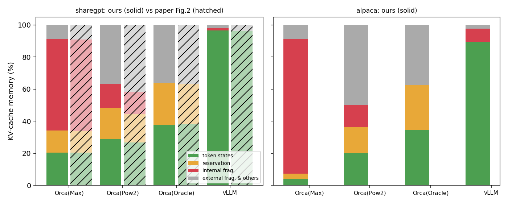
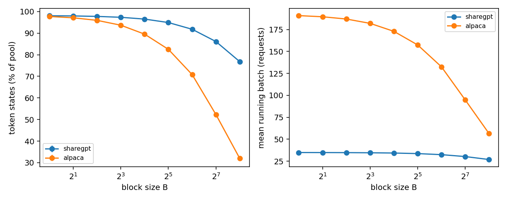
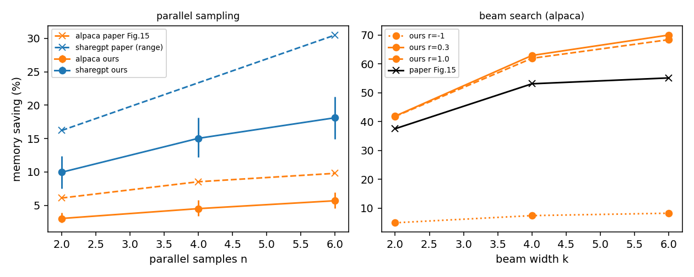

# PagedAttention의 블록 표 KV 캐시 관리자를 직접 짜서 확인한 것

vLLM의 PagedAttention(Kwon et al., SOSP 2023)은 LLM 서빙의 KV 캐시를 OS의 가상 메모리처럼 고정 크기 블록과 요청별 블록 표로 관리해, 요청당 낭비를 마지막 블록 하나 안으로 줄이고 같은 GPU에서 더 많은 요청을 묶는다는 논문입니다. 이 글은 그 관리자를 PyTorch로 직접 짜서(`minimal_impl.py`, 테스트 19개) 논문의 메모리 수치 몇 개를 다시 계산해 본 기록입니다. 처리량(2–4배)과 커널 지연은 GPU가 필요해 재지 않았습니다.

## 방법: 블록 표, 참조 횟수, copy-on-write

시퀀스의 KV를 B 토큰짜리 블록으로 나누고, 논리 블록 j를 물리 블록 번호에 대응시키는 블록 표를 요청마다 둡니다. 새 물리 블록은 이전 블록이 다 찼을 때만 받으므로 요청당 낭비는 마지막 블록 안(평균 (B−1)/2 슬롯)에 갇힙니다. 병렬 샘플링과 빔 서치는 `fork`로 부모의 블록 표를 복사하며 각 블록의 참조 횟수를 올리고, 공유된 마지막 블록에 쓰려는 순간 새 블록을 받아 내용을 복사합니다(블록 단위 copy-on-write).

구현은 `BlockAllocator`(자유 목록 + 참조 횟수), `BlockManager`(allocate, append_slot, fork, free, swap_out, swap_in), `PagedKVCache`(K/V 텐서와 어텐션 커널 세 가지), `PagedServer`(FCFS, 전부 또는 전무 선점: 재계산 또는 스와프)입니다. 어텐션 커널은 모아서 계산하기, 논문 식 4처럼 블록별 점수에 전체 softmax 분모를 쓰기, 블록을 타일로 보고 한 번 훑는 온라인 softmax 세 가지이고 모두 같은 값을 내야 합니다.

## 결과 1: 그림 2의 낭비 구성은 길이 평균만으로 재현된다

논문 그림 2는 기존 시스템이 KV 풀의 20.4–38.2%만 실제 토큰에 쓰고 vLLM은 96.3%를 쓴다고 합니다. ShareGPT·Alpaca 원자료는 받지 않았고, 논문 그림 11의 평균 길이(ShareGPT 입력 161.31, 출력 337.99)에 맞춘 절단 로그정규(분산은 가정)로 풀 15,728 슬롯(12 GiB / 800 KiB), 최대 길이 2048, FCFS 반복 단위 배치를 시뮬레이션했습니다. Orca 세 변형은 buddy 할당기를 실제로 구현해 돌렸습니다. 트레이스 20개, 구간은 부트스트랩 95%입니다.

| ShareGPT, 풀 대비 % | 토큰 | 예약 | 내부 | 외부·기타 | 평균 배치 |
|---|---|---|---|---|---|
| Orca(Max) 우리 / 논문 | 20.3 / 20.4 | 13.8 / 13.3 | 57.0 / 57.3 | 8.9 / 8.9 | 7.0 / 7.00 |
| Orca(Pow2) | 28.7 / 26.8 | 19.6 / 17.9 | 15.2 / 13.6 | 36.6 / 41.6 | 9.9 / 9.81 |
| Orca(Oracle) | 37.9 / 38.2 | 25.9 / 25.2 | 0 / 0 | 36.2 / 36.6 | 13.1 / 13.62 |
| vLLM(B=16) | 96.5 / 96.3 | - | 1.6 | 1.8 | 34.2 / 30.42 |

*왼쪽 ShareGPT의 속이 찬 막대가 우리 값, 빗금은 논문 그림 2의 읽은 값. 오른쪽은 Alpaca(논문 값 없음).*

- Orca(Max)의 외부 단편화 8.9%는 할당기 문제가 아닙니다. 풀 15,728 슬롯에 2048짜리가 7개 들어가고 남는 1,392 슬롯이 8.85%입니다. 그림 13의 Max 배치 7.00도 같은 산술입니다.
- Oracle은 정확한 길이를 알아도 36%가 "외부·기타"인데 이것은 buddy의 2의 거듭제곱 올림에서 옵니다. 그림 2의 Oracle 숫자는 "buddy 가정 아래의 숫자"로 읽어야 합니다.
- 길이 분산(변동계수)은 논문이 주지 않아 가정했습니다. 0.6배와 1.4배로 바꾸면 Max 토큰 17.8–21.6%, Oracle 37.7–38.9%로 움직이는 반면 vLLM은 96.4–96.6%로 거의 안 움직입니다. Pow2는 외부가 34.3–41.0%로 가정에 민감합니다.
- 쪽 단위(B=16)와 세 기준선의 토큰 비율 차는 쌍을 맞춘 Wilcoxon, Holm 보정 후 6개 비교 모두 p = 1.1×10⁻⁵(20개 트레이스가 전부 같은 방향)입니다.

## 결과 2: 블록 크기와 낭비

쪽 안 낭비는 요청당 (B−1)/2 슬롯으로 이론과 일치합니다(B=16에서 7.5, B=64에서 31.5). 그래서 B가 커질수록 토큰 상태 비율이 떨어지고 짧은 시퀀스에서 심합니다. Alpaca 평균 B=128에서 동시 처리 수가 B=16의 55%로 줄어듭니다(ShareGPT는 88%). 논문 7.2절의 "Alpaca에서 큰 블록이 크게 나쁘다"와 방향이 같습니다. 반대쪽(작은 블록의 커널 비효율)은 GPU 측정이라 확인하지 못했습니다.

## 결과 3: 공유 절약(그림 15)은 재현하지 못했다

공유로 줄인 비율 = (논리 블록 − 물리 블록) / 논리 블록을 디코딩 단계에 걸쳐 합산했습니다. 병렬 샘플링 Alpaca n = 2, 4, 6에서 우리는 3.0, 4.5, 5.7%로 논문의 6.1–9.8%(그림 15)의 약 절반이고, ShareGPT n = 2에서 9.9%(논문 본문 16.2%)입니다. 원인은 확인하지 못했습니다(샘플 길이 상관, 프롬프트 단계 계산 방식, 길이 분포 가정 중 하나로 의심). 빔 서치는 논문이 후보의 부모 분포를 주지 않아 가정이 결과를 지배합니다: 각 빔이 자기 혈통을 유지하면(프롬프트만 공유) Alpaca k=2, 4, 6에서 5.0, 7.4, 8.3%, 부모를 무작위로 고르면 42–70%이고 논문의 37.6–55.2%는 그 사이에 있습니다. **공유 메커니즘의 정확성은 테스트로 확인했지만 그림 15의 수치를 재현했다고는 쓰지 않습니다.**

## 결과 4: 산술과 수치 동일성

- OPT-13B의 KV는 토큰당 2 × 5120 × 40 × 2 B = 819,200 B = **800 KiB**이고 2048 토큰은 1.5625 GiB(= 1.68 GB)입니다. 논문의 "800 KB", "1.6 GB"는 단위가 섞여 있고 표 1의 GB는 GiB로 읽어야 슬롯 수(15.7K, 9.7K, 60.1K)가 맞습니다.
- Llama-2-7B(MHA)는 512 KiB/토큰, Llama-3-8B(GQA)는 128 KiB/토큰이라 같은 풀에 4배 더 들어갑니다. 논문의 절대 수치는 모델 종속이고 비율만 옮겨집니다.
- GPT-2 실제 K/V(pile-10k 문서 20개, 12층 × 12헤드)에서 섞은 물리 블록(B = 1, 16, 64)을 읽는 쪽 단위 어텐션 세 가지가 밀집 어텐션과 최대 절대 오차 5.2×10⁻⁶ 이내로 같습니다. 수치 동일성만이고 속도는 재지 않았습니다.
- 선점: 가정 상수(PCIe 24 GB/s, 복사 호출 8 µs 등)로 비용 토이를 만들면 스와프가 작은 블록에서 느리고 큰 블록에서 빠르며 교차가 B≈8–16입니다. 논문 7.3절과 방향은 같지만 상수가 가정이라 그림 19의 재현이 아닙니다.

## 현재 공식 코드와의 차이

현재 vLLM(V1, HEAD `316c6c0`)을 정적으로 읽으면 고정 크기 블록과 참조 횟수는 그대로이고 블록 풀은 접두사 해시 캐싱을 위한 LRU 자유 큐로 확장되었습니다. 반면 논문의 **스와핑 선점**은 스케줄러에서 찾지 못했고(선점은 블록을 해제하고 계산량을 0으로 되돌리는 재계산), 시퀀스 그룹 단위 CoW와 빔 서치는 코어에서 보이지 않았으며, 블록 크기 기본값도 고정 16이 아니라 백엔드가 정합니다. 논문 4절은 알고리즘의 원형이지 현재 동작의 설명이 아닙니다.

## 한계

길이 분포는 평균만 맞춘 로그정규(분산 가정)라 Orca 쪽 수치와 Alpaca의 배치 크기는 원자료로 확인하지 않았습니다. 선점 횟수는 우리 승인 규칙의 결과입니다. 처리량 2–4배, 커널 지연 +20–26%, 그림 12–19의 곡선은 GPU가 필요해 재지 않았습니다. 공식 코드는 실행하지 않고 정적으로만 읽었습니다.

## 자료

- [최소 구현](analysis/minimal_impl.py)
- [01. 논문 분석 - PagedAttention / vLLM (arXiv:2309.06180)](analysis/01_paper_analysis.md)
- [02. 계보와 관련 분석 - PagedAttention / vLLM (arXiv:2309.06180)](analysis/02_prior_work.md)
- [03. 검산과 토이 실험 - PagedAttention / vLLM (arXiv:2309.06180)](analysis/03_analysis.md)
- [04. 주장 검증과 공식 코드 대조 - PagedAttention / vLLM (arXiv:2309.06180)](analysis/04_claim_verification.md)
