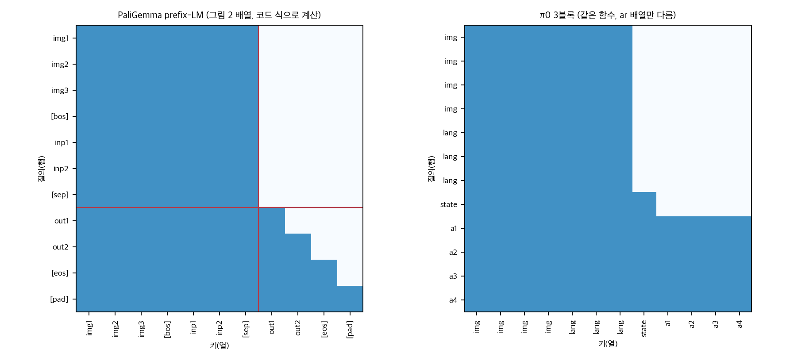
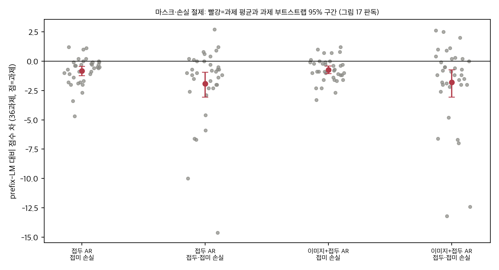
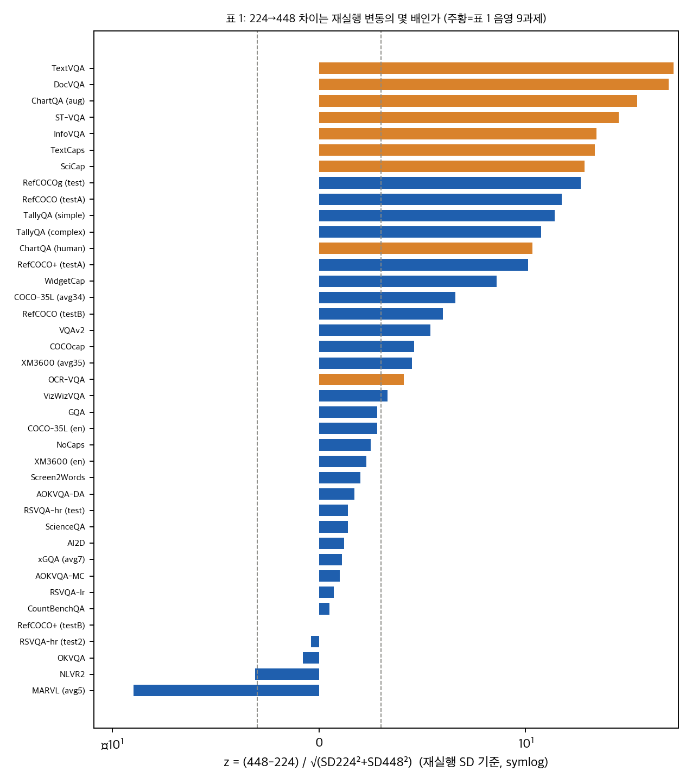
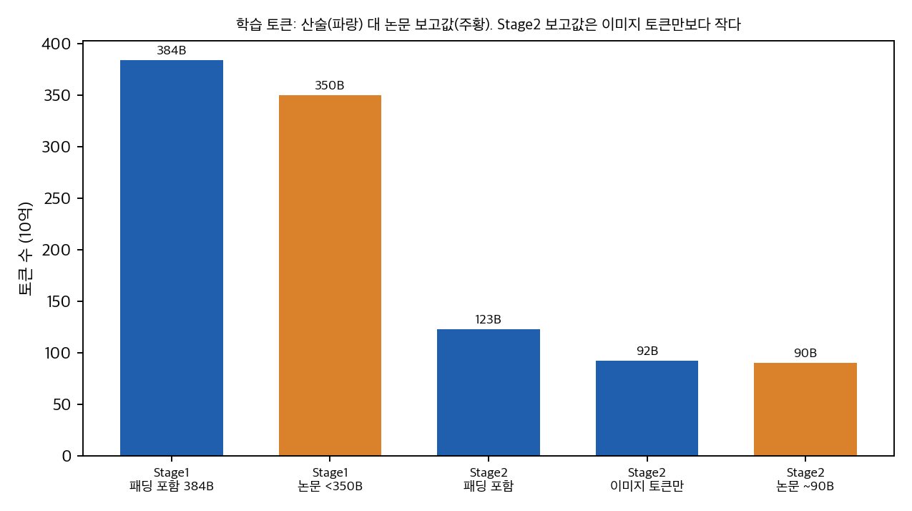

# PaliGemma의 prefix-LM 마스크와 40개 과제 전이 결과, 식과 표를 다시 계산했습니다

*PaliGemma*(Beyer 외, Google DeepMind, arXiv:2407.07726)는 SigLIP-So400m 비전 인코더와 Gemma-2B를 선형층 하나로 이어, 전이(미세조정)가 잘 되는 작은 기반 VLM을 만든 보고서입니다. π0와 π0.5의 백본이기도 합니다. 이 글은 논문의 식과 표를 다시 계산하고 공식 코드(`big_vision`)를 정적으로 대조한 기록입니다. 코드 실행, 가중치 다운로드, API 호출은 하지 않았습니다. 논문 그림은 PDF에 저작권 표시가 있어 싣지 않았고 아래 그림은 모두 우리가 그린 것입니다.

## 마스크: 식과 코드가 같습니다

입력은 `[이미지…, BOS, 접두…, SEP, 접미…, EOS, PAD…]`이고, 이미지와 접두는 서로 전부 보고 접미만 인과입니다(§3.1, 그림 2). 공식 코드의 `make_attn_mask`는 `cumsum(mask_ar)`가 같거나 작은 토큰만 볼 수 있게 하는 한 줄이고, 이미지·접두·SEP는 `mask_ar=0`, 접미와 패딩은 1입니다. 이를 numpy로 옮겨 논문 서술에서 독립적으로 만든 마스크와 비교하면 4개 구성에서 학습·평가 모두 정확히 같습니다. 작은 2층 트랜스포머 토이에서는 세 가지가 확인됩니다.

- 접미를 통째로 바꿔도 이미지·접두 은닉 상태는 비트 단위로 같습니다(KV 캐시가 성립하는 이유).
- 접두 토큰을 바꾸면 이미지 토큰 표현이 바뀝니다(이미지가 접두를 "미리 봄"). 접두를 인과로 바꾼 절제 마스크에서는 이미지 표현이 반응하지 않습니다.
- 접두 블록을 한 번에 처리하고 접미를 하나씩 확장하는 디코딩은 전체 순전파와 2×10⁻¹⁵ 안에서 같습니다.

오른쪽은 π0의 3블록 마스크로, openpi의 `make_attn_mask`가 big_vision 함수의 복사이므로 같은 함수에 `ar` 배열만 `[0…0 | 1 | 1 0 0 0]`으로 바꾼 것입니다. PaliGemma의 인과 접미를 π0는 상태 블록과 양방향 행동 블록으로 바꾸었고, 접두 부분은 그대로라 접두 KV 캐시 조건도 같습니다.

## 마스크 절제는 평균 약 1점 차이입니다

논문 그림 17의 36과제 × 5막대를 PDF 벡터에서 읽어 평균을 다시 만들면 그림 5와 0.05 안에서 일치합니다. prefix-LM 대비 차이는 접두에도 AR을 걸면 -0.83(과제 부트스트랩 95% 구간 -1.23~-0.46), 접두 손실을 추가하면 -1.92(-3.07~-0.96)입니다. 접두 손실의 손해는 MaRVL -14.6, AI2D -10.0, NLVR2 -6.7처럼 긴 접두 과제에 몰리고 캡션 과제는 평균 +0.3입니다. 이미지까지 인과로 한 절제(-0.74)가 접두 AR(-0.83)과 거의 같아서 핵심은 "이미지가 접두를 본다"로 보이지만, 둘을 분리한 실험은 없습니다. 평균은 CIDEr와 정확도를 섞은 것이고 한 번의 사전학습이라 개별 과제의 1–2점 차이는 믿을 수 없습니다.

## 해상도 이득은 읽기와 문서에 집중됩니다

표 1에서 두 해상도가 모두 있고 SD가 있는 39과제 중 21과제만 224→448 차이가 재실행 SD의 3배를 넘고, 12과제는 2배 이내입니다. 표 1 음영 9과제(텍스트 읽기, 차트, 문서)는 평균 +17.7, 나머지는 +1.6입니다. 그림 9의 총 이득 18.7은 시퀀스 길이 효과 10.9(58%)와 정보량 효과 7.8(42%)로 나뉘어 "절반씩"은 대체로 맞지만, 민감 9과제는 표 1의 이득이 큰 과제에서 골라 총 이득이 부풀 수 있습니다. 재실행 SD는 훈련 무작위성만 반영하고 시험 세트 표본 오차는 포함하지 않습니다. MMVP 47.3은 71/150쌍이라 우연 수준(25%)보다는 확실히 높지만, Gemini 40.7과는 Fisher p = 0.30이라 "큰 격차의 SOTA"는 구분되지 않습니다.

## 계산량과 보고값

시각 토큰 256/1024/4096과 파라미터 2.923B(Gemma 2.509B + SigLIP 0.412B + 투영 2.4M, float32 11.69 GB)는 맞습니다. 그러나 Stage2 "약 90B 토큰"은 이미지 토큰만으로도 92.2B(50M×1024 + 10M×4096)라 보고값이 더 작고, Stage1은 패딩 포함 384B인데 보고는 350B 미만입니다. 처리량 5189 tokens/s/device에서 MFU 55%는 6N 모델 FLOPs로는 약 39–43%이고 재계산을 넣은 8N이면 약 52%입니다(첨두 FLOPs는 외부 지식). 어떤 정의인지 논문은 쓰지 않습니다.

## 표 4와 README

부록 H의 표 4는 평균 행이 재계산과 일치합니다. 그러나 "하이퍼파라미터 통일이 가장 큰 손실, 다음이 멀티태스크"라는 결론은 SciCap 한 행(162.3 → 64.0)이 만든 것으로, 그 행을 빼면 통일은 -0.7, 멀티태스크는 -2.2로 순서가 뒤집힙니다. 공식 README의 전이 결과 79칸과 표 1을 비교하면 71칸이 일치하고 COCO-35L avg34, XM3600 avg35, OCR-VQA(약 +1.0)가 어긋납니다. 부록 J의 하이퍼파라미터 432칸은 공식 설정과 전부 일치합니다.

## 한계

사전학습 설정과 혼합이 공개되지 않아 절제를 코드로 재현할 수 없습니다. 시험 세트 크기는 논문에 거의 없어 표본 오차 계산은 근거가 있는 CountBenchQA(540)와 MMVP(150쌍) 외에는 통상 크기로 기억하는 값(미확인)을 썼습니다. 그림에서 읽은 값은 절대값 약 ±0.3입니다. 가중치는 Gemma 약관에 따라 받아야 하고 이 분석은 받지 않았습니다.

## 자료

- [통합 리포트 PDF](report/report_public.pdf)
- [01. 논문 분석: PaliGemma: A versatile 3B VLM for transfer](analysis/01_paper_analysis.md)
- [02. 계보와 관련 자료](analysis/02_prior_work.md)
- [03. 검산과 통계](analysis/03_analysis.md)
- [04. 논문 ↔ 공식 코드 대조](analysis/04_code_verification.md)
