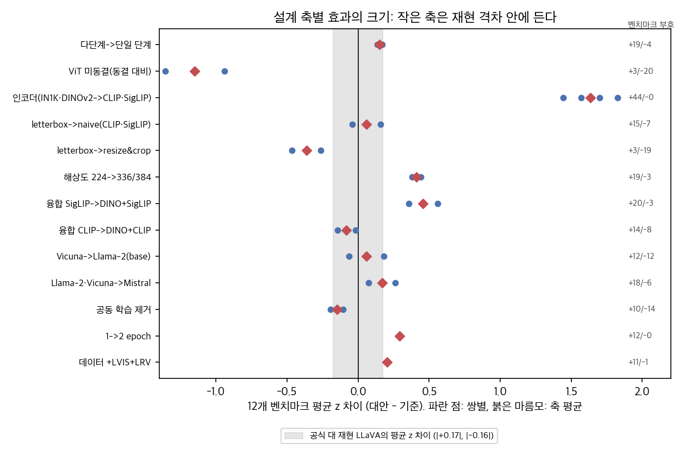
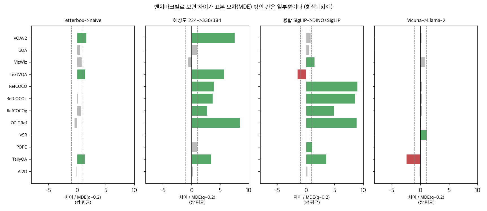
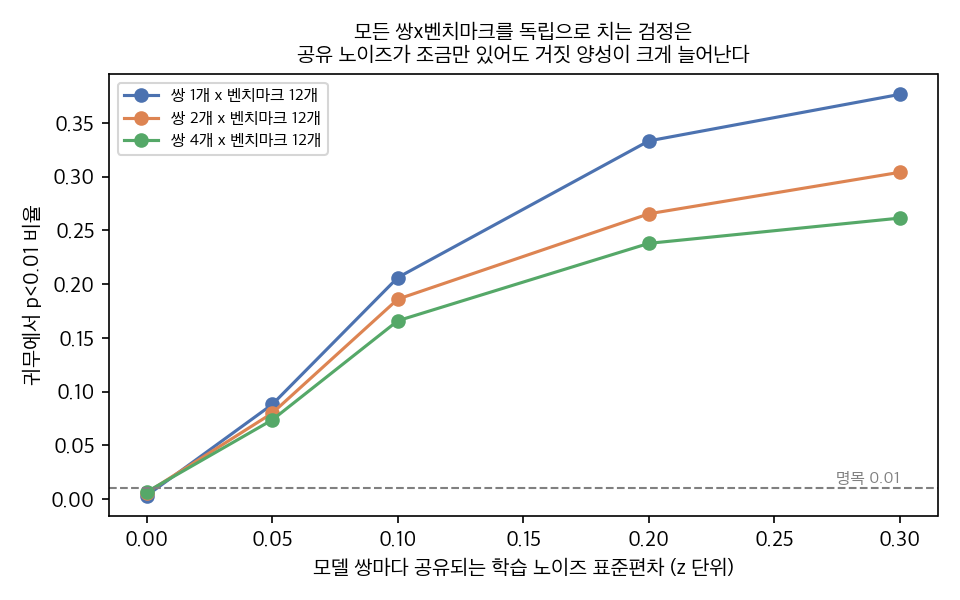
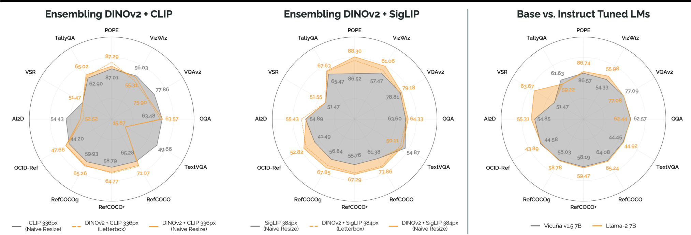

# Prismatic VLMs 분석: VLM 설계 결론은 얼마나 믿을 수 있나

*Prismatic VLMs* (Karamcheti 외, ICML 2024, arXiv:2402.07865 v2)는 LLaVA-1.5 재현 설정에서 이미지 처리, 비전 인코더, LM, 학습 절차를 한 번에 하나씩 바꿔 12개 벤치마크로 비교합니다. 이 글은 부록 표 2–4(58행)를 옮겨 다시 계산하고 공식 학습·평가 코드를 정적으로 대조한 결과입니다. 코드는 실행하지 않았고 가중치도 받지 않았습니다.

## 1. 효과 크기로 나누면

12개 벤치마크의 z 점수 평균 차이(논문의 "전체 점수" 차이)로 보면 세 층이 있습니다.

- **큰 효과:** 시각 백본 미동결(-1.15), 인코더 IN1K·DINOv2→CLIP·SigLIP(+1.64), 해상도 224→336/384(+0.41), SigLIP→DINOv2+SigLIP 융합(+0.46). 어떤 검정으로도 유의합니다.
- **작은 효과:** 단일 단계 학습(+0.15), 더 좋은 LM(+0.17), 데이터 추가(+0.20), 공동 학습 제거(-0.15). 회색 띠는 공식 LLaVA-1.5와 논문 재현 사이의 평균 z 차이(+0.17, -0.16)인데, 이 값이 설계 효과와 같은 크기입니다. 같은 레시피를 두 번 학습했을 때 나오는 격차이므로(구현과 평가 래퍼 차이 포함), 단일 실행으로는 효과와 변동을 구분하기 어렵습니다.
- **거의 0:** letterbox→naive resize(+0.06), base 대 instruct LM(+0.06, 그것도 VSR 한 벤치마크가 만든 값).

## 2. 벤치마크별로는

벤치마크 문항 수는 1,222(VSR)에서 214,354(VQAv2)까지입니다. 두 모델이 20% 문항에서 다르게 답한다고 가정한 최소 검출 효과는 VQAv2 0.27점, TallyQA 0.64점, OCID-Ref 0.92점, 그리고 VizWiz 1.91점, VSR 3.58점입니다.

VSR는 퇴화한 벤치마크입니다. 고유 모델 48개 중 16개가 항상-True 정확도 51.47%(629/1,222)와 정확히 같고, 24개가 55% 미만입니다. 그런데도 12개 평균에서 1/12을 차지하고, Vicuna→Llama-2 7B의 평균 z 차이 +0.058은 VSR 하나(+12.2점)를 빼면 +0.013입니다.

## 3. 논문의 p 값

부록 B.2는 "쌍마다 정규화 차이를 구해 1-sided Fisher T-test"라고만 씁니다. 검정 단위가 불명이고 공개 코드에도 검정이 없습니다. 쌍×벤치마크 칸 단위 쌍체 t, Welch, Wilcoxon을 시도했지만 12개 p 중 어느 것도 일치시키지 못했습니다. 단일 단계는 쌍체 t 0.001, Welch 0.10으로 검정에 따라 유의성이 갈립니다.

모든 칸을 독립 표본으로 치는 검정은 모델 쌍마다 공유되는 학습 노이즈가 조금만 있어도 거짓 양성이 늘어납니다. 위 시뮬레이션(우리 모형)에서 공유 노이즈 0.16 z(공식 대 재현 격차에서 나온 값)이면 명목 1% 검정의 실제 거짓 양성률이 약 20%입니다.

## 4. 본문 문장 점검

- "PRISM이 InstructBLIP과 LLaVA-1.5를 모든 평가에서 앞선다"는 표와 맞지 않습니다. 12개 모델 중 9개가 같은 규모의 공식 LLaVA-1.5보다 낮은 벤치마크가 하나 이상 있습니다. 가장 큰 폭은 Prism-SigLIP 13B(Controlled)의 위치 지정(RefCOCO 59.2 대 66.8)입니다.
- 융합이 "위치 지정과 도전 집합에서 5–10%" 이득이라는 문장은 위치 지정(+11.6점)에만 맞고 도전 집합은 +1.0점입니다. DINOv2+CLIP은 TextVQA가 49.66에서 15.67로 무너집니다.
- 공동 학습 제거가 "약간 개선"이라는 문장과 달리 표에서는 평균 z가 -0.15이고 VizWiz가 -9.5, -12.4점 떨어집니다.
- "해상도 2배면 시간 복잡도 16배"는 어텐션 점수 항에만 맞습니다. 7B LM 전체 순전파는 패치 4배에서 약 2–4배입니다.

*그림: 논문 그림 7. © 저자, CC BY 4.0, 출처 arXiv:2402.07865 (v2).*

## 5. 공식 코드와의 차이

- **융합 투영기가 3층입니다.** 논문 §4.2는 "투영기(2층 MLP)의 입력 차원만 키운다"고 쓰지만 `FusedMLPProjector`는 Linear(입력→4×입력)-GELU-Linear-GELU-Linear입니다. 7B에서 약 7,139만 파라미터로 비융합(약 2,100만)의 3.4배이고, 융합 이득에 투영기 용량이 섞입니다.
- DINOv2는 레지스터 4개 변형(`vit_large_patch14_reg4_dinov2`)입니다.
- VSR, POPE, TallyQA, AI2D는 생성이 아니라 후보 토큰의 첫 토큰 확률 argmax로 채점합니다.
- `Prism_13B_SigLIP` 설정의 비전 백본이 CLIP입니다. 논문의 해당 행이 이 설정으로 학습됐는지는 알 수 없습니다.
- 공개된 점수 집계 스크립트는 7개 작업만 쓰고 TextVQA를 두 변형으로 중복해 세며 RefCOCO+와 VSR·TallyQA·AI2D가 없어 논문의 "12개 평균"과 다릅니다.

## 6. 쓸 때의 단서

OpenVLA의 VLM 백본이라는 점에서 이 논문은 VLA 백본 선택의 근거로 인용됩니다. 다만 OpenVLA가 쓴 224px 융합 모델은 이 논문의 표에 없고(코드에만 있음), 시각 백본 동결 여부와 해상도 결론은 VLA에서 반대이거나 사라졌습니다. 설계 결론을 VLM 벤치마크에서 행동 예측으로 옮길 때는 이 차이를 함께 적어야 합니다.

## 재현과 자료

전체 분석과 재계산 스크립트는 `git/` 폴더(분석 01–04, `recompute.py`, 결과 JSON, 공개 리포트)에 있습니다. 논문 원문은 arXiv에서 받을 수 있습니다.

## 자료

- [통합 리포트 PDF](report/report_public.pdf)
- [01. 논문 분석: Prismatic VLMs: Investigating the Design Space of Visually-Conditioned Language Models](analysis/01_paper_analysis.md)
- [02. 선행 연구와 계보](analysis/02_prior_work.md)
- [03. 재계산, 통계 검정, 계산량 검산](analysis/03_analysis.md)
- [04. 논문 대 공식 코드 대조](analysis/04_code_verification.md)
