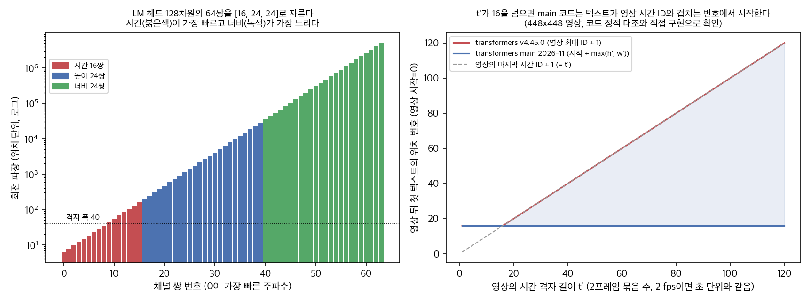
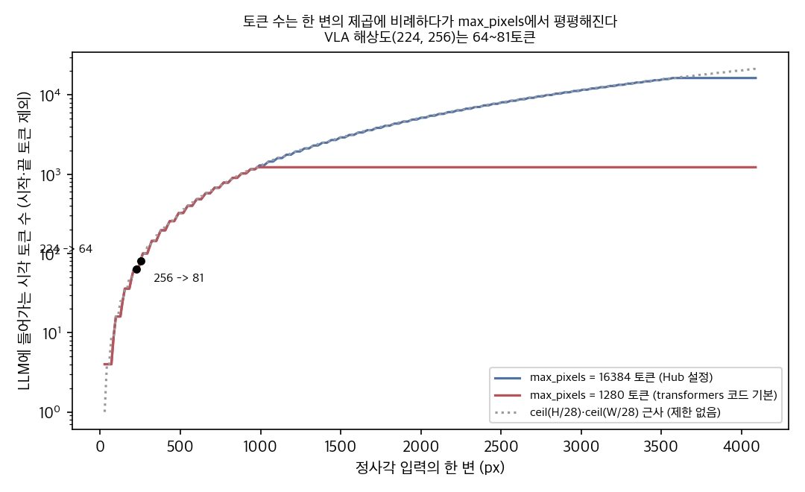
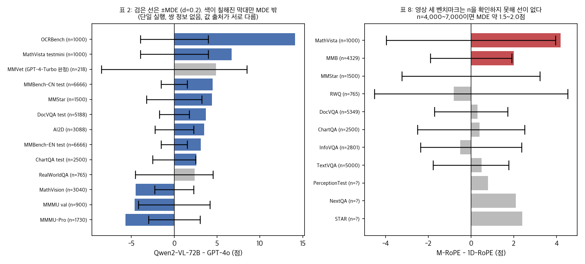

# Qwen2-VL 분석: 동적 해상도와 M-RoPE를 식과 코드로 다시 계산하면

*Qwen2-VL* (Wang 외, Alibaba Qwen Team, arXiv:2409.12191 v2)은 이미지를 원래 해상도대로 가변 개수 토큰으로 만들고(naive dynamic resolution), 위치 번호를 시간·높이·너비로 나눠 넣는(M-RoPE) VLM입니다. 이 글은 두 설계를 작은 구현으로 다시 계산하고 transformers와 공식 저장소 코드를 정적으로 읽어 대조한 결과입니다. 공식 코드는 실행하지 않았고 가중치도 받지 않았습니다. 논문의 그림은 라이선스상 싣지 않았고 우리가 그린 그래프만 넣었습니다.

## 1. M-RoPE는 무엇을 하나

LM 헤드 차원 128의 64개 채널 쌍 j는 각도 θ_j·p만큼 돕니다(θ_j = 10⁶^(−2j/128)). 1D RoPE는 p가 위치 하나이고, M-RoPE는 쌍 j가 어느 축의 위치 (p_t, p_h, p_w)를 쓸지만 다릅니다. 논문은 "세 성분으로 나눈다"고만 쓰고, 나누는 비율은 config의 `mrope_section = [16, 24, 24]`에만 있습니다. 앞 16쌍이 시간, 다음 24쌍이 높이, 마지막 24쌍이 너비입니다.

직접 구현으로 확인한 것들입니다.
- **텍스트는 1D RoPE와 비트 단위로 같습니다.** 세 성분이 같은 번호를 쓰면 cos, sin이 1D와 정확히 같았습니다(최대 차이 0.0, float64).
- **이미지 뒤 텍스트는 최대 번호 + 1에서 이어집니다.** 텍스트 3토큰, 이미지(병합 뒤 2×3), 텍스트 5토큰이면 이미지 최대 번호가 5이고 뒤 텍스트는 6에서 시작합니다.
- **축별 상대 위치 성질이 성립합니다.** 두 토큰을 세 축에서 같은 양만큼 평행 이동해도 점수가 바뀌지 않습니다(200회, 최대 상대 오차 2e-11). 높이만 이동하면 너비 채널의 기여는 변하지 않습니다.
- **영상의 시간 번호는 프레임마다가 아니라 2프레임 묶음마다** 늘어납니다. 3D 합성곱이 두 프레임을 묶기 때문입니다.

### 영상 뒤 텍스트의 시작 위치

논문과 공식 학습 코드(`rope2d.py`), transformers v4.45.0은 영상의 (시간, 높이, 너비) 번호 중 **최대값 + 1**에서 다음 텍스트를 시작합니다. 2026-11-26의 transformers main은 `시작 + max(h', w')`로 시간 격자 길이를 무시합니다. 시간 격자가 공간 격자보다 길 때만 갈립니다. 60초 영상(2 fps, 448×448)이면 시간 격자 60, 공간 격자 16이라 앞 코드는 텍스트를 64에서, main은 20에서 시작하고 60프레임 묶음 중 44개의 시간 번호가 텍스트의 시작 번호 이상이 됩니다(위 그림 오른쪽). 정적 대조와 직접 구현의 결과이고 실행으로 확인하지 않았으므로 영향의 크기는 모릅니다. 이미지나 짧은 영상에서는 갈리지 않습니다.

### 너비 채널은 거의 돌지 않습니다

청크 배치에서 너비 축은 가장 느린 주파수 24쌍을 받습니다(회전 파장 3.5만 – 506만 위치). 1792 px 이미지(격자 폭 64)에서도 너비 채널의 최대 회전각은 0.011 rad이고, 1 rad를 넘는 쌍은 시간 16, 높이 4, 너비 0개입니다. 학습된 q, k의 크기가 작은 위상 차를 증폭할 수 있어 위치를 못 쓴다는 결론은 아니고, 주파수 배분이 치우쳐 있다는 계산입니다. Qwen3-VL의 코드는 세 축을 번갈아 쓰는 인터리브로 바꿨습니다(이유는 확인하지 못했습니다).

## 2. 토큰 수는 올림이 아니라 반올림

`smart_resize`는 각 변을 28(= patch 14 × 병합 2)의 가장 가까운 배수로 **반올림**합니다(Python `round`, 0.5는 짝수로). 넓이가 `max_pixels`를 넘으면 줄이고 `min_pixels`에 모자라면 키웁니다. 쓰기 쉬운 ⌈H/28⌉·⌈W/28⌉ 근사는 100–999 범위 (H, W) 16,641쌍 중 74.6%에서 틀립니다.

| 입력 | 최대 1,280토큰 | 최대 16,384토큰 |
|---|---|---|
| 224×224 | 64 (+시작·끝 2 = 66) | 64 |
| 256×256 | 81 (252×252) | 81 |
| 448×448 | 256 | 256 |
| 1344×1344 | 1,225 | 2,304 |
| 문서 A4 150 dpi | 1,260 | 2,772 |
| 문서 A4 300 dpi | 1,260 | 11,125 |

최대 토큰 기본값이 transformers 코드 1,280, Hugging Face 전처리 설정 16,384로 갈려 같은 이미지가 경로에 따라 2배 이상 다른 토큰이 됩니다. 논문의 "224×224는 66토큰"은 맞고, 66에는 시작·끝 토큰 2개가 들어 있습니다. 한 변이 14 px 이하이면 `round`가 0이 되어 `min_pixels` 가지로 빠지는 가장자리 사례도 있습니다(14×2000이 28×672로 줄어듦).

영상은 (프레임 수 / 2) × (h'/28) × (w'/28)입니다. 논문의 학습 한도 "영상당 16,384토큰"에서 448×448이면 64초(2 fps)가 한계이고, 이 한도를 구현한 코드는 공개되어 있지 않습니다.

## 3. 파라미터와 계산량

구조 설정에서 센 파라미터가 Hugging Face의 safetensors 총합과 **정확히 일치**했습니다(2B 2,208,985,600, 7B 8,291,375,616, 72B 73,405,560,320). 논문 표 1의 "ViT 675M"은 7B 설정의 ViT + 병합기(675.8M)이고, ViT 본체 631.2M이 일정하며 병합기가 LM 폭에 따라 34M–68M으로 달라집니다.

계산량은 시각 토큰 하나당 ViT가 5.77 GFLOPs(448×448 기준)로, 같은 토큰이 LM에서 쓰는 비용의 2B에서 2.2배, 7B에서 0.44배, 72B에서 0.04배입니다. 작은 모델일수록 ViT가 전체 비용을 좌우합니다. 해상도가 커지면 ViT attention이 N²로 늘어 1344×1344(패치 9,216개)에서는 ViT 비용 25.7 TFLOPs 중 54%가 attention입니다.

## 4. 벤치마크: 어느 차이가 표본 오차 밖인가

문항 수는 논문에 없어서 공개 데이터셋 통계로 채웠고(일부는 분할을 가정), MDE = 2.80·√(d/n), d = 0.2로 비교했습니다. 모든 값은 단일 실행이고 쌍 정보가 없으며, 비교 대상 수치의 출처도 서로 다릅니다.

- **72B 대 GPT-4o (13행):** 8행은 MDE 밖에서 앞섭니다(DocVQA +3.7, OCRBench +14.1, MMBench, MMStar, MathVista 등). 3행은 GPT-4o가 MDE 밖에서 앞섭니다(**MMMU −4.6, MathVision −4.5, MMMU-Pro −5.7**). 2행(RealWorldQA +2.4, MMVet +4.9)은 구간 안입니다. 논문이 인정한 MMMU 외에 MathVision과 MMMU-Pro도 뒤집니다.
- **"RealWorldQA에서 GPT-4o를 넘었다"**는 +2.4점이 n = 765의 MDE 4.5점 안이라 구분되지 않습니다. "MMStar에서 이전 최고를 넘었다"도 +1.2점 대 MDE 3.2점입니다.
- **표 7 (고정 토큰 대 동적 해상도):** 64토큰에서는 InfoVQA가 28.9 대 75.9로 "작은 교란"이라는 서술이 맞지 않습니다. 576토큰 이상에서는 RealWorldQA와 MMMU가 평평하고, 동적 해상도(평균 1,924토큰)는 3,136토큰 고정과 InfoVQA에서 −1.4점(MDE 2.4 안)으로 같습니다. OCRBench는 3,136토큰 고정이 동적보다 8.0점 낮습니다.
- **표 8 (1D 대 M-RoPE, 사전학습 1.5B):** 이미지 8개 중 MDE 밖은 MathVista(+4.2)와 MMBench(+2.0) 둘뿐이고 그것도 경계입니다. 영상 세 벤치마크는 모두 +이지만 문항 수를 확인하지 못했습니다. 이 절제는 축 분리와 위치 번호 압축을 함께 바꾸므로 둘을 가르지 못합니다.
- **그림 5 (영상 길이 외삽):** 16K에서 80K까지 +1.0점으로 MDE(약 4.2점, n = 900 가정) 안입니다. 1D-RoPE 기준선이 없어 M-RoPE 덕분이라는 인과는 확인되지 않습니다.

## 5. 정리

- 식과 규칙은 대체로 맞습니다. 다만 채널 분할, ViT 세부 구조, 영상 토큰 한도 구현은 논문에 없거나 공개되어 있지 않습니다.
- 인용할 때는 세 가지에 주의합니다. (1) 토큰 수 산술은 반올림이며 기본 max_pixels가 경로마다 다릅니다. (2) M-RoPE의 이득(표 8)과 외삽(그림 5)은 약한 증거입니다. (3) 긴 영상 추론 위치는 transformers 판본에 따라 다를 수 있습니다.
- 공식 저장소 `QwenLM/Qwen2-VL`은 현재 `QwenLM/Qwen3-VL`로 이름이 바뀌어 있고, 모델 구현은 이 저장소가 아니라 transformers에 있습니다.

재계산 스크립트와 결과, 공개용 리포트는 함께 올린 자료에 있습니다.

## 자료

- [통합 리포트 PDF](report/report_public.pdf)
- [01. 논문 분석: Qwen2-VL](analysis/01_paper_analysis.md)
- [02. 선행 연구와 계보](analysis/02_prior_work.md)
- [03. 검산과 통계](analysis/03_analysis.md)
- [04. 논문 대 공식 코드 대조](analysis/04_code_verification.md)
