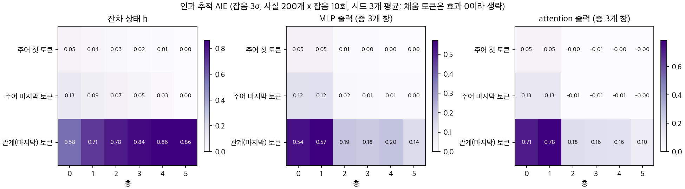
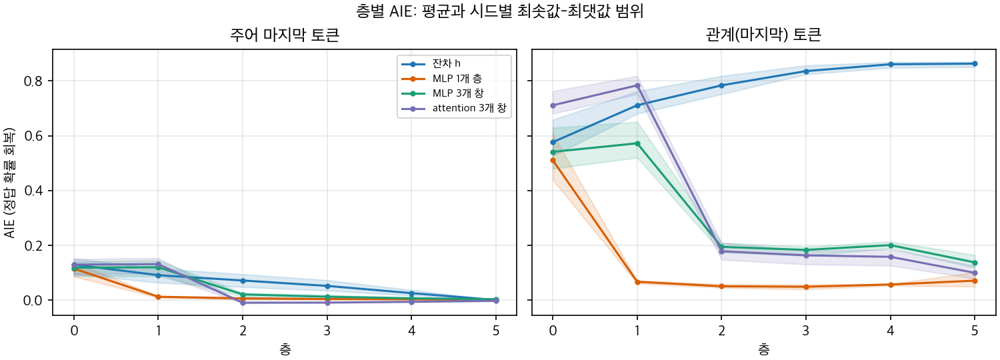
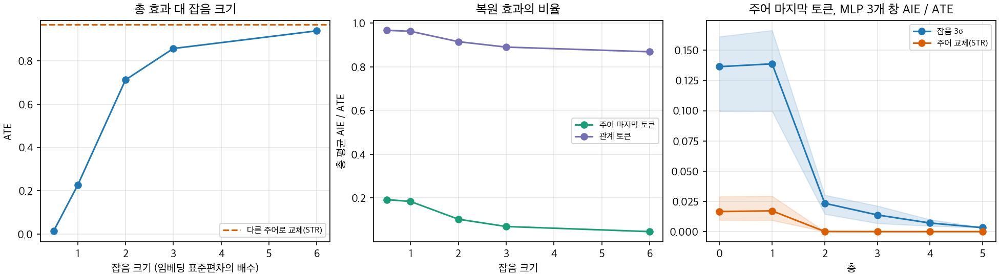
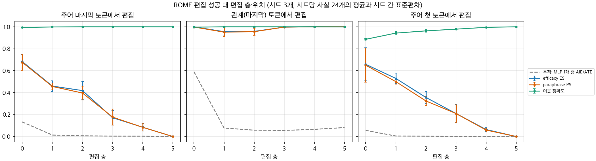
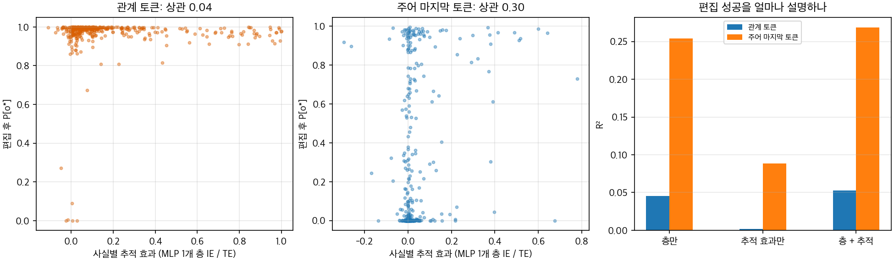
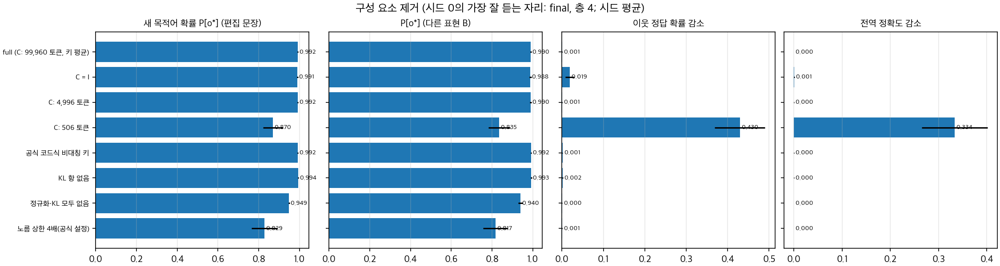
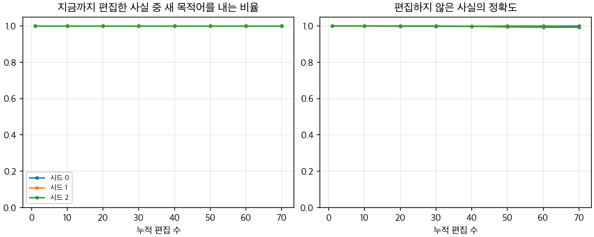
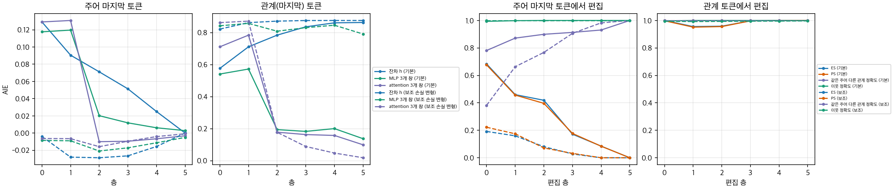
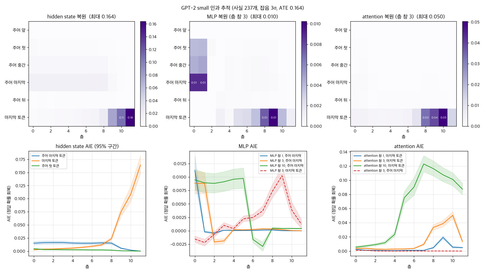
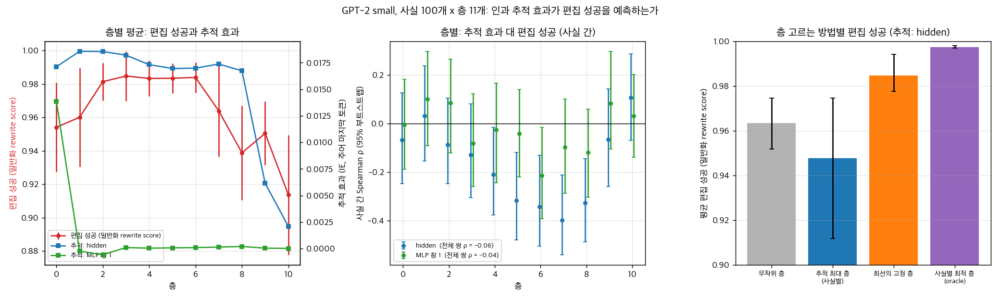

# 사실은 어디에 저장되나

ROME(Meng et al., NeurIPS 2022)은 두 가지를 주장합니다. 인과 추적으로 보면 사실 회상은 주어 마지막 토큰의 중간층 MLP에서 일어나고, 그 MLP의 가중치를 rank-one으로 고치면 사실이 바뀝니다. 이 글은 두 방법을 PyTorch로 직접 짜서(`minimal_impl.py`, CPU, 테스트 12개) 식을 검산하고 작은 모델에서 시험한 기록입니다. 논문 그림은 쓰지 않았고 그래프는 모두 직접 그렸습니다. 공식 코드는 읽기만 했고 실행하지 않았습니다. GPT-2 XL 실험은 재현하지 않았고, 사전학습 모델로는 GPT-2 small만 시험했습니다.

## 토이

주어 400명(이름 토큰 + 성 토큰), 관계 4개(관계마다 목적어 30개) + 범주 관계 1개, 사실 2,000개. 관계 표현은 두 가지, 앞에 무작위 채움 토큰 0-3개. 6층 transformer(폭 128, 파라미터 125만 개)를 마지막 토큰 손실만으로 학습해 시드 3개 모두 100% 외웠습니다.

## 인과 추적과 잡음 크기

깨끗한 실행, 주어 임베딩에 N(0, ν²) 잡음을 더한 실행, 잡음 실행에서 한 상태만 깨끗한 값으로 되돌린 실행의 확률 차가 IE입니다. 정의에서 곧바로 따라 나오는 성질(잡음 0이면 IE 0, 마지막 층 마지막 토큰을 되돌리면 IE = TE)을 테스트로 확인했습니다. 논문이 ν = 3σ를 쓰는 이유는 기하로 어림할 수 있습니다. 원소가 독립이면 잡음 노름 대 토큰 간 거리는 ν/(√2σ)이고, 토이의 실제 임베딩에서 측정한 값이 0.71(1σ), 1.42(2σ), 2.13(3σ)로 거의 그대로였습니다. ATE는 2σ에서 0.71, 3σ에서 0.86으로 6σ 값(0.94)의 91%에 이릅니다.

**효과는 주어 마지막 토큰이 아니라 관계(마지막) 토큰의 0-1층에 몰렸습니다.** 시드 3개 모두에서 MLP 1개 층과 attention 1개 층의 최댓값이 (층 0, 관계 토큰)이고, 주어 마지막 토큰의 최대 AIE는 0.13입니다. 경로 끊기 실험에서 관계 토큰 0층 복원 효과는 MLP를 끊으면 0.58에서 0.35로 줄었습니다.

마지막 토큰 손실만 있어 주어 위치가 속성을 미리 계산할 압력이 없다는 것이 가설입니다.

잡음을 0.5σ-6σ로 바꾸거나 주어를 다른 주어로 교체(STR)해도 효과 위치는 같았지만, 주어 마지막 토큰이 가져가는 몫은 가우스 잡음 3σ에서 0.14, STR에서 0.017로 약 8배 달랐습니다(Zhang & Nanda 2023의 지적과 같은 방향).

## rank-one 갱신식

W가 K, V의 최소제곱 해이면 ‖ŴK − V‖² = ‖WK − V‖² + ‖ΔK‖²이고 가운데 항이 사라집니다. ‖ΔK‖² = tr(ΔCΔᵀ)을 Δk* = v* − Wk* 아래 최소화하면 라그랑주 조건에서 Δ = Λ(C⁻¹k*)ᵀ, Λ = (v* − Wk*)/((C⁻¹k*)ᵀk*)가 나옵니다. 기존 쌍에 주는 피해의 최솟값은 ‖v*−Wk*‖²/(k*ᵀC⁻¹k*)입니다. KKT 연립을 직접 풀어 얻은 해와 1e-8 이내로 같았고, C의 스케일은 결과에 영향이 없으며 C = I이면 최소 노름 해입니다. 단 W가 실제로 최소제곱 해라는 가정은 학습된 가중치에는 정확히 맞지 않습니다.

## 편집: 어디를 고쳐야 먹히나

- **관계 토큰의 키로 고치면** 거의 모든 층에서 성공(ES, PS 0.95-1.00), 이웃 정확도 ≥ 0.996, 같은 주어의 다른 관계 1.00. 논문 Fig. 5가 마지막 토큰 편집이 나쁘다고 한 것과 반대입니다.
- **주어 마지막 토큰의 키로 고치면** 층이 깊을수록 단조 감소(ES 0.68, 0.46, 0.42, 0.17, 0.08, 0.00). 논문의 중간층 고점은 없습니다. 이 위치의 키는 관계를 몰라 같은 주어의 다른 관계 정확도가 0.78-0.93으로 떨어지는데, 논문의 이웃 지표(다른 주어의 같은 관계)는 이를 재지 않습니다.
- 주어 첫 토큰 키는 첫 이름을 공유하는 이웃을 해칩니다(이웃 정확도 0.886).

사실별로 추적 효과와 편집 성공을 짝지어 Hase et al.(2023)처럼 회귀하면, 층을 이미 알 때 추적 효과가 더하는 R²는 +0.007(관계 토큰), +0.015(주어 마지막 토큰)였습니다. 위치 사이 비교는 추적이 맞았지만 같은 위치 안의 층 선택은 알려 주지 못했습니다.

## 구성 요소를 빼 보면

- **C를 506개 토큰으로 추정하면 무너집니다.** 키 차원이 512라 C가 특이행렬이고, 갱신 노름이 90배로 커져 이웃 정확도 0.58, 전역 정확도 -33%p. 4,996개(차원의 약 10배)면 99,960개와 같습니다.
- C = I는 갱신 노름이 4분의 1이지만 이웃 정답 확률은 15배 더 깎였습니다. 최소 노름이 최소 훼손은 아닙니다.
- 공식 코드가 식과 다르게 쓰는 비대칭 키(u는 문맥 평균 키, 분모는 문맥 없는 키; 후속 연구가 붕괴 원인으로 지목)는 이 토이에서 차이가 없었습니다.
- 공식 설정의 노름 상한(4배)은 토이에서 효능을 0.84로 낮췄습니다.

같은 자리를 70번 연속 고쳐도 붕괴나 뚜렷한 망각은 없었습니다(미편집 사실 정확도 0.993-1.000). 보고된 100-1000번 이후의 붕괴와 비교할 규모가 아닙니다.

## 주어 위치 선계산 압력을 주면?

주어 마지막 토큰이 그 주어의 속성 5개에 대한 균등 분포를 맞추는 보조 손실을 더했습니다. 가설은 지지되지 않았습니다. 주어 위치의 AIE는 0 또는 약간 음수가 되었고 관계 토큰 0층 MLP AIE는 0.51에서 0.81로 올랐으며, 주어 위치 편집은 더 나빠졌습니다(ES 0.19). 모델이 보조 과제와 주 과제를 따로 푸는 것으로 보입니다. 이 변형에서는 C = I의 손해가 훨씬 커서 이웃 정확도가 0.993에서 0.687로 떨어졌습니다.

## 사전학습 GPT-2 small에서는

토이가 early site를 못 만들었으니 사전학습 모델에서 같은 절차를 돌렸습니다(GPT-2 small 124M, 공식 knowns 1,209개 중 small이 맞힌 237개, 잡음 3σ, 사실마다 잡음 10개).

- **late site는 있고 early site는 없었습니다.** 효과는 마지막 토큰의 attention(창 10, 층 7: AIE 0.123, ATE 0.164의 75%)과 hidden(층 9-11)에 몰립니다. 주어 마지막 토큰의 hidden 효과는 0.016(ATE의 약 10%, 층 0-8 평탄)이고 MLP 효과는 층 0-1에서만 0.009-0.011입니다. 논문 GPT-2 XL은 주어 마지막 토큰 hidden이 0.087(ATE 0.186의 약 47%)입니다.
- 원인은 가르지 못했습니다. 가우스 잡음 3σ와 확률 지표 하나만 썼고(대칭 토큰 교체나 잡음 크기 훑기는 안 함), small이 아는 사실은 확률이 낮은 것이 많습니다(정답 확률 평균 0.17). 논문 부록은 GPT-2 Medium과 Large에서 early-site MLP가 높다고 쓰지만 small은 다루지 않습니다.
- 복원 창을 논문 서술([l-4, l+5])과 공식 코드([l-5, l+4])로 각각 구해도 값은 같고 정점 층 표시만 한 칸 달랐습니다.

Hase et al.의 사실별 분석도 줄여서 했습니다: 사실 100개 x 층 0-10에서 ROME(공식 코드의 하이퍼파라미터, 반사실 목표는 같은 관계의 다른 속성, C는 pile-10k 20만 토큰으로 추정)으로 고치고 일반화 rewrite score를 쟀습니다. 추적 효과와 편집 성공의 전체 상관은 hidden -0.06 [-0.15, 0.06], MLP -0.04 [-0.09, 0.02]이고 층을 알 때 추적이 더하는 R²는 +0.02 이하입니다. 사실마다 추적 효과가 가장 큰 층에서 고치면 무작위 층보다 낫지 않았습니다(0.948 대 0.963). Hase et al.과 같은 방향입니다. 다만 편집이 거의 모든 층에서 성공해(ES 약 1) 층이 설명하는 분산이 3.7%(Hase 94.7%)뿐이라 "층 선택이 더 중요하다"는 주장은 검정하지 못했고, early site가 없는 모델이라 추적 효과의 변동이 작았던 점도 귀무 결과에 기여했을 수 있습니다.

## 이후 문헌이 바꾼 것

- 인과 추적 위치가 편집 층을 알려 준다는 함의는 Hase et al.(NeurIPS 2023)이 반박했습니다(GPT-J, 사실별 상관 ≈ 0, 편집 층이 R² 0.947).
- 손상 규칙(가우스 잡음 대 대칭 토큰 교체)이 국소화 결과를 바꿀 수 있습니다(Zhang & Nanda, ICLR 2024).
- 편집한 사실은 회상해도 다단계 질문은 실패합니다(MQuAKE: GPT-J, 40.5%에서 7.4%). 반복 편집에서는 망각과 붕괴가 보고되었고(Gupta et al. 2024), 일부 붕괴는 공개 구현이 논문 식과 어긋난 탓이었습니다(Gupta & Anumanchipalli 2024).

## 한계

- 토이는 논문의 early site를 재현하지 못했습니다. 사전학습 LM의 성질이 없거나, 이 토이가 그 신호를 담지 못한 것이며 어느 쪽인지 가리지 못했습니다.
- 모델이 작고 사실이 임의 연상이며 문맥이 채움 토큰이고 시드는 3개, 신뢰구간은 계산하지 않았습니다. 생성이 없어 유창성과 일관성은 측정하지 못했습니다.
- 논문의 GPT-2 XL, GPT-J 수치는 재현하지 못했습니다. GPT-2 small 실험은 사실 100-237개, 시드 1개, 하이퍼파라미터는 XL 값, 반사실 목표와 일반화 문맥은 직접 만든 대용품입니다.

## 자료

- [최소 구현](analysis/minimal_impl.py)
- [01. 논문 분석: Locating and Editing Factual Associations in GPT (ROME)](analysis/01_paper_analysis.md)
- [02. 계보, 가까운 대안, 이후 문헌, 관련 분석](analysis/02_prior_work.md)
- [03. 검산과 최소 구현](analysis/03_analysis.md)
- [04. 주장 검증(C)과 공식 코드 대조(D)](analysis/04_claim_verification.md)
