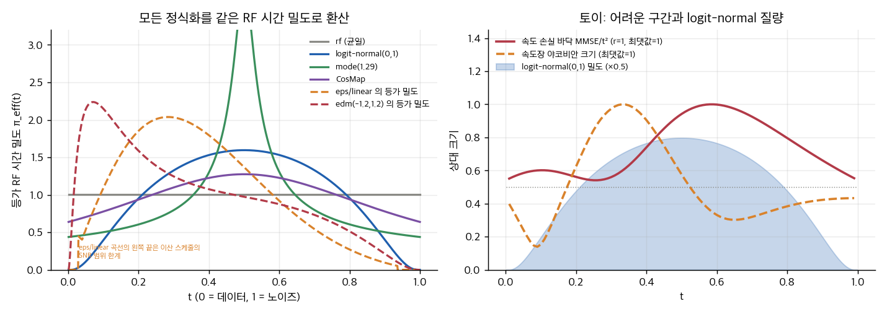
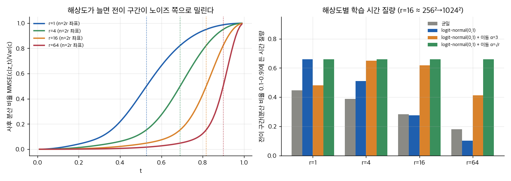
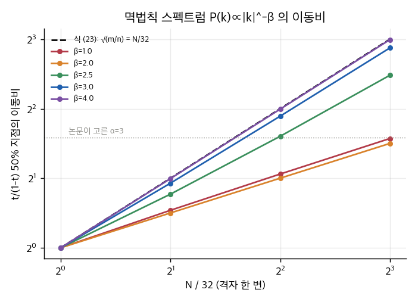
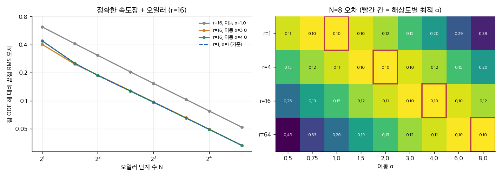
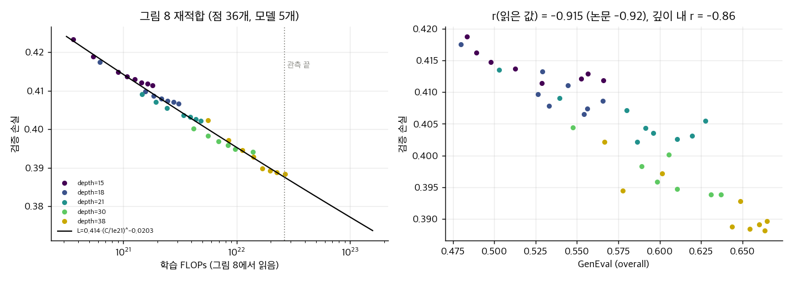

# SD3의 시간 표본기와 해상도 이동을 학습 없이 다시 계산했습니다

*Scaling Rectified Flow Transformers for High-Resolution Image Synthesis*(Esser 외, Stability AI, arXiv:2403.03206, ICML 2024 구두·최우수 논문상)는 rectified flow의 시간 표본 분포를 61개 정식화로 비교하고, 모달리티별 가중치를 가진 MM-DiT를 8B까지 키웠습니다. 이 글은 그 주장을 **학습 없이**(닫힌 식, 정확한 속도장을 가진 토이, 그림에서 읽은 점) 다시 확인한 기록입니다. 논문 그림은 arXiv 라이선스가 CC가 아니라서 싣지 않았고, 아래 그래프는 모두 직접 그렸습니다.

## 통합 손실은 맞고, w_t 표기에는 상수 배가 있습니다

식 (10)–(13)은 무작위 텐서에서 1e-15로 일치하고 RF의 w_t = t/(1−t)는 정확합니다. 코사인(ε, v)과 EDM의 w_t 표기는 정확한 값에 1/π, 2/π, 8을 곱한 것이고, 코사인의 v/ε 가중비는 표기가 정확한 값의 절반입니다. 최적해는 시간 가중의 상수 배에 불변이라 학습에는 영향이 없지만, 정식화 사이의 가중을 숫자로 비교할 때는 상수를 맞춰야 합니다.

시간 분포는 식과 일치합니다. logit-normal(0,1)은 질량의 60.3%를 t ∈ [0.3, 0.7]에 둡니다(균일은 40%). mode sampling의 유효 범위는 정확히 −1 ≤ s ≤ 2/(π−2) = 1.7519이고, 논문이 쓴 s=1.75는 그 끝점이라 π(0.5) ≈ 904의 첨봉이 되어 질량의 45%가 [0.45, 0.55]에 몰립니다. "heavy tails"보다는 가운데 첨봉에 가깝습니다.

## "가운데에 질량을 모으면 좋다"는 순위를 설명하지 못합니다

식 (18)을 거꾸로 쓰면 모든 정식화를 같은 속도 MSE에 대한 시간 밀도로 환산할 수 있습니다.

가운데 질량([0.3, 0.7])이 가장 큰 edm(0,0.6)은 표 1에서 5.63위이고, t<0.5 쪽으로 치우친 edm(−1.2,1.2)와 eps/linear는 15.58위와 2.88위입니다. 오른쪽 패널은 2차원 3성분 혼합의 정확한 속도장에서 구한 값으로, 줄일 수 없는 속도 손실의 바닥은 t=0.59에서, 속도장의 복잡도(야코비안)는 t=0.33에서 최대입니다. **"어려움"의 두 척도가 같은 t에 정점이 아닙니다.**

## 해상도가 커지면 전이 구간이 밀립니다

가우시안 혼합을 r번 복제해 "픽셀이 r배"인 데이터를 만들면 MMSE가 √r(1−t)/t의 함수가 되어, 전이 구간(분산 비율 0.1–0.9)이 노이즈 쪽으로 밀립니다.

logit-normal(0,1)이 전이 구간에 두는 질량은 r=1에서 0.66이지만 r=16에서 0.28로 균일(0.28)과 같아지고 r=64에서는 0.10으로 균일(0.18)보다 낮습니다. 식 (23)의 이동을 √r만큼 주면 모든 r에서 0.66으로 복원됩니다. 이것이 §5.3.2의 이동이 필요한 이유의 토이판입니다. 다만 이 일치는 복제 픽셀 구성상 정확하게 성립하는 항등식이고 현실 데이터에 대한 증거는 아닙니다.

## 식 (23)은 상한입니다

같은 연속 스펙트럼을 해상도만 바꿔 가며 푸리에 모드별로 MMSE를 더해 보면 이동비가 스펙트럼 지수에 따라 달라집니다.

256² → 1024²(N: 32 → 128)에서 오즈 t/(1−t)의 이동비는 β=2에서 2.0, β=2.5에서 3.04, β=3에서 3.71, β=4에서 3.98이고 식 (23)의 상수 이미지 값은 4입니다. 논문이 사람 선호 연구로 고른 α=3.0은 이 범위 안입니다. β는 VAE 잠재의 스펙트럼이 아니라 가정이므로, "α=3이 설명된다"가 아니라 "√(m/n)=4와 α=3의 차이가 스펙트럼 가정의 범위 안"이라는 정도입니다.

## 정확한 속도장 + 오일러: 최적 이동 ∝ √r, 계곡은 넓습니다

정확한 속도장으로 오일러 적분의 오차(참 ODE 해 대비 끝점 RMS)를 보면 E(r, α) = E(1, α/√r)이 소수 넷째 자리까지 성립합니다(토이의 대칭). 새로 보이는 것은 세 가지입니다. 기준 해상도(r=1)에서는 이동이 오히려 해롭습니다(α=3에서 오차 +60%). 이동하지 않은 균일 격자는 r=16에서 최적의 1.6배, r=64에서 2.7배의 오차입니다. α/√r이 0.75–1이면 1% 이내라 α=3과 4는 구별되지 않습니다.

## 표 1: 구조는 맞고, 상위권 격차는 노이즈와 구별되지 않습니다

표 1의 5스텝 열(4조합 평균), 50스텝 열(12조합), 전체 열(24조합)은 반올림 한계 안에서 정수 격자에 놓여 "6개 샘플러 설정 × EMA 유무 × 데이터셋 2개"라는 설명과 맞습니다. 조합별 순위나 시드가 없어서 직접 검정은 못 하고, 세 샘플러 체제(5스텝, 10·25스텝, 50스텝)로 나눠 짝 비교한 탐색적 검정(자유도 2, 홀름 보정)에서 rf/lognorm(0,1)과 다음 5개 변형의 보정 p는 0.57–0.76입니다. 방향은 세 체제 모두 같지만 검정력은 낮습니다. 5스텝과 50스텝의 순위는 스피어먼 ρ = 0.77(순열 p = 0.0006)로 대체로 같지만 rf/lognorm(0.5,0.6)은 50스텝 1위인데 5스텝에서는 8.5위입니다.

## 그림 8: 상관은 재현되고, 포화는 단정할 수 없습니다

그림 8은 PDF에 래스터로 들어 있어 점을 색으로 찾아 읽었습니다(오차 ±1 픽셀 = 손실 6.3e-5).

읽은 점으로 다시 구한 상관은 GenEval −0.915(논문 −0.920), 사람 선호 −0.982, T2I-CompBench −0.888(−0.898), 비디오 −0.908입니다. 검증 손실 대 FLOPs는 L = 0.4142·(C/10²¹)^−0.0203(R² 0.984, 36점)으로 맞지만 오프셋은 식별되지 않아(95% 구간 [0, 0.29]) "포화 징후 없음"은 5개 모델, 손실 범위 9%의 거듭제곱 맞춤이라는 뜻이고 바닥이 없다는 증거는 아닙니다. 점이 모델 5개의 체크포인트 궤적이라 독립 표본이 아니고, 학습 스텝이 늘면 두 지표가 함께 좋아지는 효과와 분리할 수 없습니다.

## 공식 코드에는 학습 코드가 없습니다

공식 `sd3.5` 저장소는 "inference-only"입니다. 논문의 시간 표본기와 손실은 이 코드로 대조할 수 없고, Hugging Face diffusers의 학습 스크립트는 기본값이 논문과 다릅니다(`precondition_outputs=1`이면 x0-MSE, 즉 σ² 가중이 추가되고, logit-normal의 인덱스 방향이 반대입니다). 공개 기본 샘플러는 오일러가 아니라 dpmpp_2m이고, 같은 파일에서 `sd3_medium` 설정만 shift 1.0입니다. MM-DiT 구조(결합 어텐션, 모달리티별 가중치, 헤드 단위 QK RMSNorm)와 파라미터 수(d=38에서 8.057 B, d=24에서 2.028 B)는 논문과 맞습니다.

## 한계

이 글의 토이와 재적합은 학습이 아니라 닫힌 식과 읽은 값이라, 이미지 모델의 학습 신호에 대한 직접 증거가 아닙니다. 표 1의 조합별 원자료와 시드가 없어 상위권 격차의 검정은 탐색적입니다. 코드는 실행하지 않고 정적으로만 읽었습니다.

## 자료

- [통합 리포트 PDF](report/report_public.pdf)
- [01. Scaling Rectified Flow Transformers for High-Resolution Image Synthesis (SD3) 논문 분석](analysis/01_paper_analysis.md)
- [02. 계보, 구성 요소의 출처, 관련 자료](analysis/02_prior_work.md)
- [03. 식 유도 검산, 해석 토이, 표·그림 재계산](analysis/03_analysis.md)
- [04. 논문 ↔ 코드 대조 (정적 읽기)](analysis/04_code_verification.md)
