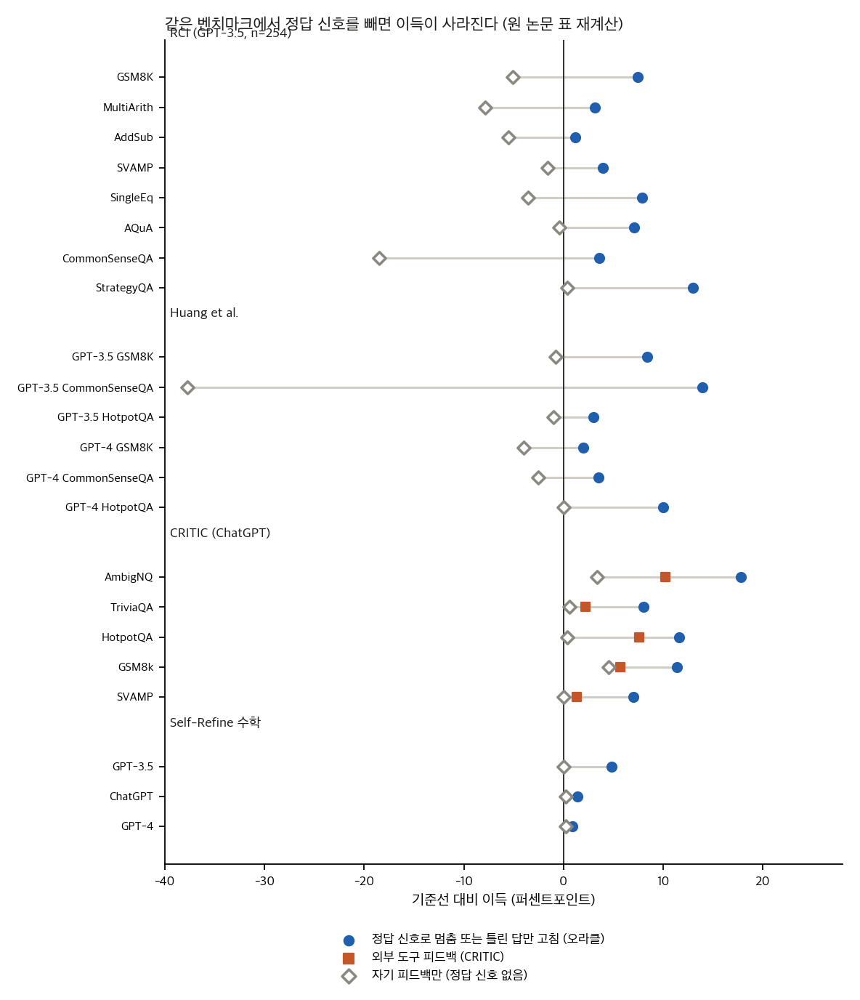

# 03. 분석: 서베이의 분류가 원 논문의 수치·조건과 맞는가

서베이에는 새 실험표가 거의 없고 판정의 근거가 원 논문의 표, 프롬프트, 코드에 있습니다. 그래서 서베이가 핵심 사례로 든 논문 8편을 골라 arXiv 원문(과 공개 코드 한 곳)을 받아 확인하고, 이 저장소에서 따로 재계산해 둔 두 편을 대조에 더했습니다. 원문 대조에서는 (a) 서베이가 쓴 조건 서술(오라클 사용, 약한 초기 프롬프트, 비교 조건)이 맞는지, (b) 원 논문 표의 수치를 다시 계산해도 서베이의 방향이 유지되는지 봤습니다. 스크립트는 `analysis/recheck_cases.py`(결과 `recheck_cases_results.json`), 그래프는 `analysis/plot_figures.py`입니다.

## 0. 방법과 한계

- 원 논문 표의 값은 `pdftotext`로 읽어 손으로 옮겼습니다(옮긴 표는 스크립트 안에 출처와 함께 있음). 수치를 바꾼 것은 없습니다.
- **짝지은 문항 단위 자료는 어느 논문도 공개하지 않았습니다.** 그래서 구간과 p는 두 비율의 독립 표본 근사(Newcombe 95% 구간, 두 비율 z 검정)입니다. 같은 문항에서 비교한 값이라 실제 짝지은 검정은 더 좁은 구간을 줍니다. 아래 "유의하지 않음"은 "이 근사로는 구별되지 않음"이고 "효과 없음"이 아닙니다. 반대로 "유의함"은 보수적입니다.
- 표본 수는 본문에 있으면 그것을 쓰고, 없으면 표의 값이 k/n으로 떨어지는 n을 찾아 추정했습니다(§1 V1).
- 모델 호출은 하지 않았고 원 논문의 값만 다시 계산했습니다.

## 1. 사례별 대조 (V1–V10)

판정 용어: **일치**(서베이의 서술과 원 논문 조건·수치가 맞음), **부분 일치**(방향은 맞으나 서베이가 구분하지 않은 점이 있음), **미확인**.

| V | 서베이 서술(위치) | 원 논문 확인 | 판정 |
|---|---|---|---|
| V1 | RCI는 정답 레이블로 정지 조건을 정하고 맞은 응답은 건드리지 않는다(§4, 표 4). 레이블 없이는 성능이 같거나 낮다(표 1의 "RCI (Table 17)") | 원문 §3.1 "terminating the loop once the output aligns with the ground-truth data", 부록 C.2 "the correct label to decide when to stop". 표 17에서 8개 벤치마크 중 7개가 기준선보다 낮고 1개(StrategyQA)가 +0.4 | 일치 |
| V2 | Reflexion §4.2의 피드백은 생성 답과 정답의 완전 일치다(표 4) | 원문 §4.2 "exact match answer grading using the environment to give a binary success signal". 표 5의 n=100 | 일치 |
| V3 | Self-Refine은 초기 응답용 지시·예시가 약하다(표 4, 표 9, 10) | 공개 코드 `src/responsegen/task_init.py`의 지시문에 "Interesting - The response is not interesting", "Engaging - The response is not very engaging"이 그대로 있음. 논문 부록 M.2는 "instruct the model to produce a response that is good at the 10 aspects"라고 씀 | 일치 (논문 서술과 코드가 다름) |
| V4 | CRITIC w/o Tool은 GSM8k, SVAMP에서 개선이 없다(표 1, "Negative Results") | 6개 셀 중 3개는 맞고(davinci −1.8, −3.3, ChatGPT SVAMP 0.0), ChatGPT GSM8k는 +4.5(p≈0.008). TabMWP는 서베이 표에 없고 +12.0, +20.3 | 부분 일치 |
| V5 | Huang et al.은 오라클로 정지하면 이득이 있으나 내재적으로는 이득이 없다(표 1, 2) | 표 2·3 재계산. 오라클 이득은 GPT-3.5 GSM8K, CSQA에서만 유의. 내재적 하락은 GPT-3.5 CSQA에서 가장 큼 | 일치 (아래 V5 참조) |
| V6 | Welleck et al.은 수정기에 추가 학습을 시켜 불공정(표 1, §5.2) | 원문 부록 A.1: 수정기는 미세조정된 초기 생성기에서 초기화해 잔차 쌍으로 추가 학습. 학습의 가치 함수는 정답 일치(§3.1). 초기 생성기에 같은 추가 학습을 준 대조는 없음 | 일치 |
| V7 | Self-Debug는 공정-비대칭(코드 실행기를 쓰고 초기 생성에는 못 쓰는 도구)(표 1) | 표 2 대 표 3으로 실행 포함 여부의 효과를 분리해 볼 수 있음. TransCoder는 **평가에 쓰는 단위 테스트 10개가 모두 프롬프트에 노출**됨 | 부분 일치 (아래 V7 참조) |
| V8 | CAI revisions는 초기 생성이 무해하게 쓰라는 지시를 받지 않는다(표 4) | 원문 §3.1: 도움만 되게 학습한 모델(helpful-only)로 해로운 응답을 먼저 뽑고 수정. "typically be quite harmful" | 일치 (CAI의 목적은 SFT 데이터 생성이라 RQ1 검증이 아님) |
| V9 | Olausson et al.(2306.09896)은 코드 생성에서 내재적 부정 결과, 같은 예산 비교(§4, §6) | 저자 원자료를 과제 단위로 따로 재계산한 결과와 대조: 같은 모델 자기 피드백의 이득은 작고(np=10, nfr=1에서 1.05배 [1.02, 1.08], np=2, nfr=10에서 0.97배 [0.95, 1.01]), 피드백만 강한 모델로 바꾸면 모든 예산에서 이득이 확실. 단 이 논문의 루프에는 **테스트 실행 오류 메시지가 입력**으로 들어가므로 엄밀히는 내재적이 아니라 실행기가 있는 설정 | 부분 일치 |
| V10 | Tyen et al.(2311.08516)은 자기 오류 탐지 실패의 증거(§1, §10) | 공개 원자료로 따로 재계산한 결과와 대조: 오류 위치를 주면 5/5 과제에서 수정이 오르고(구간이 0 위), 오라클 위치가 무작위 위치보다 낫다(Fisher p ≤ 0.022). 단 "병목은 찾기"는 전체 자기 수정 루프로 검증되지 않은 가설 | 일치 (서베이 §7의 병목 결론은 가설 수준) |

### V1. RCI (arXiv:2303.17491 v3)

- 표본 수: 표 1, 17의 모든 행이 n=254로 설명됩니다(100–400의 n 중 유일). 본문에 표본 수가 없습니다. 전체 데이터셋(GSM8K 테스트 1,319 등)이 아니라 부분 표본으로 보입니다.
- 오라클 정지(표 1)와 정답 없이 반복(표 17)의 이득, 퍼센트포인트와 95% 구간:

| 벤치마크 | 오라클 정지 | 정답 신호 없음 |
|---|---|---|
| GSM8K | +7.5 [0.7, 14.2] | −5.1 [−12.5, 2.4] |
| MultiArith | +3.2 [−0.3, 6.9] | −7.9 [−13.1, −2.8] |
| AddSub | +1.2 [−4.3, 6.7] | −5.5 [−11.6, 0.6] |
| SVAMP | +4.0 [−2.7, 10.5] | −1.6 [−8.5, 5.4] |
| SingleEq | +7.9 [2.8, 13.1] | −3.5 [−9.8, 2.7] |
| AQuA | +7.1 [−1.3, 15.3] | −0.4 [−8.8, 8.1] |
| CommonSenseQA | +3.6 [−4.7, 11.7] | −18.5 [−26.7, −9.9] |
| StrategyQA | +13.0 [4.3, 21.4] | +0.4 [−8.2, 9.0] |

  정답 신호가 없을 때 구간이 0을 벗어나게 낮은 것은 8개 중 MultiArith, CommonSenseQA 두 개입니다. 나머지는 이 표본(n=254)으로 구별되지 않습니다. "표 17은 기준선과 같거나 낮다"는 서술은 점추정으로는 맞지만 통계적으로는 "일부 과제에서 하락, 나머지는 불확정"으로 읽어야 합니다. 정답 신호가 있을 때도 8개 중 3개(GSM8K, SingleEq, StrategyQA)만 구간이 0을 벗어납니다.
- **기준선 변경.** 같은 표 1의 "Zero-Shot" 행이 v1·v2와 v3에서 다릅니다(v1 표 1: 78.35/96.06/85.83/78.35/91.34/55.91/53.15/51.57, v3 표 1: 77.95/94.48/88.58/80.70/86.61/60.23/64.56/48.81). RCI 행(85.43, 97.64, …)은 그대로입니다. 그래서 CommonSenseQA의 이득이 +15.0(v1)에서 +3.6(v3)으로 줄었습니다(StrategyQA +10.2에서 +13.0은 늘었습니다). Huang et al.이 인용한 "약 15%"는 v1·v2 값입니다. v3 본문 부록 표 2의 Zero-Shot 행(78.35, 96.06, …)은 v1 값을 그대로 두어서 같은 논문 안에서 표 1과 표 2의 기준선이 다릅니다. 서베이가 쓴 판본(표 17은 v3에만 있음)에서는 정답 레이블 사용이 이득의 일부가 아니라 대부분이라는 결론이 유지됩니다.
- 표 17 내부: StrategyQA의 Zero-Shot이 표 1에서 48.81, 표 17에서 48.42이고 표 17의 "Zero-Shot + RCI" 값 48.81이 표 1의 Zero-Shot 값과 같습니다. 옮겨 적은 오류 가능성이 있어 이 셀은 인용하지 않습니다.

### V2. Reflexion (arXiv:2303.11366 v4)

- 표 5(HotPotQA 100문항)의 이득은 CoT(GT 문맥) +17, +14, +12(davinci, gpt-3.5, gpt-4), ReAct +25, +12, +12입니다. 95% 구간은 +17 [4.1, 29.1], +14 [0.7, 26.6], +12 [−0.2, 23.7], +25 [11.3, 37.4], +12 [−0.9, 24.4], +12 [−1.8, 25.1]이라 6개 중 3개가 0을 벗어납니다.
- 이득은 완전 일치(정답 일치) 신호로 반복해서 얻은 값이고 같은 시도 횟수의 재샘플링 기준선과 비교하지 않았습니다. 원문은 "ReAct-only, CoT-only 구현은 첫 시도에 틀린 문항을 이후 시도에서 하나도 풀지 못했다(온도 0.7)"고 쓰지만, 정답 신호로 멈추는 재샘플링이 하나도 풀지 못했다는 것은 이례적이라 확인하지 못했습니다(표로 제시되지 않음).
- 서베이가 공정-비대칭으로 분류한 코드 조건(§4.3)은 자기 생성 테스트를 씁니다. HumanEval(Py) 0.80→0.91(n=164, +11 [3.3, 18.7])이지만 MBPP(Py)는 0.80→0.77로 낮아지고, StarChat-beta는 0.26→0.26(표 4)입니다. 표 3의 Rust 50문항 소거(테스트 생성 제거 0.52 대 기준선 0.60)는 n=50이라 구간 [−26.3, 11.1]이 넓습니다. 서베이의 "코드 실행기를 쓰면 된다"는 방향은 유지되지만, Reflexion의 이득은 모델 규모(표 4)와 자기 생성 테스트의 거짓 양성(표 2, MBPP의 FP 0.16)에 따라 갈립니다.

### V3. Self-Refine (arXiv:2303.17651 v2)와 공개 코드

- 대화 응답: 표 1의 이득은 GPT-3.5 +27.2, ChatGPT +19.8, GPT-4 +49.2(GPT-4 선호도 지표). 사람 평가는 표 15에서 SELF-REFINE 승 36/48/54%, INIT 승 23/18/16%입니다. 평가가 약한 INIT(코드의 지시문)와의 비교입니다.
- 부록 M.2는 INIT가 "10가지 측면에서 좋은 응답을 만들도록 지시받았다"고 하지만, 공개 코드의 지시문은 측면 3(Interesting)과 6(Engaging)에서 응답이 재미없고 덜 매력적이라고 적습니다(서베이 표 9가 인용한 그 파일이고, 마지막 커밋은 2023-03-28로 이후 바뀌지 않음). 서베이의 판정은 논문이 아니라 코드를 읽어야 확인되는 것이고, 코드로 확인됩니다.
- Constrained Generation(CommonGen-Hard): Self-Refine 표 1의 ChatGPT는 44.0→67.0. Huang et al. 표 8은 초기 프롬프트에 "ALL concepts"를 넣은 기준선이 81.8이고 같은 자기 수정 프롬프트를 얹으면 75.1로 오히려 6.7p 낮아진다고 보고합니다(두 논문 모두 이 표의 n을 확인하지 못했습니다).
- 수학: 표 1의 이득은 0.0(GPT-3.5), +0.2(ChatGPT), +0.2(GPT-4)이고 구간이 모두 0을 포함합니다(예: GPT-4 [−1.7, 2.2], n=1,319 가정). 오라클 피드백(표 9)에서는 +4.8, +1.4, +0.9입니다. 표 9에는 GPT-4 행이 "93.8 (↑0.7)"로 적혀 있지만 92.9에서 93.8은 0.9입니다. 서베이 표 4가 수학을 "약한 초기 프롬프트" 사례에 넣었으나 수학의 이득은 어차피 0에 가까워서 수치 영향은 없습니다. 수학 프롬프트가 약한지는 확인하지 않았습니다.
- 표 13: 신뢰구간이 캡션에서 95%, 본문에서 99%로 달리 적혀 있습니다. 수학 GPT-3.5(64.1±3.47)를 n=1,319 Wilson으로 재현하면 95%에서 ±2.59, 99%에서 ±3.40이므로 보고된 값은 99%에 가깝습니다.

### V4. CRITIC (arXiv:2305.11738 v4)

표 1(QA, n=500)과 표 2(수학 프로그램)의 CoT 또는 PoT 기준선 대비 이득, 95% 구간과 p(독립 근사):

| 조건 | QA 6셀 (EM) | 수학 6셀 (solve rate) |
|---|---|---|
| CRITIC w/o Tool (자기 비평만) | −2.2, −0.1, +1.2, +3.4, +0.6, +0.4. **6개 모두 p ≥ 0.28** | davinci −1.8, −3.3, **+20.3(TabMWP)**. ChatGPT **+4.5(GSM8k, p=0.008)**, 0.0, **+12.0(TabMWP)** |
| CRITIC (검색·인터프리터) | davinci +5.8, +5.3, +5.0(모두 p ≥ 0.066). ChatGPT **+10.2**, +2.2, **+7.6** | davinci +2.1, −3.3, +23.0. ChatGPT +5.7, +1.3, +14.0 |
| CRITIC* (틀린 답만 고침, 오라클) | 6개 중 6개 유의, +8.0~+17.8 | 6개 모두 +7.0 이상 |

(TabMWP의 n은 논문에 없어 1,000으로 가정했습니다. 값이 100 단위로 떨어지는 셀이 있어 부분 표본으로 보입니다. 공식 test 7,686문항이면 구간이 더 좁아집니다.)

- QA의 자기 비평만은 6개 모두 구별되지 않아 서베이의 "개선 없음"과 맞습니다. 수학에서는 TabMWP가 서베이의 부정 결과 목록 밖에 있고 w/o Tool로도 +12~+20이어서, 서베이의 "프롬프트 피드백만으로는 일반 과제에서 안 된다"에 대한 **미분류 사례**입니다. 도구(인터프리터)가 추가한 이득은 TabMWP에서 +2.0~+2.7p에 그칩니다. 왜 이 과제에서 자기 비평이 듣는지(표 형식 질문이라 프로그램 오류가 눈에 띄는지, PoT 초기 프롬프트가 약한지)는 확인하지 못했습니다.
- CRITIC 대 자기 일관성(표 1, 샘플 10개): ChatGPT AmbigNQ +9.4 [3.3, 15.4] (p=0.003), TriviaQA −0.3, HotpotQA +4.5. davinci는 +5.4, +5.4, +3.8로 모두 구간이 0을 포함. RQ3에서 "자기 일관성보다 낫다"를 보이는 곳은 ChatGPT AmbigNQ 하나뿐입니다. 논문의 "rejection sampling" 비교는 정답 점수로 고르는 오라클 방식이라 CRITIC*와 짝입니다.
- **논문 내부 불일치.** 표 2는 davinci GSM8k의 CRITIC을 72.2(+2.1), 부록 표 10은 71.2(+1.1)로 적습니다(PoT 70.1).

### V5. Huang et al. (arXiv:2310.01798 v2)

표 2·3을 재계산한 이득(GPT-3.5는 GSM8K 1,319, CSQA 1,221, HotpotQA 100. GPT-4는 200, 200, 100):

| 모델 / 과제 | 오라클 | 내재적 1회 | 내재적 2회 |
|---|---|---|---|
| GPT-3.5 GSM8K | **+8.4** [5.4, 11.4] | −0.8 [−4.0, 2.5] | −1.2 [−4.5, 2.1] |
| GPT-3.5 CSQA | **+13.9** [10.9, 16.8] | **−37.7** [−41.3, −34.0] | **−34.0** [−37.6, −30.3] |
| GPT-3.5 HotpotQA | +3.0 [−9.3, 15.2] | −1.0 | −1.0 |
| GPT-4 GSM8K | +2.0 [−1.9, 6.1] | −4.0 [−9.1, 0.9] | **−6.5** [−12.0, −1.2] |
| GPT-4 CSQA | +3.5 [−3.8, 10.8] | −2.5 | −2.0 |
| GPT-4 HotpotQA | +10.0 [−3.8, 23.2] | 0.0 | −6.0 |

- 서베이가 의존한 "오라클 이득과 내재적 하락" 대비는 큰 표본(GPT-3.5 GSM8K, CSQA)에서 확실하고, GPT-4와 HotpotQA는 n이 작아 구별되지 않습니다. GPT-4의 모든 내재적 하락 중 2회차 GSM8K만 유의합니다.
- 표 7(GSM8K 1,319): 토론 2라운드(9응답) 83.0 대 자기 일관성 9응답 88.2 = −5.2p [−7.8, −2.5] (p<0.001). 1라운드(6응답) 83.2 대 85.3은 −2.1p [−4.9, 0.7]로 구별되지 않습니다. 서베이 표 2가 Huang을 RQ3 반박(✗)으로 표시한 근거(§4)는 9응답에서만 통계적으로 서고, 응답 수가 같은 3응답 비교는 83.2 대 82.5로 같습니다.

### V6. Welleck et al. (arXiv:2211.00053 v1)

표 1의 GSM(프로그램 형식) 8.57→21.26(수정기 항상 적용)→24.22(틀린 것만 수정)이고 MultiArith는 60.00→98.33(n=120으로 설명됨). 수정기가 초기 생성기에서 초기화되고 잔차 쌍으로 추가 학습되며 가치 함수가 정답 일치입니다(부록 A.1, §3.1). 비교 대상인 "초기 생성기"는 기본 하이퍼파라미터로 한 번만 미세조정되었습니다. 즉 이득에는 학습 추가분이 섞여 있고 같은 학습량을 초기 생성기에 준 기준선이 없습니다. 서베이의 "불공정" 판정은 조건 서술로는 맞고, 이득 중 얼마가 추가 학습분인지는 분리할 수 없습니다. GSM의 n은 표 값으로 1,319를 설명하지 못해(가능한 n 607, 875, …) 확인하지 못했습니다.

### V7. Self-Debug (arXiv:2304.05128 v2)

표 2(단위 테스트 실행 포함)와 표 3(실행 없음)로 "외부 신호의 몫"을 분리한 이득(기준선 대비, 95% 구간):

| 벤치마크 / 모델 | 실행 포함(UT 피드백) | 실행 없음(Trace) |
|---|---|---|
| MBPP(n=500) Codex | +8.0 [2.1, 13.8] | +4.8 [−1.2, 10.7] |
| MBPP GPT-3.5 | +4.6 [−1.1, 10.2] | +1.6 [−4.2, 7.3] |
| MBPP GPT-4 | +7.8 [2.6, 13.0] | +3.6 [−1.8, 9.0] |
| TransCoder(n=560) Codex | +11.2 [7.2, 15.3] | +3.5 [−0.9, 8.0] |
| TransCoder GPT-3.5 | +3.6 [0.2, 7.0] | 0.0 [−3.7, 3.7] |
| TransCoder GPT-4 | +11.5 [7.1, 15.8] | +1.1 [−3.8, 5.9] |

- 실행을 빼면 6개 셀 모두 구간이 0을 포함하고 TransCoder에서는 사실상 0입니다. 서베이의 "외부 도구가 있을 때 효과적" 판단과 맞습니다. Spider(단위 테스트 없음, n=1,034)는 Codex가 설명 포함에서 +2.8 [−0.5, 6.1], 나머지 모델은 +0.2~+1.1로 구별되지 않습니다.
- **서베이가 구분하지 않은 점.** TransCoder 설정에서 "문제 설명에 C++ 코드와 모든 단위 테스트가 포함"되고(§4.2) 모든 테스트를 통과할 때까지 디버깅을 반복하며, 평가도 같은 560문항 10개 테스트로 합니다. 즉 피드백의 신호와 채점 기준이 같은 테스트입니다. 이 구조에서 얻은 이득(+3.6~+11.5)은 "공정-비대칭 자기 수정"이라기보다 서베이가 비현실적(unrealistic)으로 분류한 "정답 신호로 멈춤"에 가깝습니다. MBPP는 테스트 3개 중 첫 번째만 프롬프트에 두고 나머지 2개를 숨겨 평가(§4.3)하므로 이 우려가 없고, 그 이득(+4.6~+8.0)이 정직한 값입니다. 서베이 표 1은 Self-Debug를 하나의 범주로 한 줄에 적었습니다.

### V8. CAI revisions (arXiv:2212.08073)

원문 §3.1: "generate responses to harmfulness prompts using a helpful-only AI assistant. These initial responses will typically be quite harmful and toxic." 그림 7과 §3.5: 큰 모델에서는 비평 없이 곧바로 수정해도 무해성 점수가 비슷합니다("critiques were sometimes reasonable, but often made inaccurate or overstated criticisms"). 서베이의 서술과 맞고, CAI 논문의 목적은 수정 결과로 SFT 데이터를 만드는 것이라 자기 수정이 가능하다는 RQ1 주장을 한 것은 아닙니다. 서베이 표 2도 CAI를 RQ 열에 표시하지 않습니다.

## 2. 오라클 격차

같은 벤치마크와 같은 모델에서 정답 신호(오라클) 조건과 자기 피드백만 쓴 조건을 나란히 놓으면(RCI 8, Huang 6, CRITIC 5, Self-Refine 수학 3 = 22개 셀) 모든 셀에서 오라클 이득이 자기 피드백만의 이득보다 큽니다(동률 없음). 외부 도구 피드백(CRITIC, 사각형)은 둘 사이에 있습니다. 서베이의 핵심 구도(오라클 > 도구 > 자기 피드백)는 원 논문 표만으로 재현됩니다. 짝지은 그림이 아니라 서로 다른 논문의 표를 모은 것이므로 논문 간 크기를 비교하면 안 됩니다.

## 3. 서베이 자체 점검

- **표 4 근거 편수.** 불공정을 보인 것은 4편이고 §4 본문의 "many studies"는 그보다 넓은 표현입니다. 표 1의 내재적 행은 6개(긍정 3, 부정 3)입니다.
- **문헌 선정 절차 없음**(01 §7). "no prior work"류 결론의 반증이 사후에 나올 수 있고 실제로 나왔습니다(04 C1).
- **표 6의 학습 데이터 규모**는 원 논문에서 확인하지 못했습니다. Saunders et al.(2206.05802)에서 "100,000 generated base tasks"는 합성 과제의 학습량이고 표 6의 과제(주제 기반 요약)의 값이 아닙니다. Volcano(2311.07362)의 274K도 본문에서 못 찾았습니다. 표 6의 규모는 "서베이의 보고"로만 인용하세요.
- **그림 2의 절 번호**는 미세조정 행을 "Section 6", 외부 도구 행을 "Section 5"로 적는데 v3 본문에서는 미세조정이 §5.2, §6이 강한 기준선입니다(v2의 절 번호가 남은 것으로 보임). 내용에는 영향이 없습니다.
- **TabMWP, TransCoder 구조**(V4, V7)는 서베이 분류에서 빠진 사례입니다.

## 4. 판정 요약

| 서베이 판정 | 우리 재계산 |
|---|---|
| RCI, Reflexion §4.2는 오라클 사용(표 4) | 확인(V1, V2) |
| Self-Refine 대화는 약한 초기 프롬프트(표 4, 9) | 확인(V3, 코드로) |
| CRITIC w/o Tool은 이득 없음(표 1) | 대체로 확인. ChatGPT GSM8k +4.5와 TabMWP +12~+20은 예외(V4) |
| Huang et al.의 오라클 대 내재적(표 2) | 확인. 큰 표본 셀에서만 유의(V5) |
| 외부 도구가 있을 때 효과적(§5.1) | 확인(V7). 단 TransCoder는 채점 테스트가 노출됨 |
| 불공정 미세조정(Welleck) | 조건 서술 확인, 이득 분해는 불가(V6) |
| 서베이가 수치를 거의 쓰지 않음 | 수치로 말하는 곳(표 6 규모)은 일부 출처 미확인(§3) |

