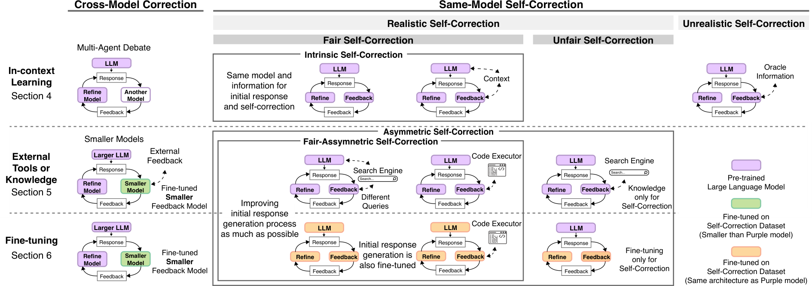
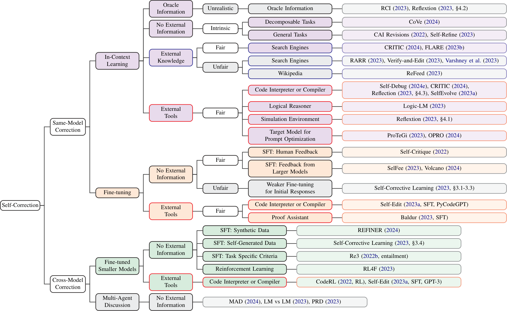
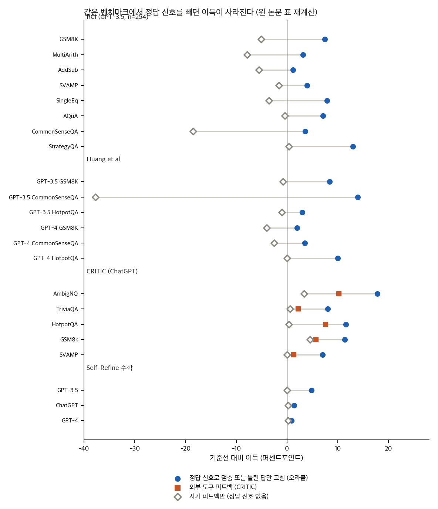

# 자기 수정 서베이를 원 논문 표로 다시 확인해 보니

*When Can LLMs Actually Correct Their Own Mistakes?* (Kamoi et al., TACL 2024)는 새 실험이 없는 비판 서베이입니다. 자기 수정 논문들이 서로 다른 질문을 묻고 있다는 점을 짚고, 질문마다 어떤 실험이 공정한지 분류했습니다. 판정이 원 논문의 조건에 기대고 있어서, 서베이가 든 사례를 원 논문에서 다시 확인했습니다.

## 서베이의 틀

- **RQ1**: 고유 능력만으로 최선의 초기 응답을 고치는가. **RQ2**: 외부 정보를 쓰면. **RQ3**: 최종 출력이 다른 방법보다 나은가(같은 계산 비용의 강한 기준선과 비교해야 함).
- 정답 같은 오라클 정보를 쓰는 설정은 비현실적이고, 초기 응답이 일부러 약한 설정은 불공정합니다. 둘 다 자기 수정의 효과를 과대평가합니다.

## 원 논문으로 확인한 것

| 서베이의 지적 | 원 논문에서 확인한 것 |
|---|---|
| RCI는 정답 레이블로 루프를 멈춘다 | 원문 §3.1과 부록 C.2에 명시. 정답 신호 없이는 8개 벤치마크 중 7개가 기준선 아래(점추정). 다만 표본이 작아(표 값으로 n=254 추정) 구간이 0을 벗어나게 낮은 것은 2개 |
| Reflexion §4.2의 피드백은 정답과의 완전 일치 | 원문 §4.2에 명시. 표 5의 100문항에서 6개 중 3개만 이득의 95% 구간이 0 위 |
| Self-Refine의 대화 초기 지시문이 약하다 | 공개 코드 지시문에 "Interesting - The response is not interesting"이 그대로 있음. 논문 부록은 "10개 측면에서 좋게" 만들도록 지시했다고 적어 서술과 코드가 다름 |
| 외부 도구가 있을 때 효과적 | Self-Debug에서 단위 테스트 실행을 빼면 이득이 6개 셀 모두 구별되지 않음 |

같은 벤치마크와 모델 22개 셀에서 오라클 이득이 자기 피드백만의 이득보다 모두 큽니다. 구도(오라클, 도구, 자기 피드백만 순)는 원 논문 표만으로 재현됩니다. 다만 문항 단위 자료가 공개되지 않아 구간은 독립 표본 근사이고, 서로 다른 논문의 표를 모은 것이라 논문 간 크기 비교는 하면 안 됩니다.

## 서베이가 구분하지 못한 것과 원 논문의 불일치

- **채점 테스트가 노출되는 설정.** Self-Debug의 TransCoder는 평가에 쓰는 단위 테스트 10개가 모두 프롬프트에 들어가고 같은 테스트로 멈춥니다. MBPP는 1개만 노출하고 2개를 숨깁니다. 서베이는 둘을 같은 범주로 다룹니다.
- **서베이의 부정 결과 목록 밖의 사례.** CRITIC의 "w/o Tool"은 TabMWP에서 +12.0(ChatGPT), +20.3(davinci)p입니다.
- **RCI 기준선 변경.** 표 1의 Zero-Shot 행이 v1과 v3에서 달라서 CommonSenseQA 이득이 +15.0에서 +3.6p로 줄었습니다. 같은 논문에서 표 1과 부록 표 2의 기준선도 다릅니다.
- 그 밖에 CRITIC 표 2와 표 10의 같은 셀(72.2 대 71.2), Self-Refine 표 9의 "↑0.7"(계산은 0.9)이 맞지 않습니다.
- 서베이 자체에는 문헌 선정 절차가 적혀 있지 않고, 불공정 판정을 표로 보인 것은 4편입니다.

## 이후 연구가 바꾼 것

초록 수준으로만 확인했습니다. 핵심 결론(검증기가 믿을 만해야 되고, 프롬프트만으로는 일반 과제에서 안 된다)은 유지됩니다. 수정된 곳은 학습 조건입니다. 서베이는 대규모 미세조정을 요건으로 봤지만, SCoRe는 자기 생성 데이터의 온라인 RL을, Self-Correction Bench는 5,306개의 수정 흔적과 "Wait" 덧붙이기를 보고합니다. 반대로 Large Language Models have Intrinsic Self-Correction Ability는 온도 0과 공정한 프롬프트에서 내재적 자기 수정이 나타난다고 주장합니다.

## 인용할 때

"공정한 설정에서 프롬프트 피드백만으로 성공한 주요 연구가 없다"는 부재 진술은 서베이가 본 2024년 5월까지의 범위에서의 말입니다. 구체 수치는 원 논문 표에서 다시 확인해서 쓰는 편이 안전합니다.

## 재계산 방법

`analysis/recheck_cases.py`가 원 논문 표의 값(출처를 스크립트에 적음)으로 이득, Newcombe 95% 구간, 두 비율 z 검정을 계산합니다. 모델 호출은 없고 numpy 없이 표준 라이브러리만 씁니다.

## 자료

- [통합 리포트 PDF](report/report_public.pdf)
- [01. 논문 분석](analysis/01_paper_analysis.md)
- [02. 선행 연구와 이후 연구](analysis/02_prior_work.md)
- [03. 분석: 서베이의 분류가 원 논문의 수치·조건과 맞는가](analysis/03_analysis.md)
- [04. 주장 검증](analysis/04_claim_verification.md)
