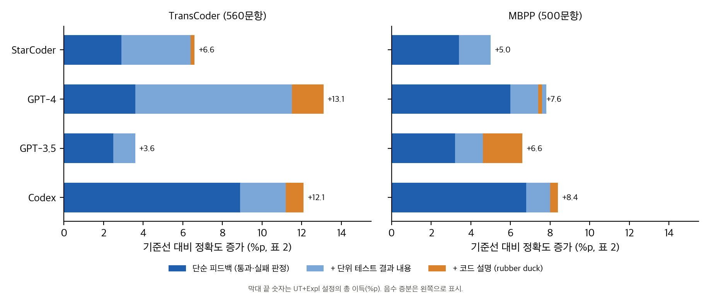

# 03. 분석과 재계산

논문: Chen et al., *Teaching Large Language Models to Self-Debug* (arXiv:2304.05128 v2, ICLR 2024)
검증 모드. 논문의 코드와 문항별 결과가 공개되어 있지 않아, 공개 표·그림 값(표 1–5, 그림 6, 8, 표 4)을 `analysis/recompute_tables.py`에 옮겨 적어 다시 계산했습니다. 결과는 `recompute_tables_results.json`에 있습니다. 모델 호출과 코드 실행은 하지 않았습니다.

## 0. 데이터와 방법

| 자료 | 출처 | 비고 |
|---|---|---|
| 정확도 표와 그림 값 | 논문 PDF에서 옮김. 그림 6(a), 8은 점 위 라벨을 읽음 | 그림 8(b)의 n=10 값은 라벨이 없어 쓰지 않음 |
| 문항 수 | Spider dev 1,034, TransCoder 560(논문 Sec 4.2), MBPP test 500(논문 Sec 4.3) | Spider와 MBPP는 HF datasets-server 크기 조회로 확인 |
| Spider 난이도별 문항 수 | easy 248, medium 446, hard 174, extra 166 | 논문에는 없음. 아래 §2에서 그림 6(b)와 표 2(a)가 서로 맞는지로 검증 |

**짝지은 문항 결과가 없으므로** 기준선(정답 a개)과 변형(정답 c개)이 같은 N문항을 푼 두 결과로 보고, 불일치쌍 n10(기준선만 맞음), n01(변형만 맞음)을 모릅니다. 확실한 것은 n01 − n10 = c − a 하나뿐입니다. n10은 0부터 min(a, N − c)까지 어느 값도 가능하므로, 정확 McNemar 검정의 p를 **가장 유의한 배치(p_min, n10 최소)**와 **가장 덜 유의한 배치(p_max, n10 최대)**로 계산합니다. p_max가 0.05보다 크면 "표만으로는 표본 오차와 구별되지 않는다"는 뜻이고, p_min이 크면 "어느 배치로도 구별되지 않는다"는 뜻입니다. 비짝 95% 구간은 Newcombe 방법입니다. 같은 표에 대한 다른 계산(Newcombe 구간)과 §4에서 값을 맞춰 보았습니다.

## 1. 격자 검사

보고된 정확도 124개(표 1(a)(b), 2, 3, 5, 그림 6, 8)가 각 벤치마크 문항 수의 정수 개수로 설명되는지 봤습니다(반올림 허용 ±0.05). **124개 모두 일치**합니다. Spider(1,034문항)는 소수 첫째 자리 하나가 문항 한두 개에 해당해 격자 검사의 변별력이 약합니다. 반면 MBPP(500)는 0.2%p 단위, TransCoder(560)는 약 0.18%p 단위라 값이 문항 수와 맞지 않으면 걸러집니다. 표 2·3에서 "같은 값"이 반복되는 것(GPT-3.5 TransCoder 89.1이 표 3의 네 행 모두에 나옴)은 변화가 정확히 0문항이라는 뜻입니다.

## 2. 그림 6(b)로 표 2(a)를 복원한 검산

그림 6(b)의 난이도별 정확도에 난이도별 문항 수(248/446/174/166)를 곱해 정답 개수를 복원하면 다음과 같습니다. 각 값은 정수 하나로 유일하게 정해집니다.

| 난이도 | N | 기준선 정답 | Self-Debug 정답 | 증가(문항) |
|---|---|---|---|---|
| easy | 248 | 225 (90.7) | 229 (92.3) | +4 |
| medium | 446 | 377 (84.5) | 380 (85.2) | +3 |
| hard | 174 | 133 (76.4) | 140 (80.5) | +7 |
| extra hard | 166 | 106 (63.9) | 121 (72.9) | +15 |
| 합 | 1,034 | **841 (81.33)** | **870 (84.14)** | **+29** |

합이 표 2(a) Codex의 Baseline 81.3과 +Expl 84.1로 정확히 맞습니다. 이 검산의 부수 결과 세 가지가 있습니다.

- 난이도별 문항 수와 그림 6(b)가 서로 일관됩니다(난이도별 문항 수는 논문에 없어 외부 지식으로 넣은 값이고, 합이 맞는 것이 간접 확인입니다).
- 표 2(a)와 표 1(a)의 Codex 열(81.3, 84.1)은 **그림 6(a)의 32개 샘플 값**과 같습니다(기준선 81.3, Self-Debug 84.1). 즉 표 2(a)의 Codex Baseline은 greedy가 아니라 32샘플 실행 다수결입니다. 같은 표의 GPT-3.5 기준선 71.1은 부록 A가 "greedy, few-shot"이라고 밝히는 값입니다(GPT-4와 StarCoder 열의 샘플 수는 서술이 없어 greedy로 보일 뿐 확인하지 못했습니다). **표 2(a)의 Codex 열과 GPT-3.5 열은 샘플 수가 다릅니다.** 표 캡션에는 이 사실이 없습니다.
- 증가 29문항의 절반(+15)이 extra hard 166문항에서 나옵니다. extra hard 63.9 → 72.9의 +9.0%p는 15문항 순증가입니다. 이 한 칸의 짝지은 가능 범위는 p_min = 6.1e-5(n10=0), p_max = 0.17(n10=45)입니다. 기준선 Wilson 95%는 [56.3, 70.8]이고 Self-Debug는 [65.7, 79.1]로 겹칩니다. "가장 어려운 문제에서 9%p"는 표만으로는 확정되지 않습니다.

## 3. 이득의 분해: 판정, 실행 결과, 설명

표 2는 같은 모델에서 피드백을 하나씩 늘려 가며 정확도를 보여 줍니다. 증분을 단계별로 쓰면 이득이 어디서 오는지 보입니다(`own_gain_decomposition.png`).

| 벤치마크 / 모델 | 기준선 | → 단순(통과·실패 판정) | → UT(실행 결과 내용) | → UT+Expl(설명) | 총 이득 | 단순이 차지하는 몫 |
|---|---|---|---|---|---|---|
| TransCoder Codex | 80.4 | +8.9 | +2.3 | +0.9 | +12.1 | 74% |
| TransCoder GPT-3.5 | 89.1 | +2.5 | +1.1 | 0.0 | +3.6 | 69% |
| TransCoder GPT-4 | 77.3 | +3.6 | +7.9 | +1.6 | +13.1 | 28% |
| TransCoder StarCoder | 70.0 | +2.9 | +3.5 | +0.2 | +6.6 | 44% |
| MBPP Codex | 61.4 | +6.8 | +1.2 | +0.4 | +8.4 | 81% |
| MBPP GPT-3.5 | 67.6 | +3.2 | +1.4 | +2.0 | +6.6 | 48% |
| MBPP GPT-4 | 72.8 | +6.0 | +1.8 | −0.2 | +7.6 | 79% |
| MBPP StarCoder | 47.2 | +3.4 | +1.6 | 0.0 | +5.0 | 68% |

해석과 한계:

1. **코드 설명(논문의 간판인 rubber duck)이 실행 결과 위에 더하는 몫은 −0.2 ~ +2.0%p입니다.** 8개 셀 중 가장 큰 것은 MBPP GPT-3.5의 +2.0(10문항 순증가)이고, UT → UT+Expl의 가능 범위는 p_min 0.002, p_max 0.58입니다. 나머지 7개 셀은 p_max가 0.46–1이라 표만으로는 0과 구별되지 않고, TransCoder GPT-4의 +1.6만 p_min 0.004입니다. 설명의 이득이 확실한 곳은 **실행 결과가 없는 Spider의 Codex(+2.8%p, 29문항)**뿐인데 이것도 p_max 0.14입니다(§5).
2. **"단순 피드백"은 모델이 통과·실패 여부만 듣는 재시도입니다.** TransCoder와 MBPP에서 단순 피드백은 단위 테스트를 실행해 판정합니다(논문 Sec 5.1: "simple feedback also utilizes the execution result to infer the code correctness"). 이 한 단계가 이득의 28–81%를 차지합니다. Codex에서는 TransCoder +8.9, MBPP +6.8로 총이득의 대부분입니다. 반면 GPT-4 TransCoder는 단순 +3.6, 실행 결과 내용이 +7.9로 내용이 더 큽니다.
3. **TransCoder의 "단위 테스트 통과가 종료 조건"** 때문에 정답을 오답으로 바꾸는 일이 구조적으로 없습니다(Sec 4.2: 통과하지 못한 경우에만 디버깅을 적용). 그래서 TransCoder 실행 포함 설정의 기준선 대비 이득은 n10 = 0이 맞고, 이때 p는 p_min입니다(Codex +68문항 p = 6.8e-21, GPT-3.5 +20문항 p = 1.9e-06, GPT-4 +73문항 p = 2.1e-22, StarCoder +37문항 p = 1.5e-11). 이득은 확실하지만 이는 "채점 테스트를 루프에 넣었기 때문"입니다. 변형 사이(UT 대 UT+Expl)의 차이에는 이 보장이 없습니다.
4. MBPP는 숨은 테스트가 있어 정답을 깨뜨리는 경우가 가능합니다(Appendix G.5: 통과한 뒤에도 "맞나요? 아니면 고치세요" 한 번을 더 줌). n10을 알 수 없으므로 p_max로 봐야 합니다. MBPP의 총이득 가운데 Codex(+9.4, p_max 0.012)와 GPT-4(+7.8, p_max 0.013)는 가장 불리한 배치에서도 구별됩니다. GPT-3.5(+6.6, p_max 0.060)와 StarCoder(+6.0, p_max 0.19)는 구별되지 않습니다.

**교차 모델 디버깅(표 5).** TransCoder에서 Codex가 GPT-3.5가 쓴 코드를 디버깅하면 UT+Expl 92.7로, GPT-3.5 자신이 디버깅한 92.7과 같습니다. 또 Codex의 80.4와 GPT-3.5의 89.1에서 시작해도 최종값은 92.5와 92.7로 모입니다(미해결 문제 42개와 41개). GPT-4(77.3 → 90.4)도 54개가 남아 비슷한 수준입니다. 이득이 "자기" 코드를 고치는 능력이 아니라 **실행 결과를 주는 반복 재시도**에서 오고, 모델 사이에 공통으로 남는 약 41–54문항이 있다는 뜻입니다(같은 문항인지, 테스트 자체 문제인지는 확인하지 못했습니다). Spider에서는 GPT-3.5가 Codex의 초기 예측을 설명으로 디버깅해 83.0(+1.7 = 17문항)으로, Codex 자신의 84.1보다 낮습니다.

## 4. 표본 오차: Wilson과 이득의 구간

| 값 | 문항 수 | Wilson 95% | 구간 폭 |
|---|---|---|---|
| Spider 81.3 (841) | 1,034 | [78.8, 83.6] | 4.8%p |
| Spider 84.1 (870) | 1,034 | [81.8, 86.2] | 4.4%p |
| TransCoder 80.4 (450) | 560 | [76.9, 83.4] | 6.5%p |
| TransCoder 92.5 (518) | 560 | [90.0, 94.4] | 4.4%p |
| MBPP 61.4 (307) | 500 | [57.1, 65.6] | 8.5%p |
| MBPP 70.8 (354) | 500 | [66.7, 74.6] | 7.9%p |

최소 검출 차이(양측 α = 0.05, 검정력 0.8, 정규 근사 z = 2.80). 같은 문항을 푼 두 변형을 짝지어 검정할 때는 불일치쌍 비율에 달려 있습니다.

| 벤치마크 | 비짝 | 불일치 3% | 6% | 12% | 20% |
|---|---|---|---|---|---|
| Spider (1,034, 정확도 약 80%) | 4.9%p | 1.5 | 2.1 | 3.0 | 3.9 |
| TransCoder (560, 약 85%) | 6.0%p | 2.0 | 2.9 | 4.1 | 5.3 |
| MBPP (500, 약 65%) | 8.4%p | 2.2 | 3.1 | 4.3 | 5.6 |

**핵심 셀의 이득 구간.** 주 결과(기준선 → 실행 포함 UT)는 대부분 비짝 구간이 0을 벗어납니다(다른 계산과 같은 값이 나옴: MBPP Codex +8.0 [2.1, 13.8], MBPP GPT-4 +7.8 [2.6, 13.0], TransCoder Codex +11.2 [7.2, 15.3]. MBPP GPT-3.5 +4.6 [−1.1, 10.2]는 0을 포함하고 TransCoder GPT-3.5 +3.6 [0.2, 7.0]은 경계). 실행을 뺀 설정(표 3)은 6개 셀 중 6개가 비짝 구간이 0을 포함합니다.

| 설정 | 이득 | 순증가(문항) | 비짝 95% | p_min | p_max |
|---|---|---|---|---|---|
| 표 3 MBPP Codex Simple (실행 없음) | **−3.8** | −19 | [−9.8, 2.3] | 3.8e-06 | 0.37 |
| 표 3 MBPP Codex Trace | +4.8 | +24 | [−1.2, 10.7] | 1.2e-07 | 0.23 |
| 표 3 MBPP GPT-4 Trace | +3.6 | +18 | [−1.8, 9.0] | 7.6e-06 | 0.29 |
| 표 3 TransCoder Codex Trace | +3.6 | +20 | [−0.9, 8.1] | 1.9e-06 | 0.18 |
| 표 3 TransCoder GPT-3.5 (4개 행) | 0.0 | 0 | [−3.7, 3.7] | 1 | 1 |
| 표 3 TransCoder GPT-4 Trace | +1.1 | +6 | [−3.8, 5.9] | 0.031 | 0.75 |

두 가지가 눈에 띕니다. (1) **MBPP Codex에서 실행 없는 Simple 피드백은 기준선보다 3.8%p 낮습니다(61.4 → 57.6).** 논문은 이 하락을 언급하지 않습니다(Sec 5.2.2는 "up to 5%" 개선만 서술). 순감소 19문항이므로 최소 19문항에서 정답이 오답으로 바뀌었습니다. 부호가 음수이면 n10 ≥ 19이므로 p_min은 3.8e-06이지만 n10이 크면 p_max는 0.37이라 통계적 하락 여부는 정할 수 없습니다. (2) "Trace가 Simple보다 일관되게 낫다"(논문 Sec 5.2.2)는 Codex에서 TransCoder +0.5, MBPP +8.6, GPT-4에서 +0.2, +0.4, GPT-3.5에서 0.0, +1.0으로 모두 같은 방향이지만 TransCoder·MBPP GPT-4/GPT-3.5의 차이는 1문항–5문항 수준입니다.

## 5. Spider: 실행 정보 없이 설명만으로 오르는가

| 모델 | 기준선 | Simple | +Expl | 이득 | 순증가 | 비짝 95% | p_min | p_max |
|---|---|---|---|---|---|---|---|---|
| Codex (32샘플 기준) | 81.3 | 81.3 | 84.1 | +2.8 | +29 | [−0.5, 6.1] | 3.7e-09 | 0.14 |
| GPT-3.5 | 71.1 | 72.2 | 72.2 | +1.1 | +12 | [−2.7, 5.0] | 4.9e-04 | 0.65 |
| GPT-4 | 73.2 | 73.4 | 73.6 | +0.4 | +4 | [−3.4, 4.2] | 0.12 | 0.90 |
| StarCoder | 64.7 | 64.9 | 64.9 | +0.2 | +2 | [−3.9, 4.3] | 0.50 | 0.97 |

순증가 문항 수는 소수점 한 자리 값을 문항으로 되돌린 것이라 ±1문항 어긋날 수 있습니다(소수점 하나가 1.03문항). 논문 초록의 "코드 설명이 기준선을 일관되게 2–3% 올린다"는 Codex에 한해서입니다. 그림 6(a)의 샘플 수별 이득은 +3.3, +3.8, +2.2, +2.8이라 두 값이 3%p를 넘습니다(`04` C3). Spider의 Codex +2.8%p는 비짝 구간이 0을 약간 포함하고, 불일치쌍 비율이 12% 이상이면 검출 가능성이 3.0%p 근처라 이 이득은 경계에 있습니다. 모델이 바뀌면 이득이 +0.2 ~ +1.1로 줄어듭니다. 가장 약한 모델의 이득이 가장 작은 것은 논문의 설명(Sec 5.1: GPT-4와 GPT-3.5는 Spider를 few-shot으로 푸는 데 최적화되어 있지 않다)과 별개로, 설명 피드백의 효과가 모델의 판별 능력에 달려 있음을 시사합니다(이 표만으로는 원인을 가르지 못합니다).

## 6. 표본 효율과 예산

논문의 표본 효율 주장(Sec 5.2.1, Abstract "more than 10×")을 세 벤치마크에서 점검했습니다.

| 비교 | 기준선(샘플 수) | Self-Debug | 차이 | 비고 |
|---|---|---|---|---|
| Spider, 그림 6(a) | n=16: 80.7 | n=1 + 디버깅: 80.8 | +0.1 (**1문항**) | 16배. 주장은 이 지점에서 성립 |
| Spider | n=32: 81.3 | n=8 + 디버깅: 82.5 | +1.2 (12문항) | p_max 0.57 |
| TransCoder, 그림 8 | n=5: 90.9, n=25: 96.3 | greedy + UT+Expl 3턴: 92.5 | n=5 대비 +1.6, n=25 대비 **−3.8** | 25개 샘플이 Self-Debug를 앞섬. 이 구간은 p_max 0.011로 구별됨 |
| MBPP, 표 1(b) | n=10: 72.2 | greedy + UT+Expl: 69.8 (Table 2c) | **−2.4** | 같은 greedy 기준선 61.4에서는 +8.4. n=10 위에 디버깅을 얹으면 75.6 (+3.4, 17문항) |
| MBPP, 선행 수치 | LEVER n=100: 68.9 | n=10 + UT+Expl: 75.6 | +6.7 | 이 논문 자신의 n=10 기준선(72.2)이 이미 LEVER(n=100)보다 3.3 높음 |

정리:

1. "10배 이상 샘플" 주장은 **Spider에서만** 직접 성립하고, 그 지점의 차이는 1문항입니다. TransCoder는 논문 본문도 "5샘플보다 낫고 10샘플에 가깝다"고만 씁니다(Appendix C.1). 실제로 25샘플 기준선(96.3, Codex+설명 98.0)이 Self-Debug greedy(92.5)보다 높습니다. MBPP에서는 greedy Self-Debug(69.8 ~ 70.8)가 10샘플 기준선(72.2)에 못 미칩니다.
2. **예산을 호출 수나 토큰으로 맞춘 비교가 없습니다.** Self-Debug 한 턴은 설명 호출, 피드백 호출, 재생성 호출을 포함하고 Spider 프롬프트에는 데이터베이스 스키마와 5–6개 예시가 길게 붙습니다(부록 E). 샘플 수 하나와 디버깅 턴 하나는 같은 비용이 아닙니다. 이 한계는 Self-Repair 논문(Olausson et al.)이 둔 "같은 토큰 예산의 i.i.d. 추출" 기준선이 여기에는 없다는 점과 같습니다.
3. MBPP의 "선행 연구 대비 이득"(Table 1(b))은 서로 다른 논문의 수치입니다. 같은 Codex라도 이 논문의 기준선 파이프라인(문제에 있는 단위 테스트로 필터 후 실행 다수결)은 LEVER 논문의 파이프라인보다 강합니다. 이득의 일부는 기준선 구현 차이입니다.

## 7. 오류 유형 표(표 4)의 분모

표 4의 백분율이 만들어지는 분모를 역산했습니다.

- Spider(a): 25.7, 17.1, 14.3, 11.4, 8.6, 5.8, 5.7, 5.7, 5.7. 분모 **35**(9, 6, 5, 4, 3, 2, 2, 2, 2건)에서 정확히 나옵니다. 단 "집계 함수·키워드 오류"는 2/35 = 5.71%인데 5.8로 적혀 있습니다(합계를 100.0으로 맞춘 반올림 조정으로 보이며, 원문 합계는 100.0). 표 안의 최소 분모는 35입니다.
- TransCoder(b): 61.9와 38.1은 분모 21(13건 대 8건)이나 그 배수입니다.
- MBPP(b): 69.2와 30.8은 분모 13(9건 대 4건)이나 그 배수입니다.

즉 오류 유형 분석은 고쳐진 사례 35개, 21개, 13개(또는 그 배수)에서 낸 비율입니다. 본문 Sec 5.2.3의 "60–70%의 성공 사례가 출력 불일치를 고친다"와 "TransCoder에서 30% 이상이 언어 간 구현 차이"는 이 작은 표본의 비율입니다. 논문은 표본 크기를 쓰지 않습니다.

## 8. 요약

| # | 점검 | 결과 |
|---|---|---|
| V1 | 정확도 124개 격자 | 전부 일치 |
| V2 | 그림 6(b) → 표 2(a) 복원 | 841과 870으로 정확히 일치. 난이도별 이득 +4/+3/+7/+15 |
| V3 | 표 2(a) Codex 열 | 32샘플 기준선(그림 6(a)와 일치). GPT-3.5 열은 greedy(부록 A). 캡션에 없음 |
| V4 | 이득 분해 | 단순(통과·실패 판정)이 총이득의 28–81%. 설명의 몫 −0.2 ~ +2.0 |
| V5 | TransCoder 실행 포함 이득 | 구조적으로 회귀 없음, p는 p_min. 단 채점 테스트가 루프 안 |
| V6 | 표 3 실행 없음 | 6개 셀 모두 비짝 구간이 0 포함. MBPP Codex Simple −3.8 미언급 |
| V7 | Spider +Expl | Codex +2.8(p_max 0.14), 나머지 모델 +0.2 ~ +1.1 |
| V8 | 표본 효율 | Spider 16배는 1문항 차. TransCoder, MBPP는 10배 주장 불성립 |
| V9 | 표 4 분모 | 35 / 21 / 13건. Spider 5.8은 5.7이어야 함 |
| V10 | 초록의 "최대 12%p" | 표 2에서 GPT-4 TransCoder가 +13.1 (77.3 → 90.4). 초록이 보수적 |
