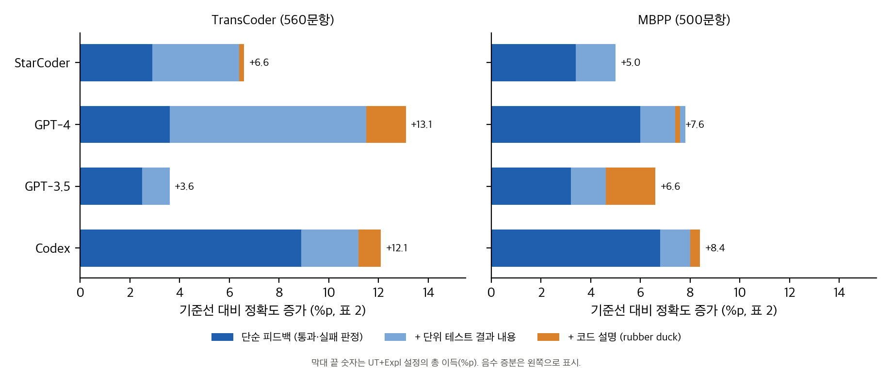

# Self-Debug의 이득은 어디서 오나: 숫자로 다시 본 Chen et al.

Chen et al. (ICLR 2024)은 LLM이 자기 코드를 실행하고 줄 단위로 설명하면서 고치게 하면(rubber duck debugging) 학습 없이 코드 생성 정확도를 올릴 수 있다고 보였습니다. TransCoder(C++ → Python)와 MBPP에서 greedy 기준선을 최대 12%p 이상, Spider(text-to-SQL)에서 2–3%p 올렸다는 결과입니다. 이 글은 논문의 공개 표와 그림 값으로 그 수치를 다시 계산하고, 이득이 어느 단계에서 오는지 나눠 본 결과입니다. 논문의 공식 코드와 문항별 결과는 공개되어 있지 않아 문항 단위 재계산은 하지 못했고, 불일치쌍을 모르는 상태에서 가능한 통계 범위로 판단했습니다.

## 무엇을 확인했나

- **내부 일관성.** 표와 그림의 정확도 124개가 모두 문항 수(Spider 1,034 / TransCoder 560 / MBPP 500)의 정수 개수와 맞습니다. 그림 6(b)의 난이도별 정확도에 난이도별 문항 수를 곱하면 정답이 841에서 870으로 늘어난 것(+29문항)이 되고, 표 2(a)의 81.3과 84.1에 정확히 맞습니다.
- **표 2(a)의 Codex 열은 greedy가 아닙니다.** 81.3과 84.1은 그림 6(a)의 32샘플 값과 같습니다. 같은 표의 GPT-3.5 열(71.1)은 부록 A가 greedy라고 밝히는 값이라, 열마다 기준선의 샘플 수가 다릅니다. 캡션에는 이 사실이 없습니다.

## 이득은 판정, 실행 결과, 설명 중 어디서 오나

표 2는 같은 모델에서 피드백을 하나씩 늘려 가며 보여 줍니다. 단계별 증분으로 쓰면 아래와 같습니다.

- 통과·실패만 알려 주는 단순 피드백이 총이득의 28–81%를 차지합니다. Codex TransCoder는 총 +12.1%p 중 +8.9%p가 여기서 나옵니다.
- 실행 결과 위에 코드 설명(논문의 간판)이 더하는 몫은 −0.2 ~ +2.0%p입니다. 가장 큰 MBPP GPT-3.5의 +2.0%p는 10문항 순증가이고, 다른 7개 셀은 불일치쌍을 가장 불리하게 배치하면 표본 오차와 구별되지 않습니다.
- TransCoder는 문제 설명에 단위 테스트 10개가 모두 들어 있고 같은 10개로 채점합니다. 통과하면 멈추므로 정답을 깨뜨리는 일이 구조상 없고, 이득은 모두 유의하지만 "채점 테스트를 루프에 넣은 재시도"의 이득입니다. MBPP는 3개 중 첫 번째만 보여 주고 나머지 2개로 채점하므로 더 정직한 설정입니다.
- 모델이 바뀌어도 최종값이 모입니다. Codex(80.4에서 시작)와 GPT-3.5(89.1에서 시작)가 TransCoder에서 92.5와 92.7로 끝납니다. Codex가 GPT-3.5의 코드를 디버깅해도 92.7입니다.

## Spider: 실행 신호 없이 설명만으로 오르는가

Codex는 81.3에서 84.1(+2.8%p, 29문항)로 오릅니다. 그러나 이 이득은 가장 불리한 배치에서 p = 0.14이고, 다른 세 모델(GPT-3.5, GPT-4, StarCoder)은 +0.2 ~ +1.1%p로 사실상 구별되지 않습니다. 가장 어려운 문제(extra hard)에서의 +9.0%p는 166문항 중 15문항 순증가입니다. 초록의 "2–3%p"는 그림 6(a)에서 +3.3, +3.8, +2.2, +2.8이라 정확히는 2–4%p입니다.

## 실행 없이도 좋아지는가 (표 3)

실행 없는 설정 6개 셀(TransCoder 3, MBPP 3)은 모두 비짝 95% 구간이 0을 포함합니다. 눈에 띄는 것은 MBPP Codex의 단순 피드백이 61.4에서 57.6으로 **3.8%p 떨어진다**는 점입니다(순감소 19문항). 논문은 이 하락을 언급하지 않습니다. 모델이 맞는 코드를 스스로 "틀렸다"고 판단해 바꾸는 것으로 보이며, 정오 판별이 병목이라는 다른 자기 수정 연구의 결과와 같은 방향입니다.

## 표본 효율: 10배는 Spider에서만

| 비교 | 기준선 | Self-Debug | 차이 |
|---|---|---|---|
| Spider, 샘플 16개 대 SD 1개 | 80.7 | 80.8 | +0.1 (1문항) |
| TransCoder, 샘플 25개 대 SD greedy | 96.3 | 92.5 | −3.8 |
| MBPP, 샘플 10개 대 SD greedy | 72.2 | 69.8 | −2.4 |

호출 수나 토큰 수를 맞춘 비교도 없습니다. 디버깅 한 턴은 설명, 피드백, 재생성 호출을 포함하고 Spider 프롬프트에는 스키마가 길게 붙습니다.

## 독립 재구현과 이후 문헌

LDB(arXiv:2402.16906)가 공개 코드가 없어 Self-Debug를 논문 지침대로 다시 구현했습니다. GPT-3.5로 TransCoder +3.6, MBPP +6.8을 얻어 실행 포함 이득은 재현되지만, StarCoder에서는 HumanEval에서 이득이 없고(−0.6, 0.0), 시드 프로그램이 강하면(GPT-4 87.2) 이득이 +1.2로 줄었습니다. 자기 생성 테스트로 디버깅하면 테스트 편향으로 쉬운 문제에서 어렵다는 후속 연구(arXiv:2501.12793, ACL 2025)도 있고, 최근 흐름은 프롬프트에서 실행 피드백 학습(RL)으로 옮겨 갑니다(초록 수준으로만 읽음).

## 인용할 때 주의

- "실행 결과를 넣은 반복 수정이 greedy 기준선을 올린다"는 인용해도 됩니다. 단 TransCoder의 이득은 채점 테스트가 루프에 있는 설정입니다.
- "rubber duck이 오류를 찾는다"는 Spider의 Codex에 한정되고 구별 경계에 있습니다. "표본 효율 10배"는 Spider에서만 성립합니다.
- "실행 없이도 모든 모델이 향상"은 인용하지 않는 편이 안전합니다. 시드, 분산, 모델 스냅샷, 비용이 보고되지 않았습니다.

## 재현

입력은 논문 표와 그림 값을 옮긴 것뿐이라 `analysis/recompute_tables.py` 하나로 다시 계산됩니다. 원문과 그림은 arXiv:2304.05128(CC BY 4.0)에서 받을 수 있습니다.

## 자료

- [통합 리포트 PDF](report/report_public.pdf)
- [01. 논문 분석: Teaching Large Language Models to Self-Debug](analysis/01_paper_analysis.md)
- [02. 계보와 관련 연구](analysis/02_prior_work.md)
- [03. 분석과 재계산](analysis/03_analysis.md)
- [04. 주장 검증 (공식 코드 없음)](analysis/04_claim_verification.md)
