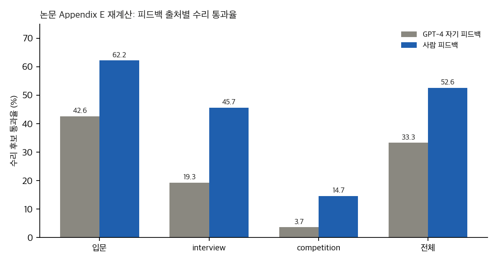
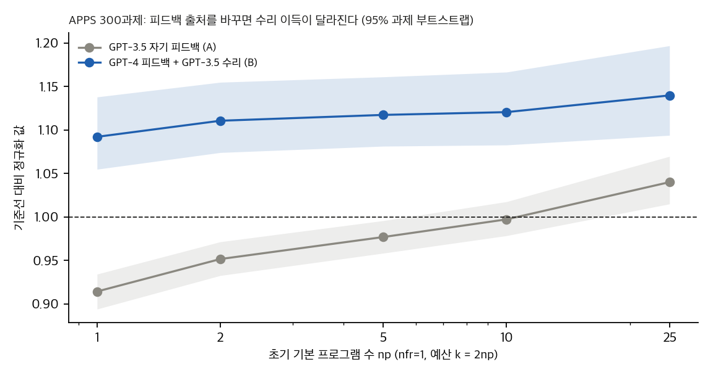

# 코드 자기 수리는 은탄환인가

*Is Self-Repair a Silver Bullet for Code Generation?* (Olausson et al., ICLR 2024)은 LLM이 자기 코드를 고치는 방식의 효과를 따졌습니다. 질문은 단순합니다. 같은 샘플 예산을 쓴다면, 고쳐 쓰는 것이 그냥 여러 번 뽑는 것보다 나은가.

## 무엇을 비교했나

모델은 코드를 쓰고, 테스트를 돌리고, 오류를 설명(피드백)하고, 그 설명으로 코드를 고칩니다. 예산은 모델 호출 수로 셉니다. 기준선은 같은 예산의 i.i.d. 샘플링입니다. 실험은 CodeLlama-13b, GPT-3.5, GPT-4에서 HumanEval과 APPS 300과제로 했습니다.

## 저자 결과와 우리 검산

| 주장 | 저자 보고 | 우리 검산 |
|---|---|---|
| 같은 예산에서 자기 수리 이득은 작거나 없다 | GPT-4 APPS 최대 8% | 히트맵 14개 셀 재현. np=10, nfr=1의 1.05배는 과제 단위 95% 구간 [1.02, 1.08] |
| 피드백 품질이 병목이다 | 강한 모델의 피드백으로 바꾸면 이득이 커짐 | 같은 수리 모델에서 피드백만 바꾼 차이의 과제 단위 구간이 모든 예산에서 0 위 |
| 사람 피드백은 수리 통과율을 올린다 | 33.3% → 52.6% (1.58배) | 재현. 다만 과제 20개라 구간이 1.24–2.33으로 넓음 |

## 읽을 때 기억할 점

- 피드백 출처를 바꾸면 이득이 달라집니다. 이것은 가장 깨끗한 근거입니다.
- 논문 오차막대는 과제 표본의 불확실성을 빼고 있습니다. 과제 수가 적은 비교일수록 과제 단위 구간을 같이 봐야 합니다.
- 정성 분석(GPT-4 피드백의 부정확 비율 등)은 라벨이 공개되지 않아 검산하지 못했습니다.
- 공식 저장소는 APPS 실행 하네스를 공개하지 않았습니다. 결과 원자료는 공개되어 있어서 이번 검산은 원자료로 했습니다.

## 재계산 방법

저자 Monte Carlo 대신 같은 식을 닫힌 형태로 풀었습니다. 기준선 pass@1 값이 저자 결과와 0.0001 안에서 맞고, 히트맵은 두 자리까지 맞습니다. 스크립트와 결과는 이 글과 같은 저장소에 있습니다.

## 자료

- [통합 리포트 PDF](report/report_public.pdf)
- [01. 논문 분석](analysis/01_paper_analysis.md)
- [02. 계보와 관련 자료](analysis/02_prior_work.md)
- [03. 분석과 재계산](analysis/03_analysis.md)
- [04. 논문과 공식 코드 대조](analysis/04_code_verification.md)
