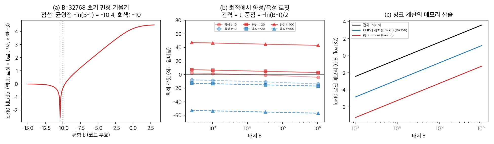
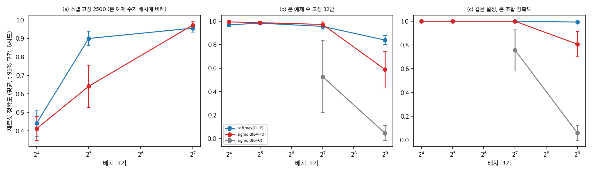

# SigLIP의 sigmoid 손실을 직접 짜 보면

Zhai et al.의 *Sigmoid Loss for Language Image Pre-Training*(Google DeepMind, ICCV 2023)은 CLIP의 두 방향 softmax 대신 **이미지-텍스트 쌍마다 독립인 이진 분류(sigmoid)** 손실을 쓰고, 학습되는 온도 t와 편향 b를 둡니다. 전역 정규화가 없어 장치 간 청크 계산이 쉽고, 작은 배치에서 낫고 큰 배치에서는 비슷하며 32k 근처에서 포화한다고 보고합니다. 이 글은 그 주장을 식으로 검산하고, 작은 구현과 합성 데이터로 성질을 보고, 공식 코드와 대조합니다. 논문의 TPU 실험은 재현하지 않았고 토이는 이해용입니다.

## 편향 b = −10은 왜 안정적인가

초기에 임베딩이 거의 직교면 모든 로짓이 ≈ b이고 행 하나의 편향 기울기는 −σ(−b) + (B−1)σ(b)입니다. b = 0이면 음성 B−1개가 양성 하나를 압도해 B = 32,768에서 초기 손실이 2.3e4, 기울기가 +16,383입니다. b = −10이면 초기 손실 11.5, 기울기 +0.49입니다. 균형점은 b* = −ln(B−1) = −10.4라서 −10은 "양성이 전체 쌍의 1/B"라는 사전확률을 로짓으로 옮긴 값에 가깝습니다. 논문은 이 유도를 적지 않고 "prior에서 시작"이라고만 합니다. 직교 임베딩에서 최적 로짓은 양성 ≈ t/2 − ½ln(B−1), 음성 ≈ −t/2 − ½ln(B−1)로 **간격이 t**이고 음성이 많을수록 둘이 함께 내려갑니다. t = 10, B = 32,768에서는 최적에서도 양성 로짓이 −0.78이라, 공개 체크포인트에서 t가 118까지 자란 이유와 맞습니다.

## 식과 알고리즘의 b 부호가 반대입니다

§3.2의 식은 σ(z(−t x·y + b)) 꼴이라 로짓이 t x·y − b이고, 알고리즘 1과 공식 코드는 t x·y + b입니다. 식을 그대로 구현하면 b = −10에서 초기 손실이 630.7로, 알고리즘 1의 9.5보다 큽니다(무작위 64쌍, d = 512). v1의 의사 코드는 코사인 부호까지 반대여서(정렬 쌍이 벌을 받음) v2에서 고쳤지만 식의 b 부호는 v4에도 남아 있습니다.

## 청크 계산과 메모리

장치 D개로 나눈 청크 계산(이미지 청크 고정, 텍스트 청크 회전)의 합은 전체 행렬 계산과 값·기울기가 1e-12 이내로 일치합니다(D = 1, 2, 4, pytest). 한 번에 만드는 블록은 (B/D)²입니다. 다만 (1) 일반 autograd에서는 블록 로짓이 역전파까지 저장되어 합이 전체 행렬과 같고, 블록마다 재계산(체크포인트)해야 b² 메모리가 됩니다. (2) **공식 big_vision 트레이너는 청크를 구현하지 않고** 머리에 "TODO: implement chunked version with shard_map"이 있습니다. OpenCLIP이 `dist_impl`(bidir, shift, reduce, gather)과 `chunk_size`로 구현합니다. (3) softmax도 타일 계산으로 배치 수백만을 정확히 학습한 연구(Inf-CLIP, 초록 수준)가 있어 메모리는 sigmoid만의 이점이 아닙니다.

## 합성 도형 토이

색 8 x 모양 8 도형 장면과 단어 열(21만 파라미터)로 같은 모델·옵티마이저에서 두 손실을 비교했습니다(6시드, t 95% 구간, 짝지은 차이). **본 예제 수를 맞춘 설정**(32만 예제)과 스텝 고정 설정을 모두 돌려 "배치를 줄이면 본 이미지도 준다"는 교란을 분리했습니다.

- 본 예제 수 고정, 배치 16(2만 스텝): sigmoid 99.4% 대 softmax 96.9%, 차이 +2.5점 [+0.7, +4.2](6/6, p = 0.016). 배치 32는 차이 없음(+0.4), 배치 128은 +1.7 [−0.2, +3.5].
- **스텝이 모자라면 sigmoid가 크게 뒤집니다.** 스텝 2500 고정 배치 32: −25.9점, 예제 고정 배치 512(625스텝): −25.1점. t와 b가 학습률 제약으로 초기값 근처에서 못 벗어나기 때문으로 보이며 논문의 대규모 설정과 다른 영역입니다.
- b = 0 초기화는 배치 128에서 −44.5점, 512에서 −54.2점으로 논문 표 4와 같은 방향입니다(토이에서 과장).
- 학습 후 sigmoid의 양성 로짓은 평균 +0.7~+2.3(스텝이 모자란 배치 512만 −1.5), 음성은 −10~−12로 갈립니다.

토이는 가짜 음성이 많고(64 조합) 모델이 작아서 논문 수치의 재현이나 성능 추정이 아닙니다.

## 논문 표를 다시 계산하면

- 부록 표 8·5에서 sigmoid−softmax 차이는 작은 배치에서 칸 대부분(5/5)이 양수이고 큰 배치(≥ 128k)에서는 ±0.2 안에서 갈립니다. 모든 칸이 단일 실행이고 시드 5개 반복(표 7)은 한 설정뿐이며 그 차이(0.2)가 표준편차(0.1–0.2)와 같은 규모입니다. 같은 설정의 표 5(차 0.0)와 표 7(차 0.2)이 어긋납니다.
- mSigLIP(표 9): 36개 언어 중 30개가 배치 240k에서 32k보다 낮고 평균은 34.9에서 32.7로 떨어집니다. "32k면 충분"이 아니라 "더 크면 평균이 떨어진다"가 표의 내용입니다.
- 표 3(공개 모델 비교)은 데이터와 학습량, So400m 모양이 섞여 있어 손실의 인과 효과가 아닙니다.

## 정리

인용할 때는 (1) 작은 배치(수 k 이하)에서 sigmoid가 낫다는 방향이 논문 표에서 일관되고 가장 좋은 지점의 격차는 약 0.5점이라는 점, (2) 편향 초기화의 산술, (3) 식과 코드의 b 부호 차이, (4) 메모리 이득이 손실 고유가 아니라는 점을 함께 적는 것이 안전합니다. 코드·테스트·토이 결과는 함께 올린 `analysis/`에 있습니다.

## 자료

- [최소 구현](analysis/minimal_impl.py)
- [01. 논문 분석: Sigmoid Loss for Language Image Pre-Training (SigLIP, arXiv:2303.15343)](analysis/01_paper_analysis.md)
- [02. 계보와 관련 자료: SigLIP (arXiv:2303.15343)](analysis/02_prior_work.md)
- [03. 분석: 식 유도 검산, 최소 구현, 표 재계산, 토이 (SigLIP, arXiv:2303.15343)](analysis/03_analysis.md)
- [04. 주장 검증: SigLIP (arXiv:2303.15343)](analysis/04_claim_verification.md)
