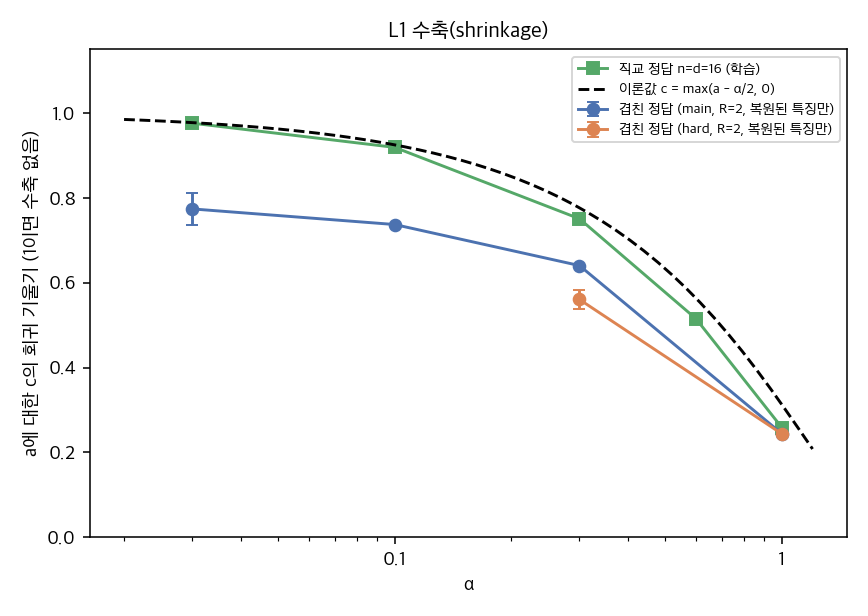
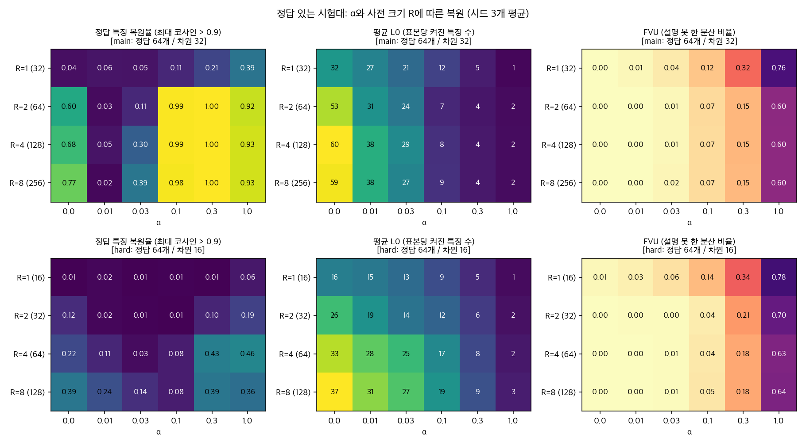
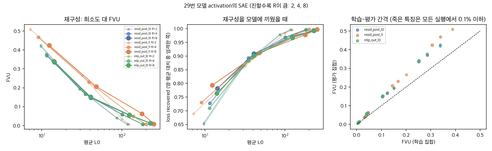
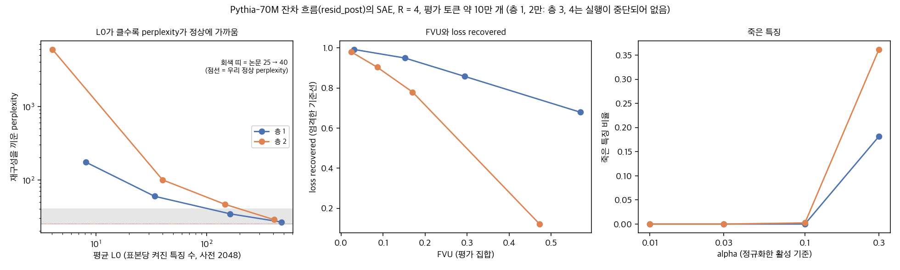
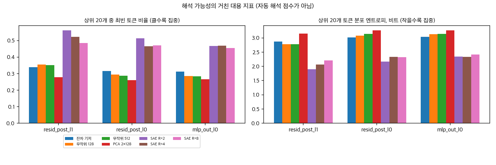

# 희소 오토인코더는 정답 특징을 찾는가

Cunningham 등의 *Sparse Autoencoders Find Highly Interpretable Features in Language Models*(ICLR 2024)는 언어모델 활성을 희소한 사전(dictionary)으로 분해하는 단층 오토인코더가 뉴런 기저보다 해석 가능한 특징을 낸다고 보입니다. 이 글은 그 방법을 PyTorch로 직접 짜서(`minimal_impl.py`, CPU, 테스트 13개) 식을 검산하고 두 곳에서 시험한 기록입니다. 하나는 **정답 특징을 아는 합성 데이터**, 다른 하나는 이 저장소의 앞선 분석(induction head)이 학습한 **2층 모델의 활성**입니다. 논문의 자동 해석 점수(GPT-4·GPT-3.5 API)와 Pythia 규모 실험은 하지 않았습니다. 논문 그림은 쓰지 않았고 아래 그래프는 모두 직접 그렸습니다. 공식 코드는 읽기만 했고 실행하지 않았습니다.

## 방법

활성 x에 대해 c = ReLU(Mx + b), x̂ = Mᵀc, 손실 ‖x − x̂‖² + α‖c‖₁이고 사전 M의 행은 단위 노름입니다(논문 식 1–4). 노름을 고정하는 이유는 (c, f) → (c/s, s f)가 재구성을 바꾸지 않고 L1만 줄이기 때문입니다. 지표는 설명 못 한 분산 비율(FVU), 평균 L0(켜진 특징 수), 죽은 특징 비율, 정답 복원율(정답 특징마다 사전과의 최대 코사인 > 0.9인 비율), 그리고 재구성을 모델 forward에 끼웠을 때의 손실 증가(loss recovered)입니다.

## L1은 켜진 특징을 α/2만큼 줄인다

정답 방향이 정규직교이고 x = Σ aᵢgᵢ이면 손실이 특징별로 분리되어 (aᵢ − cᵢ)² + α cᵢ를 최소화하는 cᵢ = max(aᵢ − α/2, 0), 곧 소프트 임계가 됩니다. ReLU 인코더가 편향 −α/2로 이것을 정확히 표현할 수 있습니다. a ~ U[0,1], 켜질 확률 p이면 평균 L0 = n p (1 − α/2), FVU ≈ 3t² − 2t³ (t = α/2), 정답 계수에 대한 학습 계수의 회귀 기울기는 닫힌 형식입니다. 그래서 FVU와 L0의 곡선에는 꺾임("무릎")이 없습니다.

n = d = 16 직교 정답에서 학습한 SAE(시드 3개)의 L0와 기울기는 α 0.03–1.0에서 이론과 0.05 이내로 맞았고(초록 사각형이 점선 위), 정답을 차원보다 많이 겹쳐 놓으면(파랑, 주황) 기울기가 이론보다 더 낮아집니다. FVU는 이론의 1.3–1.7배였는데, 학습한 사전이 정답과 코사인 0.95–0.99에서 멈춰 있기 때문으로 보입니다.

## 정답을 아는 시험대: 재구성이 좋아도 복원은 아니다

정답 특징 64개를 d차원 단위 구에 무작위로 놓고 희소 계수(밀도 0.05, 켜지면 U[0,1])로 x를 만들어 SAE를 학습했습니다. α, 사전 크기 R·d, 시드 3개를 격자로 훑었습니다. 위 줄이 정답/차원 = 2(d = 32), 아래 줄이 4(d = 16)입니다.

- **정답/차원 = 2에서 α 0.1–0.3이면 R ≥ 2에서 복원율 0.98–1.00**입니다. 이때 L0는 3.7–8.7로 정답의 켜진 수(평균 3.2)와 비슷합니다.
- **α ≤ 0.03에서는 FVU 0.002–0.02인데 복원율이 0.02–0.39**입니다. 같은 FVU 0.012에서 복원율이 0.11입니다. 재구성은 정답 복원을 보장하지 않습니다.
- **정답/차원 = 4에서는 어떤 (α, R)에서도 복원율이 최대 0.46**(±0.07)이었습니다. 같은 밀도입니다. superposition이 심하면 SAE가 못 푼다는 직접 증거입니다(원인이 인코더가 한 번의 ReLU로 lasso 해를 근사하는 한계인지 L1 최소화 자체의 한계인지는 구별하지 못했습니다).
- 밀도를 3배로 올리면 α 0.1에서는 복원이 안 되고 α 0.3에서 복원됩니다. 맞는 α는 데이터의 희소도에 따라 움직이고, FVU–L0 곡선에서는 읽을 수 없습니다.
- 사전이 정답 수보다 크면(R = 4, 8) 정답은 복원하지만 사전 원소의 절반 이상이 어떤 정답과도 닮지 않습니다(0.9 이상 닮은 원소 비율 R = 2에서 0.99, R = 4에서 0.51, R = 8에서 0.25).
- 묶은 가중치는 같은 α에서 FVU가 약간 높고(0.075 대 0.097) 복원율이 같거나 낮았습니다(시드 3개로는 작은 차이).

## 작은 언어모델의 활성에서

이 저장소의 induction head 분석이 만든 2층 트랜스포머(d = 128, MLP 512, 어휘 2,048)의 활성에 SAE를 학습했습니다(학습 97,920 벡터, 평가 32,640 벡터, 위치 0 제외, 시드 1개). 지점은 `resid_post_l0`, `resid_post_l1`, `mlp_out_l0`, 사전 크기 R ∈ {2, 4, 8}입니다.

- 활성이 **희소하게 분해되지 않습니다**: R = 4에서 FVU 0.05를 얻으려면 표본당 L0가 100–140(전체 512개 중)이어야 하고, L0 35–40에서 FVU는 0.17–0.23입니다.
- 재구성을 모델에 끼우면 FVU 0.17–0.23일 때 다음 토큰 손실이 +0.37–0.45 nats 올랐습니다(원래 2.129). 논문 §6.2의 "Pythia-70M 층 2 잔차를 재구성으로 바꾸면 perplexity 25 → 40"(+0.47 nats)과 같은 크기입니다. loss recovered는 0.88–0.89(영 대치와 평균 대치 중 엄격한 기준선), FVU 0.05–0.06에서야 0.97–0.98입니다. `resid_post_l1`에서는 평균 대치가 영 대치보다 더 나쁜 기준선이라 loss recovered가 기준선에 따라 0.894 대 0.948로 달라집니다.
- 사전 크기 R을 키워도 FVU–L0 곡선은 거의 같고(R이 커지면 같은 α에서 L0가 같이 올라감), **평가 FVU가 학습 FVU보다 30–40% 높아** 학습 벡터 9.8만 개로는 과적합이 있습니다(논문은 수백만 벡터).
- 시드 3개로 `resid_post_l1`(R = 4, α = 0.1)를 학습해 사전을 비교하면 쌍별 평균 최대 코사인은 0.76–0.77(무작위 사전 쌍은 0.27)이고, 0.9 이상으로 대응하는 원소는 34–36%뿐이었습니다. 사전 원소의 3분의 2는 다른 시드의 어떤 원소와도 0.9 미만입니다.

## Pythia-70M에서 perplexity 25 → 40

논문 §6.2는 "Pythia-70M 층 2 잔차를 재구성으로 바꾸면 Pile perplexity가 25에서 40으로 오른다"고 한 줄만 적었습니다. 층 1, 2의 잔차(`resid_post`)에 R = 4(사전 2,048) SAE를 α 네 값으로 학습해 재 보았습니다(Pile 일부 `pile-10k`, 학습 활성 153만 개, 평가 10.2만 토큰, 시드 1개, 위치 0 제외).

- 정상 perplexity는 25.4로 논문의 25와 맞습니다. 재구성을 끼우면 α = 0.03에서 34(층 1)와 46(층 2), α = 0.1에서 60과 100, α = 0.01에서 27과 29입니다. **40은 α와 L0(표본당 약 40–400개)에 따라 지나가는 값**이고 논문이 α와 층 규약을 적지 않아 정확히 재현했다고는 말할 수 없습니다. 같은 크기라는 정도입니다.
- loss recovered가 0.95와 0.90일 때도 perplexity는 34–46입니다. 영 대치의 손실이 매우 커서(perplexity 1만 이상) 분모가 커지므로, loss recovered만 적으면 재구성이 좋아 보입니다.
- α = 0.3에서는 죽은 특징이 18–36%로 늘고 층 2의 perplexity는 5,949까지 오릅니다.
- 층 3, 4와 랜덤 초기화 모델 대조는 실행이 중단되어 없습니다. 학습이 메모리를 많이 써서(관측 약 25 GB) 다시 돌리지 않았습니다.

## 해석 가능성의 거친 대용 지표와 랜덤 모델 대조

논문의 자동 해석 점수는 API가 필요해 하지 않고, 대신 **"특징이 가장 크게 켜지는 상위 20개 위치의 입력 토큰이 얼마나 한 토큰에 몰려 있나"**(최빈 토큰 비율, 토큰 엔트로피)를 재서 같은 수의 잔차 기저 방향, PCA 방향, 무작위 방향과 비교했습니다. 이것은 자동 해석 점수를 대신하지 않는 토큰 수준 단의성의 대용 지표입니다.

- 세 지점 모두 SAE 특징이 더 집중합니다: 최빈 토큰 비율 0.46–0.56 대 기저 0.31–0.34, 무작위 0.29–0.36, PCA 0.26–0.28. 논문 그림 2의 순서가 이 지표에서 재현됩니다. 가장 집중된 특징은 줄바꿈, 마침표, 따옴표, `<unk>`, `is`처럼 하나의 토큰에만 켜지고(상위 20개가 전부 같은 토큰), 가장 흩어진 특징은 상위 20개가 거의 다른 토큰입니다. 특징의 절반 정도(중앙값 0.3–0.5)는 상위 20개 중 최빈 토큰이 6–10개뿐입니다.
- 그런데 **같은 구조의 랜덤 초기화(학습 안 한) 모델**의 활성에 같은 방법으로 SAE를 학습하면 최빈 토큰 비율이 0.48로, 학습된 모델의 SAE(0.52)와 거의 같고 이 모델의 잔차 기저(0.47)와도 비슷했습니다(SAE의 동작점이 달라 같은 조건의 비교는 아니고 시드 1개). 이 지표가 높다는 것만으로 "모델이 계산에 쓰는 특징을 찾았다"고 말할 수 없다는 것으로, 랜덤 모델에서도 비슷한 점수가 나온다는 후속 연구(Heap et al.)와 같은 방향입니다.

## induction head와의 연결

반복 구절 시퀀스(자연 텍스트 64토큰을 4번 되풀이)에서, 층 1 head 출력을 뺐을 때 반복 구간 activation이 평균 55% 줄어드는 SAE 특징이 34개(반복 데이터를 학습에 섞으면 57개) 있었습니다(전체 특징 평균 23%). 반복 구간에서 선택적으로 켜지는 특징이 head 출력에 크게 의존한다는 것은 induction head가 반복을 복사한다는 앞선 결과와 같은 방향입니다. 그러나 이 특징들의 디코더 방향과 head의 평균 출력 방향의 코사인은 무작위 방향 수준(0.09 대 0.08)이었고 가장 높은 특징도 0.34–0.39였습니다. head 출력 방향과 SAE 특징 하나를 1대1로 대응시키지는 못했습니다.

## 공식 코드와의 차이

`HoagyC/sparse_coding`(LICENSE 없음, 정적으로만 읽음)은 묶은 가중치와 별도 디코더 변형을 모두 갖고 있고, 사전 정규화를 순전파 안에서 하며, 재구성 손실을 차원 수로 나눠 평균(토이 스크립트는 L1도 사전 크기로 나눔)합니다. 그래서 논문의 α = 8.6e−4가 어느 규약의 값인지 알 수 없어 우리의 α와 직접 비교하지 못합니다. 죽은 특징 재샘플링은 코드에 없습니다. loss recovered 같은 기준선 대비 비율도 코드에 없고 재구성 손실만 계산합니다.

## 인용할 때

- 이 글의 결과는 **토이**(합성 시험대 시드 3개, 29번 모델 SAE 시드 1개, 학습 벡터 9.8만 개)입니다. Pythia 규모, 자동 해석 점수, IOI 활성 패칭은 재현하지 않았습니다.
- 이후 문헌은 SAE 특징이 시드마다 다르고, 단순 기준선보다 하류 과제에서 낫지 않은 경우가 있으며, 랜덤 모델에서도 비슷한 해석 점수가 나온다고 보고했습니다. "SAE 특징 = 모델이 쓰는 참 특징"으로 읽으면 안 됩니다.
- 논문 v1에 있던 "특징 절제로 정밀한 모델 편집" 주장은 v2부터 빠졌습니다.

## 자료

- [최소 구현](analysis/minimal_impl.py)
- [01. 논문 분석: Sparse Autoencoders Find Highly Interpretable Features in Language Models (arXiv:2309.08600)](analysis/01_paper_analysis.md)
- [02. 계보와 관련 자료: Sparse Autoencoders Find Highly Interpretable Features in Language Models (arXiv:2309.08600)](analysis/02_prior_work.md)
- [03. 식 검산과 최소 구현 결과: Sparse Autoencoders (arXiv:2309.08600)](analysis/03_analysis.md)
- [04. 주장 검증과 공식 코드 대조](analysis/04_claim_verification.md)
