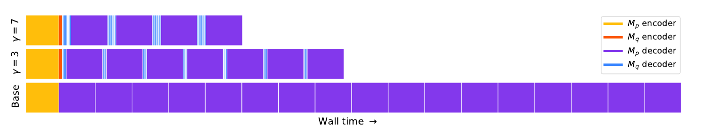
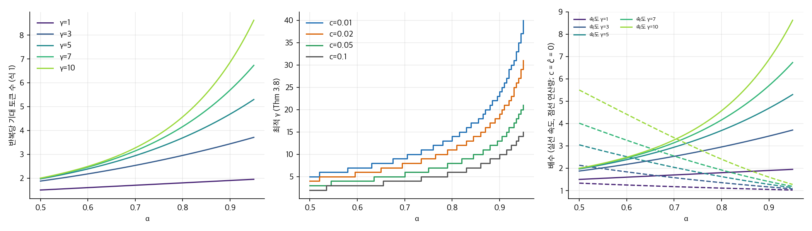
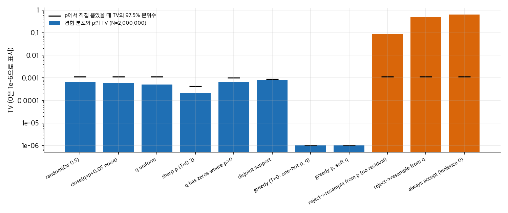
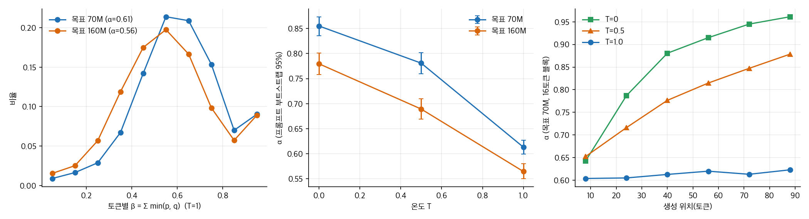
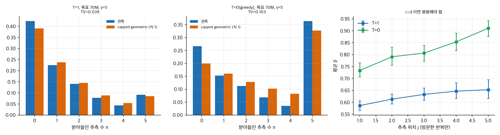
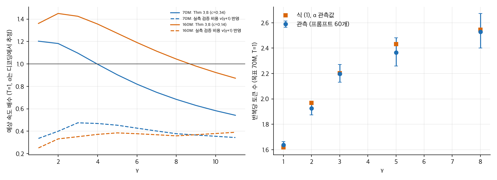

# 투기적 디코딩은 분포를 바꾸지 않는다

큰 자기회귀 모델은 토큰 K개를 만들려면 K번 순차로 돌아야 합니다. Leviathan et al.(ICML 2023, 구두)의 투기적 디코딩은 작은 초안 모델 q가 토큰 γ개를 먼저 제안하고, 큰 모델 p가 그 γ개를 **한 번의 병렬 호출**로 검증해, 출력 분포를 p 그대로 두면서 순차 호출 수를 줄입니다. 이 글은 알고리즘을 PyTorch로 직접 짜서(`minimal_impl.py`, 테스트 24개) 논문의 주장을 숫자로 확인한 기록입니다. 공식 코드는 공개되어 있지 않은 것으로 보이고, GPU·TPU 속도는 재현하지 않았습니다. 논문 그림은 Fig. 5 한 장만 썼고(arXiv CC BY 4.0, 도식), 나머지 그래프는 직접 그렸습니다.

## 알고리즘

수락 규칙은 한 줄입니다. x ~ q를 뽑아 확률 min(1, p(x)/q(x))로 받고, 거절하면 **p′ = norm(max(0, p − q))** 에서 다시 뽑습니다. 받아들여져서 x가 나올 확률은 q(x)·min(1, p/q) = min(p, q), 거절되고 x가 나올 확률은 (1 − β)p′(x) = p(x) − min(p, q)이고 합이 p(x)입니다(β = Σ min(p, q)가 정규화 상수). q가 무엇이든 성립합니다. Algorithm 1은 이것을 γ개 위치에 이어 붙여, 첫 거절 위치에서 보정 분포로 한 토큰을 뽑고 멈춥니다. 한 번의 목표 호출이 최소 1개, 최대 γ + 1개 토큰을 만듭니다.

*논문 Fig. 5(Leviathan et al., arXiv CC BY 4.0). 목표 모델 호출(보라) 앞에 초안 호출(파랑)이 γ번 붙지만 전체 호출 횟수는 줄어든다.*

## 식을 다시 유도하면

- **α = 1 − TV.** 논문의 새 발산 D_LK(p, q) = Σ|p − M|, M = (p + q)/2는 |p − M| = |p − q|/2이므로 총변동 거리 그 자체이고, 수락률 α = E[Σ min(p, q)] = 1 − E[TV]입니다.
- **식 (1).** 위치별 수락이 i.i.d. α이면 한 번 호출당 토큰 수는 1 + Σ_{j=1}^{γ} α^j = (1 − α^{γ+1})/(1 − α).
- **Thm 3.8.** 반복당 비용 T(γc + 1), 토큰 E개이므로 속도 배수 E/(γc + 1). 개선이 있을 조건은 α > c(γ = 1에서 (1 + α)/(1 + c)).
- **최적 γ.** γ에서 γ + 1로 올려 이득인 조건은 α^{γ+1}(1 + γc) > c·E(γ)로, 논문의 수치 탐색(그림 3)과 일치합니다.
- **(우리 유도) 최적성.** 어떤 무손실 방식이든 "출력이 초안 토큰과 같다"는 사건의 확률은 min(p, q)를 넘지 못하므로, 단일 초안 토큰에서 수락 확률 α는 상한이고 이 알고리즘이 그 상한에 도달합니다(maximal coupling). 논문은 이것을 적지 않았습니다.

## 분포가 정말 같은가

합성 범주형 분포(어휘 8)에서 2,000,000번 뽑아 정확한 p와 카이제곱·TV로 비교했습니다. 시나리오 8개(무작위, q가 p에 가까움, q 균등, p가 날카로움, q가 일부 0, 서로소 지지집합, greedy 두 가지)가 모두 p와 구별되지 않았고(Holm 보정 후 최소 p = 0.15), 수락률은 식의 α와 이항 표준오차 안에서 같았습니다. 같은 크기에서 **틀린 변형은 확실히 걸렸습니다**. 거절 시 p에서 다시 뽑기(residual 없음)는 TV 0.087(P(x) − p(x) = min(p, q) − αp(x)라는 식과 일치), q에서 뽑기는 0.48, 항상 수락은 0.64입니다. 그래서 위의 일치는 검정이 무뎌서가 아닙니다.

여러 토큰으로도 확인했습니다. 직전 토큰만 보는 합성 마르코프 모델 쌍(목표와 초안이 무관)에서 처음 3토큰의 결합분포(125칸, 표본 600,000)가 γ = 0, 1, 3, 5 모두 정확한 값과 구별되지 않았습니다(p = 0.55–0.91). 온도 0(one-hot)에서는 초안이 무엇이든 출력이 목표의 greedy 경로와 문자 그대로 같았습니다.

실제 모델에서도 봤습니다. 초안 Pythia-14M, 목표 Pythia-70M·160M, top-10 표준화에서 처음 2토큰의 결합분포(최대 100칸)를 목표 정방향으로 정확히 구하고, 투기적 디코딩 표본 8,000개와 목표 단독 샘플링 표본 8,000개를 각각 검정했습니다(프롬프트 4개, 검정 8개). 모두 일치(Holm 후 p = 1.0, TV가 귀무 97.5% 분위수 아래)했고 지지집합 밖 표본은 0개였습니다. T = 0에서는 5개 프롬프트 × 초안 2종(실제 14M, 무작위) × γ 2개, 모두 목표의 greedy 경로와 토큰 단위로 같았습니다. 다만 N = 8,000에서 TV 0.03의 노이즈가 있어 작은 수치 편향을 배제하는 검정은 아닙니다.

**"분포가 같다"의 범위.** 이것은 정확한 산술에서의 보장입니다. 같은 위치의 분포가 검증 호출(접두사 + γ개를 한 번에)과 일반 디코딩에서 부동소수점으로 조금 다를 수 있는데, Pythia-70M에서 KV 캐시 1토큰 호출과 9토큰 호출의 float32 분포 차이는 TV 평균 1.2e-4(최대 4.1e-4)였습니다(캐시 없이 길이만 바꾸면 0). 샘플링에는 보이지 않을 크기지만 "같은 시드에서 같은 문장"이나 비트 단위 동일이라는 뜻은 아닙니다.

## 논문 표를 식으로 다시 계산하면

- **Table 1**(c = ĉ = 0) 6행의 연산·속도 배수는 모두 일치합니다.
- **Table 4의 EXP** 12행은 α, c가 소수 둘째 자리로 반올림된 범위 안에서 재현됩니다. 반면 **실측 EMP와 EXP의 비는 0.68–1.29**이고 ±15% 안은 12행 중 5행입니다(EnDe T5-large 두 행은 30–32% 낮음).
- **Table 5(lenience)의 T = 1 열**은 Thm 3.8로 재현되지 않습니다. 논문은 α 0.62, 0.71, 0.76, 0.84, c = 0.015에서 2.5×, 3.1×, 3.6×, 5×라고 쓰지만, 최적 γ를 골라도 2.33×, 2.94×, 3.45×, 4.79×입니다. 같은 부록의 T = 0 열(γ = 8)은 재현됩니다. 인용할 때 T = 1 열은 피해야 합니다.
- 부록 A.5의 lenience는 거절 분포를 norm(max(0, p − l·q))로 두면 모든 토큰의 확률이 p/l 이하라는 보장이 성립합니다(l ≤ 1, 분포 쌍 100개로 확인).

## 실제 Pythia에서: α와 i.i.d. 가정

목표 모델이 96토큰을 직접 샘플링한 텍스트(pile-10k 앞 32토큰 프롬프트 100개, 9,600토큰) 위에서 두 모델의 분포를 구해 토큰별 수락률 β = Σ min(p, q)를 정확한 합으로 쟀습니다. 신뢰구간은 프롬프트 단위 부트스트랩입니다.

| 목표 | T = 1 | T = 0.5 | T = 0 |
|---|---|---|---|
| Pythia-70M | 0.613 (0.599–0.627) | 0.781 (0.760–0.802) | 0.855 (0.836–0.874) |
| Pythia-160M | 0.564 (0.551–0.580) | 0.689 (0.669–0.710) | 0.780 (0.758–0.801) |

온도가 낮을수록(분포가 날카로울수록) α가 높다는 논문의 경향이 나옵니다. 다만 **T = 0과 0.5의 α는 반복 루프로 부풀려집니다**. greedy 생성의 서로 다른 토큰 비율은 0.12–0.16(T = 1은 0.37)이고, 70M T = 0에서 α가 생성 위치에 따라 0.64에서 0.96으로 올랐습니다.

Algorithm 1을 끝까지 돌려(프롬프트 60개 × 64토큰) 반복마다의 받아들인 수를 모았습니다. 반복당 토큰 수는 식 (1)과 맞습니다(70M, T = 1, γ = 5: 관측 2.365, 95% 구간 2.26–2.48, 식 2.32–2.43). 그러나 **i.i.d. 가정 자체는 데이터가 기각합니다**. 위치별 평균 β가 j와 함께 올라갑니다(0.586, 0.613, 0.633, 0.647, 0.653, 첫째와 다섯째 위치의 구간이 겹치지 않음). 위치 j는 앞 위치가 모두 수락된 반복에서만 평가되고 수락은 쉬운 문맥에서 일어나므로 선택 효과로 보이는데, 이 해석은 검증하지 않았습니다. n의 히스토그램도 geometric과 TV 0.02–0.06(T = 1), 0.10(T = 0) 다릅니다. 식에 넣는 α를 첫 위치의 β로 하느냐 평가된 모든 위치의 평균으로 하느냐에 따라 예측이 5%(T = 1)에서 15%(T = 0)까지 달라지고, 관측은 두 예측 사이에 있었습니다.

## 병렬 검증은 공짜인가

Thm 3.8은 γ + 1개 위치를 병렬로 돌려도 시간이 한 번 값과 같다고 가정합니다. 이 맥 CPU(스레드 4개, KV 캐시, 문맥 96)에서 Pythia의 토큰당 시간을 재면 비용 계수 c = 14M/70M = 0.34, 14M/160M = 0.145입니다(논문 T5의 c ≤ 0.05보다 큼). 그리고 **1토큰 호출에서 2토큰 이상으로 가면 시간이 4.5배(70M), 6.1배(160M) 뛰고 그 뒤는 거의 평평**했습니다(스레드 1–8개에서 같은 도약, 원인은 확인하지 못했고 PyTorch CPU의 행렬-벡터와 행렬-행렬 경로 차이로 짐작합니다). 검증 비용 v(k) = (목표 k토큰 시간)/(1토큰 시간)을 식에 넣으면 γ에 상관없이 속도가 0.4–0.7배로, 투기적 디코딩이 손해입니다. 가정을 그대로 두어도 이 Pythia 쌍의 최대 속도는 1.2–1.8배(최적 γ 1–3)입니다. 이 값은 모형 계산이고 실제 시간을 잰 것이 아니며(구현이 캐시 없이 재계산합니다), 초안과 목표의 크기 비가 1 : 5–1 : 11이라 논문의 영역도 아닙니다. 논문의 전제(메모리 대역폭이 병목이고 병렬 계산 여유가 있는 장치)가 성립해야 한다는 것을 반대로 보여 주는 측정입니다.

## 정리

- 출력 분포 보존은 증명·합성·실모델 모두에서 확인했고, 틀린 변형은 확실히 걸렸습니다. 범위는 정확한 산술입니다.
- 식 (1), Thm 3.8, Table 1은 재현되고 Table 4는 반올림 범위에서 재현되지만 Table 5의 T = 1 열은 아닙니다.
- i.i.d. 가정은 근사이고 평균 토큰 수 예측에는 쓸 만하지만 α의 정의에 민감합니다.
- 이득은 "병렬 검증이 공짜인 장치"에서만 있고, 이 CPU에서는 없었습니다. 논문 규모와 GPU·TPU에서의 실제 속도는 확인하지 못했습니다.

재현 코드와 분석 문서는 `git/` 폴더에 있습니다.

## 자료

- [최소 구현](analysis/minimal_impl.py)
- [01. 논문 분석: Fast Inference from Transformers via Speculative Decoding](analysis/01_paper_analysis.md)
- [02. 계보와 이웃 연구](analysis/02_prior_work.md)
- [03. 식 검산, 합성 분포에서의 정확성, 논문 표 재계산, Pythia 실측](analysis/03_analysis.md)
- [04. 주장 검증 (C1–C9)](analysis/04_claim_verification.md)
